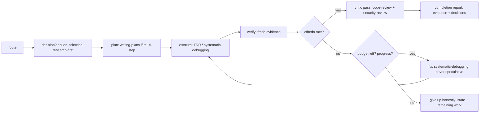

# Autonomous Loop

Drive a goal to done **without asking inside an approved phase**. Each iteration
is a full SDLC pass. Stop only when acceptance criteria are met with fresh
evidence, a budget rule fires, or the spec gate blocks an edit (scope
deviation).

**Approval is not a checkpoint.** Design approval, plan approval, and scope
approval are authorization boundaries: the loop may continue freely inside an
approved phase, but it may not create, replace, or widen a plan without a new
human approval record. A blocked edit is a scope deviation — record it and ask
for `close` + re-approval; never bypass the gate with bash or shell redirection.

## Setup (once)

- Restate the goal + **acceptance criteria** (observable, verifiable).
- Declare the **budget**: 3 iterations unless the human set one.
- Create the progress ledger `docs/plans/<slug>-progress.md` (format and
  handover rules per `managing-tasks`) — it survives compaction and drives
  the give-up-honestly report.

## Loop (repeat until a stop rule fires)

1. **Route** with `using-sdlc-lean` (feature/bugfix/refactor/research) and
   invoke the pipeline skill first.
2. **Decide** every fork via `option-selection`: research, matrix, pick,
   record. Never ask the human to choose.
3. **Plan** with `writing-plans` for multi-step work; skip for one-liners.
   Activate the gate with `spec-check approve` only after a human approves the
   plan; the plan's `files` scope bounds every later edit.
4. **Execute** with `test-driven-development`, or `systematic-debugging` for
   bugs. If the gate blocks an edit, stop and report a deviation — do not
   re-plan around it.
5. **Verify** with `verification-before-completion`: run the repo's commands,
   reuse `docs/verify-recipe.md` if it exists, else write it.
6. **Correct**: on failure, one *implementation* fix round via
   `systematic-debugging` (allowed inside the phase); a failed dispatch or an
   uncertain outcome stops for reconciliation and explicit recovery approval.
   Record what changed each round in the ledger.

## Authorized continuation

Within an approved phase, a checkpoint is **informational** — never a renewed
approval request. Continue until completion, a real blocker, a hard limit, an
uncertain outcome, or an action outside the authorization. Never ask "reply
continue" just because a chunk finished, and never read continuation as
authorization for a new phase.

If the runtime forces a turn/session boundary: persist a complete handoff
(below), state the actual constraint, and never claim a background process
exists or promise cross-session execution without a mechanism that does it.

## Stop rules (first that fires wins)

| Rule | Action |
|---|---|
| Criteria met, fresh evidence | critic pass → completion report |
| Failure or uncertain dispatch outcome | stop: reconcile evidence; retry only with explicit narrow approval |
| 2 consecutive no-progress loops | change strategy (different approach), not the same fix again |
| Budget exhausted | **give up honestly**: state, evidence, exact remaining work, next step |
| Human interrupts | pause, report loop state from the ledger |
| Spec gate blocks an edit | stop: record the deviation; request `close` + re-approval; never bypass |

## Rules

- Never claim done without fresh verification output.
- Safety guards (destructive ops, secrets) are not negotiable — never loop
  around them.
- Update the ledger every iteration; it is the memory that survives compaction.
- Subagent work fans out per `dispatching-parallel-agents`; merge per its
  contract.

## Deadlines, recovery, durable handoff

- Launch eligibility uses the **live clock** and a persisted absolute UTC
  deadline: `now + required observation allowance <= deadline`. Reports and
  old messages are historical, never live time.
- Resume never resets a deadline or cumulative usage; an expired phase stays
  closed and a further phase needs its own approval record.
- Default after failure or uncertain completion: **stop**. Reconcile evidence
  before recovery; retry only under an explicit, narrowly scoped approval. A
  step-zero crash never authorizes its own relaunch.
- Handoff carries: task/phase identity + authorization reference, verified work
  and artifact identities, exact next action, absolute deadline, limits and
  usage, in-flight actions and reservations, deviations/blockers/stop reason,
  allowed vs forbidden actions, and source/config identities. Keep secrets out;
  a summary never replaces ledger reconciliation.
- Deterministic helpers (`scripts/research/phase.mjs`, shipped with
  `research-protocol`): `createLedger` → `openPhase` → `evaluateLaunch` /
  `recordCheckpoint` → `resumePhase` / `closePhase`, plus `planRetry`,
  `reconcileDispatch`, `assertDelegationWithin`, and `buildHandoff`. The
  coordinator owns phase transitions; delegation narrows scope, never expands
  it.

## Research mode (empirical experiments via `research-protocol`)

- **Completion = protocol completed.** Every stage ran to its end condition,
  the evidence bundle exists, the report is written. Null/negative outcomes
  still count as completed — "give up honestly" applies only to errored
  protocol or budget-exhausted incomplete protocol.
- **Tiered strategy change** (never silently mutate the protocol):
  - **A (free):** implementation repair only — hash untouched.
  - **B (gated):** protocol amendment — amendment record + approval; blocked
    after final-test results until a new cycle starts.
  - **C (stop):** change the question/goal — exit to `brainstorming`.
- **Hash re-check each iteration**: `verifyProtocol` before further work;
  drift stops the loop with a freeze-violation error.
