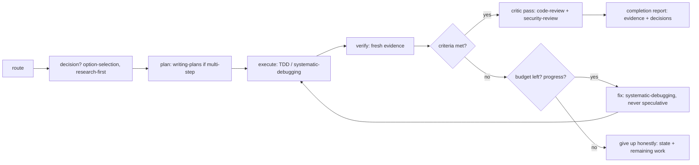

# Autonomous Loop

Auto is the default **inside the envelope**: drive a goal to done **without
asking inside an approved phase**. Each iteration is a full SDLC pass. Stop
only when acceptance criteria are met with fresh evidence, a budget rule
fires, or the spec gate blocks an edit.

**Approval is not a checkpoint.** Design, plan, and scope approvals are
authorization boundaries: the loop continues freely inside an approved phase
but may not create, replace, or widen a plan without new approval. A blocked
edit is a scope deviation — record it and ask for `close` + re-approval;
never bypass the gate with bash or shell redirection.

## Enable (determined — gated-only, never unconditional)

Enable order: `/determined` session primary → `DETERMINED_EXECUTION=1` env
fallback → default off. Store read failure resolves `false`. When off, every
determined helper returns `null`: byte-identical, fail-open.

R1–R7 are gated-only, off = no-op byte-identical:
- R1 restate goal + state, R2 observe artifact, R3 reflect buffer separate from ledger.
- R4 abstain monitor (false-continue 23-74%), R5 timely-stop (2.3-5x cost), R6 skeptic zero-persona prefix.
- R7 critic width-2 parallel fresh context, opt-in only; orchestrator critic gate preserved untouched.

## CEO brief template (6 fields, plain language)

Every CEO-facing ask uses exactly this template, defined here once and
referenced by the orchestrator sections (never duplicated):

1. **Decision** — what is being asked, in one sentence.
2. **Recommendation** — what we should do and why.
3. **Evidence** — what the observation shows.
4. **Risk** — what could go wrong if we act, and if we do not.
5. **Why now** — why this cannot wait for the next cycle.
6. **Effect / default** — what changes if approved; what happens if nothing
   changes.

No repo paths, hashes, or database picks; plain language only. The C2 route
lives in the orchestrator: silent when it can be undone, batch when low value
and can be undone, interrupt when high risk or cannot be undone — the brief
blocks the action until CEO approval.

## Setup (once)

- Restate the goal + **acceptance criteria** (observable, verifiable).
- Declare the **budget**: 3 iterations unless the human set one.
- Create the progress ledger `docs/plans/<slug>-progress.md` (format and
  handover per `managing-tasks`) — survives compaction, drives the
  give-up-honestly report.

## Loop (repeat until a stop rule fires)

1. **Route** with `using-sdlc-lean` (feature/bugfix/refactor/research) and
   invoke the pipeline skill first. Restate goal + state (R1), emit observe
   before each transition (R2, missing observe fails the phase when on),
   reflect in scratch only (R3, never the ledger), skeptic prefix before
   evaluating (R6), critic width-2 behind the same flag (R7) — all per
   Enable, off = no-op.
2. **Decide** every fork via `option-selection`: research, matrix, pick,
   record. Asking the human to judge, choose, compare, or validate merit
   is a defect except ALWAYS-human acts (merge/PR, publish/release, spend,
   prod/external writes, grader changes, red close); on any uncertainty fan out
   researcher/explorer subagents for cited evidence, never a question.
3. **Plan** with `writing-plans` for multi-step work; skip for one-liners.
   Activate the gate via `approve --machine --envelope` when a valid unchanged
   envelope covers the plan (default), else `spec-check approve` after human
   approval (fallback); the plan's `files` scope bounds every later edit.
4. **Execute** with `test-driven-development`, or `systematic-debugging` for
   bugs. If the gate blocks an edit, stop and report a deviation.
5. **Verify** with `verification-before-completion`: run the repo's commands,
   reuse `docs/verify-recipe.md` if it exists, else write it.
6. **Correct**: on failure, one *implementation* fix round via
   `systematic-debugging` inside the phase; a failed dispatch or uncertain
   outcome stops for reconciliation and explicit recovery approval.

## Authorized continuation

Within an approved phase, a checkpoint is **informational** — never a renewed
approval request. Continue until completion, a real blocker, a hard limit, an
uncertain outcome, or an action outside the authorization. Never ask "reply
continue" for a finished chunk, and never read continuation as new-phase
authorization. At a forced turn/session boundary: persist a complete handoff,
state the constraint, never claim background execution without a mechanism.

## Stop rules (first that fires wins)

| Rule | Action |
|---|---|
| Criteria met, fresh evidence | critic pass → completion report |
| Failure or uncertain dispatch outcome | stop: reconcile evidence; retry only with explicit narrow approval |
| 2 consecutive no-progress loops | change strategy (different approach), not the same fix again |
| Budget exhausted | **give up honestly**: state, evidence, exact remaining work, next step |
| Human interrupts | pause, report loop state from the ledger |
| Spec gate blocks an edit | stop: record the deviation; request `close` + re-approval; never bypass |
| `checkAbstain` false-continue in 23-74% band (R4) | abstain: decline to proceed, no-op result |
| `checkTimelyStop` projected cost > 5x baseline (R5) | stop early, emit observe artifact noting the stop reason |
| `skepticPrefix` zero-persona prefix (R6) | applied before evaluating; flips 14-18% of evaluations |
| `criticWidth2` width-2 parallel critics (R7) | opt-in only; orchestrator critic gate preserved untouched |

## Rules

- Never claim done without fresh verification output.
- Safety guards (destructive ops, secrets) are not negotiable — never loop around them.
- Update the ledger every iteration; it is the memory that survives compaction.
- Reflect vs ledger: scratch only, never `docs/plans/<slug>-progress.md` — record without relitigating.
- Audit trace on every decision: request, decision, auth, diff, outcome — all 5 recorded.
- Subagent work fans out per `dispatching-parallel-agents`; merge per its contract. Escalation carries evidence/findings, never a bare question.

## Deadlines, recovery, durable handoff

- Launch eligibility uses the **live clock** and a persisted absolute UTC
  deadline: `now + required observation allowance <= deadline`. Reports and
  old messages are historical, never live time.
- Resume never resets a deadline or cumulative usage; an expired phase stays
  closed and a further phase needs its own approval record.
- Default after failure or uncertain completion: **stop**. Reconcile evidence
  before recovery; retry only under explicit narrow approval.
- Handoff carries: task/phase identity + authorization, verified work and
  artifact identities, exact next action, absolute deadline, limits and usage,
  in-flight actions, deviations/stop reason, allowed vs forbidden actions.
  Keep secrets out; a summary never replaces ledger reconciliation.
- Deterministic helpers (`scripts/research/phase.mjs`, via
  `research-protocol`): `createLedger` → `openPhase` → `evaluateLaunch` /
  `recordCheckpoint` → `resumePhase` / `closePhase`, plus `planRetry`,
  `reconcileDispatch`, `assertDelegationWithin`, `buildHandoff`.

## Research mode (empirical experiments via `research-protocol`)

- **Completion = protocol completed.** Every stage ran to its end condition,
  the evidence bundle exists, the report is written. Null/negative outcomes
  still count — "give up honestly" is only for errored or budget-exhausted
  incomplete protocol.
- **Tiered strategy change** (never silently mutate): **A (free)**
  implementation repair, hash untouched; **B (gated)** protocol amendment +
  approval, blocked after final-test results; **C (stop)** new
  question/goal — exit to `brainstorming`.
- **Hash re-check each iteration**: `verifyProtocol` before further work;
  drift stops the loop with a freeze-violation error.
