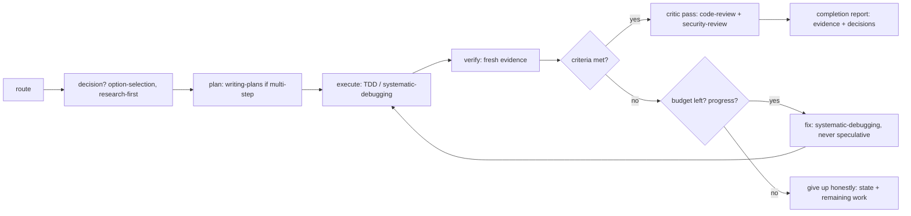

# Autonomous Loop

Auto is the default **inside the envelope**: drive a goal to done **without
asking inside an approved phase**. Each iteration is a full SDLC pass. Stop
only when acceptance criteria are met with fresh evidence, a budget rule
fires, or the spec gate blocks an edit (scope deviation).

**Approval is not a checkpoint.** Design approval, plan approval, and scope
approval are authorization boundaries: the loop may continue freely inside an
approved phase, but it may not create, replace, or widen a plan without a new
human approval record. A blocked edit is a scope deviation — record it and ask
for `close` + re-approval; never bypass the gate with bash or shell redirection.

## Enable (determined — gated-only, never unconditional)

Enable order (precedence): `/determined` slash session primary → `DETERMINED_EXECUTION=1` env fallback → default off. A session-store read failure resolves to `false`. When off, every determined helper returns `null` (no-op): behavior is byte-identical, fail-open.

All of R1–R7 are gated-only and qualified off=no-op byte-identical:
- R1 restate goal + state, R2 observe artifact, R3 reflect buffer separate from ledger — no-op when off.
- R4 abstain monitor (false-continue 23-74%), R5 timely-stop (2.3-5x cost), R6 skeptic zero-persona prefix — no-op when off.
- R7 critic width-2 parallel fresh context — opt-in flag only; the orchestrator critic gate at `orchestrator.md:194-199` is preserved untouched.

## CEO brief template (6 fields, plain language)

Every CEO-facing ask uses exactly this template, defined here once and
referenced by the orchestrator sections (never duplicated):

1. **Decision** — what is being asked, in one sentence.
2. **Recommendation** — what we should do and why.
3. **Evidence** — what the observation shows.
4. **Risk** — what could go wrong if we act, and if we do not.
5. **Why now** — why this cannot wait for the next cycle.
6. **Effect / default** — what changes if approved; what happens if nothing
   changes.

No repo paths, hashes, or database picks; plain language only. The C2 route
lives in the orchestrator: silent when it can be undone, batch when low value
and can be undone, interrupt when high risk or cannot be undone — the brief
blocks the action until CEO approval.

## Setup (once)

- Restate the goal + **acceptance criteria** (observable, verifiable).
- Declare the **budget**: 3 iterations unless the human set one.
- Create the progress ledger `docs/plans/<slug>-progress.md` (format and
  handover rules per `managing-tasks`) — it survives compaction and drives
  the give-up-honestly report.

## Loop (repeat until a stop rule fires)

1. **Route** with `using-sdlc-lean` (feature/bugfix/refactor/research) and
   invoke the pipeline skill first. Before acting, restate the goal + current
   state (`restatePhase(phase)`, R1), then emit an observe artifact before each
   transition (`emitObserve(phase)`, R2 — missing observe fails the phase when
   on). Record reflection only in the scratch buffer (`reflectScratch`, R3):
   `reflect != ledger`, never `docs/plans/<slug>-progress.md`. Gated by
   `DETERMINED_EXECUTION=1` — flag off is a no-op, byte-identical behavior.
   Skeptic zero-persona prefix (`skepticPrefix`, R6) is applied before
   evaluating; critic width-2 parallel fresh-context critics
   (`criticWidth2`, R7) run behind the same opt-in flag. Flag off is a
   no-op, byte-identical behavior. The orchestrator critic gate is preserved
   untouched.
2. **Decide** every fork via `option-selection`: research, matrix, pick,
   record. Asking the human to judge, choose, compare, or validate merit
   is a defect except ALWAYS-human acts (merge/PR, publish/release, spend,
   prod/external writes, grader changes, red close); on any uncertainty fan
   out researcher/explorer subagents for cited evidence, never a question.
3. **Plan** with `writing-plans` for multi-step work; skip for one-liners.
   Activate the gate via `approve --machine --envelope` when a valid unchanged
   envelope covers the plan (default), else `spec-check approve` after human approval (fallback); the plan's `files` scope bounds every later edit either way.
4. **Execute** with `test-driven-development`, or `systematic-debugging` for
   bugs. If the gate blocks an edit, stop and report a deviation — do not
   re-plan around it.
5. **Verify** with `verification-before-completion`: run the repo's commands,
   reuse `docs/verify-recipe.md` if it exists, else write it.
6. **Correct**: on failure, one *implementation* fix round via
   `systematic-debugging` (allowed inside the phase); a failed dispatch or an
   uncertain outcome stops for reconciliation and explicit recovery approval.
   Record what changed each round in the ledger.

## Authorized continuation

Within an approved phase, a checkpoint is **informational** — never a renewed
approval request. Continue until completion, a real blocker, a hard limit, an
uncertain outcome, or an action outside the authorization. Never ask "reply
continue" just because a chunk finished, and never read continuation as
authorization for a new phase.

If the runtime forces a turn/session boundary: persist a complete handoff
(below), state the actual constraint, and never claim a background process
exists or promise cross-session execution without a mechanism that does it.

## Stop rules (first that fires wins)

| Rule | Action |
|---|---|
| Criteria met, fresh evidence | critic pass → completion report |
| Failure or uncertain dispatch outcome | stop: reconcile evidence; retry only with explicit narrow approval |
| 2 consecutive no-progress loops | change strategy (different approach), not the same fix again |
| Budget exhausted | **give up honestly**: state, evidence, exact remaining work, next step |
| Human interrupts | pause, report loop state from the ledger |
| Spec gate blocks an edit | stop: record the deviation; request `close` + re-approval; never bypass |
| `checkAbstain` false-continue rate in 23-74% band (R4) | abstain: decline to proceed, no-op result; `DETERMINED_EXECUTION` off = no-op, byte-identical |
| `checkTimelyStop` projected cost > 5x baseline (R5) | stop early, emit observe artifact noting the stop reason; `DETERMINED_EXECUTION` off = no-op, byte-identical |
| `skepticPrefix` zero-persona prefix (R6) | applied before evaluating; flips 14-18% of evaluations, +7.4pp warmth; `DETERMINED_EXECUTION` off = no-op, byte-identical |
| `criticWidth2` width-2 parallel fresh-context critics (R7) | opt-in flag only; orchestrator critic gate preserved untouched; `DETERMINED_EXECUTION` off = no-op, byte-identical |

## Rules

- Never claim done without fresh verification output.
- Safety guards (destructive ops, secrets) are not negotiable — never loop
  around them.
- Update the ledger every iteration; it is the memory that survives compaction.
- Reflect vs ledger: reflection is scratch only (`reflectScratch`, R3), never
  the progress ledger — record-without-relitigating, never mix reflection into
  `docs/plans/<slug>-progress.md`.
- Audit trace on every decision: request, decision, auth, diff, outcome — all
  5 fields recorded, without relitigating prior decisions. `emitObserve`, `reflectScratch`,
  `skepticPrefix` and `criticWidth2` all early-return null when
  `DETERMINED_EXECUTION` is off — flag off is byte-identical, fail-open.
- Subagent work fans out per `dispatching-parallel-agents`; merge per its
  contract. Escalation carries evidence/findings, never a bare question.

## Deadlines, recovery, durable handoff

- Launch eligibility uses the **live clock** and a persisted absolute UTC
  deadline: `now + required observation allowance <= deadline`. Reports and
  old messages are historical, never live time.
- Resume never resets a deadline or cumulative usage; an expired phase stays
  closed and a further phase needs its own approval record.
- Default after failure or uncertain completion: **stop**. Reconcile evidence
  before recovery; retry only under an explicit, narrowly scoped approval. A
  step-zero crash never authorizes its own relaunch.
- Handoff carries: task/phase identity + authorization reference, verified work
  and artifact identities, exact next action, absolute deadline, limits and
  usage, in-flight actions and reservations, deviations/blockers/stop reason,
  allowed vs forbidden actions, and source/config identities. Keep secrets out;
  a summary never replaces ledger reconciliation.
- Deterministic helpers (`scripts/research/phase.mjs`, shipped with
  `research-protocol`): `createLedger` → `openPhase` → `evaluateLaunch` /
  `recordCheckpoint` → `resumePhase` / `closePhase`, plus `planRetry`,
  `reconcileDispatch`, `assertDelegationWithin`, and `buildHandoff`. The
  coordinator owns phase transitions; delegation narrows scope, never expands
  it.

## Research mode (empirical experiments via `research-protocol`)

- **Completion = protocol completed.** Every stage ran to its end condition,
  the evidence bundle exists, the report is written. Null/negative outcomes
  still count as completed — "give up honestly" applies only to errored
  protocol or budget-exhausted incomplete protocol.
- **Tiered strategy change** (never silently mutate the protocol):
  - **A (free):** implementation repair only — hash untouched.
  - **B (gated):** protocol amendment — amendment record + approval; blocked
    after final-test results until a new cycle starts.
  - **C (stop):** change the question/goal — exit to `brainstorming`.
- **Hash re-check each iteration**: `verifyProtocol` before further work;
  drift stops the loop with a freeze-violation error.
