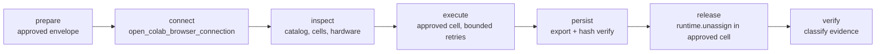

# Colab Lifecycle

Run approved Colab workloads end to end. The pinned `colab-mcp` server is a
**proxy with no runtime controls**: it can edit and run notebook cells, but it
cannot allocate, inspect, or shut down a runtime. Allocation is **manual**
(Colab UI). Release goes through `runtime.unassign()` in an approved cell.
Full audit: `references/capability-matrix.md`.

Gate each step: no allocation without an approved envelope; no execution
without an inspected connection; no release claim without classified evidence;
no "verification" by reconnecting.

## Hard rules

1. **No teardown substitute.** Never kill the MCP bridge/kernel process, or an
   unrelated MCP process, to "clean up". The only sanctioned release path is
   `runtime.unassign()` in an approved notebook cell.
2. **Never reconnect or probe to verify shutdown.** A reconnect can allocate a
   fresh runtime. Verify by evidence classification, not by a new connection.
3. **Never write proxy tokens, cookies, or credentials to logs or artifacts.**
   The proxy token travels in the URL fragment `#mcpProxyToken=`.
4. **No allocation without a complete approved envelope**: workload, notebook
   identity, accelerator preference + allowed fallback, maximum allocation
   duration, compute-unit cap (or an approved time-only fallback when the
   rate/balance is unobtainable), approved downloads/storage destinations,
   artifact preservation + cleanup policy.
5. **No Drive mount or private upload without approval.**
6. **No repeated accelerator (GPU) requests to chase better hardware.**
7. **Distinguish observed from estimated usage.** Label every consumption
   claim; never present an estimate as a meter reading.

## Enforced vs advisory (be honest)

| Level | Items | Backing |
|---|---|---|
| **Enforced** (deterministic, test-backed) | The plugin refuses **local shell commands** (the `bash`/`shell` tool) whose text matches (i) `pkill`/`killall`/`kill $(pgrep\|ps …)` targeting a `colab-mcp` process, or (ii) `rm -r` of `/content`. | plugin guards + tests |
| **Advisory** (agent judgment) | Envelope completeness, ownership and duplicate-allocation prevention, duration accounting, bounded retries, export/hash verification, release-evidence classification, incident escalation, no reconnect/probe to verify a release, credential hygiene, no Drive mount or private upload. The decision core makes these checkable; it does not intercept. | skill + decision core |

Notebook-cell code (`!pkill …`, `!rm -rf /content`) and MCP tool arguments are
**never inspected**: the guard only sees the `bash`/`shell` tool's command
text, so those paths remain advisory.

For Colab lifecycle, those two plugin refusals are **all** that is
mechanically enforced. Policy text is not a budget guard. No compute-unit cap
is claimed: the compute-unit rate and balance are unavailable in reach, so
accounting is time-only and conservative.

## Five state dimensions (never conflate)

Local MCP server · browser bridge · dynamic tool catalog · notebook identity ·
runtime allocation status.

- A bootstrap-only tool catalog is **not** proof that compute stopped.
- A live MCP server is **not** proof that compute is allocated.
- Catalogs change as browser connectivity changes (`send_tool_list_changed()`).

## References

- `references/capability-matrix.md` — pinned provenance; what the server does
  and does not expose; do-not-invent-tools caution.
- `references/evidence-and-incidents.md` — release evidence ladder, ownership
  ledger, timeout honesty, incident protocol, cleanup template, credential
  hygiene.

## Decision core

When a lifecycle decision is ambiguous, consult `lib/lifecycle.mjs`: the pure,
zero-dep normative decision table (`validateEnvelope`, `deriveSessionState`,
`classifyRelease`, `registerOwned`, `reconcileCells`, `guardAction`, `foldRun`)
— 7 exports, all pinned by `tests/opencode/test-colab-lifecycle.mjs`. The core
decides; this skill explains the policy.

**Post-release semantics.** `VERIFIED_RELEASED` does not authorise new work:
any further cell run or browser connection needs a **new** approved envelope.
The decision core cannot express that unlock — `guardAction` allows
allocation-capable actions again once a release is verified.

## Anti-patterns

- Killing anything as a teardown substitute.
- Reconnecting to "check" a release.
- Treating MCP disconnect, catalog revert, kernel disconnect, or an HTTP error
  as release proof.
- Logging a proxy token or a live notebook URL.
- Requesting a GPU repeatedly to "see" if one is free.
