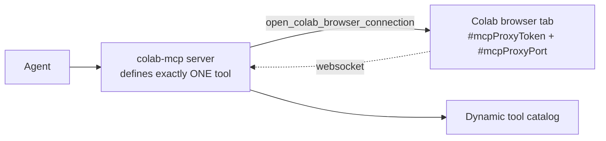

# Capability matrix — pinned colab-mcp

Everything here describes the **pinned** server only. Forks and other versions
differ; re-audit the source before claiming a capability.

## Provenance

| Item | Value |
|---|---|
| Repo + commit | `googlecolab/colab-mcp@b9ab3899e0f1fa493390b1fd6d54aa2e464ecdf1` |
| Version | v1.0.1 |
| Launch | `uvx` (pinned) |
| Local config | MCP server `colab-mcp` in `~/.config/opencode/opencode.jsonc` |
| Timeouts | startup `30000` ms, catalog `30000` ms |
| Read date | 2026-10-12 |

## Architecture: proxy, not controller

- `src/colab_mcp/session.py` defines exactly one tool itself:
  `open_colab_browser_connection`. It opens the Colab tab with
  `#mcpProxyToken=…&mcpProxyPort=…`, waits up to 60 s, and returns a bool.
- All other tools come from the **browser frontend** over a websocket. They
  appear and disappear as browser connectivity changes
  (`send_tool_list_changed()`).

## Capabilities (what is actually reachable)

| Capability | Status | What is reachable | Source | Confidence |
|---|---|---|---|---|
| Notebook operations (read/add/update/move/delete cells, run a cell) | `available` | 7 frontend tools: `add_code_cell`, `add_text_cell`, `delete_cell`, `get_cells`, `move_cell`, `run_code_cell`, `update_cell` — only while the browser bridge is connected | browser frontend over websocket | tool names + schemas **observed live** 2026-10-12 on the pinned commit (single CPU-only session); the frontend is closed source — **not a compatibility guarantee** |
| Runtime allocation & switching | `manual` | Colab UI runtime menu only. The pinned server has no allocation tool; upstream removed its runtime code entirely and the old internal CCU client was never exposed. | pinned source `src/colab_mcp/session.py` | high |
| Runtime shutdown | `manual` | `from google.colab import runtime; runtime.unassign()` in an approved notebook cell | `colabtools/google/colab/runtime.py` | high |
| Session & billing information | `not available` | No compute-unit balance/rate, no remaining runtime time, no runtime status, no accelerator read-back. `colab usage` exists only in the separate `google-colab-cli` — out of scope, not authorized. | pinned source; colabtools tree | high |
| Evidence obtainable after shutdown | `manual` | No API returns post-release state. A 200 from `unassign` means the request was accepted, not that deallocation was observed. A human check in the Colab UI is the only accepted confirmation. | `runtime.py`; `evidence-and-incidents.md` | high |

## Notebook schemas (live observation, 2026-10-12)

Observed in **one** CPU-only session on the pinned commit, after
`open_colab_browser_connection` returned true (the catalog had been
bootstrap-only before that). **Scope:** the browser frontend is closed source
and can change without notice, so this records what one session exposed — not a
compatibility guarantee. Re-observe the live catalog before relying on any
parameter.

| Tool | Parameters observed | Returns |
|---|---|---|
| `add_code_cell` | `cellIndex` (int), `language` (`python`\|`r`\|`julia`), `code` | `newCellId` |
| `add_text_cell` | `cellIndex` (int), `content` | `newCellId` |
| `delete_cell` | `cellId` | — |
| `get_cells` | `cellIndexStart`, `cellIndexEnd` (optional), `includeOutputs` (bool, default `false`) | `{ cells: [ { cell_type, id, source, outputs?, execution_count? } ] }` |
| `move_cell` | `cellId`, `cellIndex` | — |
| `run_code_cell` | `cellId` (code cells only) | outputs — the **response is not a reliable success signal**: see `evidence-and-incidents.md` (g) |
| `update_cell` | `cellId`, `content` | — |

The raw evidence for that run (catalog dump, cell outputs, artifact hash,
timeline) is kept **outside this repo** in the local run journal under
`/tmp/opencode/colab-lifecycle-live-test/` and the local state registry; it
contains no proxy tokens, cookies, credentials, or notebook URLs.

## Release mechanics (verified)

`runtime.unassign()` is the only supported in-notebook release API. It does
`POST http://$TBE_RUNTIME_ADDR/unassign`, then `google.colab.kernel.disconnect()`.

It raises `google.colab.errors.RuntimeManagementError` when:

- the notebook is not external Colab — "This operation is only supported in
  external Colab."
- `TBE_RUNTIME_ADDR` is absent — "Unable to find the runtime management
  service."
- the response is non-200 — "Unable to request VM unassignment."

## Runtime volatility

- Colab VMs are deleted on idle timeout, and they have a maximum lifetime.
- Closing the browser is **not** a documented deletion trigger.
- `/content` is VM-local; it does not survive VM deletion.
- Official docs do not publish the exact idle or maximum limits.

## Do not invent tools

Never call, script, or document a tool that the pinned catalog does not expose.
The bootstrap catalog holds only `open_colab_browser_connection`; the 7
notebook tools appear only while the browser bridge lives. If a tool name is
not in the current catalog, it does not exist for this session.

## Forks are not the pinned server

Community forks add tools such as `shutdown_runtime`, allocation helpers, or
accelerator selectors. The pinned official server does **not** have them.
Do not assume fork behaviour, and do not copy fork documentation into a plan.

## Confidence legend

- **high** — read directly in the pinned source or official source/docs.
- **medium** — observed live behaviour, not documented.
- **low / unverified** — third-party reconstruction, or undocumented and
  unconfirmed.
