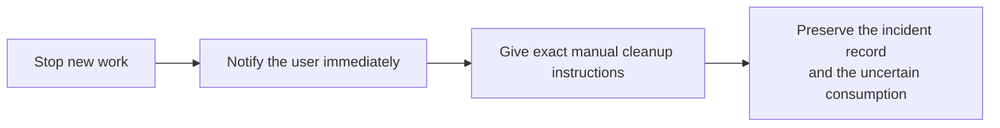

# Evidence and incidents

What counts as proof of release, who owns which runtime, and what to do when
the release path fails or is uncertain. Companion:
`capability-matrix.md`.

## (a) Release evidence states

| State | Meaning | Accepted evidence |
|---|---|---|
| `REQUESTED` | The unassign request was accepted; deallocation not observed | `unassign_request ok:true` (HTTP 200 from the call in an approved cell). **Acceptance is never release proof.** |
| `VERIFIED_RELEASED` | Deallocation confirmed by a human | `user_confirmed_released` — concretely: the user reports `Runtime → Manage sessions` shows **"No active session"**; or a non-allocating `runtime_absent` signal |
| `UNVERIFIED_POSSIBLY_ALLOCATED` | Everything else after a release attempt | denied, timeout, HTTP error, MCP exit, catalog revert |

The safe default is `UNVERIFIED_POSSIBLY_ALLOCATED`. Treat unknown as possibly
allocated.

**Not proof of release, each alone or combined:**

- MCP disconnect (including the expected `bridge_disconnect` after `unassign`)
- tool timeout
- HTTP error
- catalog revert to bootstrap-only
- kernel disconnect
- the Colab UI showing **"Reconnect"** — that means the kernel dropped while a
  runtime may still be registered. Observed live 2026-10-12: the button read
  "Reconnect" after an accepted `unassign()`, and only `Manage sessions` showed
  the absence.

An expected bridge disconnect is not a failure. It is also not release proof.

Do not click **"Reconnect"** to check anything: it can attach/allocate a fresh
runtime. Reloading the tab can re-bridge the session — also avoid it.

**Never reconnect or probe to "verify" shutdown.** A reconnect can allocate a
fresh runtime. When evidence is missing, escalate to the manual path (section d).

## (b) Ownership ledger

Write the registry as a JSON **array** — one record per owned runtime — at
`${XDG_STATE_HOME:-~/.local/state}/sdlc-lean/colab-runtimes.json`:

```json
[
  {
    "sessionId": "<the agent session that owns the runtime>",
    "instanceId": "<the MCP server instance id, if exposed>",
    "notebookId": "<notebook identity>",
    "accelerator": "<requested accelerator, e.g. cpu / t4 / a100>",
    "requestedAt": "<ISO-8601, when use began>",
    "releasedAt": "<ISO-8601 or null>",
    "evidenceState": "REQUESTED | VERIFIED_RELEASED | UNVERIFIED_POSSIBLY_ALLOCATED"
  }
]
```

- Register **before** using a runtime; `releasedAt` stays `null` until a
  release is requested, and even then the state may remain unverified.
- Never kill unrelated MCP processes or Colab sessions. Never touch a session
  you did not register.
- Ownership and duplicate-allocation prevention are advisory. The decision core
  flags `wrong-mcp-instance`, `duplicate-owned-allocation`, and
  `unowned-session`, but nothing intercepts the action.

## (c) Timeouts and retries (honest limits)

| Stage | Limit | Source | Honest limit |
|---|---|---|---|
| Bridge wait (`open_colab_browser_connection`) | ≤ 60 s | upstream pinned server | A timeout says nothing about allocation state. |
| MCP server startup | `30000` ms | local `opencode.jsonc` | A failed startup is a local failure, not a release. |
| Catalog refresh | `30000` ms | local `opencode.jsonc` | A missing or bootstrap-only catalog is not a released runtime. |

- Retries are bounded: retry a failed operation at most once with identical
  arguments, then stop and report. Never retry past a release request — the
  decision core refuses allocation-capable actions after one.
- An **ambiguous** call is not a failed call: resolve it by reading state, never
  by rerunning it (section g).
- An external timeout cannot release compute by itself. Only
  `runtime.unassign()` (or the Colab UI) can.

## (d) Incident protocol



1. **Stop new work.** No new cells, runs, uploads, or allocations.
2. **Notify the user immediately.** State the evidence state and what is
   unknown.
3. **Give exact manual cleanup instructions** (section e).
4. **Preserve the incident record and the uncertain consumption.** Append the
   incident and the possibly-billed time to the ledger; never delete evidence
   to tidy up.

Manual cleanup (Colab UI):

- Open the notebook, then **Runtime → Disconnect and delete runtime**.
- Confirm the runtime indicator shows **no connected runtime**.

## (e) Manual-cleanup instruction template

```text
Colab runtime may still be allocated (evidence: <evidenceState>).
1. Open <notebook URL> in the Colab UI.
2. Runtime -> Disconnect and delete runtime.
3. Confirm the runtime indicator shows no connected runtime.
4. Reply with the result. Your confirmation is the only accepted release
   evidence.
No MCP reconnect will be attempted: it can allocate a fresh runtime.
```

## (f) Credential hygiene

- The proxy token travels in the URL fragment `#mcpProxyToken=`.
- Never log, echo, or persist it — not in logs, artifacts, notebooks, incident
  records, ledger entries, or commits. Redact as `#mcpProxyToken=REDACTED`.
- Treat cookies and any other browser-session credentials the same way.

## (g) Ambiguous tool responses (observed live 2026-10-12)

`run_code_cell` returned `{ type: "aborted", message: "Tool execution
interrupted" }` **while the cell had in fact executed** — `execution_count` had
incremented and the expected output was present.

- Treat a tool response as **untrusted** until notebook state agrees with it.
- Verify execution by reading `get_cells` with `includeOutputs: true` and
  checking `execution_count` and the outputs before concluding success or
  failure.
- **Never blindly rerun an ambiguous call.** The first execution may have
  happened, side effects included. Resolve by reading state, then decide.
- The same discipline applies to release: an ambiguous or aborted release call
  stays `UNVERIFIED_POSSIBLY_ALLOCATED` until a human confirms absence.
- Report the ambiguity as it was observed; do not silently upgrade it to
  success or failure.
