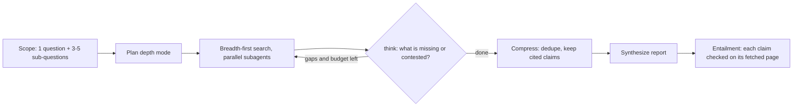

# Deep Research

Evidence over vibes. Plan → parallel search → assess gaps → cite → synthesize.
Adapted from dzhng/deep-research, open_deep_research, and gpt-researcher.

## Depth modes (pick one, announce it, never ask the user to choose)

| Mode | Rounds | Sub-questions | Sources target | Use when |
|---|---|---|---|---|
| quick | 1 pass | 3–5 | ~5–10 | one focused factual question |
| standard (default) | 1 wide + 1 gap round | 3–5 | ~10–20 | comparisons, "what is the state of X" |
| deep | 2–3 rounds | 4–6 | 20–40+ | high-stakes decisions, due diligence |

## 1. Scope

Turn the request into **one explicit research question**; list **3–5
non-overlapping sub-questions**; state in-scope and out-of-scope in one line.
Ask at most **one** clarifying question, and only if the goal is genuinely
ambiguous — otherwise state your interpretation and proceed.

## 2. Search (start wide, then narrow)

- 2–3 keyword variants per sub-question; broaden first, then drill in.
- **Prefer primary/authoritative sources** over aggregators and SEO content:
  official docs, papers, filings, first-party sites, maintainers' own pages.
  See `references/source-quality.md` (evidence hierarchy + SIFT + red flags).
- For independent sub-questions, dispatch the `researcher` subagent — **all in
  one message** so they run in parallel (fan-out; contract in
  `dispatching-parallel-agents`). Give each: objective, output schema, source
  boundary, and search budget. Subagents return distilled findings, **never
  raw pages** (keeps context small). Extra personas are optional — never
  required; do not multiply perspectives.
- Reuse `acquiring-capabilities` trust rules: no random blogs, no unsourced
  forums, no AI-generated listicles.

## 3. Assess (`think_tool`)

After each round, write one short gap analysis: what is now supported, what is
missing, what conflicts. **Close the loop**: each round's queries derive from
what was just read; a round that does not change the next query ends the loop.
Use **angles, not synonyms**; shrink breadth as depth increases.

## 4. Compress (fan-in)

Dedupe by URL; merge duplicate facts; keep only claims that carry a citation;
preserve citation numbers; never drop a source that supports a kept claim. At
fan-in **one writer** merges: parallel section writers produce disjoint
reports, so style and citations stay consistent. Resolve conflicts per
`dispatching-parallel-agents`; list what remains unanswered.

## 5. Synthesize + verify

- Output per `references/report-format.md` and `communicating-concisely`:
  executive summary first, then themed sections (mermaid/table where it
  clarifies). Long reports go to a file; return summary + path +
  `sources_reviewed: N`.
- **Per-claim entailment**: every citation `[n]` points to a page you actually
  fetched and read — never the search engine, never a snippet-only hit, never
  an invented URL. Compare each claim against that page
  (`references/citation-check.md`): supported → keep, partial → qualify,
  unsupported → cut or mark "unverified". Count citation accuracy
  (supported ÷ checked) in the report.
- End with confidence labels, unresolved conflicts, and open questions.
- When the report compares options, end with a decision: hand off to
  `option-selection` (matrix → pick → record). A comparison with no choice is
  an unfinished report. BrowseComp is a single-short-answer benchmark; do not
  optimize for it.

## Citation discipline

- Every substantive claim carries an inline `[n]`; `## Sources` lists them
  sequentially with no gaps.
- Label confidence: **high** (3+ independent sources agree), **medium** (2),
  **low** (1 source, or sources conflict).
- Single-source claims are marked "unverified". Separate fact / estimate /
  opinion. If evidence is missing, write "insufficient data found" — never pad.

## Hard budgets (stop even if not done)

Per subagent: 3–5 searches. Global: the mode's source target. Stop when 3+
independent sources agree, a round adds no new material, or the last two
searches return the same information. Report what remains unanswered.

## Anti-patterns

- No subagents for a quick lookup; no synonym queries as separate agents.
- Never treat a search hit as validated; never cite the engine instead of the page.
- No blog-only sourcing for factual claims; no repeated sections; budget out, then report gaps honestly.
