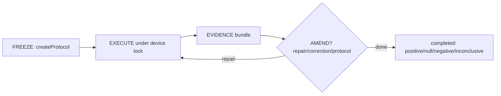

# Research Protocol

Run empirical experiments so null/negative results count as **completed
research**, not failure. Freeze first, execute under lock, prove with evidence.

## When to use (vs `deep-research`)

| This skill | `deep-research` |
|---|---|
| You run something: hypothesis, dataset splits, seeds, scores | You read something: SOTA, comparisons, external evidence |
| Claim scope, leakage, repeated observations matter | Citations matter |
| Cache identity, device locks, run logs matter | Web sources matter |

External-evidence question → `deep-research`. Empirical experiment →
this skill.

## FREEZE → EXECUTE → EVIDENCE → AMEND

1. **FREEZE** — `createProtocol({hypothesis, splits, controls, metrics,
   seeds, budgets, artifacts})`. Record the sha256 in the ledger. Every
   loop iteration re-runs `verifyProtocol`; hash drift = stop, no exceptions.
2. **EXECUTE** — `acquireDeviceLock(lockRoot, device)` per scope (`gpu:N`,
   `cpu`); shared `lockRoot` (default `defaultLockRoot()`), which must be a
   per-user trusted dir. Hold one library-level lock around the ENTIRE
   workload (acquire first, release last); never slice it per sub-step.
   Second holder is refused, never queued. Holds have no expiry while the
   holder pid lives (no heartbeat needed). `acquire()` never deletes
   another lock: if a lockfile outlives its holder (crash), confirm no
   live holder (`ps -p <pid>` or `kill -0 <pid>`), confirm no active
   workload on that device, then `rm` the lockfile manually. CLI `lock`
   is a connectivity probe only — it releases immediately (or after
   `--hold-ms`) and protects NO later shell command; protection requires
   the workload process itself to hold the lock via the library. Stay
   inside protocol budgets (wall-clock,
   iterations). Classify with `classifyOutcome`: `completed ×
   {positive, null, negative, inconclusive}` + `errored`/`cancelled` —
   **null/negative = completed research**. Code-test green ≠ evidence.
3. **EVIDENCE** — completion needs the bundle, all four (validate with
   `checkEvidenceBundle`: `estimand`, `observations`, `leakageCheck`,
   `claimScope`):
   - estimand stated (what is measured, on what split);
   - repeated observations (no single-shot claims);
   - leakage check done (train/test separation explicit);
   - claim scope ⊆ protocol scope (nothing beyond what ran).
   Cache rule: `bindScore`/`cacheHit` over dataset + model + scorer +
   protocol digests (`digestArtifactSet`, `hashFile` streamed). Any
   mismatch = miss + recompute. Scorer settings live in the frozen protocol.
   Statistical analysis stays project-local; this skill provides no
   bootstrap/CI machinery — repeated observations are required, inference
   is yours.
4. **AMEND** — run log via `createRunLog` (+ `markFinalResults` when final
   tests are viewed). `recordAmendment(log, kind, detail, approver)`:
   - `repair` — implementation-only, always allowed, hash untouched;
   - `correction` — scoring/analysis fix post-results, allowed, flags
     dependent claims for re-check, frozen fields untouched;
   - `protocol` — frozen-field change, re-freeze + hash update, **blocked
     after `markFinalResults`** (`assertAmendmentAllowed` throws
     `ProtocolAmendmentBlockedError`). Gate with `releaseDeviceLock` on exit.

## Clustering + discovery

- Group questions with `cluster.mjs`: `clusterQuestions(questions,
  {seed, k})` (frozen seed, deterministic), `pairCohesion(assignments)`,
  `stampClustering(log, {seed, k})` records the seed in the run log.
- Find the module with `resolveProtocolModule` (`SDLC_RESEARCH_PROTOCOL`
  env → `<cwd>/.opencode/scripts/research` → global
  `~/.config/opencode` → bundled-self
  `scripts/research/protocol.mjs`). CLI: `node protocol.mjs
  hash|lock|unlock|cluster|status`. Sanitize with `sanitizeDeviceName`
  (`InvalidDeviceError`); lock errors are `LockBusyError`/`NotHolderError`.

## Attribution (pinned, pattern adaptation, no code copied)

- Inspect AI `UKGovernmentBEIS/inspect_ai@a1dbea8` (MIT) — outcome taxonomy,
  cache-key partition, EvalLog shape.
- RD-Agent `microsoft/RD-Agent@484776c` (MIT) — budget completion,
  repair/withdraw taxonomy, artifact binding.
- MLflow, AgentLaboratory, AI-Scientist-v2 — reference-only (see design §3).
