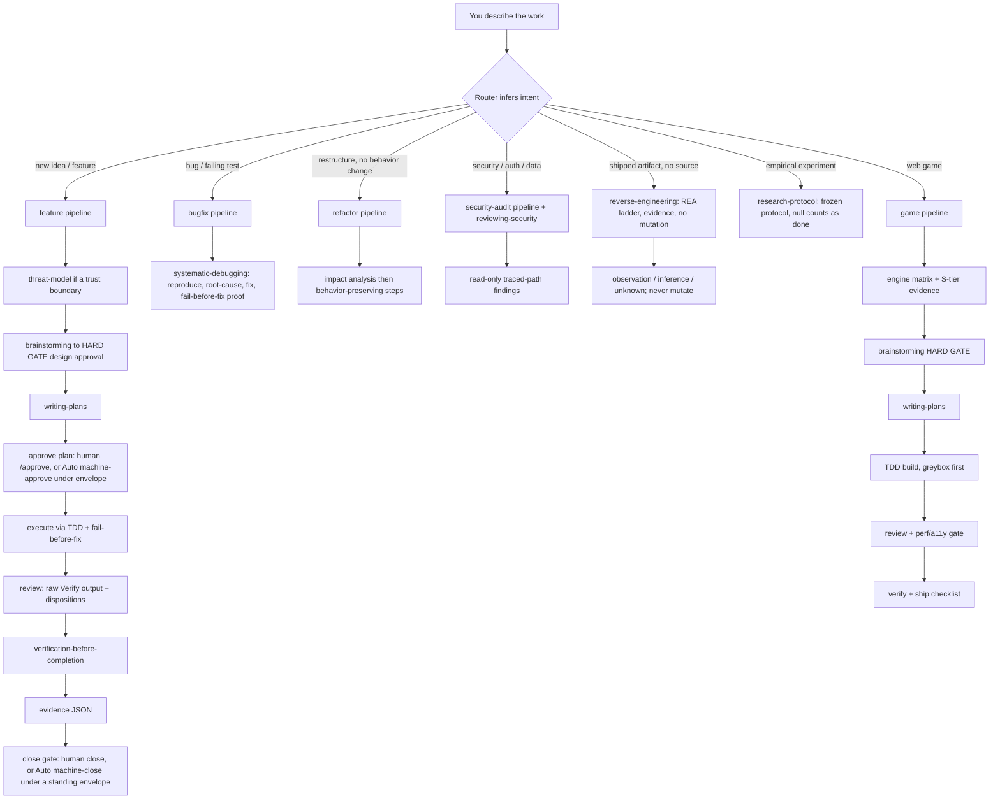

# sdlc-lean

A generic OpenCode SDLC suite for any project: superpowers' workflow discipline
filtered through ponytail's leanness, plus the best ideas from the wider agent
ecosystem. You just describe the work — it infers the pipeline and runs the
skills and subagents itself. No modes, no setup questions.

**New here? See [USAGE.md](USAGE.md) for step-by-step install and workflows.**



Explicit commands `/preview`, `/release`, and `/sdlc-lean` bypass router inference: `/preview` is read-only, `/release` drafts only, and `/sdlc-lean` reports status; on V2, `/approve <plan>` activates the spec gate as a human-only act (TTY fallback: `spec-check approve`).

Every route scales scrutiny to the task: trivial work is built directly,
standard work enforces the lean ladder, architectural work runs the full
`brainstorming` flow first.

## Install

**Project-local** — this repo is the source of truth:

```sh
cp -r .opencode /path/to/your-project/        # includes plugins/sdlc-lean-tui/
mkdir -p /path/to/your-project/scripts
cp scripts/spec-check.mjs scripts/host-evidence.mjs /path/to/your-project/scripts/
```

The project-local plugin resolves `scripts/spec-check.mjs` relative to the
project; without it the gate stays inactive (fail-open).

**Global** — available in every project, one command:

```sh
npm run install:global
```

Copies skills/agents/commands/plugin, the TUI part, `scripts/spec-check.mjs`,
`scripts/host-evidence.mjs`, and `scripts/research/` into `~/.config/opencode/` and prunes
files a previous install placed that no longer exist in the repo — your own
skills and config are never touched. Manual equivalent:

```sh
cp -r .opencode/skills/*   ~/.config/opencode/skills/
cp -r .opencode/agents/*   ~/.config/opencode/agents/
cp -r .opencode/commands/* ~/.config/opencode/commands/
mkdir -p ~/.config/opencode/plugins/sdlc-lean-tui
cp .opencode/plugins/sdlc-lean.js ~/.config/opencode/plugins/
cp .opencode/plugins/sdlc-lean-tui/* ~/.config/opencode/plugins/sdlc-lean-tui/
mkdir -p ~/.config/opencode/scripts
cp scripts/spec-check.mjs scripts/host-evidence.mjs ~/.config/opencode/scripts/
cp -r scripts/research     ~/.config/opencode/scripts/
```

**Updating** (this PC or any other with a clone): `git pull && npm run install:global`.
First time on a new machine: `git clone <repo-url> ~/sdlc-lean && cd ~/sdlc-lean && npm run install:global`.

> **Double-install note (inside this repo):** OpenCode loads both
> `~/.config/opencode/plugins/` and `<project>/.opencode/plugins/`. On V1 this
> failed with "failed to load plugin sdlc-lean"; on V2.0.22 both loading has
> been verified working (TUI session + headless `opencode run`). If you ever
> see the load failure, remove the global copy
> (`rm ~/.config/opencode/plugins/sdlc-lean.js`) — the project-local plugin
> already covers this directory.

Restart OpenCode after installing. No dependencies. Works on OpenCode V1
(1.18.x) and V2 (2.0.x, verified) — V2 auto-loads the global plugin from
`~/.config/opencode/plugins/`. Pair with
[snip](https://github.com/edouard-claude/snip) for 60–90% shell-output token
savings — complementary, not bundled.

## What's inside

| Area | Contents |
|---|---|
| Skills (40) | router · brainstorming · writing-plans · worktrees · sdd / executing-plans · TDD · debugging · verification · review in/out · finish-branch · parallel-agents · writing-skills · diagnosing · lean-review · security · performance · schemas · release-notes · exploring-codebase · managing-tasks · communicating-concisely · simplified-technical-english · acquiring-capabilities · deep-research · research-protocol · incident-postmortem · dependency-upgrade · threat-model · adr · autonomous-loop · option-selection · frontend-design · web-game-development · ui-review · intent-preview · autonomy-dial · colab-lifecycle · reverse-engineering |
| Agents (8) | orchestrator · implementer · planner · code-reviewer · test-writer · explorer · security-reviewer · researcher |
| Research helpers | `scripts/research/` (stdlib-only `protocol.mjs` + `cluster.mjs` + `phase.mjs`): protocol freeze + sha256, 4-field score-cache binding, outcome taxonomy (null counts as done), amendment gate, O_EXCL device locks, deterministic clustering, CLI — plus the phase ledger (authorized continuation, absolute UTC deadlines, observation allowance, cumulative limits, recovery authorization, delegation scope, durable handoff, fail-closed state) — ships globally; `resolveProtocolModule` / `resolvePhaseModule` use the same env → local → global → bundled ladder |
| Spec gate | `scripts/spec-check.mjs` + plugin hook: an approved plan writes `.sdlc/spec-gate.json` binding spec/plan/CLI SHA-256 and a file scope; out-of-scope `edit`/`write`/`patch`/`apply_patch` calls are blocked until `close` + re-approval. The V2 TUI palette command `sdlc.approve` is primary: it lists immediate plans, shows `files`/`allow` and the plan SHA-256, and Approve writes the normal marker (`approved_via: tui-popup`); typed `/approve` and `spec-check approve` TTY fallback stay. Headless/SSH uses the TTY CLI; V1 loads no TUI part. `close` requires `docs/plans/<slug>-evidence.json` with one exit-0 row per plan task. Auto-tier runs may machine-close under a once-authorized standing envelope (`envelope check` + `close --machine`; see `docs/design/0001-auto-tier-pilot.md`). Machine-close enforces envelope-immutability (envelope unchanged since auth), grader-immutability (tests/**, scripts/validate-skills.mjs, eval/** untouched since approval), critic session-independence (validateCriticsSessions refuses duplicate/self-review sessions), and check-binding (--check must exactly equal envelope check). Bare `close` skips drift checks (skipDrift escape hatch); approve/verify/keep full drift enforcement. Installer refuses symlinked destinations (assertDestNotSymlink before every copyFileSync). `approve --machine` opens the gate under envelope ceiling (plan files/allow ⊆ envelope paths). Fail-open when no marker; bash writes are a documented residual risk, not a sandbox. `approved_via: tui-popup` is informational and bash-forgeable — trust comes from close evidence binding, not the label. The plugin itself must come from a trusted install |
| Host evidence | Hash-only, advisory: the V2 plugin appends `at`/`sessionID`/`tool`/`argv0`/`command_sha256`/`plan_sha256`/`status`/`exit`/`output_sha256`/`output_bytes`/`workdir` to `.sdlc/host-evidence.jsonl` — never the raw command or output. `node scripts/host-evidence.mjs status` prints `host evidence: n/m matched (advisory)`; `--require-host` opts into a nonzero exit |
| Pipelines (8) | `/feature` · `/bugfix` · `/security-audit` · `/refactor` · `/reverse-engineer` · `/game` · `/preview` · `/release` — invoked automatically by the router |
| Autonomy | `orchestrator` primary agent + `autonomous-loop` + `option-selection` — goal-driven loops (route → research → pick best option → execute → verify → self-correct) until acceptance criteria or an honest budget stop; Inside an authorized envelope, Auto tier is the default: machine-approve opens the gate, agent loops alone, machine-close records completion — zero keystrokes. Human /approve+hash is fallback-only (no envelope, or envelope refused/changed). Checkpoints are informational, deadlines are live-clock UTC, recovery needs explicit narrow approval, and phase state + handoff are durable |
| Status | `/sdlc-lean` — activation proof + installed skills/agents/commands |
| Plugin | per-session bootstrap, auto-routing, always-on safety guards |
| Model routing | BRAIN = orchestrator session model (UNPINNED, inherits session; reviewers/planner/research-synthesis/brainstorming run on it; cap + ask-to-extend, secrets NEVER to any free endpoint); MUSCLE = free-first: 1) `super-vl:free` both `console-openrouter` accounts round-robin (429→other account, blind no polling, ledger-tracked), 2) `opencode-go` cost-0/0 re-discovered via models API at dispatch (denylist excluded; crouton/beam/iceman are fallback examples only, never hardcoded), 3) all free exhausted → orchestrator's own model (cap + ask-to-extend; secrets never free; North break-glass (outage-only manual fallback, never normal routing)). Guard: `tests/opencode/test-model-routing.mjs` + pre-dispatch role→tier check; mismatch → stop + correct + ledger row (model+account). |
| Eval | `npm run eval` — opt-in live harness, dry by default: 44 structural probes across 9 groups, plus a coverage map (`eval/coverage.mjs`) for every skill and command; token/cost telemetry |

## Model routing

BRAIN = orchestrator session model (unpin). MUSCLE = free-first, fail-closed.

| Order | Source | Behavior |
|---|---|---|
| 1 | `super-vl:free`, both `console-openrouter` accounts, round-robin | `429` → other account; blind (no polling); ledger-tracked |
| 2 | `opencode-go` cost-0/0, re-discovered via models API at dispatch | denylist excluded; `crouton`/`beam`/`iceman` are examples only, never hardcoded |
| 3 | all free exhausted | orchestrator's own session model (cap + ask-to-extend); secrets never to free; North break-glass (outage-only manual fallback, never normal routing) |

**Dynamic discovery:** filter cost `0/0`; require tool-call (strict); TTL 60s revalidate before dispatch; fail-closed trio (miss/deny/expiry → no paid fallback).

**Denylist (excluded):** `poolside`/`laguna` (expired), `inkling` (harness-only), `liquid`/`lfm` (not-for-coding), `gpt-oss` paid family, bare `muse-spark`. Suffix normalization applied before match.

**Cooldown / circuit:** JSONL row `{"type":"cooldown","model":"<pool-id>","account":"<account>","cooldown_until":"...","circuit":"OPEN"}`. States: `CLOSED` → `OPEN` (cooldown) → `HALF-OPEN` (probe). Probe = cheap `GET /api/v1/models`, then `max_tokens:1`; **never** a paid probe.

**429 routing-event:** applies to `429`/provider-error only (**billing never**). **NEVER stop / NEVER fresh approval.** Pre-authorized re-dispatch via `resolveNextFreeLink(pool, failedId, {isDenied, isSecretLike, isCoolingDown})`; `null` = exhausted → stop + escalate, **never auto-spend**.

**Critic gate (mandatory BRAIN):** every implementer/test-writer output → `code-reviewer` + `security-reviewer` on the orchestrator's session model **before** any completion claim; no minor/docs exception. Skipped gates = debt + retro-sweep.

**Escalation ladder:** free-worker hardship (`requires_clarification`, rework>1, low confidence, 2 no-progress loops) → orchestrator re-dispatches the **SAME** task on BRAIN (cap-counted, secrets never free) → still stuck → stop + reconcile + explicit human approval. Never silently accept degraded output to save cost.

**Admission (cap+ask):** `settled+outstanding+next<=cap`; at cap → block + ask extension + escalate; never auto-extend/auto-spend. Paid fallback (orchestrator's own model) is the **ONLY** step needing explicit spend approval.

**Secrets boundary:** secrets NEVER to any free endpoint; customer code only to no-train endpoints; NVIDIA non-sensitive only under verified ZDR. No secret values shown.

## Human-facing output contract

Every response and generated doc follows `communicating-concisely`: a
~30-second attention budget (~120 words default), answer-first, and visuals
over walls — mermaid for flows/architecture/schemas, tables for comparisons
and task lists, progressive disclosure for detail. Plans and designs are a
diagram plus a table, not an essay. Long prose and generated docs also apply
`simplified-technical-english` — an ASD-STE100-informed subset (rules 1–20),
never claimed as certified or compliant.

## Debt ledger

Deliberate shortcuts and deferred work are recorded in a debt ledger
(`docs/debt-ledger.md`; format ships in the `lean-review` skill). `refactor`
and `lean-review` read and write it, so a side improvement never grows an
unrelated diff.

## Reuse before rebuild

When the suite hits a capability gap or an unfamiliar domain, the router runs
`acquiring-capabilities`: search curated marketplaces and authoritative sources
(the OpenCode ecosystem, `anthropics/skills`, wshobson/agents, upstreams this
suite vendors), then reuse or install instead of reimplementing.

Trust is tiered — **verified** (official/curated) installs directly,
**established** (popular, active, permissive license) needs approval after a
security review, **unknown** is inspect-only. Third-party code is a trust
boundary: no obfuscated source, no rogue lifecycle hooks, pinned versions.
For upstream mechanisms the suite now reuses a source-level audit workflow —
inspect (shallow clone, pin commit, read source + tests) → reproduce
(read-only, behavior vs docs claims) → extract/adapt (lean ladder, cite
sources) → verify (acceptance check + danger scan) — worked once against five
research implementations (evidence in `docs/research/upstream-audits/`).
Sources and install paths: `.opencode/skills/acquiring-capabilities/references/trusted-sources.md`.

## Deep research

Questions that need external evidence route to `deep-research`: it scopes the
question, runs breadth-first parallel searches (dispatching the `researcher`
subagent per sub-question), assesses gaps, then synthesizes a cited report.
Discipline is enforced — evidence hierarchy for sources, inline `[n]` citations
to pages actually fetched, confidence labels, honest "insufficient data"
instead of invented sources, and hard search budgets. Adapted from
dzhng/deep-research, LangChain `open_deep_research`, and gpt-researcher.

## Empirical research

Experiments you *run* (hypothesis, splits, seeds, scores) route to
`research-protocol`, not `deep-research`: freeze the protocol (hypothesis,
splits, controls, metrics, seeds, budgets → sha256), execute under a
device-scoped lock (second holder refused, CLI lock is a probe only), prove
completion with an evidence bundle (estimand, repeated observations, leakage
check, claim scope), and record amendments (repair always / correction
post-results / protocol changes blocked after final results). Null or
negative results count as **completed** research; stale locks fail closed
(manual recovery only). Statistical analysis stays project-local — the suite
provides deterministic clustering and an evidence checklist, no
bootstrap/CI machinery. Mechanism: `scripts/research/` (see table above);
design + audits in `docs/plans/` and `docs/research/upstream-audits/`.

Long-running work is phased: the same `scripts/research/phase.mjs` ledger gates
launches on the live clock and an absolute UTC deadline plus the required
observation allowance, keeps checkpoints informational (no "reply continue" per
chunk), preserves deadline and cumulative usage across resumes, expires phases
for good, defaults to stopping after a failure or uncertain outcome (retry only
under an explicit, narrowly scoped approval), and writes a durable handoff.

## Parallel work (fan-out / fan-in)

Independent work fans out — one worker per independent task, all dispatched in
a single message — and results fan back in through a merge contract: validate
against the output schema, dedupe by key, merge in dependency order, resolve
conflicts by a stated rule (never silently), handle partial failures, then one
review over the merged result. `dispatching-parallel-agents` owns the contract;
`subagent-driven-development` and `deep-research` reuse it.

## Web games

Web-game work routes to `web-game-development` (or `/game`): pick a web-first
engine, keep the simulation deterministic on a fixed step, budget frame time and
assets before art, add authoritative netcode only when the design needs it, then
gate on playtest, accessibility, and portal requirements. The skill ships S-tier
gates and a pinned Apache-2.0 reference corpus; vendored engine guides are
drill-down detail, not a second source of truth.

## Safety

Trust-boundary validation, data-loss handling, security, accessibility, and
one runnable check for non-trivial logic are **never** cut by the lean ladder.
The plugin also blocks known-destructive shell commands and refuses to open
`.env` / private keys — through the read/edit/patch tools or common shell
readers — at every level. There is no in-band `#nosafety` bypass: the token is
removed, so the agent cannot self-authorize destructive or secret access.

## Verify

```sh
npm run verify                          # static skill lint + plugin/budget/safety tests
node scripts/validate-skills.mjs        # lint only
node --test                             # tests only
node scripts/host-evidence.mjs status   # advisory host-evidence match check
npm run eval                            # live eval harness — DRY by default
```

The live harness (`eval/run.mjs`) runs probes through a real OpenCode session
in a throwaway project and records tokens/cost. It spends nothing unless you
pass `--run`, and is capped by `--max-probes`, so it never runs in CI:

```sh
npm run eval                              # print the plan, spend nothing
node eval/run.mjs --run --max-probes 4    # run at most 4 probes
node eval/run.mjs --run --filter safety   # one group
```

Live-harness verification: [`eval/results/`](eval/results/).

## Credits

Built on patterns from MIT-licensed upstream work:
[obra/superpowers](https://github.com/obra/superpowers) (workflow + plugin skeleton),
[DietrichGebert/ponytail](https://github.com/DietrichGebert/ponytail) (lean ladder),
plus ideas from wshobson/agents, ClaudeTools/marketplace, osmontero/opencode-skills,
opencode-snip, and the awesome-opencode ecosystem. Research-mode patterns
adapted (no code copied) from
[UKGovernmentBEIS/inspect_ai](https://github.com/UKGovernmentBEIS/inspect_ai)
(outcome taxonomy, cache-key partition, EvalLog shape) and
[microsoft/RD-Agent](https://github.com/microsoft/RD-Agent) (budget completion,
repair/withdraw taxonomy, artifact binding) — both MIT. The vendored
game-development corpus under `.opencode/skills/web-game-development/references/vendor/`
is Apache-2.0, © Abhishek Barali and the awesome-gamedev-agent-skills
contributors (see its `NOTICE`). See [LICENSE](LICENSE).
