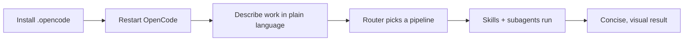

# Usage

How to install, run, and customize `sdlc-lean` in OpenCode. New here? Read the
[README](README.md) first; this file is the hands-on guide.



## 1. Install

**Project-local** — applies to one repo, reviewable in its diff:

```sh
cp -r .opencode /path/to/your-project/     # includes plugins/sdlc-lean-tui/
mkdir -p /path/to/your-project/scripts
cp scripts/spec-check.mjs scripts/host-evidence.mjs /path/to/your-project/scripts/
```

**Global** — applies to every project, one command:

```sh
npm run install:global
```

The script copies skills/agents/commands/plugin, the TUI part (`.opencode/plugins/sdlc-lean-tui/`), `scripts/spec-check.mjs`, `scripts/host-evidence.mjs`, and `scripts/research/`
into `~/.config/opencode/`
(XDG_CONFIG_HOME honored) and prunes files a previous install placed that no
longer exist in the repo. Your own skills and config are never touched. Manual
equivalent:

```sh
cp -r .opencode/skills/*   ~/.config/opencode/skills/
cp -r .opencode/agents/*   ~/.config/opencode/agents/
cp -r .opencode/commands/* ~/.config/opencode/commands/
mkdir -p ~/.config/opencode/plugins/sdlc-lean-tui
cp .opencode/plugins/sdlc-lean.js ~/.config/opencode/plugins/
cp .opencode/plugins/sdlc-lean-tui/* ~/.config/opencode/plugins/sdlc-lean-tui/
mkdir -p ~/.config/opencode/scripts
cp scripts/spec-check.mjs scripts/host-evidence.mjs ~/.config/opencode/scripts/
cp -r scripts/research     ~/.config/opencode/scripts/
```

### Updating (this PC and other PCs)

After enhancements land on `main`, refresh any machine that has a clone:

```sh
git pull && npm run install:global
```

First time on a new machine:

```sh
git clone https://github.com/garikipatisai-code/sdlc-lean.git ~/sdlc-lean
cd ~/sdlc-lean && npm run install:global
```

Then restart OpenCode (plugins and skills load at session start).

> **Double-install note (inside this repo):** OpenCode loads both
> `~/.config/opencode/plugins/` and `<project>/.opencode/plugins/`. On V1 this
> failed with "failed to load plugin sdlc-lean"; on V2.0.22 both loading has
> been verified working (TUI session + headless `opencode run`). If you ever
> see the load failure, remove the global copy
> (`rm ~/.config/opencode/plugins/sdlc-lean.js`) — the project-local plugin
> already covers this directory.

Restart OpenCode after installing. No dependencies. Works on OpenCode V1
(1.18.x) and V2 (2.0.x, verified). V2 auto-loads the global plugin from
`~/.config/opencode/plugins/`; the plugin registers safety guards on both
flavors (V1 `tool.execute.before`, V2 `ctx.tool.hook("execute.before")`).

> **V2 tip:** when scripting checks with `opencode run` while a TUI session is
> open, pass `--standalone` — otherwise `run` attaches to the shared background
> service and can collide with your live session.

## 2. Verify it is live

The suite augments the built-in **Build** (and **Plan**) agents. It also ships
an **orchestrator** primary agent for autonomous goal-driven runs — switch with
<kbd>Tab</kbd> to it when you want the agent to loop on its own until done.

How you know it is triggered (four independent signals):

| Signal | Where |
|---|---|
| One-time toast **"sdlc-lean active — N skills"** | TUI part (`.opencode/plugins/sdlc-lean-tui/`), first session |
| `Using <skill> to …` announce line | Agent's reply |
| Skill tool call (`→ Skill "brainstorming"`) | TUI activity under the reply |
| Activation status file | `/sdlc-lean` command, or `~/.local/state/sdlc-lean/status.json` |

Quick probes:

| Say this | Expected |
|---|---|
| `Let's add a date picker` | Routes to `brainstorming` (feature pipeline) |
| `This test is failing` | Routes to `systematic-debugging` (bugfix pipeline) |
| `Explain how X works` | Uses `communicating-concisely` (diagram + short prose) |
| `Keep going until all tests pass` | `orchestrator` + `autonomous-loop`: loops until criteria or an honest budget stop |
| `Build a polished 3D web game` | `web-game-development` + `/game`: design → plan → build → perf/a11y gate → ship |
| `Run the paired-question experiment on seeds 7 and 8` | Routes to `research-protocol` (frozen protocol; null counts as done) |
| `Which library should we use — A or B?` | `option-selection`: research → matrix → pick → record |
| `/sdlc-lean` | Prints activation timestamp, install path, and counts |

The V2 activation toast comes from the TUI part, not the server plugin. In
headless `opencode run` there is no TUI, so the toast is skipped — the status
file and the announce line still prove activation.

## 3. Everyday use

Nothing to select — describe the work and the router runs the pipeline.

| You want | You say | Pipeline runs |
|---|---|---|
| A new feature | *"Add CSV export to the reports page"* | explore → brainstorm → plan → TDD → review → verify |
| A bug fixed | *"Login 500s on unicode passwords"* | reproduce → root-cause → fix → confirm |
| A cleanup | *"Split this 600-line module"* | impact analysis → behavior-preserving steps |
| A security check | *"Is the upload endpoint safe?"* | read-only traced-path audit |
| A web game | *"Build a polished 3D web game"* | engine choice → design gate → plan → TDD build → perf/a11y → ship |
| A capability you lack | *"We need OCR — find a trusted option"* | trusted-source search → reuse/install |
| External research | *"Compare Postgres vs SQLite for this"* | scope → parallel search → cite → synthesize |
| An empirical experiment | *"Run the paired-question experiment on seeds 7 and 8"* | freeze → lock → evidence → amend (null counts as done) |
| Pick the best option | *"Which library should we use — A or B?"* | `option-selection`: research → matrix → pick → record |
| An autonomous goal | *"Keep going until all tests pass"* | `orchestrator` → `autonomous-loop`: route → decide → execute → verify → self-correct |

### Pipelines as commands

Every pipeline also has an explicit slash command when you want determinism:

| Command | Flow |
|---|---|
| `/feature <what>` | explore → plan → implement → review → verify |
| `/bugfix <what>` | explore → investigate → fix → review → confirm |
| `/refactor <what>` | impact → decompose → implement → verify |
| `/security-audit [scope]` | audit → scan → dead-code → report (read-only) |
| `/reverse-engineer [target]` | route → analyze → validate → report (read-only) |
| `/game <what>` | design → plan → build → perf/a11y gate → ship |
| `/preview <what>` | read-only preview → goal/steps/files/risk/check → human approval (never implements) |
| `/release <what>` | read-only diff/PRs → draft notes → version bump → hand off (never publishes) |
| `/sdlc-lean` | Status: activation proof + installed skills/agents/commands |

## 4. What happens automatically

- **Routing & scrutiny** — the router infers the pipeline and scales effort
  (trivial builds directly; architectural runs the full brainstorming gate).
- **Lean ladder** — every change stops at the earliest rung: need it? → reuse
  in-repo → stdlib → native → installed dep → one line → minimum code.
- **Safety guards** — destructive shell commands are blocked and `.env`/private
  keys are refused, always. The in-band `#nosafety` token is removed: there is
  no bypass, and the agent cannot self-authorize. Trust-boundary validation,
  data-loss handling, security, and accessibility are never cut.
- **Output contract** — replies respect a ~30-second budget and prefer mermaid
  diagrams and tables over prose walls. Long prose also applies
  `simplified-technical-english` (STE-informed, not certified).
- **Debt ledger** — deferred shortcuts are logged in `docs/debt-ledger.md`
  (format in the `lean-review` skill) instead of expanding an unrelated diff.
- **Spec gate** — the V2 TUI palette command `sdlc.approve` is primary: it
  shows the plan's `files`/`allow` patterns and SHA-256, and Approve writes
  the normal `.sdlc/spec-gate.json` (`approved_via: tui-popup`). Typed
  `/approve <absolute-path> sha256:<hex>` and the `spec-check approve` TTY
  fallback stay; headless/SSH uses the TTY CLI; V1 loads no TUI part. The
  optional `sha256:<hex>` binds approval to the plan bytes as `.sdlc/spec-gate.json` is
  written. Edits outside the plan's `files`/`allow` scope are blocked for
  `edit`/`write`/`patch`/`apply_patch`, and the plan/spec are immutable until
  `close` + re-approval. Bash redirection is outside the gate: it is a drift
  guard, not a sandbox. `approved_via: tui-popup` is informational and
  bash-forgeable — trust comes from close evidence binding, not the label.

### Spec gate commands

```sh
# V2 TUI palette: sdlc.approve (primary, approved_via: tui-popup) and sdlc.status
/approve docs/plans/<slug>.md                              # V2 typed command (human-only)
/approve docs/plans/<slug>.md sha256:<hex>                 # hash-bound typed approval
node scripts/spec-check.mjs approve docs/plans/<slug>.md   # TTY fallback (human terminal)
node scripts/spec-check.mjs status                         # active plan + hashes
node scripts/spec-check.mjs verify                         # fail on drift
node scripts/spec-check.mjs check <path>                   # is this path in scope?
node scripts/spec-check.mjs close                          # after evidence is recorded
node scripts/host-evidence.mjs status                       # advisory host evidence match check
```

## 5. Skills & agents reference

| Skills (40) | Purpose |
|---|---|
| `using-sdlc-lean` | Router: infers pipeline + scrutiny |
| `research-protocol` | Empirical experiments: frozen protocol, device locks, evidence bundle, provenance (null counts as done); phase ledger (`scripts/research/phase.mjs`) for absolute UTC deadlines, observation allowance, cumulative limits, recovery authorization, delegation scope, durable handoff |
| `autonomous-loop` | Goal-driven loop protocol: budgets, stop rules, give-up-honestly report; checkpoints stay informational inside an approved phase, continuation never opens a new phase |
| `option-selection` | Research-first decisions: binary criteria matrix → pick → record; swap order for two options. |
| `colab-lifecycle` | Colab runtime lifecycle (prepare → connect → inspect → execute → persist → release → verify): pinned capability matrix, release-evidence ladder, incident protocol; deterministic guards against kill-as-teardown and `/content` deletion |
| `reverse-engineering` | Shipped-artifact reverse engineering: REA engine ladder (pinned, not vendored), full target routing with recovery and release-availability notes, evidence discipline, S-tier reconstruction gates, competitor best-of matrix, `/reverse-engineer` command |
| `frontend-design` | Distinctive UI build (adapted anthropics, Apache-2.0) |
| `web-game-development` | Web-game router + SOTA gates: engine matrix, fixed-step/WebGPU perf, netcode, game feel/playtest, a11y, PWA/portal shipping; vendored Apache-2.0 Phaser/Pixi/three + discipline references, `/game` command |
| `ui-review` | UI/a11y/UX + React perf review, terse file-line |
| `intent-preview` | Read-only preview; human TTY approval; never self-approve. |
| `autonomy-dial` | Observe→Auto tiers; named check command, audit ledger, reversal path, escalation on a failed check. |
| `brainstorming` · `writing-plans` · `executing-plans` · `subagent-driven-development` | Feature flow: design → plan → execute |
| `test-driven-development` · `systematic-debugging` · `verification-before-completion` | Correctness gates |
| `requesting-code-review` · `receiving-code-review` · `lean-review` | Review in/out + over-engineering audit |
| `reviewing-security` · `investigating-performance` · `evolving-schemas` · `writing-release-notes` | Rigor skills |
| `incident-postmortem` · `dependency-upgrade` · `threat-model` · `adr` | Lifecycle: postmortems, safe bumps, design-time threat modeling, decision records |
| `using-git-worktrees` · `dispatching-parallel-agents` · `managing-tasks` | Isolation, parallel work (fan-out/fan-in), persistence |
| `exploring-codebase` · `acquiring-capabilities` · `deep-research` · `communicating-concisely` · `simplified-technical-english` | Orientation, reuse, research, output |
| `writing-skills` · `diagnosing-sdlc` | Meta: author skills, debug the suite |

| Agents (8) | What it does |
|---|---|
| `orchestrator` | **Primary** agent: drives goals to done in loops, dispatches workers below |
| `explorer` | Read-only codebase reconnaissance |
| `researcher` | Web research on one sub-question, returns cited findings |
| `planner` | Produces bite-sized implementation plans |
| `implementer` | Executes one task with TDD |
| `test-writer` | Adds failing-first tests |
| `code-reviewer` | 4-pass diff review |
| `security-reviewer` | Exploitability-ranked findings |

Subagents inherit your configured model. Invoke one directly with `@explorer`
or let a pipeline dispatch it.

## 6. Customize

Fix the model a subagent uses:

```md
---
description: Executes one plan task with TDD, self-review, and evidence reporting
mode: subagent
model: deepseek/deepseek-flash
---
```

Restrict skills per agent (in `opencode.json`):

```json
{ "agent": { "plan": { "permission": { "skill": { "acquiring-capabilities": "deny" } } } } }
```

Add a skill: follow `writing-skills`, then run `node scripts/validate-skills.mjs`.

## 7. Safety & trust

`acquiring-capabilities` gates third-party code by trust tier — verified
installs directly, established needs approval after a security review, unknown
is inspect-only. Trusted sources and install paths:
[`.opencode/skills/acquiring-capabilities/references/trusted-sources.md`](.opencode/skills/acquiring-capabilities/references/trusted-sources.md).

## 8. Update / uninstall

Re-copy `.opencode` (including `plugins/sdlc-lean-tui/`), `scripts/spec-check.mjs`,
and `scripts/host-evidence.mjs` from a fresh clone to update.
To uninstall, delete the copied `skills/`, `agents/`, `commands/`,
`.opencode/plugins/sdlc-lean-tui/`, `scripts/spec-check.mjs`,
`scripts/host-evidence.mjs`, `scripts/research/` entries and the plugin file;
remove the plugin entry from `opencode.json` if you added one.

## 9. Troubleshooting

| Symptom | Fix |
|---|---|
| No skill announced | Confirm `.opencode/skills/*/SKILL.md` exists and restart |
| `/feature` missing | Commands must be in `.opencode/commands/` or `~/.config/opencode/commands/` |
| Plugin not loading | Check the file is `.opencode/plugins/sdlc-lean.js`; V2 needs the repo root to contain `index.js` only if installed as a package |
| "failed to load plugin sdlc-lean" | Duplicate ID: same file in both `~/.config/opencode/plugins/` and `.opencode/plugins/` — remove the global copy when working inside this repo |
| `sdlc.approve` missing from the palette | Confirm `.opencode/plugins/sdlc-lean-tui/` (or `~/.config/opencode/plugins/sdlc-lean-tui/`) contains `index.js`, `tui.js`, and `register.js`, then restart OpenCode. The part fails open, so the typed `/approve` still works |
| Wrong pipeline chosen | Be explicit (`/bugfix …`) — free-text routing is model-dependent |

## 10. Develop / verify

```sh
npm run verify                     # static skill lint + plugin/budget/safety tests
node scripts/validate-skills.mjs   # lint only
node --test                        # tests only
npm run eval                       # live eval harness — DRY by default
```

The live harness spends nothing without `--run` (capped by `--max-probes`) and
never runs in CI. Results land in `eval/results/` as JSON + markdown, including
tokens and USD cost per run.

Live-harness evidence: [`eval/results/`](eval/results/).
