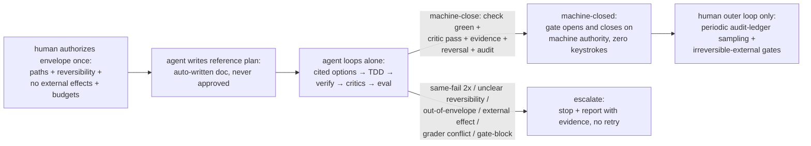

# 0001 auto-tier-pilot

## Status

accepted (accepted-by appusai in chat 2026-10-31 "good"; accepted-at 2026-10-31)

## Context

Solo-dev speed on a trusted local repo is gated by per-step approval friction. Ranked friction inputs: plan approval (#1), design HARD GATE (#2), intent-preview accept (#3), drift (#4), merge (#5), fix-loop exhaustion (#6), grader (#7). Authority: `autonomy-dial` (Observe/Assist/Auto tiers, named check, one audit row per run, reversal path, escalate on 2×same-failure or unclear scope/reversibility), `autonomous-loop` (goal + acceptance + budget, loop route-decide-plan-execute-verify-correct, stop rules incl. spec-gate block as deviation), `brainstorming` HARD GATE (no code/plans/tests until human approves the design artifact). External patterns considered: verification-gated tiers, staffing L1–L5, goal-loop with exits, steering policy-as-context, pre-approved scopes + sandbox, maker-checker + audit. The pilot keeps every authorization boundary intact while allowing long unattended Auto runs inside one standing pre-approval. Rubber-stamp hazard: on experimental work the human lacks the domain knowledge to judge plan/scope correctness, so any correctness-approval sought there degrades into a rubber stamp — false trust that is worse than useless. Friction finding: plan approval gate #1 assumes an expert judge; without one it preserves the wait without buying safety.

## Decision

We will pilot an ENVELOPE-AUTHORIZED MACHINE-CLOSED loop for Auto-tier runs on this repo. The standing envelope is the ONLY human act: authorized once per goal, version-controlled, in human-readable risk terms — allowed paths, reversibility requirement, no external side effects, iteration/time budgets. Inside the envelope, no human keystrokes occur.

Inside the envelope: the agent authors plan/spec MDs as REFERENCE (auto-written, never approved — audit trail only, never an authorization input), implements, then the gate OPENS and CLOSES on machine authority alone. Machine-close condition (all required, zero human keystrokes): named check green (default `npm run verify`) + independent critic pass + evidence rows recorded + reversal commit present + audit-ledger row written (`date | tier | check | result | reversal`). Built form: `node scripts/spec-check.mjs close --machine --check "<cmd>" --critics <file> --reversal <sha> [--envelope <file>]` (`closeMachineGate` in `scripts/spec-check.mjs`).

Honest boundary, stated plainly: inside-the-machine (local repo, reversible work) = human-out-of-loop is achievable and is what this pilot covers. IRREVERSIBLE EXTERNAL acts stay ALWAYS-human — the only human gates: merge to shared remote / PR to a shared branch; publish/release; spend (money, paid API beyond budget, provisioned resources); network writes to prod or any external system; grader assertion changes; red close (closing while checks are red). Everything else inside the envelope is autonomous.

Each Auto run declares, before the first edit: tier (`Auto`), named check, file scope (exact paths inside the envelope), iteration budget (default 3 per `autonomous-loop`), and reversal (the reverting commit SHA; no reversal path, no run).

Escalate — stop the run, report, no retry — on any of: same check fails twice with the same output; scope or reversibility unclear; destructive/irreversible act requested; grader conflict (check says pass, grader/assertion says fail, or vice versa); spec-gate block; out-of-envelope file requested; any external effect requested.

Safeties that replace the human (the substance of this design): (1) envelope enforced TECHNICALLY by gate hooks, not by promises — out-of-envelope writes are refused as deviations; (2) grader-immutability — the agent never edits its own grading tests (existing rule, now load-bearing); (3) independent critics — separate reviewer agents review, never the implementer reviewing itself; (4) reward-hacking guards — checks must be pre-existing or reviewer-owned; new behavior needs a pre-declared expected outcome before implementation; (5) audit-ledger row + reversal commit per run for outer-loop sampling; (6) escalation stops (2×same-failure, unclear reversibility, out-of-envelope file, external effect) route to the human with evidence.

Experimental track: unknown domain → SMALLER envelope (fewer files, scratch dirs, no merge), MORE evidence required (named check + eval probes + reviewer pass + reversal commit), never auto-merge/publish.

## Goal

Give the solo operator long unattended Auto runs inside a once-authorized envelope — the agent writes its own reference plan, loops alone through execute-verify-correct until the machine-close criteria hold or a stop rule fires, then closes on machine authority with audit row + reversal commit — while irreversible-external acts stay human and the human's only remaining role inside-the-machine is periodic audit-ledger SAMPLING, not per-step approval.

## Non-goals

- No self-approval of plans: the agent never approves, widens, or replaces a plan/scope.
- No merge/PR/release without a human: merges, PRs, and publish/release acts stay ALWAYS-human.
- No grader weakening: grader assertions, pass bars, and evidence rules are never loosened to go green.
- No destructive/irreversible acts: deletes, force-pushes, secret-touching, and unrecoverable mutations are out; destructive patterns still throw.
- No gate bypass: a spec-gate block is never routed around with bash, redirection, or generated scripts.
- No rubber-stamp approvals: never ask the human to judge what they stated they can't judge; correctness-judgment on experimental work is never sought from the human nor counted as approval.
- No human hash approvals: no per-plan hash approval, no per-plan accept waits, no approval prompts the human can't judge — plans/specs are reference output (auto-written audit trail), never authorization inputs.

## Alternatives

| Option | Why rejected |
|---|---|
| Delete-gate full-freedom (remove approvals; agent acts anywhere) | Surrenders the authorization boundary that `autonomous-loop` and the spec gate exist to hold: plan/scope approval is an authorization, not a checkpoint. Friction #1 (plan approval) is real, but deleting it trades waits for unscoped writes and unrecoverable acts; external pre-approved-scopes pattern says the scope edge — not the absence of gates — is what makes autonomy safe. |
| Steering-only (policy-as-context: steer via queued follow-ups, keep every per-step gate wait) | Leaves the top friction in place: per-step approval waits (#1 plan approval, #3 intent-preview accept, #5 merge stops) still interrupt every run, so no long unattended run is possible. Steering (Copilot-steer pattern) is kept as a complement — follow-ups queue for the next tool call — not as the autonomy mechanism. |
| Maker-checker-only (keep human check on every action; audit after the fact) | Already exists yet still stops: maker-checker + audit (the current gate + ledger shape) gates each step, so fix-loop exhaustion (#6) and drift (#4) still page the human mid-run. The pilot instead pre-authorizes the loop inside a declared scope and keeps maker-checker only at the authorization boundaries (plan/scope, merge, release, grader), with verification-gated tiers and goal-loop exits doing the per-iteration control. |
| Keep judgment-based plan approval for experimental work | Rejected: without domain knowledge the human cannot judge correctness, so every such approval degrades into a rubber stamp — false trust that hides scope breaks. Preserves friction #1's wait without buying safety; the pilot instead takes envelope approval from the human and correctness evidence from checks + critics + cited research. |
| Keep human hash-approval of plans (per-plan accept waits) | Rejected: operator-declared inability to judge makes it pure rubber-stamp latency with zero safety value. Plans/scope MDs stay FOR REFERENCE (audit trail, auto-maintained) — never approval artifacts. Safety moves to the envelope hooks + machine-close criteria + outer-loop sampling instead. |

## Trade-offs

- Buys: long unattended runs inside a declared scope; fewer mid-loop interrupts for the top-ranked frictions; every run still verifiable (named check + audit row + reversal SHA).
- Gives up: spontaneity outside scope — anything undeclared stops instead of adapting; operator owes pre-run declaration discipline and per-run audit hygiene.
- Risk accepted: a mis-scoped pre-approval could authorize a bad-but-in-scope run; bounded by iteration budget, named-check gating, gate-hook scope enforcement, and the reversal commit.

## Trace

| Requirement | Design section | Test / check proving it |
|---|---|---|
| Run declares tier + named check + scope + budget + reversal before first edit | Decision | Human review of the run header against this doc (no code this round) |
| One audit-ledger row per run with reversal SHA | Decision | `grep` audit row present; `git log` shows reversal commit |
| Escalate (stop, no retry) on 2×same-failure, unclear scope/reversibility, destructive act, grader conflict, gate-block | Decision | Ledger stop-reason cites the trigger; no retry commits after it |
| ALWAYS-human: plan/scope, merge/PR, release, grader changes, red close, out-of-scope | Decision | `git status` + gate history show zero such acts by the agent |
| No self-approval, no gate bypass, no grader weakening, no destructive acts | Non-goals | `node scripts/spec-check.mjs status` shows no forged/weakened gate; destructive-guard tests stay green under default `npm run verify` |
| Design approved before any plan or code | Status / Review findings | Human written-findings approval record; zero code changed this round |
| Envelope authorized once per goal (blast radius + reversibility + no external effects + budget) | Decision | Pre-approval record in the run header; `git status` shows zero out-of-envelope acts |
| Correctness without a domain expert delegated to checks + critics + eval | Decision | Named check green + reviewer pass + cited research + eval probes recorded per run |
| Reversibility per run | Decision | `git log` shows the reverting commit per run |
| Auditability per run | Decision | Exactly one ledger row per run (`date \| tier \| check \| result \| reversal`) |
| Reference plan is auto-written, never approved | Decision | Plan MD exists as reference output; no approval record sought or counted; tests prove machine-close criteria instead |
| Outer-loop sampling replaces per-step approval | Decision / Consequences | Audit ledger stays human-readable (pass/fail, counts, cited sources); sampling cadence recorded (e.g. weekly review, not per-run) |
| Irreversible-external acts stay human | Decision | Explicit human-gate list (shared-remote merge/PR, publish/release, spend, prod/external network writes, grader changes, red close); `git status` + gate history show zero such acts by the agent |
| 3-source grader-immutability anchored at approval | Decision | `listGraderChanges` (working tree vs reversal) + `listReversalGraderFiles` + `listGraderCommitsSince` (`--since=<approved_at>`) in `scripts/spec-check.mjs`; machine-close refuses `grader-changed`, fail-closed `grader-unknown` on git failure |
| Envelope-immutability | Decision | `checkEnvelopeClean` in `scripts/spec-check.mjs` (mirrored by `checkCloser` in the plugin): envelope file git-clean AND unchanged since `approved_at`; machine-close refuses `envelope-changed`, fail-closed `envelope-unknown` |
| Exactly one audit row per run (no double-close) | Decision | `ledgerHasReversal` exact 5th-column ledger match in `scripts/spec-check.mjs`; machine-close refuses `duplicate-reversal` |

## Review findings

Accepted by appusai in chat 2026-10-31 ("good"). Human written findings and dispositions:

| # | Reviewer / perspective | Finding | Disposition (accept / reject + reason / defer + owner) |
|---|---|---|---|
| 1 | appusai (operator, chat 2026-10-31) | Rubber-stamp hazard: on experimental work the human lacks the domain knowledge to judge plan/scope correctness, so any correctness-approval sought degrades into a rubber stamp — false trust worse than useless | accept — design takes only envelope approval from the human; correctness evidence comes from checks + critics + cited research (see Non-goals) |
| 2 | appusai (operator, chat 2026-10-31) | Human-out-of-loop directive: safely remove the human from the inner loop entirely; plans/scope MDs stay FOR REFERENCE (auto-maintained audit trail), never approval artifacts | accept — envelope-authorized machine-closed loop; the standing envelope is the only human act; zero human keystrokes inside |
| 3 | appusai (operator, chat 2026-10-31) | Envelope-vs-judgment split: the human authorizes the risk envelope once per goal (paths, reversibility, no external effects, budgets); correctness-judgment goes to machine-verifiable checks + independent critics + cited research evidence | accept — experimental track adds a smaller envelope + more evidence, never auto-merge/publish |

## Leading indicators

_No measurements yet — record here per `brainstorming` §5, one line each. Do not fabricate._

- Issues caught pre-implementation: (none recorded yet)
- Review coverage (perspectives assigned vs. findings received): (pending human review)
- Requirements traced to tests: (traced / total — pending)

## Consequences

- What becomes easy: experimental automation at machine speed with zero approval latency — long fix/verify loops unattended inside the envelope; reconciling any run from its audit row + reversal commit; refusing out-of-scope work by citing the envelope; no per-plan accept waits.
- What becomes hard: envelope calibration (too wide risks blast radius, too narrow stalls the run); keeping evidence human-readable for sampling (pass/fail, counts, cited sources — a non-expert must be able to sample it).
- What we now owe: an envelope template file (paths + reversibility + no-external-effects + budgets); machine-close criteria (named check green + critic pass + evidence rows + reversal commit + audit row); a sampling cadence (e.g. review the audit ledger weekly, not per-run); audit-ledger discipline (exactly one row per Auto run); a reversal commit per run (no reversal path, no run); escalation honesty (stop + report, no silent retry); design-first sequencing — `writing-plans` only after human written-findings approval of this artifact.
