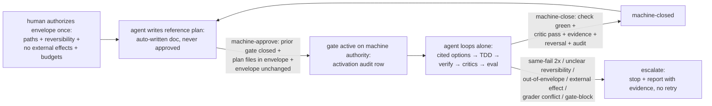

# 0002 machine-approve

## Status

proposed (awaiting human written-findings approval; zero code this round)

Supersedes (partially) [0001](0001-auto-tier-pilot.md): 0001's "approve stays human" point only — 0001 removed human hash-approval of reference plans inside a machine-closed run, but gate OPENING (approve) still required a human keystroke. This ADR closes that last gap with envelope-authorized machine-approve. Everything else in 0001 (envelope as the only human act, machine-close criteria, ALWAYS-human irreversible-external list, SoP, grader-immutability, reward-hacking guards) stands unchanged.

## Context

Audit established 2026-10-31: `close` is CLI-only (no `/close`, no `sdlc.close`); typed `/approve` refuses overwrite (only the popup has a 2nd-confirm); drift/parity cases print terminal commands. The built machine-close (`close --machine`: check + critics + evidence + reversal + audit) already lets the agent close alone — but OPENING the next gate (approve) still needs a human keystroke. Forced-terminal approvals remain in three cases:

1. Active-gate overwrite on the typed path — a re-approval while a gate is active is refused on the typed path, forcing the operator to a terminal.
2. Drift `close && approve` — drift recovery prints terminal commands for the operator to run.
3. Parity reinstall — parity cases print terminal commands for the operator to run.

Human directive 2026-10-31: remove ALL forced-terminal approvals. Close that last gap: the agent must be able to open the next gate itself, inside the envelope, with zero keystrokes — completing the zero-terminal loop that 0001 started.

## Decision

We will add envelope-authorized MACHINE-APPROVE: when (a) the prior gate is machine-closed (or no gate is active) AND (b) a valid envelope covers the new plan's files AND (c) the envelope is unchanged since its authorization AND (d) the plan was authored from the envelope by the agent as a REFERENCE doc, the agent activates the gate itself via `approve --machine` (new flag, mirroring `close --machine` rigor) with zero keystrokes.

`approve --machine` mirrors `close --machine` rigor: envelope ceiling checked technically (plan `files`/`allow` ⊆ envelope paths or refuse), envelope-immutability re-verified (reuse `checkEnvelopeClean`: envelope file git-clean AND unchanged-since anchor — now anchored to the ENVELOPE authorization record, defined as human chat-accept recorded in the ledger + envelope file committed), prior gate machine-closed first (no double-gate: refuse if a gate is still active), and an activation audit row written (distinct from run rows). Out-of-envelope plan content escalates (stop + report, no retry) — the envelope file list is the hard ceiling.

## Goal

Complete the zero-terminal loop: after a machine-close, the agent opens the next gate on machine authority under the same standing envelope — reference plan in, machine-approve, autonomous run, machine-close — with zero human keystrokes anywhere inside the envelope, while envelope authorization and irreversible-external acts stay human.

## Non-goals

- No human hash approvals anywhere in the loop: no per-plan hash approval, no per-plan accept waits — plans/specs stay reference output, never authorization inputs (0001 rule, extended to gate opening).
- No silent widening: the envelope file list is the hard ceiling; out-of-envelope plan content refuses at `approve --machine` time and escalates — scope never grows by machine approval.
- No merge/publish/spend/prod: the ALWAYS-human irreversible-external list is unchanged (shared-remote merge/PR, publish/release, spend, prod/external network writes, grader assertion changes, red close).
- No gate bypass: a spec-gate block is never routed around with bash, redirection, or generated scripts.
- No double-gate: `approve --machine` refuses while any gate is active; the prior gate must machine-close first.

## Alternatives

| Option | Why rejected |
|---|---|
| Human-invoked `/close` + `sdlc.close` pair for every re-approval | Keeps one human click per re-approval — preserves exactly the friction the directive removes. Rejected: no zero-terminal loop possible while each gate opening waits on a keystroke. |
| Typed-overwrite 2nd-confirm (add a confirm channel to the typed approve path) | The typed path has no confirm channel, and even with one it still costs a per-step human act. Rejected: rebuilds the rubber-stamp wait 0001 removed, without buying safety the envelope ceiling doesn't already buy. |
| Keep terminal close/approve (status quo) | Rejected by directive: the operator explicitly ordered ALL forced-terminal approvals removed. Preserves cases #1–#3 above as terminal interrupts on every re-approval, drift recovery, and parity reinstall. |

## Trade-offs

- Buys: zero-terminal loop — re-approval, drift recovery, and parity reinstall run unattended inside the envelope; no operator keystroke between machine-close and the next gate opening.
- Costs: agent-held activation power — the agent now OPENS gates (grants itself write scope), which is stronger than closing (see threat model `2026-10-31 machine-approve`). Mitigated by: technical envelope ceiling (plan files ⊆ envelope paths or refuse), envelope immutability anchored to the envelope authorization record, no-double-gate (prior machine-close first), distinct activation audit row, and unchanged grader-immutability + critic rules.
- Risk accepted: an envelope authorized on misunderstood risk (human misjudgment of blast radius) now compounds across gates without a per-gate human look — owned by the human operator via envelope sizing discipline + outer-loop sampling.

## Trace

| Requirement | Design section | Test / check proving it |
|---|---|---|
| Prior gate machine-closed (or no gate) before machine-approve | Decision | `approve --machine` refuses while any gate is active; gate history shows close precedes approve |
| Plan `files`/`allow` ⊆ envelope paths or refuse | Decision | Envelope-ceiling check in `approve --machine`; out-of-envelope plan content refuses + escalates |
| Envelope unchanged since its authorization | Decision | Reused `checkEnvelopeClean` anchored to the envelope authorization record (human chat-accept in ledger + envelope file committed); refuses `envelope-changed`, fail-closed `envelope-unknown` |
| Plan authored from the envelope as REFERENCE doc | Decision / Context | Plan MD exists as agent-authored reference output; no approval record sought or counted |
| Activation audit row distinct from run rows | Decision | Ledger shows an activation row per machine-approve, distinguishable from per-run rows |
| Same grader-immutability + critic rules apply | Decision | Unchanged 0001 guards: 3-source grader rule, grader conflict escalates, independent critics |
| No double-gate, no widening, no bypass | Non-goals | `node scripts/spec-check.mjs status` shows exactly one gate lineage; `git status` shows zero out-of-envelope acts |
| Design approved before any plan or code | Status / Review findings | Human written-findings approval record; zero code changed this round |

## Review findings

Human written findings and dispositions (to be filled by the human reviewer — no code until approved):

| # | Reviewer / perspective | Finding | Disposition (accept / reject + reason / defer + owner) |
|---|---|---|---|
| | | | |
| | | | |
| | | | |

## Leading indicators

_No measurements yet — record here per `brainstorming` §5, one line each. Do not fabricate._

- Issues caught pre-implementation: (none recorded yet)
- Review coverage (perspectives assigned vs. findings received): (pending human review)
- Requirements traced to tests: (traced / total — pending)

## Consequences

- What becomes easy: fully unattended multi-gate runs inside one envelope — close, re-approve, drift-recover, and parity-reinstall without terminal interrupts; reconciling any activation from its audit row + envelope authorization record.
- What becomes hard: envelope authorization carries more weight (each envelope now covers N gate openings, not one run); activation rows must stay distinguishable from run rows under sampling; refusal paths (`envelope-changed`, out-of-envelope plan, double-gate) must stay fail-closed and human-readable.
- What we now owe: the `approve --machine` flag with 0001-mirroring rigor (ceiling check + `checkEnvelopeClean` anchored to envelope auth + no-double-gate + activation row); a definition of envelope authorization (human chat-accept recorded in ledger + envelope file committed); unchanged ALWAYS-human list enforcement; design-first sequencing — `writing-plans` only after human written-findings approval of this artifact.
