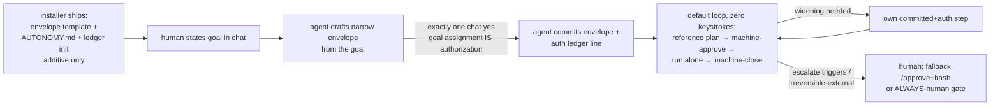

# 0003 autonomy-by-default

## Status

proposed (awaiting human written-findings approval; zero code this round)

Supersedes-and-extends [0001](0001-auto-tier-pilot.md) + [0002](0002-machine-approve.md): the DEFAULT POSTURE flips — every new repo/session gets the envelope-authorized zero-approval loop out of the box; human plan/hash approval becomes the fallback, not the norm. MECHANISMS UNCHANGED — envelope ceiling, machine-approve/machine-close rigor, grader-immutability, independent critics, audit + reversal, escalate list, and the ALWAYS-human irreversible-external list all carry over exactly as 0001+0002 define them.

## Context

Per-repo retrofit doesn't scale. The EgWg run proved the 0001+0002 pattern works — standing envelope authorized once, agent drafts reference plans, machine-approve opens each gate, autonomous loop runs alone, machine-close records completion — but getting there needed manual porting: hand-copying the envelope template, hand-writing the standing rule, hand-initializing the audit ledger, and re-teaching the router flow per repo. Every new repo/session starts from the old posture (human plan/hash approval as the norm) and must be converted by hand. The human directive 2026-11-01 reverses this: the envelope-authorized zero-approval loop must become the DEFAULT posture of sdlc-lean — shipped by the installer, assumed by the router, documented by the skills — with human plan/hash approval surviving ONLY as fallback.

## Decision

We will make autonomy-by-default the shipped posture of sdlc-lean, in four parts. No mechanism changes; this ADR moves the delivery point and the default, not the rigor.

### 1. INSTALLER ships autonomy by default

Every fresh install receives the autonomy payload additively. Exact installer payload additions:

- Envelope template (paths + reversibility + no-external-effects + budgets, starting NARROW — see threat section) installed as the repo's standing-envelope stub.
- `AUTONOMY.md` standing rule (envelope-first router default: goal → draft envelope → one chat yes → commit + auth ledger line → machine-approve → loop alone → machine-close; human `/approve`+hash as fallback only).
- Audit-ledger init (ledger file with header row format `date | tier | check | result | reversal`, zero rows pre-filled).

Additive-only rule: the installer MUST NEVER overwrite an existing repo envelope or ledger — if either file exists, the installer leaves it untouched and reports `already present, skipped`. No pre-filled paths: the installer ships the template with empty scope; scope is filled by the bootstrap step (§4), never by the installer.

### 2. ROUTER defaults to envelope-first

The `using-sdlc-lean` / `intent-preview` flow becomes, by default:

1. Human states the goal in chat.
2. Agent drafts the envelope from the goal (narrow: plan+impl+evidence paths only).
3. Human confirms ONCE in chat — the goal assignment IS the authorization.
4. Agent commits the envelope + writes the auth ledger line (human chat-accept recorded + envelope file committed = the envelope authorization record per 0002).
5. Machine-approve opens the gate → agent loops alone → machine-close records completion.
6. Repeat from step 2 (next reference plan) with zero further keystrokes while the envelope covers the plan and stays unchanged.

Human `/approve`+hash remains ONLY as fallback: no envelope exists (and bootstrap is refused or impossible), or the envelope was refused/changed (re-authorization declined). The fallback path is unchanged — typed `/approve` with plan SHA-256 — and is documented as the exception, not the norm.

### 3. SKILL updates (enumerated; no code yet)

- `intent-preview`: accept step gains the envelope meaning — a goal statement confirmed once in chat CAN authorize the envelope (goal assignment IS the authorization). No separate plan-accept wait inside the envelope.
- `writing-plans`: machine-approve becomes the default gate-opening path when a valid unchanged envelope covers the plan; human `/approve`+hash is documented as fallback-only (no envelope, or envelope refused).
- `autonomous-loop`: Auto tier becomes the default INSIDE the envelope (named check + evidence + reversal + audit row per run, escalate list unchanged); Observe/Assist remain the tiers OUTSIDE it (no envelope = no Auto).
- `finishing-a-development-branch`: UNCHANGED — merge/PR/release stay human, always. No envelope covers the irreversible-external boundary.
- `brainstorming` HARD GATE: UNCHANGED for first-time architecture — no code/plans/tests until human approves the design artifact. Envelope work itself is Bounded (narrow scope + budgets + no external effects), which is why routine envelope runs skip the gate while first-time architecture never does.

### 4. BOOTSTRAP for repos without envelope

First run on a repo with no envelope: the agent drafts the envelope from the stated goal (narrow template, empty-scope fill only — never copied from another repo); the human says yes EXACTLY ONCE in chat; the agent commits the envelope + auth ledger line; from that point the loop runs with zero approvals while the envelope holds. Widening the envelope later is its own committed+authorized step (commit the widened envelope + fresh auth ledger line), never silent.

### 5. NON-NEGOTIABLES carried over (0001+0002, unchanged)

- Envelope ceiling: plan `files`/`allow` ⊆ envelope paths or machine-approve refuses; out-of-envelope writes blocked by gate hooks.
- Grader-immutability: the agent never edits its own grading tests; grader conflict escalates.
- Independent critics: separate reviewer agents review; never the implementer reviewing itself.
- Audit row + reversal per run: exactly one ledger row per run naming the reverting commit.
- Escalate list: stop + report, no retry — on 2×same-failure, unclear scope/reversibility, destructive/irreversible act, grader conflict, gate-block, out-of-envelope file, external effect.
- Irreversible-external human list: shared-remote merge/PR, publish/release, spend, prod/external network writes, grader assertion changes, red close — ALWAYS-human, no envelope covers them.
- No gate bypass: a spec-gate block is never routed around with bash, redirection, or generated scripts.

## Correctness responsibility (prime directive)

Per human prime directive 2026-11-01 (authoritative): sdlc-lean takes responsibility for ALWAYS being correct. Human knowledge/intuition is limited and must never be the correctness backstop. The human's only concerns are stating the goal + constraints and receiving the best SOTA-standard outcome. If correctness needs more insight — for ANY selection, suggestion, or judgment — the agent fans out subagents and gathers evidence itself. It never punts judgment to the human; never asks the human to choose, compare, or validate technical merit.

(a) Agent owns correctness end-to-end — research-first on ANY uncertainty: parallel researcher/explorer fan-out with cited evidence per `option-selection` (fetched sources in the decision matrix), never memory/vibes picks. Uncertainty triggers evidence gathering, not a human question.
(b) Suggestions/decisions arrive human-ready with evidence, never as questions — the human is never asked to choose, compare options, or validate technical merit. This extends the `autonomous-loop` "never ask the human to choose" rule from tier routing to every suggestion and judgment the agent produces.
(c) SOTA standard by default — trusted-source verification for consequential picks (per `acquiring-capabilities`), eval harness where behavior is graded. "Best known" means verified against sources/probes, not asserted.
(d) Self-correction over human correction — independent critics from different angles, `verification-before-completion` (fresh evidence before any done claim), fix budgets, fail-before-fix proofs. Human correction is a sampled outer-loop input (audit sampling), not the inner-loop mechanism.
(e) Human's narrowed role: goal + constraints + envelope + sampling. Explicit: human fallibility is ASSUMED (limited knowledge/intuition), so no design may depend on human technical judgment — including approval UX. No "review this diff carefully and tell me if it's right" asks; review surfaces carry findings + evidence, never bare questions.

## Goal

Every new repo/session gets zero-setup zero-approval autonomy out of the box: install ships the template + standing rule + ledger init, first run costs exactly one chat yes, everything after runs unattended inside the envelope — while human plan/hash approval survives only as the fallback path and irreversible-external acts stay human.

## Non-goals

- No silent auto-publish: publish/release acts never ride inside any envelope.
- No removing human merge/release approval: `finishing-a-development-branch` is unchanged; merge/PR/release stay ALWAYS-human.
- No weakening grader rules: grader-immutability, the 3-source rule, and reward-hacking guards carry over untouched.
- No changing the close-human path: red close stays ALWAYS-human; machine-close criteria are unchanged.

## Alternatives

| Option | Why rejected |
|---|---|
| Per-repo manual porting (status quo — hand-copy envelope, hand-write rule, hand-init ledger per repo) | Doesn't scale: every new repo/session repeats the EgWg manual work and starts from the wrong default. Rejected by directive — the posture flip is the whole point. |
| Global envelope shared across repos (one envelope covering all checkouts) | Wrong blast radius: envelopes must be per-repo — paths, reversibility, and risk differ per checkout, and one widened global envelope would authorize writes everywhere. Rejected: per-repo authorization records stay the unit. |
| Removing approval entirely incl. merges (full removal — no human gates anywhere) | Surrenders the irreversible-external boundary: merge/publish/spend/prod writes are unrecoverable by audit row + reversal commit. Rejected: the ALWAYS-human list stands. |

## Trade-offs

- Buys: zero-setup zero-approval for every repo — no per-repo porting; first run costs one chat yes; the router assumes autonomy instead of re-litigating it.
- Costs: default-on autonomy widens exposure on day one (see threat-model `2026-11-01 autonomy-by-default`): the first envelope is agent-drafted, so the bootstrap yes risks becoming a rubber stamp; mitigated by narrow-start template + own-step widening + installer never pre-filling paths.
- Risk accepted: an envelope authorized on misunderstood risk at bootstrap now compounds across all gates of that repo without a per-gate human look — owned by the human operator via envelope sizing discipline + outer-loop sampling (same residual shape as 0002, now multiplied by repo count).

## Trace

| Requirement | Design section | Future test / check proving it |
|---|---|---|
| Installer ships envelope template + AUTONOMY.md + ledger init additively | Decision §1 | Installer test: fresh install contains all three; pre-existing envelope/ledger byte-identical after reinstall |
| Installer never overwrites existing envelope/ledger | Decision §1 | Installer test: seeded envelope + ledger files unchanged post-install; status reports `already present, skipped` |
| Router envelope-first flow (goal → draft → one chat yes → commit + auth line → machine-approve → loop → machine-close) | Decision §2 | Skill-body review: `intent-preview`/`using-sdlc-lean` describe this order with `/approve`+hash as fallback-only |
| Human `/approve`+hash fallback only (no envelope, or envelope refused) | Decision §2 | Skill-body review: fallback conditions enumerated; default path never mentions hash approval |
| Skill updates enumerated, `finishing-a-development-branch` + `brainstorming` HARD GATE unchanged | Decision §3 | Skill-body diff review: only listed skills change; finishing + brainstorming diffs empty |
| Bootstrap: one chat yes, then zero approvals | Decision §4 | Ledger review: exactly one auth line per envelope; gate history shows machine-approve thereafter |
| Widening requires its own committed+auth step | Decision §4 | Gate history + ledger: widened envelope commit + fresh auth line precede any widened-scope approve |
| Non-negotiables carried over unchanged | Decision §5 | Existing 0001+0002 regression suites stay green; no mechanism diff |
| Design approved before any plan or code | Status / Review findings | Human written-findings approval record; zero code changed this round |

## Review findings

Human written findings and dispositions (to be filled by the human reviewer — no code until approved):

| # | Reviewer / perspective | Finding | Disposition (accept / reject + reason / defer + owner) |
|---|---|---|---|
| | | | |
| | | | |

## Leading indicators

_No measurements yet — record here per `brainstorming` §5, one line each. Do not fabricate._

- Issues caught pre-implementation: (none recorded yet)
- Review coverage (perspectives assigned vs. findings received): (pending human review)
- Requirements traced to tests: (traced / total — pending)
- Human asked to judge technical merit (choose/compare/validate count, target 0): (none recorded yet)
- Researcher fan-out per consequential decision (decisions with cited evidence / total): (none recorded yet)

## Consequences

- What becomes easy: starting autonomous work anywhere — install, state a goal, one yes, unattended from there; no per-repo porting effort; the router never asks for plan/hash approval inside the envelope.
- What becomes hard: bootstrap discipline at scale — every repo's first envelope deserves a real read, and narrow-start will feel slow on repos the operator already trusts; resisting the widen-first-ask-later temptation.
- What we now owe: installer payload work (template + AUTONOMY.md + ledger init, additive-only with never-overwrite tests); skill-body edits (`intent-preview`, `writing-plans`, `autonomous-loop`; finishing + brainstorming verifiably untouched); a migration note for existing repos (repos with envelopes keep them — installer skips; repos without get the bootstrap path on next run); design-first sequencing — `writing-plans` only after human written-findings approval of this artifact. Loop skills must treat "ask the human" as a defect unless the item is in the irreversible-external / ALWAYS-human list: any suggestion, option comparison, or technical-merit validation routed to the human is a bug, not a workflow step (per Correctness responsibility prime directive above).
