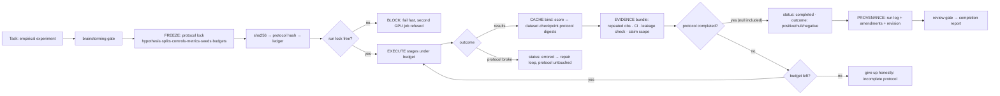
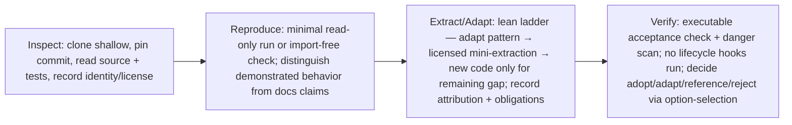

# Design — Empirical AI Research Enhancement (SDLC-Lean)

**Stage:** source audit + design. **Gate:** STOPPED at design-approval gate — no
production changes made. Awaiting approval before `writing-plans`.

## Goal

Give SDLC-Lean research-mode semantics for empirical AI experiments (hypotheses,
splits, seeds, null results, provenance) by adapting proven upstream mechanisms
— not by installing a framework. All reuse follows the re-engineering ladder:
SDLC-Lean first, then instruction adaptation, then small licensed components,
new code only for demonstrated gaps.

## Non-goals

- No new orchestrator, database server, dashboard, queue daemon, or cloud service.
- No new runtime dependency. Everything stdlib (`node:crypto`, `node:fs`).
- No GPU training, paid compute, or remote writes (this stage or later).
- No copying whole frameworks; no extraction from AI-Scientist-v2 (license blocks it).
- Default (non-research) SDLC-Lean workflows stay byte-for-byte compatible.

## Overview

## 1. Upstream audit — identity evidence (fetched + cloned, read-only)

| Repo | Canonical URL (evidence) | Pinned commit (audited) | Commit date | License | Maintenance | Verdict |
|---|---|---|---|---|---|---|
| Inspect AI | `UKGovernmentBEIS/inspect_ai` — its own docs "Code"/citation links, PyPI `inspect-ai` metadata [1][2] | `a1dbea8db3cc85e04ff532760d0eaaeb64df6d3a` | 2026-10-10 | MIT (UK AI Security Institute, 2024) | Active; 0.3.278 (2026-10-09), releases every few days [1] | **Adapt patterns** |
| microsoft/RD-Agent | GitHub + PyPI `rdagent` homepage [1] | `484776c211e4fbbeef03e0ec00d6bbee7362a4f4` | 2026-09-23 (v1.0.0) | MIT (Microsoft) | Active; daily commits/PRs, v1.0.0 [1] | **Adapt patterns** |
| mlflow/mlflow | GitHub + PyPI `mlflow` [1] | `074c0fcf4f42abd857afafccbbc5038ce30efa3d` | 2026-10-11 | Apache-2.0 (Databricks) | Active; 3.17.0 (2026-10-07) | **Reference-only** |
| SamuelSchmidgall/AgentLaboratory | GitHub, README self-link | `d9017d90e329112d2a80b7712f37ee9094d2cd27` | 2025-08-20 | MIT (Schmidgall 2025) | Unmaintained; no releases ever, no tests, no CI [1] | **Reject dependency** |
| SakanaAI/AI-Scientist-v2 | GitHub | `96bd51617cfdbb494a9fc283af00fe090edfae48` | 2025-12-19 | Custom "AI Scientist Source Code License v1.0" (RAIL-based, no SPDX) | Stale; last commit was the license change (PR #78); no releases [1] | **Reference-only** |

Identity note: `uk-ai-safety-institute/inspect-ai` → 404. `meridianlabs-ai/inspect_ai` is an
active dev fork/ecosystem hub; releases ship from the BEIS repo [1].

## 2. Capability-to-upstream matrix

Pins: RD = `RD-Agent@484776c`, AL = `AgentLaboratory@d9017d9`, IN = `inspect_ai@a1dbea8`,
ML = `mlflow@074c0fc`, AS2 = `AI-Scientist-v2@96bd516`. All paths verified by direct reads of the clones.

| # | Gap | Current SDLC-Lean behavior | Upstream source path (pinned) | Proposed mechanism | License/attribution | Integration size & deps | Executable acceptance test | Limitations |
|---|---|---|---|---|---|---|---|---|
| 1 | Completion = approved experiment completed, null/negative included | `autonomous-loop/SKILL.md:9-10,53-56` stops on criteria/no-progress/budget; "give up honestly" frames non-goal outcomes as failure. No experiment pipeline. | RD `rdagent/utils/workflow/loop.py:173-193` (termination by step/timer budget only — verified, no quality gate); IN `src/inspect_ai/_eval/task/run.py:342` (`SampleTerminalOutcome = completed\|errored\|cancelled`) + `log/_log.py:62`; AS2 `launch_scientist_bfts.py:271-299` (writeup runs unconditionally); ML `mlflow/entities/run_status.py:9-15` (FINISHED/FAILED/KILLED) | Outcome taxonomy `{completed, errored, cancelled}` × `{positive, null, negative, inconclusive}`. Loop stops "research completed" when the protocol ran to its end conditions — outcome is recorded, never gated. "Give up honestly" only for errored protocol or budget-exhausted incomplete protocol. | MIT (RD, IN, AL); Apache-2.0 (ML) — pattern adaptation, cite path; AS2 semantics referenced only (license forbids extraction) | Skill section in `research-protocol` + `autonomous-loop` edit (~20 lines); no deps | Simulated null-result run → emits `status:completed, outcome:null`; loop reports research-completed (fake loop harness, node:test) | Taxonomy is ours; no upstream has null-result completion semantics (RD records `decision=False` but nothing gates on it) |
| 2 | Repair separated from protocol change | `systematic-debugging/SKILL.md:13-16` repair discipline; `evolving-schemas/SKILL.md:8-13` expand/contract. No repair-vs-protocol gate; nothing forces protocol edits through a distinct path. | RD `rdagent/core/evolving_agent.py:140-198` (repair loop confined to code workspace; trace/hypothesis changes only at record step) + `loop.py:101-103,249-264` (`skip_loop_error` vs `withdraw_loop_error` taxonomy); AL `mlesolver.py:152-183` (repair prompt "without affecting the code output", plan read-only) | Two-tier change classification: tier A = implementation repair (test-fix loop, protocol hash untouched); tier B = protocol amendment (amendment record {before, after, rationale, approver} appended; re-freeze; hash update; gate blocks amendments after final-test results viewed) | MIT (RD, AL) — pattern adaptation with path citation | `research-protocol` skill + amendment-gate check in `scripts/research/protocol.mjs` (~40 lines); no deps | Test: frozen-field edit without amendment record → rejected; with record → hash updated + amendment logged; implementation-only edit → allowed, hash unchanged | Gate is process-level (skill + script), not a hard sandbox; same trust level as the rest of the suite |
| 3 | Freeze hypotheses/splits/controls/metrics/seeds/budgets | `autonomous-loop/SKILL.md:15` budget declared once; `managing-tasks/SKILL.md:12-14` STATE.md records decisions. Nothing else frozen; no seed/split/metric lock concept. | RD `rdagent/core/conf.py:14-44` (config frozen at process import, source precedence) — but RD never freezes seeds in the protocol (`np.random.seed(42)` only in `scenarios/qlib/factor_experiment_loader/pdf_loader.py:400`); IN `src/inspect_ai/_eval/evalset.py:2089-2100,2128-2134` (task-identity partition pinned by test) — IN logs no seeds | Protocol lock file: hypothesis, split spec, controls, metrics, seeds, budgets, dataset/checkpoint digests. sha256 over the lock file → protocol hash recorded in ledger; loop re-checks each iteration; mismatch → stop | MIT (RD, IN) — pattern adaptation, cited | `scripts/research/protocol.mjs` (~30 lines, node:crypto) + skill section | Mutating any frozen field (e.g., seed) → hash mismatch detected by lock check; unchanged → match | Freeze is convention + hash verification, not OS-enforced immutability — consistent with the suite's instruction-level approach |
| 4 | Verify dataset/config/checkpoint identity before cached-score reuse | `verification-before-completion/SKILL.md:8-9` "stale results do not count" — human-enforced, no content-hash checks. Only token-cache telemetry and in-memory memoization exist. | IN `src/inspect_ai/model/_cache.py:177-205` (cache key = md5(config + inputs + tools + scopes) — verified; **no model-version pin**, staleness documented in docs) ; ML `mlflow/data/digest_utils.py:12-28` (`df.head(MAX_ROWS=10000)` trim — verified, silent-collision weakness we reject) + `store/tracking/file_store.py:1093-1101` (metric rows carry dataset name+digest); RD `rdagent/core/serialization.py:64-91` (HMAC-SHA256 over artifact payload, verify-before-load) | Score cache entry binds score to `{dataset_sha256, checkpoint_sha256, protocol_hash, provenance_ref}` (full-content sha256 — no row trim; JSON, not pickle). Reuse iff all digests match; any mismatch = cache miss + recompute | MIT (IN, RD) + Apache-2.0 (ML concept; no code copied); fix both upstream weaknesses (trim, version pin) | `scripts/research/protocol.mjs` (~50 lines, node:crypto) + skill rule | Seed cache from split A; run protocol on split B → cache miss (recompute). Mutate 1 byte of checkpoint → digest mismatch → miss | Only declared artifacts are protected; upstream Inspect pickle-cache risk avoided by using JSON + optional HMAC |
| 5 | Review estimands, repeated observations, leakage, claim scope | `deep-research/SKILL.md:20-21` citation verification; no estimand/leakage/statistical review concept anywhere. | IN `src/inspect_ai/scorer/_metrics/std.py:21-50,174-230` (`bootstrap_stderr`, `ci` t\|bootstrap, clustered variants); AS2 `ai_scientist/perform_llm_review.py:60-130` + AL `agents.py:36-180` (NeurIPS-style rubrics: soundness/presentation/contribution); ML `store/tracking/sqlalchemy_store.py:1706` (metric history = repeated observations with steps) | Evidence bundle required for completion: estimand stated; repeated observations present; leakage check performed; claim scope ⊆ protocol scope. Plus `bootstrap_stderr` primitive (pure math, re-implemented ~30 lines from IN formula) for CIs | IN MIT — formula adapted with citation; AS2/AL rubrics referenced for question shape only (AS2 license forbids verbatim use) | Review checklist in skill (~15 lines) + CI function in `protocol.mjs` + tests with reference values | Evidence bundle missing any checklist item → completion rejected (node:test). Bootstrap CI matches reference values on a fixed fixture | CI is a statistical tool, not a proof; checklist is heuristic (LLM or human reviewer) |
| 6 | One GPU job / bounded resource use | `eval/run.mjs:74-76` model-call timeouts/probes; plugin safety guards (`sdlc-lean.js:274-338`) cover destructive commands + secrets only. No GPU/queue/lock concepts. | IN `src/inspect_ai/_cli/eval.py:497-588` (`--limit/--max-tasks/--max-samples/--max-subprocesses/--max-connections/--timeout`) + `util/_sandbox/limits.py:8-10` (exec/read caps) + `approval/_policy.py:62-78` (deny-by-default approval); RD `rdagent/core/conf.py:67,92-100` (`multi_proc_n=1` default, step semaphores); AS2 `treesearch/parallel_agent.py:1120-1136` (`nvidia-smi --query-gpu` discovery — pattern only); ML: **verified absence** of scheduling — MLflow does not queue jobs | Run lock: `O_EXCL` lockfile in run dir (PID + heartbeat, staleness reclaim); second GPU job blocked with clear error (no queue — no daemon). Budgets (wall-clock, iterations) enforced from protocol lock. Optional GPU discovery via `nvidia-smi` parse behind injectable command | MIT (IN, RD); AS2/ML pattern-reference only, no code copied | `scripts/research/protocol.mjs` (~40 lines, node:fs) + skill rule | Second acquire on same run dir → blocked (exit code + message); stale lock (dead PID) → reclaimed; budgets abort overrun runs | Cooperative lock, single machine, one run dir; no cross-host or queue semantics |
| 7 | Provenance + amendments across handoffs | `managing-tasks/SKILL.md:12-25` STATE.md + resume prompt; `autonomous-loop/SKILL.md:16-18,63` ledger; plugin compaction injection. Strong free-text, but no structured experiment provenance or amendment records. | IN `src/inspect_ai/log/_log.py:1303-1358` (EvalLog v2: spec snapshot, plan, results, stats, revisions (git commit+dirty, `:1014-1024`), config_updates); RD `rdagent/utils/workflow/loop.py:427-433,454-528` (per-step dumps, resume/checkout); ML run lineage (reference) | Extend existing ledger pattern with a JSON run log: protocol snapshot (hash + frozen fields), per-run artifacts, ordered amendments array, outcome status, git revision. No MLflow (server/sqlite = violates constraints; its local default is sqlite now, `_tracking_service/utils.py:170-174`) | MIT (IN, RD) — shape adapted, cited; no MLflow code | `scripts/research/protocol.mjs` (~40 lines) + `managing-tasks` cross-reference line | Run log round-trips; amendments append in order; git revision captured (mocked); compaction injection picks up run log | File-based JSON, no DB; optional HMAC for tamper evidence (key mgmt as RD: auto key, mode 0600) |

## 3. Per-repo decisions (option-selection)

| Repo | Decision | Y-statement / why |
|---|---|---|
| Inspect AI | **Adapt** (patterns + CI formula) | Facing gaps 1,4,5,6,7 in a zero-dep node suite, chose Inspect's tested mechanisms (outcome taxonomy, cache-key partition, limits, EvalLog, bootstrap CI) as design references to achieve protocol-safe research with minimal code, accepting that we re-implement rather than import (Python framework, no deps allowed). MIT permits with attribution. |
| RD-Agent | **Adapt** (patterns) | Chose its budget-driven completion and repair/withdraw taxonomy as the G1/G2 reference to keep null results non-fatal, accepting re-implementation in JS. HMAC-signed artifact concept adopted (node:crypto, ~15 lines) — extraction unnecessary. MIT. |
| MLflow | **Reference-only** | Its digest↔score binding answers G4's shape, but the dependency is rejected: server/sqlite, ~hundreds of MB, and it does not schedule jobs (verified absence). Its 10k-row digest trim is a silent-collision weakness we explicitly do not copy. No code copied → no Apache NOTICE obligation; avoid MLflow trademarks. |
| AgentLaboratory | **Reject** (reference one prompt idea) | Unmaintained, zero tests, unsandboxed `exec()`, dead pickle-restore path, hardcoded secrets. Nothing worth extracting. One reference: repair-prompt discipline ("fix without changing output"). MIT but nothing copied. |
| AI-Scientist-v2 | **Reference-only, extraction blocked** | LicenseRef "AI Scientist Source Code License v1.0": §3.2(e) mandates prominent machine-generation disclosure on any generated manuscript and §3.3 requires those restrictions carried into downstream agreements. We will not copy its code, prompts, or rubric text. Reference only: writeup-always semantics (G1) and `nvidia-smi` discovery pattern (G6). |

## 4. Reconcile autonomous-loop with protocol locks

Conflict. Current loop text (quoted, `autonomous-loop/SKILL.md`):

- `:3` — "Loop route-decide-plan-execute-verify-correct **until done** or an honest budget stop"
- `:9-10` — "Stop only when **acceptance criteria are met** with fresh evidence, or a budget rule fires"
- `:53-54` — "2 consecutive no-progress loops → **change strategy** (different approach), not the same fix again"
- `:55` — "Budget exhausted → **give up honestly**"

Resolution (additive section; default mode unchanged):

1. **Research mode redefines "criteria met"** = protocol completion: every stage ran to its end condition, the evidence bundle exists, and the report was written. A null/negative outcome still meets the criteria (G1). "Give up honestly" now applies only to: protocol errored beyond repair budget, or budget exhausted before protocol completion.
2. **"Change strategy" is tiered, never protocol-mutating:**
   - **Tier A (free):** change implementation only — new code approach, different library, retry. Protocol hash unchanged.
   - **Tier B (gated):** protocol amendment — requires an amendment record and approval gate; after final-test results exist, tier B is blocked until a new research cycle starts (G2, G5).
   - **Tier C (stop):** change the research question/goal — exits research mode, re-enters `brainstorming` design approval.
3. **Loop reads the protocol hash every iteration.** A drift between ledger hash and lock file stops the loop with a freeze-violation error before any further work.

## 5. Extend acquiring-capabilities (reuse-first, per task)

Add one reusable section — "Source-level capability audit" — after the current
security-review step. No new skill; this task is its worked example.

Required outputs per step (the schema used in this audit): identity table,
mechanism registry (inputs/state/outputs/failure behavior/deps/trust boundary),
reproduction evidence, license obligations, danger scan, docs-vs-code divergences.

## 6. Proposed minimal changes (implementation stage, post-approval)

| # | Change | Rung | Size |
|---|---|---|---|
| 1 | NEW `.opencode/skills/research-protocol/SKILL.md` (freeze → execute → evidence → amend; outcome taxonomy; cache-identity rule; run lock) | 2 — instruction adaptation | ~100 lines |
| 2 | EDIT `.opencode/skills/autonomous-loop/SKILL.md` (research-mode completion + tiered strategy change, §4) | 2 | ~15 lines |
| 3 | EDIT `.opencode/skills/acquiring-capabilities/SKILL.md` (inspect → reproduce → extract/adapt → verify, §5) | 2 | ~20 lines |
| 4 | NEW `scripts/research/protocol.mjs` (stdlib-only: sha256, lockfile, outcome status, digest binding, bootstrap CI, run log) | 5 — small component, stdlib | ~150 lines |
| 5 | NEW `tests/scripts/research/*.mjs` (node --test, hermetic fakes, no GPU/network/keys) | — | ~200 lines |
| 6 | Skill references file citing pinned commits + licenses (attribution) | — | ~30 lines |

No new skill beyond `research-protocol` (justified: domain trigger, keeps
`autonomous-loop` generic). No plugin changes needed at this stage.

## 7. Threat model (design-time, short)

| Boundary | Threat | Likelihood | Mitigation | Residual |
|---|---|---|---|---|
| Upstream repos → our audit/design | Malicious code in clones; dishonest docs | Medium | Shallow read-only clones in /tmp; no installs/hooks/setup scripts run; every mechanism claim read at path:line; docs-vs-code divergence column | A repo we never execute cannot run code on us — accepted |
| Upstream → extracted components | License violation; obfuscation | Low | License check before any extraction; AI-Scientist-v2 excluded; re-implement in stdlib with citations; no pickle (JSON + optional HMAC) | None meaningful |
| Research artifacts (dataset/checkpoint/config) → cache reuse | Tampering or silent drift | Medium | Full-content sha256 digests verified before reuse; protocol-hash check each loop iteration | Undeclared artifacts unprotected — accepted, documented |
| Generated experiment code → host | Arbitrary execution | Medium | Run under lock + budgets; destructive-op safety guards stay; default network-off guidance (Inspect pattern); approval for risky ops | Cooperative, not sandboxed — same trust level as suite today |
| LLM claims of results | False "success" claims | High | Completion requires evidence bundle + provenance, not claims; reviewer gate | LLM review is heuristic — accepted |
| Lock file | Stale lock denial | Low | PID + heartbeat + staleness reclaim | Cross-host not supported — accepted |

## 8. Test plan (acceptance scenarios → executable tests)

All hermetic: `node --test`, fakes for lockfile/GPU/clock, no network, no API keys, no GPU.
Gate: `npm run verify` (lint + all tests); skill changes must pass `scripts/validate-skills.mjs`.

| Acceptance scenario | Test | Location | Verifies |
|---|---|---|---|
| Reject final analysis scored on development data | Seed cache with dev-split digest; run protocol on test split → cache miss; evidence bundle missing dev/test separation → completion rejected | `tests/scripts/research/cache-identity.test.mjs` | G4 + G5 |
| Reject stale cache from a different checkpoint/split | Mutate 1 byte of checkpoint; assert digest mismatch → recompute path; no cached score returned | same | G4 |
| Preserve question clustering across repeated training seeds | Freeze seeds in lock file; mutate seed → hash mismatch stops loop; two seeded runs both record `protocol.seeds` in run log | `tests/scripts/research/protocol-lock.test.mjs` | G3 + G7 |
| Accept an audited null result as completed research | Simulated null-result protocol → `status:completed, outcome:null`; loop reports research-completed, not give-up | `tests/scripts/research/outcome.test.mjs` | G1 |
| Prevent unapproved changes after viewing final-test results | Post-results: frozen-field edit without amendment record → gate rejects; with record + approval flag → accepted | `tests/scripts/research/amendment-gate.test.mjs` | G2 |
| Block or queue a second GPU job | Acquire lock; second acquire → blocked (exit code + message); dead-PID lock reclaimed | `tests/scripts/research/run-lock.test.mjs` | G6 |
| Distinguish code-test success from scientific evidence | Green unit tests + missing evidence bundle → not completed; both green → completed | `tests/scripts/research/evidence-bundle.test.mjs` | G1 + G5 |

## 9. Expected dependency / runtime cost

- **New runtime dependencies: none.** sha256/HMAC (node:crypto), lock (node:fs), CI (arithmetic) — stdlib.
- **Runtime cost:** one sha256 per declared artifact per run (seconds); lockfile and JSON run log (negligible). No server, no database, no GPU, no paid services.
- **Maintenance cost:** ~1 new skill + 2 small skill edits + ~350 lines script/tests, gated by existing `npm run verify`.

## 10. Licensing considerations

| Source | License | Obligation if reused |
|---|---|---|
| Inspect AI | MIT | Include copyright + permission notice in substantial copies; cite `UKGovernmentBEIS/inspect_ai`; `CITATION.cff` for academic use. We adapt patterns + one formula → attribution in references file suffices. |
| RD-Agent | MIT (Microsoft) | Same MIT terms; we adapt patterns and re-implement HMAC in node stdlib → attribution, no code copy. |
| MLflow | Apache-2.0 (Databricks) | Concept-only reuse → no code copied, no NOTICE obligation; avoid MLflow/Apache trademarks. |
| AgentLaboratory | MIT (Schmidgall) | Nothing copied; if the repair-prompt phrasing is adapted, cite it. |
| AI-Scientist-v2 | LicenseRef (RAIL-based) | **No extraction.** §3.2(e) disclosure clause + §3.3 carry-forward restrictions; reference-only. |
| Our additions | match repo norms | Skill/script additions under the repo's own terms; upstream attribution consolidated in one references file. |

## 11. Alternatives considered and rejected

| Option | Rejected because |
|---|---|
| Do nothing | G3/G4/G6 demonstrated missing (repo-wide grep: no GPU/lock/cache/estimand/null-result concepts); user mandate |
| Install Inspect AI as dependency | Python framework, large, violates zero-dep node suite; patterns suffice |
| Use MLflow for tracking/provenance | Server/sqlite database, heavy; does not schedule jobs (verified); violates no-database constraint |
| Fork RD-Agent loop | Whole-framework copy forbidden; Docker-heavy; we need its ideas, not its runtime |
| Extract AgentLaboratory code | Unmaintained, no tests, unsandboxed exec — nothing trustworthy to take |
| Extract AI-Scientist-v2 code/prompts | LicenseRef RAIL clause blocks it (§3.2(e), §3.3) |
| New orchestrator / queue daemon | Duplicates `autonomous-loop`; explicitly forbidden by task; lean rung 1 |

## 12. Lean check

- G1-G7 needs: **yes** — gaps demonstrated, user-specified.
- Already in codebase: `managing-tasks` ledger/STATE (G7 base), `autonomous-loop` budget (G3 seed), `verification-before-completion` (G4 hook), `evolving-schemas` (G2 analogy), plugin safety guards (G6) — reused first.
- Stdlib covers: hashing, locks, CI math — no new dependency.
- New code limited to: `research-protocol` skill (instruction) + ~150-line stdlib script (proven gap: no executable mechanism exists in the suite).

## 13. Open questions for approval

1. Skill name: `research-protocol` (proposed) vs `empirical-research`?
2. GPU discovery: default config-only; optional `nvidia-smi` parse — include now or later?
3. Should the amendment gate integrate with `intent-preview`/`autonomy-dial` tiers, or stay a plain record in the run log?
4. Post-approval handoff is `writing-plans` (architectural). Confirm.

---

Sources reviewed: 5 clones audited at pinned commits + 19 fetched URLs (identity report). Worker audits archived in session; key path:line claims spot-verified against clones by the orchestrator (RD `loop.py:173-193`, IN `_cache.py:177-205`, ML `digest_utils.py:12-28`, AS2 `LICENSE:36-42`, AL `ai_lab_repo.py`).
