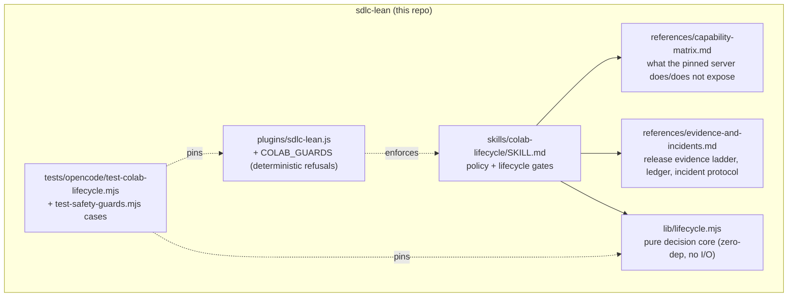

# Plan — Colab runtime lifecycle capability (SDLC-Lean)

**Goal**: give the suite a reusable, honest capability for managing approved
Colab workloads: prepare → connect → inspect → execute → persist → release →
verify. The pinned `colab-mcp` server is a *proxy* with no runtime controls, so
the capability must be explicit about what it can and cannot prove.

**Architecture / interfaces**

- `validateEnvelope(envelope, caps)`, `deriveSessionState(signals)`,
  `registerOwned(registry, candidate)`, `classifyRelease(evidence)`,
  `reconcileCells(known, current)`, `guardAction(action, session)`,
  `foldRun(events)` — all pure, plain-data in/out, no deps, no I/O.
- Plugin guard: `tool.execute.before` (V1) / `ctx.tool.hook('execute.before')`
  (V2) → `checkSafety(tool, args)` (existing entry point, unchanged shape).

**Tech stack**: Node ESM (Node 20+), `node --test`, repo lint
(`scripts/validate-skills.mjs`). Commands: `npm run verify`.

**Spec**: the user's task brief (7 numbered requirements + deliverables list),
treated as the approved spec; implementation + offline tests pre-authorized.

**Global constraints (from AGENTS.md + verified mechanisms)**

| Constraint | Binding limit | Evidence |
|---|---|---|
| Skill frontmatter | `name` == dir, `^[a-z0-9]+(-[a-z0-9]+)*$`, description ≤1024, `Use when...` trigger only | `scripts/validate-skills.mjs:31-45` |
| Bootstrap budget | 5029 B now; tests allow ≤5116 (`<5120`) → **router body untouched** | `test-plugin-loading.mjs:67,136,170,191` |
| Plugin | zero-dep, fail-open, V1+V2 dual arg shapes, benign must pass, `#nosafety` shell opt-out preserved | `sdlc-lean.js:271-338,365,463`; `test-safety-guards.mjs:57-65` |
| Installer | recursive walk ships `references/` **and** any file under a skill dir → no `SOURCES` edit, no count assertions touched | `install-global.mjs:30-47,99-107` |
| Docs counts | README:77, USAGE.md:154, docs/verify-recipe.md:7 carry literal counts | verified by grep |
| Safety carve-outs | never cut: trust-boundary validation, data-loss handling, secrets | using-sdlc-lean |

**Lean constraints (rung each area stops at)**

- Skill: rung 2 (reuse existing skill mechanism/lint/installer) — no new tooling.
- Decision core: rung 7 minimum code; justified only because spec §7 mandates
  13 mock scenarios that prose cannot satisfy. Zero deps, zero I/O, no CLI.
- Guard: rung 2 (extend existing `checkSafety` list shape), literal patterns
  matching the repo's existing style — no parser, no new dependency.
- No parallel cloud framework: no transports, config, daemon, CLI, or REST client.

**Decisions (option-selection, recorded — not relitigated later)**

| Fork | Options | Pick | Why losers lost |
|---|---|---|---|
| Deterministic enforcement | do nothing / plugin-guard only / plugin-guard + pure decision core | **guard + decision core** | prose-only fails spec §7 mocks; guard-only leaves release/ownership claims untestable |
| Where the core lives | `scripts/colab/` (needs installer `SOURCES` + count changes) / inside the skill dir | **inside skill dir** (`lib/`) | `scripts/` breaks global install self-containment unless SOURCES grows; skill dir ships via recursive walk, installer untouched |
| Guard scope | kill-substitute only / + `/content` data-loss | **both** | killing the bridge is the sanctioned-path violation; `/content` deletion is unexported-artifact loss (never-cut carve-out) |
| Router wiring | edit router body / description-triggered | **description-triggered** | 87 B headroom; precedent: lifecycle skills shipped "no router growth" (CHANGELOG:14-15) |
| Capability claims | assume fork features / pinned-source audit only | **pinned audit only** | forks expose `shutdown_runtime` etc.; the pinned server does not — inventing tools is the failure mode the spec forbids |

**Tasks**

| # | Task | Files | Test | Expected | Verify |
|---|---|---|---|---|---|
| T1 | Skill + 2 references (policy, capability matrix, evidence/incident protocols) | `.opencode/skills/colab-lifecycle/SKILL.md`, `references/capability-matrix.md`, `references/evidence-and-incidents.md` | lint frontmatter rules | trigger-only description; capability limits stated; enforced-vs-advisory table present | `node scripts/validate-skills.mjs` → `checked 38 skills, 0 failures` |
| T2 | Pure decision core (TDD) | `.opencode/skills/colab-lifecycle/lib/lifecycle.mjs`, `tests/opencode/test-colab-lifecycle.mjs` | 13 mock scenarios (spec §7) | each scenario asserted against frozen tokens | `node --test tests/opencode/test-colab-lifecycle.mjs` |
| T3 | Deterministic Colab guards in plugin | `.opencode/plugins/sdlc-lean.js`, `tests/opencode/test-safety-guards.mjs` | blocked + benign + `#nosafety` | kill-substitute and `/content` delete refused; benign pass; bootstrap bytes unchanged | `node --test tests/opencode/` |
| T4 | Docs/counts/changelog/debt ledger | `README.md`, `USAGE.md`, `docs/verify-recipe.md`, `CHANGELOG.md`, `docs/debt-ledger.md` | none (doc) | counts match reality | `grep` + `npm run verify` |
| T5 | Critic pass: code + security review, fixes | — | reviewers' findings | findings resolved or recorded | review artifacts |
| T6 | Final verify + completion report | — | `npm run verify` fresh | green + counts | `docs/verify-recipe.md` recipe |

**Frozen interface (do not drift between parallel tasks)**

- `RELEASE = { REQUESTED, VERIFIED_RELEASED, UNVERIFIED_POSSIBLY_ALLOCATED }`
- `validateEnvelope(envelope, caps = {}) → { ok, blockers[], warnings[], accounting: { basis, mode }, requiredControls[] }`
  - blockers: `missing-<field>`, `cu-cap-not-verifiable` (when `cuCap` set and no rate/balance and no approved time-only fallback)
  - `accounting.basis = 'conservative-pre-allocation'`, `mode = 'time-only' | 'cu-capped'`
- `deriveSessionState(signals) → { dimensions, mismatched[], computeClaim, nextActions[] }`
  - dimensions: `mcpServer`, `bridge`, `catalog`, `notebook`, `runtime` (tracked separately)
  - `computeClaim ∈ { allocated, released, unknown }`; **`bootstrap-only` catalog or a live MCP server alone ⇒ `unknown`**, never `released`
- `registerOwned(registry, candidate) → { ok, registry, blockers[], activeOwned }`
  - blockers: `wrong-mcp-instance`, `duplicate-owned-allocation`, `unowned-session`
- `classifyRelease(evidence) → { state, reasons[], nextActions[], notifyUser, manualCleanup }`
  - `VERIFIED_RELEASED` only from `user_confirmed_released` / non-allocating `runtime_absent`
  - `unassign_request ok:true` ⇒ `REQUESTED`; denied/timeout/http-error/mcp-exit/catalog-revert alone ⇒ `UNVERIFIED_POSSIBLY_ALLOCATED`
  - expected `bridge_disconnect` is not a failure, is not release proof; `nextActions` never contain allocation-capable or reconnect tokens
  - `notifyUser`/`manualCleanup` true whenever state ≠ `VERIFIED_RELEASED`
- `reconcileCells(known, current) → { stale[], reuse[], remedy }`
- `guardAction(action, session) → { allow, reason }` — refuses allocation-capable actions after a release request and any action targeting a non-owned session
- `foldRun(events) → { phase, artifacts, release, incidents[], stopNewWork, nextActions[], accounting }`
  - event `type`s: `prepared`, `connected`, `inspected`, `cell-run`, `export`, `unassign-request`, `bridge-disconnect`, `timeout`, `abort`
  - stable `nextActions`/incident tokens: `record-incident`, `notify-user`, `give-manual-cleanup`, `re-resolve-cells`, `export-artifacts`, `request-unassign`, `do-not-reconnect`
- Plugin guard tokens in error messages: `/bridge|kernel/` and `/unexported|artifact/` (tests match these)

**Review focus**: honesty of enforced-vs-advisory claims; guard false positives
(benign fixtures must pass); V1+V2 argument shapes; no credential logging; no
tool invented that the pinned server lacks.

**Non-goals / not authorized**: GPU allocation, model download, any experiment,
global install, OAuth grant, remote push, edits to `opencode.jsonc`, adding a
`colab` CLI or REST client, changing agent/model routing.

**Rollback**: `git rm -r .opencode/skills/colab-lifecycle tests/opencode/test-colab-lifecycle.mjs`
plus revert the guard hunk and the doc-count lines; nothing is installed globally
by this change, so rollback is repo-local.

**Amendments after critic pass (2026-10-12)**

- `COLAB_GUARDS` patterns now anchor to a command position (same
  `(?:^|[;&|\n]\s*)(?:sudo\s+|env\s+|command\s+)?` prefix as `SECRET_READ_RE`),
  and the `colab[_-]mcp` terminator is `(?![\w-])`; `pkill -0` (liveness check)
  is excluded. Quoted prose and suffixed processes (`colab-mcp-helper`) pass.
- Enforced-vs-advisory wording is now limited to the `bash`/`shell` tool:
  notebook-cell code and MCP tool arguments are explicitly outside the guard.
- `deriveSessionState` no longer returns `ready` (read by nothing, not in the
  frozen interface).
- `artifacts.verified` tightened: `exportCount > 0 && exportsVerified &&
  !artifact-export-failed`, and an export counts as verified only when
  acknowledged **and** hashed (`sha256`); a pathless hash is not recorded.
- New `user-confirmed` fold event maps to the accepted
  `user_confirmed_released` evidence so the fold can reach `VERIFIED_RELEASED`.
- `reconcileCells` is listed in the skill's decision-core exports (7).
- Ownership-ledger example is now the array form that `registerOwned` consumes.
- Debt-ledger D-009 corrected: the bypass list is `sh -c 'pkill … colab-mcp'`
  (after anchoring), `rm -R`, split `rm -r -f`, `rm -rf --`, `rm -rf //content`,
  `kill <pid>`, `xargs kill`, `find /content -delete`.
