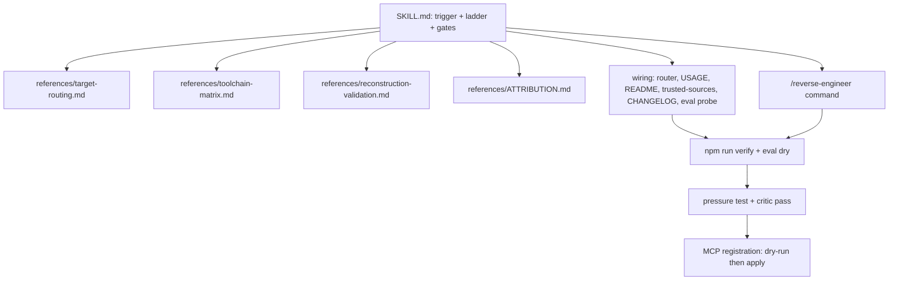

# Plan — Reverse-Engineering Capability (`reverse-engineering`)

**Goal**: Add a first-party `reverse-engineering` skill (with references + command) so sdlc-lean can reverse engineer shipped artifacts to SOTA S-tier quality via the REA engine (pinned, not vendored), with evidence discipline, validation gates, and a best-of-competitor fallback matrix.

**Architecture**: touches `.opencode/skills/reverse-engineering/` (new: SKILL.md + 4 references), `.opencode/skills/using-sdlc-lean/SKILL.md` (one routing line), `.opencode/skills/acquiring-capabilities/references/trusted-sources.md` (REA row), `.opencode/commands/reverse-engineer.md` (new), `USAGE.md` + `README.md` (counts 38→39, rows), `CHANGELOG.md`, `eval/probes.mjs` (1 structural probe), docs (this plan + spike + ledger). Consumes: REA MCP/CLI (pinned 6.4.0 @ `2a61dea`), existing lint/tests/eval. Produces: routing + gates + matrix; no code.

**Tech stack**: Markdown skills; Node 24 local; tests `npm run verify` (lint + `node --test`); eval `npm run eval` (dry by default, never in CI).

**Spec**: [`docs/spikes/2026-10-13-reverse-engineering.md`](../spikes/2026-10-13-reverse-engineering.md) (APPROVED 2026-10-13).

**Global Constraints**: AGENTS.md — `name==dir`, `Use when…` descriptions only, ≤1024 chars; skills on-demand (no bootstrap growth); plugin zero-dep + fail-open untouched; safety guards exact-known only; all output `communicating-concisely` + STE-informed; trusted-sources additions deliberate; never auto-install unknown code; `npm run verify` must pass.

**Lean Constraints**: rung 2/5 engine reuse (REA, pinned citation, no vendor, no deps); rung 6 minimal skill (1) + command (1) + references on demand; rung 1 wiring for inventory truth. Reuse: REA docs (pinned), existing probe/lint patterns.

**Review Focus**: attribution/license pins (REA MIT + commit + version; competitor citations by URL); install policy language (approval required, never silent); evidence language preserving "unknown ≠ absent"; SDO trigger description; counts consistent across README/USAGE/CHANGELOG; command read-only (`agent: plan`); bootstrap bytes unchanged; probe expectation structural, non-advisory.

**Execution note**: inline via `executing-plans` (single tightly-coupled doc set; research context held by orchestrator, no information loss to dispatches). Critic pass dispatched: `code-reviewer` + `security-reviewer`.

| # | Task | Files | Test | Expected | Verify |
|---|------|-------|------|----------|--------|
| 1 | Design + plan + ledger recorded | `docs/spikes/2026-10-13-reverse-engineering.md`, this file, `-progress.md` | links resolve | approved design of record | `ls`, grep Spec link |
| 2 | Skill core: trigger, connection ladder, target-route table, authority rules, evidence discipline, gate summary, hooks | `.opencode/skills/reverse-engineering/SKILL.md` | frontmatter lint | `name==dir`, `Use when…`, ≤1024 | `node scripts/validate-skills.mjs` |
| 3 | Target routing: all REA target classes → tool/CLI route; connection ladder + recovery; docs pin + 6.4.0 availability note | `references/target-routing.md` | row count vs REA matrix (28) | every class mapped | `grep -c '^\|' + diff vs README list` |
| 4 | Toolchain matrix: per-class SOTA primary/fallback + license + URL + status; REA-gap table (symbolic, fuzzing, hardware, malware triage) | `references/toolchain-matrix.md` | every row has URL + license | best-of matrix incl. archived-tool corrections | grep URL/license |
| 5 | Validation gates: S-tier ladder (byte-exact → differential → declared-partial), unknown/contradiction rules, draft→verified/rejected, failure modes with sources | `references/reconstruction-validation.md` | contains fail-closed rule | gates match research | read + grep |
| 6 | Attribution: REA MIT pin + adapted-model sources + tool citations | `references/ATTRIBUTION.md` | pins present | license-clean | grep commit/hash |
| 7 | Wiring: router bullet; USAGE 38→39 + skill row + command row; README 38→39 + list entry; trusted-sources REA row (established tier); CHANGELOG entry | 5 files | counts consistent | suite inventory true | `grep -rn "38" README.md USAGE.md`, `npm run verify` |
| 8 | Command `/reverse-engineer` | `.opencode/commands/reverse-engineer.md` | pattern check vs `/security-audit` | read-only deterministic entry | `ls` + review |
| 9 | Eval probe `routing-reverse-engineering` (structural) | `eval/probes.mjs` | `node --test tests/eval/` | probe parses, group routing | `npm run eval` (dry) |
| 10 | Pressure test: fresh-context reviewer, 5 scenarios (3 RE → fires; 2 source-repo → not) | — | verdict per scenario | no misfires | reviewer report |
| 11 | Critic pass: `code-reviewer` (lean/correctness) + `security-reviewer` (authority/legal/install policy); fix or reject with reason | — | verdicts | findings addressed | review reports in ledger |
| 12 | Final verify + MCP registration: `npx rea-agents@6.4.0 setup --client opencode --skill=false --dry-run` → review → `--yes`; completion report | progress ledger | `npm run verify`, `npm run eval` dry, lint 39/0 | evidence recorded; `mcp.rea` present after apply | commands' output |

Self-review: coverage — skill (T2), routing (T3), matrix (T4), gates (T5), attribution (T6), suite wiring (T7,8,9), quality gates (T10,11), registration (T12); consistency — no task contradicts non-goals (no vendor, no deps, no installs pre-T12); leanness — 1 skill + 1 command + 4 refs only, no code.
