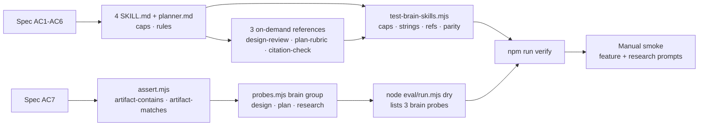

# Plan — Brain-layer hardening

**Goal**: turn the approved brain-layer spec into five tightened skill/agent bodies, three on-demand references, and one model-free structural gate, then extend the eval harness with artifact assertions and three brain probes. Every rule the spec adds is enforced either by `tests/opencode/test-brain-skills.mjs` (line caps, required/forbidden strings, reference links, installer byte parity) or by the eval dry run; the router, plugin, safety guards, spec-check, and installer code are untouched. `npm run verify` stays the single green gate and live model spend stays opt-in.



**Architecture**

- **Content layer** — `.opencode/skills/{brainstorming,writing-plans,deep-research,option-selection}/SKILL.md` plus `.opencode/agents/planner.md`. Bodies stay procedural; templates, checklists, and protocols move to one reference each. Caps force prose cuts, not rule cuts.
- **Structural gate** — `tests/opencode/test-brain-skills.mjs`: `node:test` + `node:fs`, no model calls, no network. Asserts caps, required/forbidden strings, exactly-one-new-reference links, reference existence, and installer byte parity for the 8 changed content files.
- **Eval layer** — `eval/lib/assert.mjs` gains `artifact-contains` and `artifact-matches` over a new `observed.artifacts` map; `eval/run.mjs` populates that map from `probe.artifacts` (paths relative to the scratch project); `eval/probes.mjs` gains group `brain` with 3 probes.
- **Interfaces** — `evaluate(expect, observed)` signature unchanged; `observed.artifacts?: Record<string, string>` where a missing key means "file absent". Probe schema adds `artifacts?: string[]`. `runProbe(scratch, probe, opts)` signature unchanged.
- **Untouched** — router/`getBootstrapContent()` (≤5116 bytes), `.opencode/plugins/sdlc-lean.js`, safety guards, `scripts/spec-check.mjs`, `scripts/install-global.mjs` (its recursive skill/agent copy already ships references).

**Tech stack**: Node 20+ ESM, zero dependencies, `node --test`, `scripts/validate-skills.mjs`; the `opencode` CLI is used only by the opt-in live harness (`node eval/run.mjs --run`), never by `npm run verify`.

**Spec**: [`docs/specs/2026-10-30-brain-layer-hardening.md`](../specs/2026-10-30-brain-layer-hardening.md) (APPROVED 2026-10-30T17:31:25Z).

**Global Constraints**

- `npm run verify` = `node scripts/validate-skills.mjs` + `node --test`; must end green.
- Bootstrap budget test stays ≤5116 bytes; do not touch `using-sdlc-lean` or the plugin router.
- Line caps are **whole-file** counts with `wc -l` semantics (the stricter reading): brainstorming ≤60, writing-plans ≤85, deep-research ≤105, option-selection ≤45, planner ≤22.
- Skill frontmatter: `name` == directory, description 1–1024 chars (`scripts/validate-skills.mjs`).
- No new agents, skills, runtime dependencies, or judge model. Spec and evidence report are frozen.
- Preserve existing test contracts: `deep-research` must still contain `Citation discipline` and `option-selection`; `option-selection` must still contain `Matrix`, `Y-statement`, `record the decision` (`tests/opencode/test-plugin-loading.mjs`).
- TDD: task 1 writes the failing structural test before any content edit; tasks 6–7 write failing eval tests before implementation. Never edit a test to fit an implementation.
- Test integrity: no task may weaken `tests/opencode/test-plugin-loading.mjs` or any existing grader.

**Lean Constraints**

- Rung 2 (reuse): existing test stack, existing installer, existing eval harness. Only 4 new files: 3 references + 1 test.
- References carry templates/checklists; skill bodies stay procedural. No dashboard, no metrics pipeline, no second eval framework.
- `assert.mjs` grows by two `switch` cases and one lookup helper; `run.mjs` by one helper. No new abstraction layer.
- No LLM-as-judge, no absolute Likert gates, no live spend in `npm run verify`.
- Net body growth is capped at +21/+10/+4/+11/+4 lines respectively; if a cap binds, delete prose (attribution, repetition), never a rule.

**Review Focus**

- Caps vs rules: confirm `deep-research` (4 lines of headroom) kept every rule after deleting the provenance paragraph.
- Structural assertions must be deterministic: missing artifact vs empty file distinguished; invalid regex fails without throwing.
- Existing contracts listed above still hold; no grader was edited.
- Router, plugin, safety, spec-check, and installer code unchanged; 8 changed content files ship byte-identically.
- Skill text is internally consistent: no "2–5 minutes", no cost-of-defect multiplier, no mandatory personas, no holistic scoring.

## Task table

| # | Task | Spec req | Files | Test | Expected | Verify |
|---|---|---|---|---|---|---|
| 1 | Model-free structural gate (RED) + baseline ledger | AC1–AC6, AC9 | `tests/opencode/test-brain-skills.mjs`, `docs/plans/2026-10-30-brain-layer-hardening-progress.md` (allow) | new `node:test` file: caps, strings, refs, installer parity | caps pass; content/ref/parity assertions fail with named messages; baseline recorded | `node --test tests/opencode/test-brain-skills.mjs; echo exit=$?` → `exit=1` |
| 2 | Brainstorming: artifact contract + written individual review | AC1, AC6 | `.opencode/skills/brainstorming/SKILL.md`, `.opencode/skills/brainstorming/references/design-review.md` | task-1 structural tests | ≤60 lines; 7 artifact headings; perspectives; no cost claim; one ref | `node --test tests/opencode/test-brain-skills.mjs`; `wc -l < .opencode/skills/brainstorming/SKILL.md` |
| 3 | Writing plans: task-shape routing, external verify, test integrity | AC2, AC6 | `.opencode/skills/writing-plans/SKILL.md`, `.opencode/skills/writing-plans/references/plan-rubric.md` | task-1 structural tests | ≤85 lines; no `2–5 min`; new headings; rubric linked | `node --test tests/opencode/test-brain-skills.mjs`; `wc -l < .opencode/skills/writing-plans/SKILL.md` |
| 4 | Deep research: loop closing, entailment, one writer, caveat | AC3, AC6 | `.opencode/skills/deep-research/SKILL.md`, `.opencode/skills/deep-research/references/citation-check.md` | task-1 structural tests + existing plugin test | ≤105 lines; 5 new phrases; `Citation discipline` + `option-selection` kept | `node --test tests/opencode/test-brain-skills.mjs`; `node --test tests/opencode/test-plugin-loading.mjs`; `wc -l < .opencode/skills/deep-research/SKILL.md` |
| 5 | Option selection binary matrix + planner mirror | AC4, AC5 | `.opencode/skills/option-selection/SKILL.md`, `.opencode/agents/planner.md` | task-1 structural tests | ≤45 and ≤22 lines; binary/do-nothing/swap/record; planner shape/verify/integrity | `node --test tests/opencode/test-brain-skills.mjs`; `wc -l < .opencode/skills/option-selection/SKILL.md`; `wc -l < .opencode/agents/planner.md` |
| 6 | Artifact assertions + unit tests (RED first) | AC7 | `eval/lib/assert.mjs`, `tests/eval/test-assert.mjs` | `tests/eval/test-assert.mjs` | 2 kinds; missing/empty/invalid-regex cases; never throws | `node --test tests/eval/test-assert.mjs` |
| 7 | Brain probes + artifact plumbing (RED first) | AC7, AC10 | `eval/probes.mjs`, `eval/run.mjs`, `tests/eval/test-probes.mjs` | `tests/eval/test-probes.mjs` | 3 probes; dry lists them; artifacts read from scratch; no spend | `node --test tests/eval/test-probes.mjs`; `node --check eval/run.mjs`; `node eval/run.mjs \| grep -c '^  - brain-'` → 3 |
| 8 | Full verify + installer parity + smoke record | AC8, AC9, AC10 | `docs/plans/2026-10-30-brain-layer-hardening-progress.md` (allow) | full suite + dry run + parity test | lint 0 failures; all tests pass; bootstrap ≤5116; 8 files byte-identical; smoke recorded | `npm run verify`; `node eval/run.mjs`; `node --test tests/opencode/test-plugin-loading.mjs` |

## Task notes

### Content contract (single source for tasks 1–5)

Caps are whole-file, `wc -l` semantics. "Must contain" is a case-sensitive literal unless shown as a regex.

| File | Cap | Must contain | Must not match | New ref |
|---|---|---|---|---|
| `brainstorming/SKILL.md` | 60 | `## Goal`, `## Non-goals`, `## Alternatives`, `## Trade-offs`, `## Trace`, `## Review findings`, `## Leading indicators`, `perspective` | `/cost[- ]of[- ]defect/i`, `/40\s*[×x]/i`, `/100\s*[×x]/i` | `references/design-review.md` |
| `writing-plans/SKILL.md` | 85 | `one verifiable outcome`, `## Task shape`, `external verification command`, `## Requirement coverage`, `## Test integrity` | `/2[–-]5\s*min/i` | `references/plan-rubric.md` |
| `deep-research/SKILL.md` | 105 | `Close the loop`, `entailment`, `one writer`, `BrowseComp`, `personas are optional` | `/required personas?/i` | `references/citation-check.md` |
| `option-selection/SKILL.md` | 45 | `do nothing`, `binary`, `swap`, `Matrix`, `Y-statement`, `record the decision` | `/holistic/i` | — |
| `agents/planner.md` | 22 | `/task shape/i`, `/external/i`, `/test integrity/i` | — | — |

### Task 1 — structural gate and baseline

- Create `tests/opencode/test-brain-skills.mjs`. Helpers:
  - `const root = path.resolve(import.meta.dirname, '../..')`
  - `read(rel)` → `fs.readFileSync(path.join(root, rel), 'utf8')`
  - `lineCount(text)` → `text.split('\n').length - (text.endsWith('\n') ? 1 : 0)` (equals `wc -l` for newline-terminated files)
- Tests (all `node:test`, no model calls):
  1. one cap test per file from the contract table;
  2. one "required strings" test per file, with a per-string failure message;
  3. forbidden-claim tests for the three skills;
  4. reference links: for each of the 4 skills count occurrences of `design-review.md`, `plan-rubric.md`, `citation-check.md`; assert ≤1 each, and exactly 1 for the three target skills (0 for `option-selection`); assert each referenced file exists;
  5. installer parity: `installGlobal({ repo: root, target: tmp })` from `scripts/install-global.mjs` into `fs.mkdtempSync(path.join(os.tmpdir(), 'sdlc-brain-install-'))`, then byte-compare the 8 changed files at their installed paths (`skills/<name>/...`, `agents/planner.md`); `finally` removes the temp dir.
- Create the progress ledger with a baseline table: current `wc -l` values (39 / 75 / 101 / 34 / 18), the caps, and an empty task log.
- Expected: cap tests pass at baseline; required-string, reference, and parity tests fail with named assertions → RED.

### Task 2 — brainstorming

- Keep Classify, Questions, HARD GATE, and Handoff. Rewrite the design-document section as an artifact contract listing the 7 headings from the contract table; `## Alternatives` requires ≥2 options each with why rejected; `## Trace` is a requirement → design → test table.
- Add review protocol: written individual findings before approval; bounded change → one reviewer; architectural change → ≥2 assigned perspectives (requirements, failure modes, operability — the spec's proposed default); merge dispositions; meeting optional.
- Add leading indicators: issues caught pre-implementation, review coverage, requirements traced to tests. No dashboard.
- Remove any cost-of-defect framing; do not add a mandatory pre-mortem.
- Link `references/design-review.md` exactly once. Reference holds: artifact template, perspective table, review protocol, leading-indicator log.
- Cap 60 — cut prose, not rules.

### Task 3 — writing-plans

- Replace the "2–5 minutes" intro with "one verifiable outcome per task".
- Add `## Task shape`: localized (one file/one concern) → 3–5 tasks; multi-file interdependent → explicit dependency order + impact notes; unknown → spike first.
- Tighten the table rules: `Files` = exact paths where knowable; `Verify` = an external command (test, lint, typecheck, CLI), never "reviewed it".
- Add `## Requirement coverage` as a binary checklist (every AC → ≥1 task; every task names a spec req; no orphan task; no task edits its own grader).
- Add `## Test integrity`: never edit the tests that grade the work; if a grader is wrong, stop and escalate.
- Compress "Activate the gate" from 13 lines to ~6 to stay ≤85; keep the post-approval frontmatter shape and the self-review section.
- Link `references/plan-rubric.md` exactly once. Reference holds the full binary checklist and fail actions.

### Task 4 — deep-research

- Add: `Close the loop` (each round's queries derive from what was just read; a round that does not change the next query ends the loop); `personas are optional` (never required, do not multiply perspectives); per-claim `entailment` against the fetched page (unsupported → cut or mark unverified, count citation accuracy); `one writer` at fan-in (parallel section writers produce disjoint reports); `BrowseComp` caveat (single-short-answer benchmark; do not optimize for it).
- Keep the `## Citation discipline` heading and the `option-selection` handoff — both are asserted by `tests/opencode/test-plugin-loading.mjs`.
- Link `references/citation-check.md` exactly once. Reference holds: claim extraction, fetch, entailment rubric (supported/partial/unsupported), accuracy count, conflict handling.
- Budget: delete the 3-line provenance paragraph (keep one attribution line) and merge two anti-pattern bullets to make room; cap 105.

### Task 5 — option-selection and planner

- `option-selection`: binary criteria matrix (each criterion answerable yes/no per option), always include "do nothing", exactly two options → run the matrix twice with the order swapped and keep the winner only if both orders agree, tie-break by less code / no dependency / platform-native, then record the decision (`adr` or plan/progress). Keep `Matrix`, `Y-statement`, `record the decision`; remove holistic scoring; cap 45.
- `planner.md`: add task-shape routing, one verifiable outcome per task with exact files and an external verification command, and test integrity ("never plan edits to the tests that grade the work"); keep read-only, draft status, empty approval fields, scope-completeness warning; cap 22.

### Task 6 — artifact assertions

- `eval/lib/assert.mjs` — signature unchanged. Add:
  - `const artifacts = observed.artifacts || {};`
  - `const artifact = (p) => (typeof p === 'string' && Object.hasOwn(artifacts, p) ? artifacts[p] : undefined);`
  - `artifact-contains`: missing key → `{ ...e, ok: false, error: \`artifact missing: ${e.path}\` }`; else `body.includes(e.value)`.
  - `artifact-matches`: same missing handling; else `new RegExp(e.value).test(body)` inside `try/catch`; invalid regex → `{ ...e, ok: false, error: \`bad regex: ${err.message}\` }`.
- No flags parameter (regexes are un-flagged; probes use `[^\n]` where needed).
- `tests/eval/test-assert.mjs` (RED first): contains pass/fail, matches pass/fail, missing artifact fails with `error`, empty-string artifact is not "missing", invalid regex fails without throwing, `passed()` unchanged.

### Task 7 — brain probes and plumbing

- `eval/probes.mjs`: group `brain`, three hard (non-advisory) probes:
  - `brain-design` — prompt: "Design a CSV export feature for the reports page. Write the design artifact to docs/design.md and nothing else — no code. Include Goal, Non-goals, at least two alternatives with why each was rejected, Trade-offs, written review findings, and a requirement-to-test trace." `artifacts: ['docs/design.md']`; expect `skill: brainstorming` and artifact-contains `## Non-goals`, `Alternatives`, `Trade-offs`, `Review findings`.
  - `brain-plan` — prompt: "Turn this approved spec into an implementation plan and write it to docs/plan.md. Spec: R1 add a CSV export button; R2 add unit tests; R3 keep the lint gate green. Use YAML frontmatter and a task table with columns # | Task | Spec req | Files | Test | Expected | Verify. Every task needs exact files and an external verification command." `artifacts: ['docs/plan.md']`; expect `skill: writing-plans`, artifact-matches `'\\|\\s*Files\\s*\\|'`, `'\\|\\s*Verify\\s*\\|'`, `'\\b(?:AC-?\\d+|R\\d+)\\b'`.
  - `brain-research` — prompt: "Research whether binary rubrics beat Likert scales for LLM evaluation and write a cited report to docs/report.md. Include a Sources section and report sources_reviewed: N." `artifacts: ['docs/report.md']`; expect `skill: deep-research`, artifact-contains `## Sources` and `sources_reviewed:`, artifact-matches `'\\[\\d+\\]'` and `'1\\.[^\\n]*https?://'`.
- `eval/run.mjs`: add `readArtifacts(scratch, paths = [])` → `{}`; skip non-string, empty, absolute, or `..`-containing paths; read each from `scratch`; on `ENOENT` omit the key. Call `observed.artifacts = readArtifacts(scratch, probe.artifacts);` after parsing and before `evaluate`. No change to dry output or result payload.
- `tests/eval/test-probes.mjs` (RED first): `GROUPS = ['activation', 'safety', 'routing', 'brain']`; assert exactly 3 brain probes with the expected ids; every `artifact-*` expectation's `path` is declared in that probe's `artifacts`; every artifact path is relative; keep "only safety probes are advisory".

### Task 8 — verification and evidence

- Run and record in the ledger:
  - `npm run verify` → lint 0 failures, all tests pass.
  - `node --test tests/opencode/test-plugin-loading.mjs` → bootstrap ≤5116 bytes and existing skill contracts hold.
  - `node eval/run.mjs` → dry output lists `brain-design`, `brain-plan`, `brain-research`; no spend.
  - Installer parity is covered by the task-1 test inside `npm run verify`.
- Manual smoke (human-run, spends tokens, not part of `npm run verify`), in a temp copy of `.opencode`:
  ```sh
  tmp=$(mktemp -d) && cp -r .opencode "$tmp/" && cd "$tmp"
  opencode run --standalone --auto --title eval:brain-design 'Design a CSV export feature for the reports page. Write the design artifact to docs/design.md and nothing else — no code. Include Goal, Non-goals, at least two alternatives with why each was rejected, Trade-offs, written review findings, and a requirement-to-test trace.'
  grep -E '^## (Non-goals|Alternatives|Trade-offs|Review findings)' docs/design.md
  opencode run --standalone --auto 'Research whether binary rubrics beat Likert scales for LLM evaluation and write a cited report to docs/report.md. Include a Sources section and report sources_reviewed: N.'
  grep -E '^## Sources|sources_reviewed:' docs/report.md
  ```
- Record the smoke outcome (`sources_reviewed: N`, fields present) in the ledger. Add a debt row only if something is explicitly deferred; do not edit the spec or the evidence report.

## Self-review

### Coverage

| AC | Tasks | How it is proven |
|---|---|---|
| AC1 | 1, 2 | cap + required/forbidden strings in `test-brain-skills.mjs`; body rewritten |
| AC2 | 1, 3 | cap, `## Task shape`, `## Requirement coverage`, `## Test integrity`, no `2–5 min` |
| AC3 | 1, 4 | cap, 5 required phrases, existing `Citation discipline`/`option-selection` test |
| AC4 | 1, 5 | cap, binary/do-nothing/swap/record, no `holistic` |
| AC5 | 1, 5 | cap + shape/external/integrity strings |
| AC6 | 1, 2, 3, 4 | exactly-one-new-reference test + reference existence |
| AC7 | 6, 7 | unit tests for 2 assertion kinds; probe schema test; dry run lists 3 probes |
| AC8 | 8 | `npm run verify`; explicit bootstrap test run |
| AC9 | 1, 8 | installer byte-parity test, run green in `npm run verify` |
| AC10 | 7, 8 | probe assertions on skill + artifact fields; recorded manual smoke |

### Consistency

- The content contract table is the single source for both the test and the rewrites; tasks 2–5 must not invent different wording.
- Caps are whole-file `wc -l` counts; the test helper matches that definition exactly.
- Existing contracts preserved: `Citation discipline`, `option-selection`, `Matrix`, `Y-statement`, `record the decision`.
- No task edits the spec, evidence report, router, plugin, safety guards, spec-check, or installer code.
- Task order respects dependencies: 1 → 2–5 → 6 → 7 → 8; task 8 only verifies and records.
- Every path in a task row is in `files` or `allow`; the union of task rows equals the 14-file scope. The plan file itself is not in `files`: it is created before approval, hashed by the gate, and never edited by a task.

### Leanness

- 4 new files only (3 references + 1 test); no new agents, skills, dependencies, or judge.
- Eval growth is ~24 lines total: two `switch` cases plus one lookup in `assert.mjs`; one helper plus one call in `run.mjs`; three probe objects.
- References replace body prose rather than adding a parallel system; no dashboard, no metrics pipeline.
- Flagged tradeoff: the parity test copies `.opencode` into a temp dir — the same cost the existing installer tests already pay, accepted for a real byte-identity check.
- Flagged risk: `deep-research` has only 4 lines of headroom; task 4 must delete attribution prose first, never a rule.
