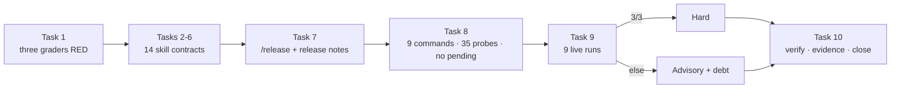

# Plan — Domain/meta hardening (Wave 4)

**Goal**: close Wave 4 by turning the five `pending: Wave 4` skill entries (10 rules) into hard contracts, routing the two orphan skills, removing unmeasured autonomy/preview/STE claims, making six domain skills evidence-bound, adding a read-only `/release` command and `command-release` probe, and recalibrating the three unstable execution probes. No new dependency, agent, skill, plugin hook, or runtime-enforcement claim; no live spend in `npm run verify`.



## Architecture

- **Contract layer** — `tests/opencode/test-skill-contracts.mjs` keeps the 11 high-risk contracts, adds 6 evidence contracts for AC4–AC9, 2 route contracts, a `release:` command contract, and a no-pending test. The single aggregated specific test becomes one test per skill (`specific: <name>`, `evidence: <name>`) so each content task can verify only its own skill; coverage is identical, failure isolation is better.
- **Coverage layer** — `eval/coverage.mjs` maps 40 skills and 9 commands; `PENDING_RULES` and every `pending` key are removed; `writing-release-notes` and `release` both map to `command-release`; `CALIBRATION` records the three recalibrated statuses.
- **Probe layer** — `eval/probes.mjs` gains `command-release` (existing assertion kinds only), stays at 35 probes, command group 4, no harness/assertion-engine change.
- **Content layer** — 14 skill edits and one command. `brainstorming` gets exactly one handoff line at 60/60; `systematic-debugging` replaces one line at 29/30. No router/bootstrap edit.
- **Governance layer** — `docs/audit-ledger.md` becomes the five-column manual ledger; progress ledger and evidence JSON are the only hand-written control files; `close` is separate after all ten evidence rows.

## Tech stack

Node 20+ ESM, zero dependencies, `node:test`, `node --test --test-name-pattern`, `scripts/validate-skills.mjs`, `scripts/spec-check.mjs`, `npm run verify`. The `opencode` CLI is used only by the opt-in live calibration in Task 9; every other task is dry.

## Spec

[`docs/specs/2026-10-30-domain-meta-hardening.md`](../specs/2026-10-30-domain-meta-hardening.md) (APPROVED 2026-10-30T21:40:56Z; AC16 amended 2026-10-30 with human approval). The audit is [`docs/research/2026-10-30-suite-portfolio-audit.md`](../research/2026-10-30-suite-portfolio-audit.md).

## Global Constraints

- Wave 1–3 are closed. The human fills `approved_by`/`approved_at` and runs `node scripts/spec-check.mjs approve docs/plans/2026-10-30-domain-meta-hardening.md` in a real TTY. Task 1 starts only after `node scripts/spec-check.mjs verify --require-active` exits 0.
- No edits to the spec, audit, plugin, installer, `package.json`, `scripts/**`, agents, `eval/run.mjs`, `eval/lib/**`, the router, or any Wave 1–3 test except the three graders named in `files`. No new dependency, agent, skill, or sandbox claim.
- Baseline → target: 40 skills, 8 → 9 commands, 34 → 35 probes, command group 3 → 4, 10 pending rules → 0, 11 high-risk contracts → 11 + 6 evidence + 2 route + release.
- Caps enforced by the contract table: threat-model ≤40, autonomy-dial ≤30, intent-preview ≤25, adr ≤30, STE ≤80, incident ≤35, dependency ≤35, evolving ≤35, diagnosing ≤25, reviewing-security ≤35, ui-review ≤25, web-game ≤155. `brainstorming` stays ≤60 (`test-brain-skills`) and `systematic-debugging` ≤30 (`test-execution-skills`); neither test is edited.
- Bootstrap stays ≤5116 bytes; no router edit. The `release` command is a command over existing skills, not an agent.
- Test integrity: Task 1 authors every grader change; Tasks 2–9 edit content/data only; no task edits its own grader. If a grader is wrong, stop and escalate; never weaken it.
- Probes are dry by default. No `--run` appears in `npm run verify` or Tasks 1–8. Task 9 live spend needs the separate approval recorded in the progress ledger.
- Evidence: one row per task, exact `Verify`, `exit: 0`, UTC `at`; RED tasks record 0 after inspecting the named failures. `close` is a separate action, never an evidence row.

## Lean Constraints

- Reuse the existing probe schema, `artifact-contains`/`file-unchanged`/`skill` assertions, `node:test`, the existing install/parity tests, and the existing `spawnSync` harness. No new assertion kind, schema library, or shared test utility.
- The 6 evidence contracts are data rows in the existing contract test, not a second test framework. Per-skill tests replace one aggregate loop; no new test file.
- `/release` is one command file over `writing-release-notes`; no agent, hook, or publish API.
- The audit ledger is a five-column Markdown table, not a dashboard. `uxStatus` wiring and `command-release` calibration go to the debt ledger instead of runtime work.
- Calibration is limited to 3 named probes × 3 runs, not the whole suite.

## Review Focus

- **Exact-string coupling**: Task 1 hard strings must match Task 2–7 content after whitespace collapse and lowercasing, but **not** emphasis markers. Do not put `**` or backticks inside `risk is binary: high or low` or H1/H2/H3; the test compares literal substrings.
- **Caps**: `brainstorming` is 59 lines today; the handoff must be exactly one line (60/60). `systematic-debugging` is 29/30; replace the two-strike line in place. Never raise a cap or edit `test-brain-skills`/`test-execution-skills`.
- **Pending removal**: after Task 8 there is no `pending` key, no `PENDING_RULES` export, and no `pending: 'Wave 4'` literal in `eval/coverage.mjs` or the two graders. Historical specs/plans are immutable and out of scope.
- **Counts**: 9 commands, 35 probes, command=4; `writing-release-notes` and `release` both map to `command-release`; `command-release` is advisory and uses only existing assertion kinds.
- **Release safety**: `/release` reads read-only, drafts version/changelog, never tags/publishes/pushes, and publishing requires explicit human approval.
- **Calibration**: prompts only; `expect` arrays unchanged. 3/3 → stable/hard, anything else → unstable/advisory + debt; a single pass never hardens. Record model, harness version, date.
- **Structural vs runtime**: all checks are structural evidence; keep the “not runtime enforcement” headers. Do not describe contracts or probes as sandboxing.
- **Test integrity**: the 11 existing high-risk hard lists stay unchanged except the 7 named skills; Wave 1–3 tests stay green except the permitted counts/pending/calibration updates.

**Dependency order**: `1 → 2 → 3 → 4 → 5 → 6 → 7 → 8 → 9 → 10`.

| Task | Depends on | Impact |
|---|---|---|
| 1 | human approve | Adds all grader contracts; three suites go red only for missing content/data. No skill, coverage, or probe data edit. |
| 2 | 1 | Edits 5 skills; `brainstorming` hits 60/60, `systematic-debugging` stays 29/30; no router bytes. |
| 3 | 1 | Edits 3 skills + audit ledger; autonomy/preview/ADR contracts go green. |
| 4 | 1 | Edits STE + incident; removes every 80% mention and adds recurrence verification. |
| 5 | 1 | Edits dependency + evolving; both stay ≤35. |
| 6 | 1 | Edits ui-review + web-game; web-game table lands before any S-tier claim. |
| 7 | 1 | Adds the 9th command; coverage still has 8 until Task 8, so only the release contract is green. |
| 8 | 2–7 | Removes pending, adds release mapping and probe, 9/9 commands and 35/35 probes; full three-suite gate goes green. |
| 9 | 8 + spend approval | 9 live runs; only prompt text and calibration statuses change. |
| 10 | 9 | Full gate, evidence, debt, then separate close. |

| # | Task | Spec req | Files | Test | Expected | Verify |
|---|---|---|---|---|---|---|
| 1 | RED: Wave 4 contracts in the three graders | AC1–AC13, AC16 | `tests/opencode/test-skill-contracts.mjs`, `tests/opencode/test-eval-coverage.mjs`, `tests/eval/test-probes.mjs` | Per-skill hard/forbidden/cap contracts; no-pending; 9 commands; 4 command probes/35; release command and probe shape | Each suite exits non-zero for named missing content/data, not a syntax or import error; generic/trust/brain/execution counts still pass | `! node --test tests/opencode/test-skill-contracts.mjs && ! node --test tests/opencode/test-eval-coverage.mjs && ! node --test tests/eval/test-probes.mjs` |
| 2 | GREEN: threat-model route, security template, two-strike diagnosis | AC1, AC9, AC10 | `.opencode/skills/threat-model/SKILL.md`, `.opencode/skills/brainstorming/SKILL.md`, `.opencode/skills/reviewing-security/SKILL.md`, `.opencode/skills/systematic-debugging/SKILL.md`, `.opencode/skills/diagnosing-sdlc/SKILL.md` | `specific:` contracts for the five skills; brainstorming ≤60 and sysdebug ≤30 in their existing suites | Five per-skill tests green; caps hold; no router edit; bootstrap unchanged | `set -e; for s in threat-model brainstorming reviewing-security systematic-debugging diagnosing-sdlc; do node --test --test-name-pattern="specific: $s" tests/opencode/test-skill-contracts.mjs; done; node --test tests/opencode/test-brain-skills.mjs tests/opencode/test-execution-skills.mjs` |
| 3 | GREEN: autonomy ledger, TTY approval, ADR status-only | AC2, AC3, AC4 | `.opencode/skills/autonomy-dial/SKILL.md`, `.opencode/skills/intent-preview/SKILL.md`, `.opencode/skills/adr/SKILL.md`, `docs/audit-ledger.md` | `specific: autonomy-dial`, `specific: intent-preview`, `evidence: adr` | Caps 30/25/30; H2 ledger header; no `<5%`, `5–15%`, `confidence signal`, `>85%`, `accept rate`, or old “never edit” rule | `set -e; for s in autonomy-dial intent-preview; do node --test --test-name-pattern="specific: $s" tests/opencode/test-skill-contracts.mjs; done; node --test --test-name-pattern="evidence: adr" tests/opencode/test-skill-contracts.mjs` |
| 4 | GREEN: STE citation, incident recurrence verification | AC5, AC6 | `.opencode/skills/simplified-technical-english/SKILL.md`, `.opencode/skills/incident-postmortem/SKILL.md` | `evidence: simplified-technical-english`, `evidence: incident-postmortem` | Caps 80/35; no 80% or compliant string; owner/date/recurrence verification and debt-ledger location present | `set -e; for s in simplified-technical-english incident-postmortem; do node --test --test-name-pattern="evidence: $s" tests/opencode/test-skill-contracts.mjs; done` |
| 5 | GREEN: dependency audit/rollback, schema zero-read gate | AC7, AC8 | `.opencode/skills/dependency-upgrade/SKILL.md`, `.opencode/skills/evolving-schemas/SKILL.md` | `evidence: dependency-upgrade`, `evidence: evolving-schemas` | Both ≤35; advisory ID, one-package lockfile assertion, runtime smoke, rollback path; zero-read metric, idempotent backfill, rollback | `set -e; for s in dependency-upgrade evolving-schemas; do node --test --test-name-pattern="evidence: $s" tests/opencode/test-skill-contracts.mjs; done` |
| 6 | GREEN: ui-review fail-closed, web-game S-tier evidence | AC10, AC11 | `.opencode/skills/ui-review/SKILL.md`, `.opencode/skills/web-game-development/SKILL.md` | `specific: ui-review`, `specific: web-game-development` | Caps 25/155; fail-closed fetch text; H3 table before any S-tier claim; existing hard strings kept | `set -e; for s in ui-review web-game-development; do node --test --test-name-pattern="specific: $s" tests/opencode/test-skill-contracts.mjs; done` |
| 7 | GREEN: /release command and release-notes route | AC12 | `.opencode/commands/release.md`, `.opencode/skills/writing-release-notes/SKILL.md` | `release:` command contract; `specific: writing-release-notes` | Command exists with description/agent, read-only/draft/explicit-approval strings; skill names `/release`; no publish path | `node --test --test-name-pattern="release:" tests/opencode/test-skill-contracts.mjs && node --test --test-name-pattern="specific: writing-release-notes" tests/opencode/test-skill-contracts.mjs` |
| 8 | GREEN: 9 commands, 35 probes, no pending | AC12, AC13, AC15 | `eval/coverage.mjs`, `eval/probes.mjs` | Coverage, probe schema, full contract suite, dry listing | 40/40 skills and 9/9 commands; 35 probes; command=4; `command-release`; no pending key/export; dry lists 35 | `node --test tests/opencode/test-skill-contracts.mjs tests/opencode/test-eval-coverage.mjs tests/eval/test-probes.mjs && node eval/run.mjs` |
| 9 | LIVE CHECKPOINT: recalibrate the three unstable probes | AC14, AC16 | `eval/probes.mjs`, `eval/coverage.mjs`, progress ledger (allow), debt ledger (allow) | 9 recorded runs; prompt-only changes; calibration status binding | 3 runs each with explicit model/version/date; hard iff 3/3, else advisory + debt; `expect` unchanged; dry lists 35 | `node --input-type=module -e "import fs from 'node:fs';import {CALIBRATION} from './eval/coverage.mjs';const ids=['review-disposition','merge-gate','worktree-baseline'];let n=0;for(const id of ids){let p=0;for(let i=1;i<=3;i++){const d='eval/results/calibration/wave4/'+id+'/'+i;const f=fs.readdirSync(d).find(x=>x.endsWith('-eval.json'));const r=JSON.parse(fs.readFileSync(d+'/'+f));if(!r.model)throw Error(id+' model');if(!r.harness?.opencode)throw Error(id+' version');if(r.results[0].ok)p++;n++}if((p===3)!==(CALIBRATION[id]==='stable'))throw Error(id+' '+p+'/3 vs '+CALIBRATION[id])}if(n!==9)throw Error('runs '+n)" && node --test tests/eval/test-probes.mjs && node eval/run.mjs` |
| 10 | GREEN: final gate, evidence, debt, close | AC15, AC16 | progress ledger (allow), evidence JSON (allow), debt ledger (allow) | Full suite + dry eval + evidence/close validation | `npm run verify` 0 failures; dry lists 35; 10 evidence rows with exact Verify and exit 0; close prints a 64-hex hash; no new dependency/agent; bootstrap ≤5116 | `npm run verify && node eval/run.mjs` |

## Task notes

### Task 1 — graders RED

Edit the three test files only. Do not edit any skill, command, `eval/coverage.mjs`, or `eval/probes.mjs`.

**`test-skill-contracts.mjs`**

1. Import `{ GENERIC_EXEMPTIONS, SKILLS }`; drop `PENDING_RULES`.
2. Keep the 11 high-risk `SPECIFIC` entries, add `cap` and `forbidden` to the 7 changed entries, and add the 6 `EVIDENCE` entries and 2 `CONTENT` entries. Generate one test per entry: `test(\`${group}: ${skill}\`, ...)`. Each test asserts every hard string is a substring of `prose(read(skill))` (whitespace collapsed, lowercased), every forbidden regex does **not** match the whole file, and `lineCount(text) <= cap` when `cap` is set.
3. Delete the pending-declaration test. Add `test('mappings: no skill carries pending', ...)` over `SKILLS` (`Object.hasOwn(entry, 'pending')` must be empty).
4. Add `test('release: command', ...)`: `.opencode/commands/release.md` exists; frontmatter has `description` and `agent: build`; body contains `read-only`, `writing-release-notes`, `explicit human approval`, `Do not tag`.
5. Keep the generic tests, the `writing-skills` test, and the status test unchanged. Keep the “structural evidence, not runtime enforcement” header and extend it with “11 high-risk + 6 evidence + 2 route contracts + release command”.

Exact contract data:

| Test | Cap | Hard strings (all must appear) | Forbidden |
|---|---|---|---|
| `specific: reviewing-security` | 35 | `Input → sink`; `path:line`; `attack path`; `attacker input → sink`; `severity`; `threat-model` | — |
| `specific: threat-model` | 40 | `Assets`; `Entry points`; `Trust boundaries`; `Attacker paths`; `risk is binary: high or low`; `residual owner`; `No finding without a traced path`; H1 | F-threat |
| `specific: autonomy-dial` | 30 | `docs/audit-ledger.md`; `named check command`; `reversal`; `No unmeasured success rate`; H2 | F-autonomy |
| `specific: intent-preview` | 25 | `Wait for accept`; `read-only`; `never self-approve`; `spec-check approve`; `TTY` | F-intent |
| `specific: web-game-development` | 155 | `S-tier is a gate`; `stable 60 fps`; `Refuse to call a build S-tier`; `S-tier evidence table`; H3 | — |
| `specific: ui-review` | 25 | `Never review from memory`; `raw.githubusercontent.com/vercel-labs/web-interface-guidelines`; `If the fetch fails, stop`; `review nothing`; `fails closed` | — |
| `specific: writing-release-notes` | — | `Breaking`; `/release`; `explicit human approval`; `read-only` | — |
| `specific: brainstorming` | — | `threat-model` | — |
| `specific: systematic-debugging` | — | `diagnosing-sdlc` | — |
| `evidence: adr` | 30 | `only the Status line may change`; `superseded by NNNN`; `links the decision it replaces` | F-adr |
| `evidence: simplified-technical-english` | 80 | `rules 1–20`; `eval/research/2026-10-04-asd-ste100.md`; `STE-informed`; `not the standard` | F-ste |
| `evidence: incident-postmortem` | 35 | `owner`; `date`; `recurrence-prevention verification`; `docs/debt-ledger.md`; `fails if the cause returns` | — |
| `evidence: dependency-upgrade` | 35 | `audit`; `advisory ID`; `one package`; `lockfile diff assertion`; `runtime smoke`; `rollback path` | — |
| `evidence: evolving-schemas` | 35 | `zero old-shape reads`; `metric`; `idempotent`; `rollback` | — |
| `evidence: diagnosing-sdlc` | 25 | `Inbound route`; `two identical diagnoses`; `stop and escalate`; `systematic-debugging` | — |

The four unchanged `SPECIFIC` entries (`research-protocol`, `acquiring-capabilities`, `reverse-engineering`, `colab-lifecycle`) keep their current hard lists and no cap.

Exact H strings (hard strings start at the first `|`; no emphasis markers inside):

```text
H1 = | boundary | threat | risk | mitigation | residual owner |
H2 = | date | tier | check | result | reversal |
H3 = | engine | performance | accessibility | replay | shipping |
```

Forbidden regexes (whole file, case-insensitive):

```text
F-threat:   /\|\s*likelihood\s*\|/i
F-autonomy: /<\s*5\s*%/i   /\b5\s*[–-]\s*15\s*%/i   /confidence signal/i   /target\s*<?\s*\d+\s*%\s*reversion/i
F-intent:   />\s*85\s*%/i   /accept rate/i   /track accept/i
F-adr:      /never edit an accepted adr/i
F-ste:      /~\s*80\s*%/i   /\babout\s+80\s*%/i   /\b80\s*%\s*of\s*the\s*way/i   /ASD-STE100 compliant/i
```

**`test-eval-coverage.mjs`**

- Drop the `PENDING_RULES` import, the pending test, and the `PENDING_RULES` checks.
- Command count 8 → 9; rename the test.
- Add `test('mappings: no skill carries pending', ...)`.
- Add `test('coverage: release and writing-release-notes map to command-release', ...)`: `COMMANDS.release.probe === 'command-release'` and `SKILLS['writing-release-notes'].probe === 'command-release'`.
- Keep the mapping, exemption, and calibration tests unchanged.

**`test-probes.mjs`**

- Command group expected ids become `command-preview`, `command-release`, `command-reverse-engineer`, `command-security-audit`; rename “seven” to “eight”.
- Add `assert.equal(PROBES.length, 35)`.
- Add `test('command-release is a read-only draft probe', ...)`: advisory `true`, group `command`, `artifacts` exactly `['docs/release.md']`, `skill: writing-release-notes`, `artifact-contains` for `version:`, `## Breaking`, `## Added`, and `file-unchanged` on `src/index.js` with `baseline` declared.
- Keep trust/brain/execution/calibration tests unchanged.

Expected RED: `test-skill-contracts` fails the five pending skills, the six evidence skills, the two route contracts, the no-pending test, and `release:`; `test-eval-coverage` fails the command count, no-pending, and release mapping; `test-probes` fails the command group, total 35, and release shape. No import or syntax error.

### Task 2 — threat-model route, security template, two-strike diagnosis

- `threat-model`: add `**Inbound route**: \`brainstorming\` ... or \`reviewing-security\` ...`; require `docs/threat-model.md`; keep Assets/Entry points/Trust boundaries; add Attacker paths; use H1; state `Risk is binary: high or low. No ordinal 1–10 likelihood or impact scores...`; name the residual owner. Cap 40.
- `brainstorming`: append exactly one line to Handoff: `- Trust boundary in scope? Hand off to \`threat-model\`; its artifact is a design input.` Do not wrap it; 60/60.
- `reviewing-security`: add `## Finding template` with `` `attacker input → sink → path:line → severity` `` and the “untraced concern is a question” rule; keep the `threat-model` pairing line.
- `systematic-debugging`: replace the two-strike line in place with one that ends `... a third identical diagnosis → run \`diagnosing-sdlc\` and escalate. Never stack speculative fixes.` 29/30.
- `diagnosing-sdlc`: add `**Inbound route**: \`systematic-debugging\` after its two-strike stop...` and step 5 `**Two strikes**: two identical diagnoses ... → stop and escalate ... Do not retry a third time.` Cap 25.

No router edit; bootstrap bytes unchanged.

### Task 3 — autonomy ledger, TTY approval, ADR status-only

- `autonomy-dial`: rewrite Rules around a **named check command** per Auto run, one `docs/audit-ledger.md` row with H2, `reversal` as commit/diff/path, and `No unmeasured success rate`. Remove the `<5%` target, `5–15%` edge-case claim, and the “confidence signal” line. Cap 30.
- `docs/audit-ledger.md`: replace the header and example with exactly H2 and a one-line “one row per Auto run” note. No second format.
- `intent-preview`: keep read-only research and preview; state `Never self-approve`, the human runs `node scripts/spec-check.mjs approve <plan>` in a `TTY`, non-interactive approval is denied; remove accept-rate tracking. Cap 25.
- `adr`: replace “Never edit an accepted ADR” with “only the Status line may change: accepted → superseded by NNNN (or deprecated)”; add that the new ADR names/links the one it replaces. Cap 30.

### Task 4 — STE citation, incident recurrence verification

- `simplified-technical-english`: remove every 80% mention including the description and Karpathy quote; keep the “dictionary is not reproduced” line and rule 20; change the anti-pattern to `Do not claim certification or compliance.`; cite `` `eval/research/2026-10-04-asd-ste100.md` ``; heading `## The subset (rules 1–20)`. Cap 80.
- `incident-postmortem`: item 8 gains `recurrence-prevention verification` (the test/alert/check that fails if the cause returns); add a “Where action items live” section naming the postmortem or `docs/debt-ledger.md`. Cap 35.

### Task 5 — dependency audit/rollback, schema zero-read gate

- `dependency-upgrade`: add the project audit command and `advisory ID`; add the one-package `lockfile diff assertion`; add a `runtime smoke` beyond the unit suite; strengthen rollback to a tested `rollback path`. Cap 35.
- `evolving-schemas`: gate contract on a named `metric` reading `zero old-shape reads`; require an `idempotent` backfill with row-count assertions and a double run; name and test a `rollback`. Cap 35.

### Task 6 — ui-review fail-closed, web-game S-tier evidence

- `ui-review`: step 1 ends `If the fetch fails, stop: report the failure and review nothing. Never review from memory or a cached copy; the review fails closed.` Cap 25.
- `web-game-development`: insert `## S-tier evidence table` with H3 and one evidence row per column before `## Non-negotiables`; keep the “S-tier is a gate” intro and existing non-negotiables. Cap 155.

### Task 7 — /release command and release-notes route

- `.opencode/commands/release.md`: frontmatter `description` + `agent: build`; body invokes `writing-release-notes`, reads the diff/merged PRs `read-only`, drafts Breaking/Added/Fixed/Deprecated and the version bump, and says `Do not tag, publish, push, or edit source.` Publishing requires `explicit human approval`; never infer consent.
- `writing-release-notes`: add `Route: \`/release\` reads the diff read-only ... Publishing requires explicit human approval ...` Cap is the generic 160.

### Task 8 — coverage and probe data

- `eval/coverage.mjs`: delete `PENDING_RULES` and the header schema line; remove `pending` from `autonomy-dial`, `intent-preview`, `threat-model`, `web-game-development`, `ui-review`; give autonomy `exempt: true, reason: 'manual ledger and named check; no calibrated probe'`; change `writing-release-notes` to `{ probe: 'command-release' }`; add `COMMANDS.release = { probe: 'command-release' }`; leave `CALIBRATION` unchanged.
- `eval/probes.mjs`: add `command-release` to group `command`, `advisory: true`, fixtures `src/index.js`, artifact `docs/release.md`, baseline `src/index.js`; expectations `skill: writing-release-notes`, `artifact-contains` `version:`, `## Breaking`, `## Added`, `file-unchanged` `src/index.js`. No new assertion kind.
- Keep the “structural evidence, not runtime enforcement” header. Do not edit the three graders.

### Task 9 — live recalibration checkpoint

**STOP** until the human records in the progress ledger: `calibration approved: <provider/model> · 9 runs · <cost cap> · <UTC date>`. If withheld, stop after Task 8, record the deferral, do not claim AC14, and do not close.

- Prompt-only changes (do not change `expect`):
  - `review-disposition`: require the literal strings `severity` and `disposition` and at least one `path:line` such as `src/review.js:2`.
  - `merge-gate`: require the four literal phrases `human approval`, `final SHA`, `spec-check verify`, `spec-check close`.
  - `worktree-baseline`: start the note with `baseline SHA: <sha>`; require the literals `test command` and `per-worktree`.
- Run 3× each with an explicit model, e.g. `opencode-go/deepseek-v4.1-flash`, into `eval/results/calibration/wave4/<id>/<n>` (`--run --max-probes 1 --filter <id> --model <model> --out ...`). A non-zero harness exit is still a recorded run; continue and classify honestly.
- 3/3 → `stable`, remove `advisory: true`; else `unstable`, keep advisory, update D-023–D-025 with the new date/model/result. Record model, `harness.opencode`, and date in the evidence `calibration` summary.

### Task 10 — final gate, evidence, debt, close

- Run `npm run verify && node eval/run.mjs`; expect 0 failures, 35 probes, command=4.
- Write `docs/plans/2026-10-30-domain-meta-hardening-evidence.json` with `plan`, `plan_sha256` from `.sdlc/spec-gate.json`, and one row per task 1–10: exact `verify` string, `exit: 0`, UTC `at`.
- Progress ledger: baseline 40/8/34 → 40/9/35; approvals; task log with exact Verify/exit; RED evidence; calibration model/version/date; P1→AC map (with the AC16 substitutions); close output.
- Debt ledger: close D-021 (pending rules resolved); update D-023–D-025 per calibration; add D-026 `uxStatus` still has no caller/wiring (autonomy manual ledger only); add D-027 `command-release` is advisory until calibrated. Keep D-022 (structural, not runtime).
- Run `node scripts/spec-check.mjs close` as a separate action after all ten rows. It must print `closed spec gate: evidence ... sha256 <64 hex>`; if it refuses, fix the evidence rows, never the tests or marker. Append the close output to the progress ledger.

## Self-review

### Coverage AC1–AC16

| AC | Tasks | Proof |
|---|---|---|
| AC1 | 1, 2 | `specific: threat-model` asserts inbound route, artifact, assets/entry points/boundaries/attacker paths, H1, binary risk, residual owner, and forbids a likelihood column; `specific: brainstorming` and `specific: reviewing-security` assert the handoff; brainstorming is 60/60. |
| AC2 | 1, 3, 8, 10 | `specific: autonomy-dial` asserts the named check, H2 ledger row, reversal, and no unmeasured success rate; F-autonomy forbids `<5%`, `5–15%`, `confidence signal`; no pending key remains; D-026 records `uxStatus`. |
| AC3 | 1, 3 | `specific: intent-preview` asserts `never self-approve`, `spec-check approve`, `TTY`; F-intent forbids `>85%` and accept-rate tracking; cap 25. |
| AC4 | 1, 3 | `evidence: adr` asserts status-only edit and the superseding link; F-adr forbids the old “never edit” rule; cap 30. |
| AC5 | 1, 4 | `evidence: simplified-technical-english` asserts rules 1–20, the in-repo research path, and STE-informed; F-ste forbids 80% and “ASD-STE100 compliant”; cap 80. |
| AC6 | 1, 4 | `evidence: incident-postmortem` asserts owner, date, recurrence-prevention verification, and the debt-ledger location; cap 35. |
| AC7 | 1, 5 | `evidence: dependency-upgrade` asserts audit, advisory ID, one package, lockfile diff assertion, runtime smoke, rollback path; cap 35. |
| AC8 | 1, 5 | `evidence: evolving-schemas` asserts zero old-shape reads, metric, idempotent, rollback; cap 35. |
| AC9 | 1, 2 | `evidence: diagnosing-sdlc` asserts inbound route, two identical diagnoses, stop/escalate; `specific: systematic-debugging` asserts the `diagnosing-sdlc` handoff; no router edit. |
| AC10 | 1, 2, 6 | `specific: reviewing-security` asserts attacker input → sink → path:line → severity; `specific: ui-review` asserts fail-closed fetch, review nothing, never from memory; caps 35/25. |
| AC11 | 1, 6 | `specific: web-game-development` asserts H3 and the S-tier evidence table; cap 155. |
| AC12 | 1, 7, 8 | `release:` asserts the command is read-only/draft-only with explicit human approval; `specific: writing-release-notes` names `/release`; coverage maps both to `command-release`; 9/9 commands; probe uses existing kinds. |
| AC13 | 1, 8 | 10 rules across 5 skills become hard strings; `PENDING_RULES` and every `pending` key are removed; no-pending tests in both suites; no `pending: 'Wave 4'` literal remains in code/data/tests. |
| AC14 | 9, 10 | Prompt-only fixes; 9 records with model/version/date; `CALIBRATION` and `advisory` agree; 3/3 hard, else advisory + debt; no live spend in verify. |
| AC15 | 1, 8, 10 | `npm run verify` green; 40 skills, 9 commands, 35 probes; bootstrap ≤5116; no new dependency/agent/skill; only the permitted test updates. |
| AC16 | 9, 10 | Model/version/date recorded; progress ledger maps P1→AC; structural checks keep the “not runtime enforcement” header; AC16 amendment applies. |

### AC16 amendment (approved 2026-10-30)

- AC7 (`dependency-upgrade`) and AC8 (`evolving-schemas`) cite the audit Wave 4 program row.
- The `reviewing-security` half of AC10 cites the audit P1 Safety/meta group.
- AC14 cites Wave 3 debt D-023–D-025.
- No other AC needs a substitution.

### Consistency

- Union of task files equals the 22 `files` entries plus the 3 `allow` entries. No task edits the plan, spec, audit, plugin, installer, `package.json`, `scripts/**`, agents, harness, or router.
- TDD: Task 1 authors all grader changes; Tasks 2–7 edit content; Task 8 edits coverage/probe data; Task 9 edits prompts/statuses; Task 10 edits allow files only. No task edits its own grader.
- Every `Verify` is an external command. RED tasks use `!` and record 0 only after inspecting the named failures. Task 10 is `npm run verify && node eval/run.mjs`; `close` is separate.
- Counts: 40 skills, 9 commands, 35 probes; command=4; `writing-release-notes` and `release` both map to `command-release`; `command-release` is advisory.
- Caps: brainstorming 60/60, sysdebug 29/30, the 12 AC caps enforced by the contract table. No cap test is edited.
- `eval/results/calibration/wave4/**` is generated by `eval/run.mjs`; no task edits it, so it is outside `files` by design.

### Leanness

- Three test files, one data map, one probe file, 14 skills, one command, one ledger. No new dependency, agent, skill, hook, assertion kind, or test utility.
- Six evidence contracts are rows in the existing contract test; per-skill tests replace one aggregate loop rather than adding a framework.
- `/release` is a command over `writing-release-notes`; no publish API or agent.
- Audit ledger and calibration are manual/small; runtime wiring for autonomy and release-probe calibration are debt, not this wave.
- No router growth; the two handoffs are one line each.

### Explicit notes / escalations

1. **AC13 scope**: “no `pending: Wave 4` remains” applies to `eval/coverage.mjs` and the two graders; historical specs/plans retain the phrase and are immutable.
2. **“11 skills + release”**: the 11 high-risk contracts stay exactly 11; the 6 evidence contracts and 2 route contracts are additive and stricter, not a replacement.
3. **AC14 spend**: if the human withholds the Task 9 approval, stop after Task 8, record the deferral, do not claim AC14, and do not close. This follows the spec’s separate-approval rule.
4. **AC1 60/60**: if the one-line handoff cannot fit without wrapping, replace a redundant line in `brainstorming`; never raise the cap or edit `test-brain-skills`. If impossible, escalate.
5. **AC12 probe fidelity**: the eval scratch has no git history, so `command-release` proves the command is read-only and drafts the required phrases from a fixture; it does not prove a real `git diff`. The command text still requires the read-only diff. Structural evidence, not runtime enforcement.
