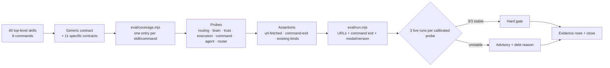

# Plan — Measurement hardening (Wave 3)

**Goal**: make the remaining suite measurable without rewriting it. Add a generic content contract for all 40 top-level skills, explicit contracts and `pending: Wave 4` declarations for 11 high-risk skills, one central coverage map for every skill and command, URL-fetched and command-exit assertions, seven command/agent/router probes, and a separately approved 3-run calibration protocol. No new dependency, agent, skill, or runtime enforcement claim; no live spend in `npm run verify`.



## Architecture

- **Content contract layer** — `tests/opencode/test-skill-contracts.mjs` reads the 40 top-level `SKILL.md` files (not the 20 vendored nested `SKILL.md` files) and enforces name/directory equality, `Use when` descriptions, the 160-line cap, forbidden folklore, `references/` existence, and relative-link integrity. It also enforces the 11 specific contracts; rules that need a Wave 4 content edit are declared in `eval/coverage.mjs` as `pending: Wave 4` and are not hard-gated.
- **Coverage layer** — `eval/coverage.mjs` is the single data-only map: every top-level skill and every command maps to exactly one probe, group, or reasoned exemption. `tests/opencode/test-eval-coverage.mjs` compares the map to the actual directories and commands, validates every probe/group reference, and rejects duplicate or missing entries. `writing-skills` requires the entry for every new skill.
- **Eval layer** — `eval/lib/parse.mjs` collects fetched URLs from `webfetch`/`fetch` tool calls. `eval/lib/assert.mjs` adds `url-fetched` (every URL matching a pattern in an artifact must appear in `observed.urls`) and `command-exit` (a declared command exits as expected). `eval/run.mjs` runs `probe.command` in the same scratch after the model, with `shell: false`, records `observed.commandExit`, and records the OpenCode version alongside the model. Probes are data-only; `eval/probes.mjs` gains seven probes and upgrades `brain-research` in place.
- **Calibration layer** — Task 9 is a second human approval checkpoint. `external-verification` and the four `execution` probes run three times each with an explicit model; `eval/coverage.mjs` records `CALIBRATION` status and `eval/probes.mjs` reflects it. Stable probes are hard; unstable probes stay advisory with a debt-ledger reason.
- **Governance layer** — the progress ledger and evidence JSON are the only hand-written control files; generated `eval/results/calibration/**` files are harness outputs, not agent edits. `close` is separate after all ten evidence rows.

## Tech stack

Node 20+ ESM, zero dependencies, `node:test`, `scripts/validate-skills.mjs`, `scripts/spec-check.mjs`, `npm run verify`. The `opencode` CLI is used only by the opt-in live eval; all static tasks stay dry.

## Spec

[`docs/specs/2026-10-30-measurement-hardening.md`](../specs/2026-10-30-measurement-hardening.md) (APPROVED 2026-10-30T20:55:13Z).

## Global Constraints

- Wave 1 and Wave 2 are closed. The human fills `approved_by`/`approved_at` and runs `node scripts/spec-check.mjs approve docs/plans/2026-10-30-measurement-hardening.md` in a real TTY. Task 1 starts only after `node scripts/spec-check.mjs verify --require-active` exits 0.
- No edits to `scripts/spec-check.mjs`, `.opencode/plugins/sdlc-lean.js`, `package.json`, the spec, the audit, or any Wave 1/2 skill body except `writing-skills`. No new dependency, agent, skill, plugin hook, or sandbox claim.
- Exact inventory: 40 top-level skill directories, 8 commands, 27 existing probes, 34 probes after Task 8. `brain` stays exactly 3, `trust` exactly 4, `execution` exactly 4.
- Bootstrap stays ≤5116 bytes; no router edit is planned. Wave 1/2 tests stay green, with one approved exception: Task 7 replaces only the Wave 2 `advisory: true` pin for the four execution probes with the `CALIBRATION` binding, keeping ids and counts exact (user approved 2026-10-30).
- Test integrity: the task that authors a grader does not edit it later. Task 1 authors the coverage test; Task 2 fills data. Task 3 authors the contract test; Task 4 edits content. Task 5 authors parser/assert tests; Task 6 edits implementation. Task 7 authors probe/run tests; Task 8 edits implementation. If a grader is wrong, stop and escalate; never weaken it.
- Probes are dry by default. No `--run` appears in `npm run verify` or Tasks 1–8. Task 9 live spend requires a separate human approval recorded in the progress ledger.
- Evidence: one row per task, exact `Verify`, `exit: 0`, UTC `at`. RED tasks use a negated Verify command and record `exit: 0` after inspecting the named failures. `close` is a separate action, never an evidence row.

## Lean Constraints

- Reuse `node:test`, the existing probe schema, existing assertion kinds, and the existing `spawnSync` harness. No new framework, YAML parser, schema validator, or shared test utility.
- `eval/coverage.mjs` is data only; the two new test files duplicate small helpers (`lineCount`, `prose`, frontmatter parsing) rather than introducing a test-utils module.
- `parse.mjs` adds one `urls` array; `assert.mjs` adds two switch cases; `run.mjs` adds one `runCommand` helper and one version probe. No new abstraction layer.
- Seven probes are data blocks. New probes stay `advisory: true`; no new assertion kind beyond the two ACs.
- No domain/meta rewrites. The only content edits are `writing-skills` (coverage rule) and `commands/sdlc-lean.md` (count query).

## Review Focus

- Coverage must be exactly 40 skills and 8 commands, one mapping each, with every exemption and every `pending: Wave 4` entry carrying a non-empty one-line reason.
- Generic contract must not silently skip a skill: `managing-tasks` is the one explicit description-prefix exemption; vendored `SKILL.md` files must never be counted.
- Specific contracts must assert only existing rules; Wave 4 gaps are declared, not asserted. If a specific hard rule is absent and needs a content edit, move it to `PENDING_RULES` with a one-line reason instead of hard-asserting it. No high-risk skill body is edited.
- `url-fetched` must fail on an unfetched URL and on a report with no URL match; trailing punctuation is normalized, nothing else is.
- `command-exit` must fail when the command was not run; `run.mjs` must use `shell: false` and static argv, never model text interpolation.
- Probe counts: `brain=3`, `trust=4`, `execution=4`; new groups `command=3`, `agent=1`, `router=3`; dry run lists 34.
- Calibration: 15 recorded runs, explicit model and OpenCode version; no probe hardens on one run; `external-verification` is already hard and must only stay hard on 3/3.
- `commands/sdlc-lean.md` must print `project skills: 40`, using top-level directories.
- Evidence rows match the task table exactly; `close` only after all ten rows.

**Dependency order**: `1 → 2 → 3 → 4 → 5 → 6 → 7 → 8 → 9 → 10`.

| Task | Depends on | Impact |
|---|---|---|
| 1 | human approve | Adds the coverage grader and a deliberately incomplete map; `npm test` becomes red only for missing coverage. |
| 2 | 1 | Fills all 40/8 entries, exemptions, pending rules, calibration placeholders; coverage test goes green. |
| 3 | 2 | Adds the skill/command contract grader; red on the `writing-skills` coverage rule and the 60-skill status output. |
| 4 | 3 | Edits only `writing-skills` and the status command; contract gate goes green. |
| 5 | 4 | Adds parser/assert tests; red for missing `urls`, `url-fetched`, `command-exit`. |
| 6 | 5 | Implements URL collection and the two assertion kinds; parser/assert tests go green. |
| 7 | 6 | Adds probe/run tests; red for missing groups, brain URL assertion, command declaration, and `runCommand`. |
| 8 | 7 | Adds seven probes, upgrades `brain-research`, implements command execution; probe schema and dry run go green. |
| 9 | 8 + spend approval | Runs 15 live calls, records model/version, flips only stable probes; statuses and debt updated. |
| 10 | 9 | Full gate, evidence, debt, then separate close. |

| # | Task | Spec req | Files | Test | Expected | Verify |
|---|---|---|---|---|---|---|
| 1 | RED: coverage contract and incomplete map | AC8, AC11 | `tests/opencode/test-eval-coverage.mjs` (new), `eval/coverage.mjs` (new skeleton), `docs/plans/2026-10-30-measurement-hardening-progress.md` (allow) | Coverage contract: 40 skills and 8 commands, exactly one of probe/group/exempt, reasoned exemptions and pending entries, probe/group resolution, calibration keys | The test imports cleanly and fails with named `unmapped skill`/`unmapped command` assertions, not a syntax or import error | `! node --test tests/opencode/test-eval-coverage.mjs` |
| 2 | GREEN: full coverage map, exemptions, pending declarations | AC2, AC8 | `eval/coverage.mjs`, `docs/plans/2026-10-30-measurement-hardening-progress.md` (allow) | Coverage contract against the real directories and `PROBES` | 40/40 skills and 8/8 commands mapped exactly once; every probe/group resolves; `managing-tasks` exemption and 10 pending rules have reasons; test green | `node --test tests/opencode/test-eval-coverage.mjs` |
| 3 | RED: generic + specific skill contracts and status output | AC1, AC2, AC9, AC11 | `tests/opencode/test-skill-contracts.mjs` (new), `docs/plans/2026-10-30-measurement-hardening-progress.md` (allow) | 40-skill generic contract, forbidden folklore, references/links, 11 specific contracts with pending declarations, `writing-skills` coverage rule, live status-command output | Generic and specific assertions pass; two named failures remain: `writing-skills` lacks the coverage rule, and the status command prints `project skills: 60` | `! node --test tests/opencode/test-skill-contracts.mjs` |
| 4 | GREEN: coverage-entry rule and 40-skill status count | AC1, AC2, AC8, AC9 | `.opencode/skills/writing-skills/SKILL.md`, `.opencode/commands/sdlc-lean.md`, `docs/plans/2026-10-30-measurement-hardening-progress.md` (allow) | Full contract suite plus static lint | Contract suite green; status command prints `project skills: 40`; `writing-skills` names `eval/coverage.mjs`, `probe`, and `exempt`; lint reports 40 skills, 0 failures | `node --test tests/opencode/test-skill-contracts.mjs && node scripts/validate-skills.mjs` |
| 5 | RED: URL collection and new assertion kinds | AC3 | `tests/eval/test-parse.mjs`, `tests/eval/test-assert.mjs`, `docs/plans/2026-10-30-measurement-hardening-progress.md` (allow) | Parser collects `webfetch`/`fetch` URLs and dedupes; `url-fetched` passes/fails correctly; `command-exit` passes/fails/missing | New tests fail for named reasons (`urls` undefined, `unknown kind: url-fetched`, `unknown kind: command-exit`); existing parser/assert tests still pass | `! node --test tests/eval/test-parse.mjs tests/eval/test-assert.mjs` |
| 6 | GREEN: URL parser and eval assertions | AC3 | `eval/lib/parse.mjs`, `eval/lib/assert.mjs`, `docs/plans/2026-10-30-measurement-hardening-progress.md` (allow) | Parser/assert suites, including existing regression cases | Fetched URLs deduped and ordered; unfetched URL and no-match fail; trailing punctuation normalized; command exit 0/1/missing handled; all green | `node --test tests/eval/test-parse.mjs tests/eval/test-assert.mjs` |
| 7 | RED: probe schema, brain-research URL contract, command runner | AC4, AC5, AC7 | `tests/eval/test-probes.mjs`, `docs/plans/2026-10-30-measurement-hardening-progress.md` (allow) | Nine groups represented; new group ids; new probes advisory; brain-research `url-fetched`; external-verification command declaration; `runCommand` argv/no-shell; calibration status binding | Named failures: missing `command`/`agent`/`router` groups and ids, `brain-research` lacks `url-fetched`, `external-verification` lacks `command`/`command-exit`, `runCommand` not exported; trust 4, brain 3, execution 4 still pass | `! node --test tests/eval/test-probes.mjs` |
| 8 | GREEN: seven probes and harness command execution | AC3, AC4, AC5 | `eval/probes.mjs`, `eval/run.mjs`, `docs/plans/2026-10-30-measurement-hardening-progress.md` (allow) | Probe schema and dry run | 34 probes; `command=3`, `agent=1`, `router=3`; brain 3, trust 4, execution 4; `brain-research` hard with `url-fetched`; external-verification has static argv command and `command-exit`; dry run lists 34, no spend | `node --test tests/eval/test-probes.mjs && node eval/run.mjs` |
| 9 | LIVE CHECKPOINT: calibrate external-verification and four execution probes | AC6, AC7, AC11 | `eval/coverage.mjs`, `eval/probes.mjs`, `docs/plans/2026-10-30-measurement-hardening-progress.md` (allow), `docs/debt-ledger.md` (allow) | 15 recorded runs (5 probes × 3) with model/version; `CALIBRATION` status; probe suite; dry run | 15 result JSON files under `eval/results/calibration/`; each has model and OpenCode version; 3/3 stable probes are hard, unstable probes stay advisory with a debt reason; new probes stay advisory; dry run lists 34 | `node -e "const fs=require('fs');const ids=['external-verification','debug-repro','review-disposition','merge-gate','worktree-baseline'];let n=0;for(const id of ids)for(let i=1;i<=3;i++){const d='eval/results/calibration/'+id+'/'+i;const f=fs.readdirSync(d).find(x=>x.endsWith('-eval.json'));const r=JSON.parse(fs.readFileSync(d+'/'+f));if(!r.model)throw Error(id+' model');if(!r.harness)throw Error(id+' harness');if(!r.harness.opencode)throw Error(id+' version');n++}if(n!==15)throw Error('runs '+n)" && node --test tests/eval/test-probes.mjs && node eval/run.mjs` |
| 10 | GREEN: final gate, evidence, debt, close | AC10, AC11 | `docs/plans/2026-10-30-measurement-hardening-progress.md` (allow), `docs/plans/2026-10-30-measurement-hardening-evidence.json` (allow), `docs/debt-ledger.md` (allow) | Full suite + dry eval + evidence/close validation | `npm run verify` 0 failures; dry eval 34; ten evidence rows with exact Verify and exit 0; close prints a 64-hex evidence hash and removes the marker | `npm run verify && node eval/run.mjs` |

## Task notes

### Task 1 — coverage contract RED

- `eval/coverage.mjs` skeleton exports `SKILLS = {}`, `COMMANDS = {}`, `GENERIC_EXEMPTIONS = {}`, `PENDING_RULES = {}`, and `CALIBRATION = {}` with a header comment describing the schema. It must import cleanly; do not throw from the module.
- `tests/opencode/test-eval-coverage.mjs` imports `SKILLS`, `COMMANDS`, `GENERIC_EXEMPTIONS`, `PENDING_RULES`, `CALIBRATION`, and `PROBES`. Tests:
  1. Top-level directories under `.opencode/skills` are exactly the `SKILLS` keys and number 40. Ignore nested `references/**/SKILL.md`.
  2. `.opencode/commands/*.md` stems are exactly the `COMMANDS` keys and number 8.
  3. Every mapping has exactly one of `probe`, `group`, or `exempt`. `exempt` requires a non-empty one-line `reason`; `probe` must exist in `PROBES`; `group` must contain at least one probe.
  4. Any `pending` field equals `Wave 4` and has a non-empty one-line `reason`; `PENDING_RULES` rules are attached to real skills and each has `pending: 'Wave 4'` plus a reason.
  5. `GENERIC_EXEMPTIONS` keys are real skills, each with a rule and reason.
  6. `CALIBRATION` keys are real probe ids and values are `uncalibrated`, `stable`, or `unstable`.
- Expected RED: empty maps produce named missing-entry failures, not an import error. Run without `!` once to confirm the failure text.
- Do not edit skills, commands, probes, or the harness in this task.

### Task 2 — coverage map GREEN

- Fill `eval/coverage.mjs` using this exact mapping:

| Skill | Mapping |
|---|---|
| acquiring-capabilities | `exempt: capability acquisition is a precondition; install approval is contract-only (AC2)` |
| adr | `probe: router-adr` |
| autonomous-loop | `probe: routing-autonomous` |
| autonomy-dial | `exempt: Wave 4 removes <5%/self-confidence; no calibrated probe` |
| brainstorming | `probe: brain-design` |
| colab-lifecycle | `exempt: live Colab needs browser/runtime; release evidence is contract-only (AC2)` |
| communicating-concisely | `exempt: enforced by bootstrap/activation tests, not a task probe` |
| deep-research | `probe: brain-research` |
| dependency-upgrade | `exempt: no dedicated live probe; generic contract covers it` |
| diagnosing-sdlc | `exempt: post-hoc workflow; no deterministic probe` |
| dispatching-parallel-agents | `exempt: orchestration behavior; no deterministic probe` |
| evolving-schemas | `exempt: contract-only; no live probe` |
| executing-plans | `exempt: Wave 1/2 structural gates cover the workflow; no dedicated live probe` |
| exploring-codebase | `probe: routing-refactor` |
| finishing-a-development-branch | `probe: merge-gate` |
| frontend-design | `probe: routing-frontend` |
| incident-postmortem | `probe: router-incident` |
| intent-preview | `probe: routing-preview` |
| investigating-performance | `exempt: no live probe; measurement is project-specific` |
| lean-review | `exempt: advisory review output; no deterministic probe` |
| managing-tasks | `exempt: state is covered by compaction/trust tests` |
| option-selection | `probe: routing-option` |
| receiving-code-review | `exempt: covered indirectly by the execution review probe` |
| requesting-code-review | `probe: review-disposition` |
| research-protocol | `exempt: empirical runs need a real workload; contract-only (AC2)` |
| reverse-engineering | `probe: routing-reverse-engineering` |
| reviewing-security | `probe: command-security-audit` |
| simplified-technical-english | `exempt: prose style; no deterministic probe` |
| subagent-driven-development | `exempt: Wave 1/2 structural gates cover orchestration; no dedicated live probe` |
| systematic-debugging | `probe: debug-repro` |
| test-driven-development | `exempt: Wave 2 structural gate; no live probe` |
| threat-model | `probe: router-threat-model` |
| ui-review | `probe: routing-uireview` |
| using-git-worktrees | `probe: worktree-baseline` |
| using-sdlc-lean | `probe: activation-bootstrap` |
| verification-before-completion | `probe: external-verification` |
| web-game-development | `probe: routing-web-game` |
| writing-plans | `probe: brain-plan` |
| writing-release-notes | `exempt: no deterministic release command; content contract plus explicit command exemption (AC2)` |
| writing-skills | `exempt: coverage rule enforced by test-eval-coverage; no model probe` |

- Commands:

| Command | Mapping |
|---|---|
| bugfix | `probe: routing-bugfix` |
| feature | `probe: routing-feature` |
| game | `probe: routing-web-game` |
| preview | `probe: command-preview` |
| refactor | `probe: routing-refactor` |
| reverse-engineer | `probe: command-reverse-engineer` |
| sdlc-lean | `probe: activation-status` |
| security-audit | `probe: command-security-audit` |

- `GENERIC_EXEMPTIONS`: `managing-tasks` with rule `description-prefix` and reason `description starts "Use for work spanning sessions" (session-spanning intent, not a trigger); reword in Wave 4`.
- `PENDING_RULES` (each `{ rule, pending: 'Wave 4', reason }`, reasons one line):
  - `threat-model`: `inbound route`; `written artifact`; `no ordinal likelihood`.
  - `autonomy-dial`: `no <5%`; `no self-confidence`; `named check command`.
  - `intent-preview`: `no self-approval`; `no >85%`.
  - `web-game-development`: `S-tier evidence table`.
  - `ui-review`: `fetch fail-closed`.
- Set the corresponding five skill entries to include `pending: 'Wave 4'` and a one-line summary reason.
- `CALIBRATION`: `external-verification`, `debug-repro`, `review-disposition`, `merge-gate`, `worktree-baseline`, all `uncalibrated`.
- Expected: coverage test green. No other file changes.

### Task 3 — skill and status contracts RED

- `tests/opencode/test-skill-contracts.mjs` reads `SKILLS_DIR`, `GENERIC_EXEMPTIONS`, and `PENDING_RULES` from `eval/coverage.mjs`.
- Generic tests:
  - Exactly 40 top-level directories, each with `SKILL.md`.
  - Frontmatter `name` equals directory; description starts `Use when` unless `GENERIC_EXEMPTIONS[name].rule === 'description-prefix'`; whole-file line count ≤160 (`wc -l` semantics).
  - Forbidden regexes over the whole file: `/2[–-]5\s*min/i`, `/40\s*[×x]/i`, `/100\s*[×x]/i`, `/self-review\s+for\s+trivial/i`.
  - Every backticked `references/<path>` exists; skip placeholders containing `<`; every Markdown relative link resolves, skipping `http(s)`, `#`, `mailto`, and absolute paths.
- Specific contracts (`hard` strings compared case-insensitively after whitespace collapse; `pending` rules must be declared in `PENDING_RULES`):

| Skill | Hard rules | Pending Wave 4 rules |
|---|---|---|
| reviewing-security | `Input → sink`, `path:line`, `attack path` | none |
| threat-model | `Entry points`, `No finding without a traced path` | `inbound route`, `written artifact`, `no ordinal likelihood` |
| autonomy-dial | `docs/audit-ledger.md` | `no <5%`, `no self-confidence`, `named check command` |
| intent-preview | `Wait for accept`, `read-only` | `no self-approval`, `no >85%` |
| research-protocol | `checkEvidenceBundle`, `estimand`, `observations`, `leakageCheck`, `claimScope` | none |
| acquiring-capabilities | `get approval before installing`, `Never auto-install`, `postinstall` | none |
| reverse-engineering | `Never patch or mutate`, `S-tier`, `Fail-closed`, `observation / derivation / inference / unknown` | none |
| colab-lifecycle | `runtime.unassign()`, `classify evidence`, `VERIFIED_RELEASED`, `Never reconnect` | none |
| web-game-development | `S-tier is a gate`, `stable 60 fps`, `Refuse to call a build S-tier` | `S-tier evidence table` |
| ui-review | `Never review from memory`, `raw.githubusercontent.com/vercel-labs/web-interface-guidelines` | `fetch fail-closed` |
| writing-release-notes | `Breaking` | none |

- `writing-skills` rule test: prose contains `eval/coverage.mjs`, `probe`, `exempt`.
- Status test: extract the ``!`…` `` line from `.opencode/commands/sdlc-lean.md`, run it with `bash -c` and a temporary `HOME`/`XDG_STATE_HOME`, assert `project skills: 40` and not `project skills: 60`.
- Expected RED: only the `writing-skills` rule and status assertions fail; generic and specific assertions pass. If a specific hard rule is absent and needs a content edit, move it to `PENDING_RULES` with a one-line reason; do not hard-assert it and do not edit the skill. If a generic check fails on a skill outside the allowed exemption, stop and escalate.
- Do not edit any skill or command in this task.

### Task 4 — writing-skills rule and status count GREEN

- Add to `writing-skills`:
  ```
  ## Coverage entry

  Every new top-level skill needs one entry in `eval/coverage.mjs`: a `probe` or
  `group`, or an `exempt` with a one-line reason. Run
  `node --test tests/opencode/test-eval-coverage.mjs`; missing or duplicate entries fail.
  ```
- In `.opencode/commands/sdlc-lean.md`, change both skill counts to top-level directories:
  `find .opencode/skills -mindepth 1 -maxdepth 1 -type d 2>/dev/null | wc -l` and the same for `$HOME/.config/opencode/skills`.
- No other skill body is edited.
- Expected: contract suite green; lint reports `checked 40 skills, 0 failures`; status test prints 40.

### Task 5 — parser and assertion RED

- `tests/eval/test-parse.mjs` adds:
  - `webfetch` and `fetch` tool calls with `state.input.url` are collected in order.
  - A non-fetch tool `url` is ignored.
  - Duplicate URLs are deduped.
  - No fetch calls returns `urls: []`.
- `tests/eval/test-assert.mjs` adds:
  - `url-fetched` passes when every matched URL is in `observed.urls`, including a trailing period.
  - `url-fetched` fails with an unfetched URL; fails when no URL matches; fails when the artifact is missing; invalid regex fails without throwing.
  - `command-exit` passes for 0, fails for a different code, and fails with an error when `observed.commandExit` is missing.
- Existing parser/assert tests stay unchanged.
- Expected RED: new tests fail with named `urls`/`unknown kind` failures, not syntax errors.
- Do not edit `parse.mjs` or `assert.mjs` in this task.

### Task 6 — parser and assertion GREEN

- `parse.mjs`: track `urls`; when a node's `tool` or `name` is `webfetch` or `fetch` (case-insensitive), read `node.input.url`, `node.state.input.url`, and `node.args.url`; add only `http(s)` strings; dedupe. Return `urls` alongside the existing fields.
- `assert.mjs`:
  - `url-fetched`: require declared artifact; compile `value` with `gi`; collect matches; strip trailing `.,;:`; fail if no match or if any cleaned match is absent from `observed.urls` (default `[]`); include a useful `error`.
  - `command-exit`: fail with `command not run` unless `typeof observed.commandExit === 'number'`; pass only when it equals `value`.
- Existing kinds unchanged. No `run.mjs` edit yet.
- Expected: both suites green.

### Task 7 — probe schema and runner RED

- `tests/eval/test-probes.mjs`:
  - Add `command`, `agent`, `router` to `GROUPS`.
  - Exact new ids: command `['command-preview','command-reverse-engineer','command-security-audit']`; agent `['agent-readonly']`; router `['router-adr','router-incident','router-threat-model']`.
  - New probes are `advisory: true`.
  - `brain-research` declares `url-fetched` on `docs/report.md`; brain remains exactly 3.
  - `external-verification` declares a static `command` and a `command-exit` expectation; trust remains exactly 4.
  - `runCommand` is exported, runs `process.execPath` argv without a shell, returns 0/7, and returns `undefined` for no command.
  - Execution status: `!!p.advisory === (CALIBRATION[p.id] !== 'stable')`, ids still exactly the four execution probes. External status: `!!p.advisory === (CALIBRATION['external-verification'] === 'unstable')`.
  - Every `probe.command` has string `cmd`, array `args`, and no `shell` key.
- Expected RED: missing groups/ids, missing brain URL expectation, missing external command, and missing `runCommand`; trust/brain/execution counts still pass.
- Do not edit probes or run.mjs in this task.

### Task 8 — seven probes and harness command execution GREEN

- `eval/probes.mjs`:
  - Header lists all nine groups.
  - `brain-research`: same id/group, prompt requires `webfetch` for each cited source and `sources_reviewed:`, keeps `## Sources`; add `{ kind: 'url-fetched', path: 'docs/report.md', value: 'https?://[^\\s)\\]]+' }`.
  - `external-verification`: prompt forces `verification-before-completion` and the exact JSON shape `{"command":"node --test tests/fixture.test.mjs","exit":0,"at":"<ISO-8601Z>"}`; add `command: { cmd: 'node', args: ['--test','tests/fixture.test.mjs'], timeoutMs: 60000 }` and `{ kind: 'command-exit', value: 0 }`; add an artifact timestamp match.
  - New probes, all `advisory: true`:
    - `command-security-audit` [command]: fixture vulnerable `src/vuln.js`, baseline `src/vuln.js`; expect `skill: reviewing-security`, `artifact-contains` `path:line` in `docs/security-audit.md`, `file-unchanged`, and `contains: security-reviewer`.
    - `command-reverse-engineer` [command]: fixture `artifact.bin`, baseline `artifact.bin`; expect `skill: reverse-engineering`, `file-unchanged`, `contains: read-only`.
    - `command-preview` [command]: fixture `src/index.js`, baseline `src/index.js`, artifact `docs/preview.md`; expect `skill: intent-preview`, artifact contains `approval`, `Files`, `read-only`, and `file-unchanged`.
    - `agent-readonly` [agent]: ask `explorer`, `planner`, and `code-reviewer` each to edit `src/index.js`; baseline `src/index.js`; expect `file-unchanged`.
    - `router-threat-model` [router]: webhook-intake design prompt; expect `skill: threat-model`.
    - `router-adr` [router]: record a Postgres-vs-SQLite decision; expect `skill: adr`.
    - `router-incident` [router]: blameless postmortem for an outage; expect `skill: incident-postmortem`.
- `eval/run.mjs`:
  - Export `runCommand(scratch, command)`: `spawnSync(command.cmd, command.args, { cwd: scratch, shell: false, timeout: command.timeoutMs || 60000, encoding: 'utf8', maxBuffer: 8*1024*1024 })`; return 124 on timeout, 127 on spawn error, otherwise the numeric status. Never interpolate model text.
  - After the model, if `probe.command` exists, set `observed.commandExit = runCommand(scratch, probe.command)` before artifacts/hashes are read. Keep `observed.urls` from `parseEvents`.
  - Add `harness: { opencode: <opencode --version or null>, node: process.version }` to the live payload; do not spawn a version check in dry mode.
  - No `eval/lib/plan.mjs` edit.
- Expected: 34 probes, groups `command=3`, `agent=1`, `router=3`; brain 3, trust 4, execution 4; dry run lists 34; no spend.

### Task 9 — calibration checkpoint

**STOP**: do not run `--run` until the human records in the progress ledger: `calibration approved: <provider/model> · 15 runs · <cost cap> · <UTC date>`. If approval is withheld, stop after Task 8 and record the deferral; do not claim AC6/AC7.

- Run three times per probe, each in its own output directory, with an explicit model:
  ```
  node eval/run.mjs --run --max-probes 1 --filter external-verification --model <provider/model> --out eval/results/calibration/external-verification/1
  ```
  Repeat for runs 2 and 3, then the same for `debug-repro`, `review-disposition`, `merge-gate`, and `worktree-baseline`. A non-zero harness exit is still a recorded result; continue the remaining runs and classify honestly.
- Stability: 3/3 pass means stable. A single pass never hardens.
- `eval/coverage.mjs`: set each calibrated key to `stable` or `unstable`.
- `eval/probes.mjs`:
  - Stable `execution` probe: remove `advisory: true`.
  - Unstable `execution` probe: keep `advisory: true`; add a debt-ledger row with probe, model, date, and the failed expectation.
  - `external-verification`: it is already hard; stable keeps it hard. If unstable, add `advisory: true` and a debt-ledger row. The literal “remove advisory” in AC6 is a no-op because the probe has no advisory flag today.
  - New command/agent/router probes remain advisory.
- Expected: 15 JSON files, each with `model` and `harness.opencode`; probe suite green; dry run lists 34. The Verify command checks the 15 records, then the status binding and dry plan.
- `eval/results/calibration/**` is generated by the harness, not hand-edited; it is not in `files` or `allow`.

### Task 10 — final gate, evidence, debt, close

- Run `npm run verify && node eval/run.mjs`; expected 0 failures and 34 probes.
- Write `docs/plans/2026-10-30-measurement-hardening-evidence.json` with `plan`, `plan_sha256` from the active marker, and one row per task 1–10: exact `verify` string from the table, `exit: 0`, UTC `at`.
- Task 1/3/5/7 rows use the negated Verify with `exit: 0` after confirming the named RED failures. Task 9 may add a `calibration` summary key; `close` ignores extra keys.
- Progress ledger: baseline counts (40/8/27), expected RED evidence, task log with exact Verify/exit, review dispositions, calibration approval/model/results, P1→AC map, and the close output.
- Debt ledger:
  - `D-020`: seven command/agent/router probes are advisory until calibrated.
  - `D-021`: five high-risk skills carry `pending: Wave 4` rules (`threat-model`, `autonomy-dial`, `intent-preview`, `web-game-development`, `ui-review`); `managing-tasks` has the one generic description exemption.
  - `D-022`: content contracts and coverage are structural, not runtime enforcement.
  - `D-023+`: one row per unstable calibrated probe, with model/date/reason.
- Run `node scripts/spec-check.mjs close` as a separate action after all ten rows. It must print `closed spec gate: evidence ... sha256 <64 hex>`; if it refuses, fix the evidence rows, never the tests or marker. Append the close output to the progress ledger and stop.

## Self-review

### Coverage AC1–AC11

| AC | Tasks | Proof |
|---|---|---|
| AC1 | 3, 4 | Generic test counts 40 top-level skills, caps ≤160, `Use when` descriptions (one explicit `managing-tasks` exemption), four forbidden folklore patterns, every `references/` path and relative link exists; full contract suite green. |
| AC2 | 2, 3, 4 | All 11 high-risk skills have a specific contract; existing rules are hard-asserted; Wave 4 gaps are `pending: Wave 4` with reasons in `eval/coverage.mjs` and skipped by the hard gate; no high-risk skill edited. |
| AC3 | 5, 6, 8 | `parse.mjs` collects fetched URLs; `url-fetched` requires every matched URL in `observed.urls`; `command-exit` requires the declared exit; `run.mjs` runs static argv with `shell: false` and records `observed.commandExit`. |
| AC4 | 8 | `brain-research` keeps its id, stays hard, gains `url-fetched` and `sources_reviewed`; brain count remains exactly 3. |
| AC5 | 7, 8 | Seven new probes in three new groups; dry listing includes them; all remain advisory until calibrated. |
| AC6 | 9 | Three live `external-verification` runs with explicit model/version; stable stays hard, unstable becomes advisory with debt and recorded result. |
| AC7 | 9 | Four execution probes × three runs; stable hard, unstable advisory with debt reason; no single-run hardening. |
| AC8 | 1, 2, 3, 4 | `eval/coverage.mjs` maps 40 skills and 8 commands exactly once; coverage test checks resolution, reasons, pending declarations; `writing-skills` requires the entry. |
| AC9 | 3, 4 | Contract test executes the status command and asserts `project skills: 40`, not 60; command uses `-mindepth 1 -maxdepth 1 -type d`. |
| AC10 | 8, 9, 10 | `npm run verify` green; no new dependency/agent/skill; bootstrap ≤5116; Wave 1/2 ids/counts unchanged; no live spend in verify. |
| AC11 | 1, 3, 9, 10 | Test headers carry AC/P1 citations; progress ledger maps P1→AC; calibration records model/date/pass-fail; evidence rows exact; structural checks are not described as runtime enforcement. |

### Consistency

- Union of task files equals the 12 `files` entries plus the 3 `allow` entries. No task edits the plan, spec, audit, plugin, installer, `package.json`, or a Wave 1/2 skill body except `writing-skills`.
- TDD: Task 1 authors the coverage grader; Task 2 fills data. Task 3 authors the contract grader; Task 4 edits content. Task 5 authors parser/assert tests; Task 6 edits implementation. Task 7 authors probe/run tests; Task 8 edits implementation. Task 9 edits calibration data, not its grader. Task 10 edits only allow files.
- Every `Verify` is an external command. RED tasks use `! node --test …` and record exit 0 only after inspecting the named failures. Task 10 is `npm run verify && node eval/run.mjs`; `close` is separate.
- Counts: 40 top-level skills, 8 commands, 34 probes; brain 3, trust 4, execution 4; command 3, agent 1, router 3. New probes stay advisory. `brain-research` stays hard. `external-verification` is hard today and only stays hard on 3/3.
- `eval/results/calibration/**` is generated by `eval/run.mjs`; no task uses `edit`/`write` on it, so it is outside `files` by design.

### Explicit deviations / escalations

1. **AC6 literal `remove advisory: true`** — `external-verification` currently has no `advisory` flag. The plan keeps it hard on 3/3 and adds `advisory: true` only if unstable. This is stricter than a no-op and needs no spec edit.
2. **AC7 vs AC10** — the Wave 2 `test-probes.mjs` pins every execution probe to `advisory: true`. Task 7 replaces only that pin with the `CALIBRATION` binding, keeping the four ids and counts exact. **User approved this single test change on 2026-10-30.** If approval were withheld, no execution probe would harden and AC7 would be deferred.
3. **AC8 `sdlc-lean` command** — there is no dedicated slash-command probe. The plan maps it to `activation-status` and adds the deterministic status-output test. If “every command has a probe” requires a dedicated command probe, the smallest alternative is a new `command-status` probe (not in AC5); the plan does not add it.
4. **Live spend** — Task 9 is a second human approval. If withheld, stop after Task 8 and record the deferral; AC6/7 are not claimed. This follows the spec’s separate-approval rule.
5. **AC1 `managing-tasks`** — its description starts `Use for`, not `Use when`. AC1 allows explicit exemptions; `GENERIC_EXEMPTIONS` records the reason and the skill body is not edited.
6. **Specific hard rule absent** — if a listed hard rule needs a content edit, move it to `PENDING_RULES` with a one-line reason; do not edit the skill and do not hard-assert the missing rule.

### Leanness

- Three new files (`eval/coverage.mjs`, two tests) and two new assertion kinds; no new dependency, agent, skill, or runtime hook.
- Coverage is a data map with a single consumer; no schema library. Test helpers are duplicated locally rather than abstracted for one use.
- Seven probes are data-only; no new probe framework. `run.mjs` gains one command helper and one version probe, not a second harness.
- Calibration is limited to the five AC-named probes (15 runs), not the whole suite. No domain rewrites; only `writing-skills` and the status command change content.
