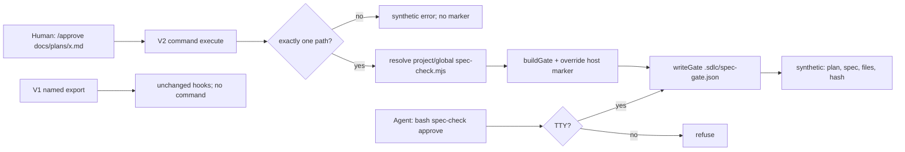

# Plan — TUI `/approve` command

**Goal**: make plan approval a TUI-first human act. V2 `setup` registers an `approve` command that accepts exactly one repo-relative plan, writes the normal `.sdlc/spec-gate.json` with the host OS user and `approved_via: tui-command`, and confirms through a synthetic message. V1 and the TTY-bound CLI stay unchanged; there is no agent-callable approval path.

**Architecture**

- **V2 plugin surface**: append an optional command block to `setup(ctx)`. Guard with `if (ctx.command && typeof ctx.command.transform === 'function')`; if absent or registration throws, log and continue. `ctx.command.transform((editor) => editor.add({ name: 'approve', description, execute }))`.
- **Executor**: `execute({ sessionID, prompt, delivery })` reads `prompt.text` as command argument text (V2 `CommandInvocation.prompt` is `PromptInput`; the `/approve` token is not included). Parse exactly one non-flag token; resolve root from `ctx.location.directory`; resolve `scripts/spec-check.mjs` from `<root>/scripts/` first, then `$XDG_CONFIG_HOME/opencode/scripts/` or `~/.config/opencode/scripts/`; dynamically import it with `pathToFileURL`.
- **Gate contract reuse**: call the imported `normalizeRel(root, arg)` then `buildGate(root, rel)`; override `approved_by = os.userInfo().username`, `approved_at = new Date().toISOString()`, add `approved_via = 'tui-command'`; call `writeGate(root, marker)`. The plan file is never written. `writeGate` validates atomically.
- **Result path**: call `ctx.session.synthetic({ sessionID, text })` with plan, spec, file count, and `plan_sha256.slice(0, 12)`. Never call `ctx.session.prompt`; never create a model turn. Refusals also go through synthetic, with no marker.
- **Unchanged surfaces**: V1 `SdlcLeanPlugin` named export remains untouched. No `spec_approve` tool, no `ctx.tool.transform` call. `scripts/spec-check.mjs` needs no change: `validateGate` spreads unknown keys and `writeGate` writes the original object, so `approved_via` round-trips.
- **Tests and docs**: one new test file mocks V2, uses a temp repo with a copy of the real CLI, and asserts registration, success, refusals, synthetic output, no tool, V1 hooks, and non-TTY CLI. Docs updates are scoped to README/USAGE/CHANGELOG and two skills.

**Tech stack**: Node 20+ ESM, zero dependencies, `node:test`, `node --check`, `scripts/validate-skills.mjs`, `npm run verify`, and the dry `node eval/run.mjs`. No new package, agent, skill, command file, or eval probe.

**Spec**: [`docs/specs/2026-10-30-tui-approval-command.md`](../specs/2026-10-30-tui-approval-command.md) (APPROVED 2026-10-30).

**Global Constraints**

- `npm run verify` must end green; bootstrap stays ≤5116 bytes. Do not edit the router or add a skill.
- The `/approve` command is V2-only and fail-open. V1 keeps its exact hooks and the TTY CLI; no V1 command registration.
- No `spec_approve` tool and no agent-callable approval. The CLI remains TTY-bound: stdin and stdout must be TTYs.
- No new dependency, agent, skill, command file, or eval probe. `.opencode/commands` stays at 9 `.md` files.
- Test integrity: Task 1 authors the only new test file. Tasks 2–4 must not edit it, weaken it, or edit existing graders (`test-plugin-loading`, `test-spec-check`, `test-spec-gate`, `test-brain-skills`, `test-skill-contracts`). `scripts/spec-check.mjs` is read-only in this plan; if a grader is wrong, stop and escalate.
- Docs caps: `writing-plans` ≤85 lines; `intent-preview` ≤25 lines. Preserve the existing required strings and references.
- AC8 is a process step: the human approves this plan once with the TTY CLI before Task 1; this is the last terminal approval for this feature. After this feature lands, later plans use `/approve`.
- Evidence is written only after all task Verifies pass. `close` is a separate terminal step; it is never a task row.

**Lean Constraints**

- Reuse the existing CLI, `os`/`fs`/`path`, and `node:test`. Add only `pathToFileURL` to the existing `url` import.
- One small resolver (two candidates), one argument parser, and one executor. No command framework, no CLI refactor, no new schema layer.
- One new test file; copy the real `scripts/spec-check.mjs` into temp repos instead of stubbing `buildGate`/`writeGate`.
- Docs edits replace/append rows and lines only. `writing-plans` keeps 85 lines by replacing its 3-line approval paragraph with 3 lines.
- No active-marker refusal is added: `/approve` follows the existing CLI `approve` semantics (approve only, no close). Scope changes still require `close` + re-approval in the workflow.

**Review Focus**

- The command is user-invoked by construction: no `spec_approve` export, no `ctx.tool.transform` call, and V1 returns only its four existing hooks.
- Path handling: exactly one token; no flags; no multiple paths; no outside-repo or glob escapes; draft/unsafe/missing plans leave no marker; every refusal sends a synthetic error and no model prompt.
- Marker identity: `approved_by` is the host OS user, `approved_at` is command time UTC, `approved_via` is `tui-command`; the plan's own frontmatter is byte-identical before/after; `writeGate` leaves no `.tmp` file.
- Success synthetic text carries plan, spec, file count, and 12-hex plan hash; `session.prompt`/`session.command` are never called.
- Fail-open registration: no `ctx.command`, a throwing `transform`, or a throwing `synthetic` must not break setup or the other hooks.
- V1 exact hooks; V2 without `ctx.command` still registers skills/context/tool hooks; non-TTY CLI still refuses.
- `validateGate` tolerates `approved_via`; if it does not, stop rather than editing the CLI inside this plan's scope.
- Docs caps and TTY fallback wording; test integrity.

**Dependency order**: `1 → 2 → 3 → 4`. Task 1 authors the behavior and docs assertions first; Task 2 changes only the plugin (impact: V1/V2 loading and spec-gate regression tests); Task 3 changes only docs (impact: `writing-plans` 85-line cap, `intent-preview` 25-line cap, required contract strings); Task 4 touches allow files only and runs the full gate. No task starts before its predecessor's Verify passes.

| # | Task | Spec req | Files | Test | Expected | Verify |
|---|---|---|---|---|---|---|
| 1 | RED: command, marker, refusal, V1, and docs contract tests | AC1–AC7 | `tests/opencode/test-approve-command.mjs`, `docs/plans/2026-10-30-tui-approval-command-progress.md` (allow) | new V2 mock tests plus docs assertions | behavior tests fail: no `approve` command, no marker; docs tests fail: no `/approve`; V1/non-TTY baseline assertions pass; baseline recorded | ! node --test tests/opencode/test-approve-command.mjs |
| 2 | GREEN: register the V2 `/approve` executor and write the host marker | AC1–AC5 | `.opencode/plugins/sdlc-lean.js`, `docs/plans/2026-10-30-tui-approval-command-progress.md` (allow) | task-1 `behavior:` tests; existing V1/V2 and spec-gate tests | command registered; success writes host-user/time/`approved_via` marker and synthetic confirmation; refusals write no marker; V1/V2 regressions green | node --test --test-name-pattern="^behavior:" tests/opencode/test-approve-command.mjs && node --test tests/opencode/test-plugin-loading.mjs tests/opencode/test-spec-gate.mjs |
| 3 | GREEN: document `/approve` and the TTY fallback | AC7 | `README.md`, `USAGE.md`, `.opencode/skills/writing-plans/SKILL.md`, `.opencode/skills/intent-preview/SKILL.md`, `CHANGELOG.md`, `docs/plans/2026-10-30-tui-approval-command-progress.md` (allow) | task-1 `docs:` assertions; existing skill caps/contracts | README flow and spec-gate row name `/approve`; USAGE names the TUI approval and TTY fallback; both skills name both channels; CHANGELOG entry present; caps hold | node --test --test-name-pattern="^docs:" tests/opencode/test-approve-command.mjs && node --test tests/opencode/test-brain-skills.mjs tests/opencode/test-skill-contracts.mjs |
| 4 | Full gate, evidence, and final dry eval | AC6, AC8 | `docs/plans/2026-10-30-tui-approval-command-progress.md` (allow), `docs/plans/2026-10-30-tui-approval-command-evidence.json` (allow), `docs/debt-ledger.md` (allow) | full suite + dry eval + evidence close validation | `npm run verify` 0 failures; bootstrap ≤5116; dry eval lists probes; one exact evidence row per task; close validates and removes the marker | npm run verify && node eval/run.mjs |

## Task notes

### Task 1 — RED contract tests

- Create `tests/opencode/test-approve-command.mjs`. Set `XDG_STATE_HOME` to a temp dir before importing the plugin. Use `node:test`, `node:assert/strict`, `fs`, `os`, `path`, `spawnSync`, and `pathToFileURL`.
- Helpers: `repoRoot`, `makeRepo()` (temp root with `scripts/spec-check.mjs` copied from the repo, `docs/specs/spec.md`, and an approved `docs/plans/plan.md` with `approved_by: plan-author`, a UTC `approved_at`, two `files`, and one `allow`), `planText()`, `mockCtx()` (skill transform, session hook/get/synthetic/prompt spies, tool hook/transform spies, optional command transform, `location.directory`), and `invoke()`.
- Tests named `behavior: ...`:
  - registration: one `approve` command, description contains `approve` and `human-only`;
  - success: marker exists; `approved_by === os.userInfo().username`; `approved_at` is UTC and within the command window; `approved_via === 'tui-command'`; `plan`/`spec`/`files` match; plan bytes unchanged; no `.tmp`; copied CLI `validateGate(root, marker)` accepts the marker and returns `approved_via`;
  - synthetic confirmation contains plan, spec, `2 files`, and `plan_sha256.slice(0, 12)`; `session.prompt` and `session.command` are not called;
  - refusals (fresh root each): empty, `--force`, two paths, `../outside.md`, `/etc/passwd`, missing plan, draft plan, unsafe `files: ['../secret']`, and `docs/plans/*.md`; each leaves no marker, sends a synthetic refusal, and never prompts;
  - no approval tool: `plugin.spec_approve` undefined, default export has no tool, `ctx.tool.transform` not called;
  - V1 unchanged: `SdlcLeanPlugin({})` returns exactly `config`, `experimental.chat.messages.transform`, `experimental.session.compacting`, `tool.execute.before`; no `command`;
  - fail-open: V2 setup without `ctx.command` resolves and still registers `context`/`tool:execute.before`;
  - non-TTY CLI: spawn `scripts/spec-check.mjs approve docs/plans/plan.md` with piped stdio; exit 1, stderr matches `/TTY|terminal/i`, no marker.
- Test named `docs: ...`: read repo docs and assert README, USAGE, writing-plans, intent-preview, and CHANGELOG mention `/approve`; writing-plans and intent-preview retain `spec-check approve`; intent-preview retains `TTY`.
- Record the baseline in the progress ledger: full file exit 1, failing command registration/marker, docs absent. Do not edit the plugin or docs in this task. Do not weaken existing tests.

### Task 2 — GREEN plugin command

- In `.opencode/plugins/sdlc-lean.js`, extend the `url` import with `pathToFileURL`.
- Add `resolveApprovalCli(root)` with exactly two candidates, in order: `path.join(root, 'scripts', 'spec-check.mjs')`, then `path.join(process.env.XDG_CONFIG_HOME || path.join(os.homedir(), '.config'), 'opencode', 'scripts', 'spec-check.mjs')`. Use `fs.statSync(...).isFile()`; return `null` if neither exists. Do not cache: tests use multiple roots.
- Add `parseApprovalArg(text)`: trim; require non-empty; split on whitespace; require exactly one token; reject a token starting with `-`. Error text names `usage: /approve <repo-relative-plan.md>`, `exactly one`, or `flags`.
- Add `approvePlan(ctx, { sessionID, prompt })`:
  - require `typeof ctx.location?.directory === 'string'` and non-empty; otherwise refuse;
  - dynamically import the resolved CLI; throw a clear error if missing;
  - `const rel = mod.normalizeRel(root, arg); const gate = mod.buildGate(root, rel);`
  - `const marker = { ...gate, approved_by: os.userInfo().username, approved_at: new Date().toISOString(), approved_via: 'tui-command' }; await mod.writeGate(root, marker);`
  - send `[sdlc-lean] spec gate active: <plan> -> <spec> (<n> files, plan sha256 <12>)` via `ctx.session.synthetic({ sessionID, text })`;
  - catch every error and send `[sdlc-lean] /approve refused: <message>` via synthetic; never throw out of `execute`; wrap the synthetic call in its own try/catch and log.
- At the end of V2 `setup(ctx)`, after the tool hook, add the guarded `ctx.command.transform` block with the exact description `Approve an SDLC plan and activate the spec gate (human-only)`. Catch registration errors and log; do not fail setup.
- Do not touch `SdlcLeanPlugin`, `resolveSpecCheck`, `checkSpecGate`, `scripts/spec-check.mjs`, or existing tests. Do not add an active-marker refusal; this task approves only, matching the CLI.
- Run the task-1 behavior tests plus the existing V1/V2 and spec-gate tests. If the `validateGate` tolerance assertion fails, stop and escalate per Deviations.

### Task 3 — GREEN docs

- `README.md`: update the feature-flow mermaid line so the approval node names `/approve` in the TUI or the TTY fallback; update the explicit-commands sentence; update the spec-gate row so `/approve <plan>` (V2) is primary and `spec-check approve` is the TTY fallback.
- `USAGE.md`: update the automatic spec-gate bullet to name `/approve <plan>` (V2) and the TTY fallback; add a `/approve` line to the spec-gate command block.
- `.opencode/skills/writing-plans/SKILL.md`: replace the 3-line "Activate the gate" paragraph with 3 lines naming `/approve` first and `spec-check approve` (TTY) as fallback; keep the file at 85 lines.
- `.opencode/skills/intent-preview/SKILL.md`: change the approval bullet to name `/approve <plan>` (V2) and the `spec-check approve` TTY fallback; keep `TTY`, `never self-approve`, and the file ≤25 lines.
- `CHANGELOG.md`: add one Unreleased Added bullet for the V2 TUI command, host-user/`approved_via` marker, TTY fallback, and no new dependency.
- Do not edit tests, the plugin, the CLI, or the router. Run the docs assertion and the existing skill cap/contract tests.

### Task 4 — full gate and evidence

- Run each task Verify once more in order and capture raw output/exit/time in the progress ledger. Write `docs/plans/2026-10-30-tui-approval-command-evidence.json` with `plan`, `plan_sha256` copied from the active `.sdlc/spec-gate.json`, and exactly four task rows whose `verify` strings match the table cells exactly, `exit: 0`, and UTC `at`. The RED row records 0 for the negated command; the progress ledger records the underlying test exit 1.
- Run `npm run verify && node eval/run.mjs`. Confirm bootstrap ≤5116 and the dry eval lists probes. Add a debt row only if a real deferred shortcut is accepted; otherwise leave `docs/debt-ledger.md` unchanged.
- Do not edit code, tests, docs, or the plan after approval. Do not add a close row to the evidence.

## Close (separate; no task row)

After Task 4 evidence is complete and every row matches, run `node scripts/spec-check.mjs close` in the repo root. It validates the plan hash, one row per task, exact Verify strings, exit 0, and UTC `at`; it removes `.sdlc/spec-gate.json` and prints the evidence SHA-256. If close refuses, fix the evidence; the marker stays. Close is never a plan task and never gets its own evidence row.

## Deviations and AC flags

- No AC is blocked. AC8 is a process criterion, handled by the pre-Task-1 TTY approval and the separate close. AC4 is structural, not an OS sandbox: no tool, no agent command path, and the CLI remains TTY-bound.
- `scripts/spec-check.mjs` needs no change. `validateGate` spreads unknown fields and `writeGate` writes the original object, so `approved_via` is preserved; Task 1 proves it through the copied CLI. If that assertion fails on the installed CLI, stop and escalate; the smallest deviation is an explicit `approved_via` passthrough in `validateGate` plus one case in `tests/scripts/test-spec-check.mjs`, which changes scope and requires `close` + re-approval.
- If `ctx.command.transform` is absent or throws, the command is not registered and setup continues; this is the documented fail-open path, not an AC failure.

## Self-review

**Coverage**

| AC | Task(s) | Proof |
|---|---|---|
| AC1 | 1, 2 | registration, one-path parsing, draft/unsafe/outside/missing refusals with no marker |
| AC2 | 1, 2 | `buildGate`/`writeGate`; host user, UTC time, `approved_via`; plan bytes unchanged |
| AC3 | 1, 2 | synthetic plan/spec/files/hash; `session.prompt`/`session.command` never called |
| AC4 | 1, 2 | no `spec_approve` export, no `ctx.tool.transform`, non-TTY CLI refusal |
| AC5 | 1, 2 | exact V1 hooks, no V1 command, fail-open without `ctx.command`; existing tests |
| AC6 | 1–4 | new coverage, full `npm run verify`, bootstrap test, dry eval |
| AC7 | 1, 3 | docs assertions for README, USAGE, writing-plans, intent-preview, CHANGELOG |
| AC8 | pre-flight + Close | TTY approval before Task 1; separate close after evidence |

**Binary checks**

- [x] Every AC maps to at least one task; every task names a spec req; no orphan task.
- [x] No task edits its own grader: Task 1 authors the new test; Tasks 2–4 never edit it or existing graders.
- [x] `files` covers every edit: plugin, new test, README, USAGE, two skills, CHANGELOG. `allow` covers progress, evidence, debt ledger.
- [x] Every Verify is an external command; the RED task uses `! node --test`; the final command is exactly `npm run verify && node eval/run.mjs`.
- [x] No new dependency, agent, skill, command file, eval probe, or CLI change; bootstrap unaffected.
- [x] Docs caps hold: `writing-plans` 85, `intent-preview` 25; required contract strings preserved.
- [x] Close is separate and has no evidence row; evidence has one row per task.
- [x] `status: draft`, `approved_by`/`approved_at` empty; no self-approval.
