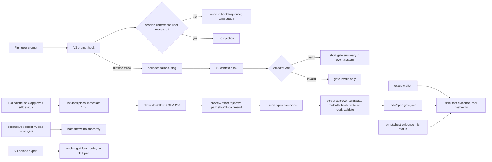

# Plan — V2-native brain

**Goal**: make the V2 plugin brain native without weakening the trust boundary. The server plugin injects the router once per persisted session through `ctx.session.hook('prompt')`, resolves the project from `ctx.location.directory` (never `cwd`), emits only a validated active-gate summary from `context`, keeps destructive/secret/Colab/spec-gate guards as hard throws with no `#nosafety`, records hash-only host evidence from `execute.after`, and adds a TUI part that previews plans, displays `files`/`allow` patterns and the plan SHA-256, and shows the exact `/approve <absolute-path> sha256:<hex>` command. The picker is preview-only this wave because U2 (agent-bash reachability of the command endpoint) was not run. V1 keeps its exact hook shape; `scripts/spec-check.mjs` is untouched.



**Architecture**

- **Server plugin** (`.opencode/plugins/sdlc-lean.js`): add `projectRoot(ctx)`, replace direct `ctx.directory` reads; register `prompt`, `context`, `compaction`, `execute.before`, and `execute.after`; keep `ctx.command.transform` for `/approve`; remove `#nosafety`; add approval validation and the host-evidence writer. No `ctx.permission` call.
- **TUI part** (`.opencode/plugins/sdlc-lean-tui/`): `index.js` is a stub server part; `tui.js` exports `{ id, setup }`; `register.js` owns pure helpers and fail-open registration. It uses the documented `context.keymap.layer(() => ({ mode: 'global', commands: [...] }))` shape, `dialog.select/confirm/prompt`, and `toast.show`. Session resolution is only `context.ui?.router?.current?.()` with `route.type === 'session'` and `route.sessionID`. Activation counts only `context.data.location.skill.sync(location)` + `.list(location)`. It never calls `client.session.command` and never sends a model prompt.
- **Host-evidence script** (`scripts/host-evidence.mjs`): read-only `status`; imports `parsePlanTasks` from `spec-check.mjs`; prints `host evidence: n/m matched (advisory)`; `--require-host` opts into a nonzero exit.
- **Installer** (`scripts/install-global.mjs`): add a `kind: 'dir'` source for `plugins/sdlc-lean-tui` and a file source for `scripts/host-evidence.mjs`; add summary keys and CLI output; prune stale installed files only.
- **Interfaces consumed/produced**: V2 prompt event `{ sessionID, prompt: { text } }`; `session.context({ sessionID })` messages; gate marker via `readGate`/`validateGate`; host row schema `{ at, sessionID, tool, argv0, command_sha256, plan_sha256, status, exit, output_sha256, output_bytes, workdir }`; TUI context with `ui.router.current()`, `data.location.skill`, `keymap.layer`, `dialog`, `toast`.
- `docs/threat-model.md` and `docs/review/2026-10-30-v2-native-brain.md` are already written; this plan does not edit them. `scripts/spec-check.mjs` is read-only; its `readGate` and `hashFile` exports are confirmed and may be imported.

**Tech stack**: Node 20+ ESM, zero dependencies, `node:test`, `node --check`, `npm run verify`, dry `node eval/run.mjs`, POSIX file modes for evidence. No new npm package, agent, skill, command file, eval probe, or router edit.

**Spec**: [`docs/specs/2026-10-30-v2-native-brain.md`](../specs/2026-10-30-v2-native-brain.md) (APPROVED 2026-10-31T00:27:17Z).

**Global Constraints**

- Follow `AGENTS.md`: plugin stays dependency-free, V1+V2 compatible, fail-open except the exact guards; safety guards only grow by exact-known patterns; bootstrap stays ≤5116 bytes.
- `scripts/spec-check.mjs` must not change. Host evidence is a new read-only script; `cli_sha256` must not drift under the active gate.
- Test integrity: Task 1 authors all new and updated tests. Tasks 2–5 must not edit those tests; if a test is wrong, stop and escalate. No task weakens a V1 assertion.
- Every task Verify is an external command. The RED task uses `! node --test …`; the final gate is exactly `npm run verify && node eval/run.mjs`.
- No new dependency, no `ctx.permission` registration, no native `ask`, no `instructions.entry`, no `ctx.storage`/`ctx.options`, no JSX, no TypeScript.
- V1 `SdlcLeanPlugin` keeps exactly `config`, `experimental.chat.messages.transform`, `experimental.session.compacting`, and `tool.execute.before`; V1 loads no TUI part.
- `npm run verify` ends with 0 failures; dry eval lists ≥35 probes and 0 failures; no live spend.
- Evidence is written only after all six Verifies pass; exactly six rows; `verify` strings match the table cells; `exit: 0`; UTC `at`; close is a separate terminal step with no row.
- The plan's `files` covers every edit; only `allow` files are writable outside it. `docs/plans/2026-10-30-v2-native-brain.md` and the spec are immutable while the gate is active.

**Lean Constraints**

- Reuse existing `fs`/`crypto`/`path`/`os`/`spawnSync`, `getBootstrapContent`, `isChildSession`, `writeStatus`, `checkSafety`, `checkSpecGate`, and the CLI's `normalizeRel`/`buildGate`/`writeGate`/`readGate`/`validateGate`/`hashFile`.
- One new server hook family and one new read-only script; no schema layer, event bus, storage, dependency, or framework.
- TUI: one small directory with three files, a minimal frontmatter summary parser, and fail-open registration. `node:fs` is dynamically imported inside `try/catch`; no npm import and no JSX. Use the documented keymap command list; a bind parse failure retries the same commands without `bind` so the palette survives.
- Host evidence is append-only JSONL with a `statSync` size check plus an in-process row counter seeded once per log path; no full-file read on the hot path and no database. Command normalization is three lines duplicated in plugin and script, with a test asserting both produce identical hashes.
- Docs edits are additive and concise; no router growth and no new skill.
- Debt rows record deferred work; D-003 is explicitly closed by this work, and other historical rows stay unchanged.

**Review Focus**

- **Guard boundary**: `#nosafety` no longer returns early; destructive, secret, Colab-bridge, `/content`, and spec-gate violations throw; error messages do not advertise the token; no permission hook; benign commands still pass.
- **Prompt persistence**: append (not prepend) to `event.prompt.text`; persisted `session.context` check; second prompt with a user message unchanged; child skip; lookup failure skips; retry after failed admission injects again; no once-per-session set or text marker; runtime fallback is bounded and only for the throwing session.
- **Root**: `location.directory` first, then `directory`; never `cwd`; mutating file tools fail closed when unknown; `compactionContext` returns `[]`; `approvePlan` requires `ctx.location.directory`.
- **Context summary**: `validateGate` first; one short text with plan/spec/file count; invalid marker emits only `gate invalid`; no bootstrap; no gate means no injection.
- **Approval order**: `buildGate` first; then realpath-check `gate.plan` and `gate.spec` under the project root; then compare the optional plan hash; then `writeGate`; then `readGate` + `validateGate` and compare plan/spec/files. A mismatch deletes the marker and refuses. `approved_via` is `tui-picker` with hash, else `tui-command`; plan file never written.
- **TUI keymap**: documented `keymap.layer(() => ({ mode: 'global', commands }))`; palette commands `sdlc.approve` and `sdlc.status`; optional `bind: 'ctrl+shift+a'`; a bind parse error is fail-open and the palette remains; no `layer.command`/`layer.keybind`.
- **TUI session**: only `context.ui?.router?.current?.()`; require `route.type === 'session'` and `route.sessionID`; otherwise refuse. No most-recent-session fallback.
- **TUI activation**: only `context.data.location.skill.sync(location)` + `.list(location)` with `location = context.location ?? context.data.location.default()`; count the returned array; missing/throw means 0 and log only.
- **TUI marker display**: `gateSummary` sanitizes plan/spec and verifies `plan_sha256`/`spec_sha256` against the files before display; mismatch returns `{ active: true, invalid: true }` and status shows `gate invalid`.
- **TUI preview**: filters immediate plans, symlinks, non-regular, >1 MB, control chars, `-progress`/`-evidence`; shows `files`/`allow` and SHA-256; exact preview command; no `session.command`, no model prompt; refuses without a current session; one activation toast per process; `sdlc.status`.
- **Host evidence**: hash-only command/output; `argv0`; plan hash stamped; skip background/running/timeout; 0700/0600; `lstat` + `O_NOFOLLOW` + `fstat`; `statSync` size + in-process counter for 500 rows/2 MB; kill switch; never blocks.
- **Script**: normalization for `!`/`$`/whitespace; plan hash, command hash, status `completed`, `exit === 0`; missing exit is unknown; extras advisory; malformed skipped and counted; zero rows fail only under `--require-host`.
- **Installer**: TUI dir and script copied byte-identical; manifest tracks; stale files pruned; user files untouched; V1 plugin remains a file.
- **Docs**: breaking `#nosafety` removal stated; picker is preview-only; host evidence advisory; debt rows record deferred work and close D-003.

**Dependency order**: `1 → 2 → 3 → 4 → 5 → 6`. Task 2 changes the shared plugin (impact: V1/V2 loading, spec-gate, safety, compaction, approval, host evidence). Task 3 adds a new directory loaded only by V2 (impact: installer parity and TUI tests). Task 4 consumes the Task 2 row format and the Task 3 directory. Task 5 documents the behavior. Task 6 runs every gate and writes allow-only evidence. No task starts before its predecessor's Verify passes.

| # | Task | Spec req | Files | Test | Expected | Verify |
|---|---|---|---|---|---|---|
| 1 | RED: author the new and updated contract tests | AC1–AC10 | `tests/opencode/test-v2-brain.mjs`, `tests/opencode/test-tui-brain.mjs`, `tests/opencode/test-host-evidence.mjs`, `tests/scripts/test-host-evidence.mjs`, `tests/opencode/test-plugin-loading.mjs`, `tests/opencode/test-spec-gate.mjs`, `tests/opencode/test-compaction-hook.mjs`, `tests/opencode/test-safety-guards.mjs`, `tests/opencode/test-approve-command.mjs`, `tests/scripts/test-install-global.mjs`, `docs/plans/2026-10-30-v2-native-brain-progress.md` (allow) | new `prompt:`/`root:`/`gate:`/`safety:`/`docs:` tests and updated suites | prompt, root, guard, TUI module-not-found, evidence, script, installer, and docs assertions fail; V1-only assertions pass; baseline recorded | `! node --test tests/opencode/test-v2-brain.mjs tests/opencode/test-tui-brain.mjs tests/opencode/test-host-evidence.mjs tests/scripts/test-host-evidence.mjs tests/opencode/test-plugin-loading.mjs tests/opencode/test-spec-gate.mjs tests/opencode/test-compaction-hook.mjs tests/opencode/test-safety-guards.mjs tests/opencode/test-approve-command.mjs tests/scripts/test-install-global.mjs` |
| 2 | GREEN server: prompt, context, roots, strict guards, approval, host evidence | AC1, AC2, AC3, AC5, AC6, AC8, AC9 | `.opencode/plugins/sdlc-lean.js`, `docs/plans/2026-10-30-v2-native-brain-progress.md` (allow) | `test-v2-brain` non-docs tests, `test-host-evidence`, existing plugin/spec-gate/compaction/safety/approval suites | prompt appends once; context emits only validated summary; roots fail closed; guards throw without `#nosafety`; approval order/hash/re-read; hash-only evidence rows | `node --test --test-name-pattern="^prompt:" tests/opencode/test-v2-brain.mjs && node --test --test-name-pattern="^root:" tests/opencode/test-v2-brain.mjs && node --test --test-name-pattern="^gate:" tests/opencode/test-v2-brain.mjs && node --test --test-name-pattern="^safety:" tests/opencode/test-v2-brain.mjs && node --test tests/opencode/test-host-evidence.mjs tests/opencode/test-plugin-loading.mjs tests/opencode/test-spec-gate.mjs tests/opencode/test-compaction-hook.mjs tests/opencode/test-safety-guards.mjs tests/opencode/test-approve-command.mjs` |
| 3 | GREEN TUI part: preview-only picker, activation, status | AC4, AC5 | `.opencode/plugins/sdlc-lean-tui/index.js`, `.opencode/plugins/sdlc-lean-tui/tui.js`, `.opencode/plugins/sdlc-lean-tui/register.js`, `docs/plans/2026-10-30-v2-native-brain-progress.md` (allow) | `test-tui-brain` | documented keymap commands, router session, skill sync/list count, listing filters, details/hash, exact preview command, no `session.command`, one toast, `sdlc.status` | `node --check .opencode/plugins/sdlc-lean-tui/index.js && node --check .opencode/plugins/sdlc-lean-tui/tui.js && node --check .opencode/plugins/sdlc-lean-tui/register.js && node --test tests/opencode/test-tui-brain.mjs` |
| 4 | GREEN host-evidence script and installer parity | AC7, AC10 | `scripts/host-evidence.mjs`, `scripts/install-global.mjs`, `docs/plans/2026-10-30-v2-native-brain-progress.md` (allow) | `tests/scripts/test-host-evidence.mjs`, `tests/scripts/test-install-global.mjs` | `status` string, `--require-host`, malformed skip; TUI dir and script copied, pruned, V1 file kept | `node --check scripts/host-evidence.mjs && node --test tests/scripts/test-host-evidence.mjs tests/scripts/test-install-global.mjs` |
| 5 | GREEN docs: native behavior, preview-only picker, strict guards | AC10 | `README.md`, `USAGE.md`, `CHANGELOG.md`, `docs/plans/2026-10-30-v2-native-brain-progress.md` (allow) | `docs:` assertions plus existing `/approve` docs test | docs name `sdlc.approve`, host evidence, preview-only, and the `#nosafety` removal | `node --test --test-name-pattern="^docs:" tests/opencode/test-v2-brain.mjs tests/opencode/test-approve-command.mjs` |
| 6 | Full gate, evidence, and debt rows | AC10 | `docs/plans/2026-10-30-v2-native-brain-progress.md` (allow), `docs/plans/2026-10-30-v2-native-brain-evidence.json` (allow), `docs/debt-ledger.md` (allow) | full suite, dry eval, host-evidence status, six-row evidence | `npm run verify` 0 failures; bootstrap ≤5116; dry eval ≥35 probes, 0 failures; six exact evidence rows; D-003 closed and D-028–D-034 added | `npm run verify && node eval/run.mjs` |

## Task notes

### Task 1 — RED contract tests

Create `tests/opencode/test-v2-brain.mjs`. Set `process.env.XDG_STATE_HOME` to a temp dir before importing the plugin. Use `node:test`, `node:assert/strict`, `crypto`, `fs`, `os`, `path`, and `pathToFileURL`. Helpers: `makeRoot()` with `docs/specs/spec.md`, an approved `docs/plans/plan.md`, `src/app.js`, and a debt ledger; `activate(root)` using the real `scripts/spec-check.mjs` `buildGate`/`writeGate`; `mockCtx()` capturing `prompt`, `context`, `compaction`, `tool:execute.before`, `tool:execute.after`, `session.context`, `session.get`, `session.synthetic`, `command.transform`, and a `permission` spy.

Tests prefixed for routing:

- `prompt:` first prompt appends `\n\n` plus `EXTREMELY_IMPORTANT`; a prompt containing an existing user message is unchanged; a retry after an empty message injects again; a child session skips; a rejected or thrown `session.context` skips; `@file` mention text remains a prefix; two distinct sessions each inject; `writeStatus` records the session; a runtime throw marks the session and the `context` hook injects the bootstrap once through `event.system`.
- `root:` `projectRoot(ctx)` returns `location.directory` before `directory`; returns `undefined` when neither; the V2 tool hook uses location when both are present; `checkSpecGate('edit'|'write'|'patch', ..., undefined)` throws while `read`/`bash` do not; `compactionContext(undefined)` returns `[]`; the V2 compaction hook uses location; the V1 compaction hook with no directory still uses the repo-root default.
- `gate:` a valid marker pushes one short text with plan, spec, and file count and no `EXTREMELY_IMPORTANT`; an invalid marker pushes only `gate invalid`; no marker pushes nothing.
- `safety:` `rm -rf / #nosafety`, `cat .env #nosafety`, `pkill -f colab-mcp #nosafety`, and `rm -rf /content #nosafety` all throw; error messages do not contain `#nosafety`; benign commands pass; `ctx.permission` is never called; V1 keys are exactly the four existing hooks.
- `docs:` README, USAGE, and CHANGELOG name `sdlc.approve`, `host evidence`, and `preview-only`; CHANGELOG states `#nosafety` is removed; README/USAGE name `scripts/host-evidence.mjs`.

Create `tests/opencode/test-tui-brain.mjs` with `tui:` tests. A top-level `import` of `register.js` may fail RED with module-not-found; record that baseline and do not create TUI stubs in Task 1.

- `listPlans` includes immediate `.md` only and skips `-progress`, `-evidence`, symlinks, non-regular files, files over 1 MB, and control-character names.
- `planDetails` returns `files`/`allow` and a SHA-256 equal to `crypto` over the plan bytes.
- `resolveSessionID` uses only `context.ui?.router?.current?.()`; require `route.type === 'session'` and `route.sessionID`; a home route, a plugin route, and no current route return `null`.
- `buildApproveCommand` returns `/approve <absolute-path> sha256:<hex>`.
- `gateSummary` sanitizes plan/spec and verifies `plan_sha256`/`spec_sha256` against the files; a tampered marker or changed file returns `{ active: true, invalid: true }`; `sdlc.status` then shows `gate invalid`.
- `setupTui` with a fake context calls `context.keymap.layer(() => ({ mode: 'global', commands: [...] }))`, captures the returned `commands`, and invokes `run`. The fake `keymap.layer` may throw once when a command has `bind`; the retry without `bind` must still expose `sdlc.approve` in the palette. No `layer.command` or `layer.keybind`.
- The picker selects a plan, confirms, shows the exact command, and the fake `client.session.command` spy is never called; the fake `session.prompt` spy is never called. Do not assert the text `session.command` is absent; comments are allowed.
- The picker refuses with no session; `sdlc.status` prints the gate plus host-evidence count.
- Activation count uses `context.data.location.skill.sync(location)` then `.list(location)` with `location = context.location ?? context.data.location.default()`; count the returned array; missing/throw means 0 and log only (no toast). It must not infer counts from directory entries or object keys.
- One activation toast across two setups; zero skills logs only.
- `tui.js` and `index.js` export the required shapes; no JSX or npm import.

Create `tests/opencode/test-host-evidence.mjs` with `evidence:` tests against a temp repo with an active gate: invoke the captured `tool:execute.after`; assert row fields, normalized `command_sha256`, `output_sha256`, `argv0`, `plan_sha256`, `completed`, numeric exit, UTC `at`, and `workdir`; assert the raw command and output never appear; skip background, `metadata.status === "running"`, and `metadata.timeout === true`; ignore non-bash/shell and no-gate cases; honor `SDLC_LEAN_NO_HOST_EVIDENCE=1`; refuse a symlinked `.sdlc` directory and file without outside writes; enforce 500 rows and 2 MB using a 500-row log and a synthetic >2 MB file, with a read spy proving the large file is skipped by `statSync` without a full read; assert `.sdlc` is 0700 and the log is 0600; assert invalid events never throw.

Create `tests/scripts/test-host-evidence.mjs` with `script:` tests: `normalizeCommand` strips a leading `!`/`$` and collapses whitespace but leaves `$HOME` alone; the plugin and script normalization functions produce identical output; per-task matching requires the active `plan_sha256`, matching `command_sha256`, `status: "completed"`, and `exit === 0`; missing/null exit is unknown and never matches; extra rows are advisory; malformed lines are skipped and counted; `--require-host` exits 1 on an unmatched task or zero matches and 0 when all match; stdout contains `host evidence: n/m matched (advisory)`; no active gate exits 0 advisory and 1 with `--require-host`; `--plan` must still hash to the active gate.

Update existing tests without weakening V1 coverage:

- `test-plugin-loading`: add `session.context`, capture `prompt`, replace the V2 context-injection assertion with prompt append/no-op, assert the context hook has no bootstrap by default, and keep the safety and V1 tests.
- `test-spec-gate`: cover location-only, directory-only, both (location wins), and neither (mutating tools throw, non-mutating pass).
- `test-compaction-hook`: `compactionContext()` returns `[]`; V2 uses location; unknown V2 root yields `[]`; V1 no-directory hook still uses the repo-root default.
- `test-safety-guards`: remove the `#nosafety` opt-out assertions; assert the token no longer bypasses destructive, secret, and Colab guards and messages do not advertise it; keep all benign cases.
- `test-approve-command`: set `XDG_CONFIG_HOME` to a temp home; add global-preference and project-fallback cases; add `sha256:<hex>` success (`tui-picker`) and wrong-hash refusal; add a temp fake global CLI whose `writeGate` writes a mismatched marker and assert the plugin deletes it and refuses; add a fake gate whose spec realpath escapes and assert `writeGate` is not called; assert `ctx.location.directory` is required; keep the V1 four-key and no-tool assertions.
- `test-install-global`: extend `fakeRepo` with `.opencode/plugins/sdlc-lean-tui/{index,tui,register}.js` and `scripts/host-evidence.mjs`; assert summary keys `tui` and `hostEvidence`; assert real-repo byte-identical copies and manifest entries; prune a stale TUI file; assert `plugins/sdlc-lean.js` stays a regular file.

Create `docs/plans/2026-10-30-v2-native-brain-progress.md` with plan/spec links, the RED baseline time, per-file pass/fail counts, the TUI module-not-found baseline, and the exact failing names (`prompt`, `root`, `gate`, `safety`, TUI, evidence, script, installer, docs). Do not edit the plugin, docs, scripts, or TUI in this task. The negated Verify exits 0 while the underlying suites exit 1; record both.

### Task 2 — GREEN server

In `.opencode/plugins/sdlc-lean.js`:

- Add `export const projectRoot = (ctx)` returning `ctx.location?.directory` then `ctx.directory`; never `process.cwd()`. Add `REPO_ROOT = path.resolve(__dirname, '..', '..')` for the V1 compaction legacy default.
- `checkSpecGate(tool, args, root)`: compute targets first; if targets exist and `!root`, throw `[sdlc-lean] spec gate root unknown: refusing <tool> (no location or directory)`. Keep the marker, CLI hash, spawn, and error behavior otherwise. Non-mutating tools and targetless calls remain no-ops.
- `compactionContext(root)`: remove the default argument; return `[]` when `!root`; keep `safeReadDoc` and the 1500-char cap. V1's `experimental.session.compacting` passes `directory || REPO_ROOT` to preserve its old behavior.
- `checkSafety`: delete the `#nosafety` early return; remove the token from destructive, secret, and `/content` messages. Keep all exact-known patterns and fail-open for benign input. Do not register any permission hook.
- `resolveApprovalCli(root)`: global `$XDG_CONFIG_HOME/opencode/scripts/spec-check.mjs` (or `~/.config/opencode/...`) first; project `<root>/scripts/spec-check.mjs` only if no global exists. Export it for tests if useful.
- `parseApprovalArg(text)`: return `{ arg, hash }`. Accept exactly one non-flag path token plus optional `sha256:<hex>`; lowercase the hash; usage is `usage: /approve <repo-relative-or-absolute-plan.md> [sha256:<hex>]`; errors contain `usage`, `exactly one`, `flag`, or `sha256`.
- `approvePlan(ctx, { sessionID, prompt })`: require `ctx.location?.directory` only. Resolve the CLI and dynamically import it. Execute this exact order:
  1. `const rel = mod.normalizeRel(root, arg); const gate = mod.buildGate(root, rel);`
  2. Realpath-check `gate.plan` and `gate.spec` under the real project root; refuse if either resolves outside.
  3. Compare the optional `sha256:<hex>` to `gate.plan_sha256`; refuse on mismatch.
  4. Write `{ ...gate, approved_by: os.userInfo().username, approved_at: UTC, approved_via: hash ? 'tui-picker' : 'tui-command' }` with `mod.writeGate`.
  5. `mod.readGate` + `mod.validateGate`; compare `plan`, `spec`, `plan_sha256`, `spec_sha256`, `files`, `allow`; on any mismatch or error, unlink only a marker written by this invocation and throw; never delete a pre-existing marker.
  Do not claim the spec path is realpath-checked before `buildGate`. Notify success and refusals through `ctx.session.synthetic`; never write the plan.
- V2 setup: `const root = projectRoot(ctx)`.
  - Register `prompt` before `context`. Skip without `sessionID` or `event.prompt.text`; skip children via `isChildSession`; require `ctx.session.context`; unwrap `{ data: { messages } }` or `{ messages }`; skip when no array or any `role === 'user'`/`info.role === 'user'`; append `\n\n${getBootstrapContent()}`; call `writeStatus(sessionID)` only on injection. On a runtime throw, log and add the session to a bounded `_promptFallback` set; this is the AC1 fallback marker, not a once-per-session injection set.
  - Register `context`: if `event.system` is an array, push the bootstrap once for a session in `_promptFallback` and delete the flag. Resolve `root`; if unknown, stop. Use `resolveSpecCheck()` and dynamic import to `readGate`/`validateGate`; valid pushes one short text with `plan`, `spec`, and `files.length`; invalid pushes only `gate invalid`; no marker pushes nothing. Never push the bootstrap normally.
  - Register `compaction`: `compactionContext(root)`; append text parts to `event.system` or strings to `event.context`; `[]` is a no-op.
  - Register `execute.before`: `checkSafety` then `checkSpecGate` with `root`.
  - Register `execute.after`: call the hash-only writer for `bash`/`shell` with a command. Add `export const normalizeCommand` (`/^\s*[!$]\s+/`, trim, collapse whitespace), `hostEvidencePath`, `HOST_EVIDENCE_MAX_ROWS = 500`, `HOST_EVIDENCE_MAX_BYTES = 2 * 1024 * 1024`, and `appendHostEvidence(root, row)`; export `recordHostEvidence(event, root)` if useful. Skip background, `metadata.status === "running"`, and `metadata.timeout === true`. Read the marker and `validateGate`; skip when none/invalid. Row fields exactly: `at`, `sessionID`, `tool`, `argv0` (normalized first token), `command_sha256` (normalized command), `plan_sha256`, `status` (`completed` unless the event says otherwise), `exit` (number or null), `output_sha256` (hex or null), `output_bytes`, `workdir` (event/input or null). Never store raw command or output.
  - Host-evidence cap: keep a module-level `Map` from log path to row count. On the first append for a path, `lstat`/`statSync` the file; if it is absent the count is 0; if its size is at least 2 MB skip without reading; otherwise seed the counter once by reading that file (cold path) and counting newlines. On later calls, `statSync` the file and skip when size is at least 2 MB or the in-process count is at least 500; do not read the full file on the hot path. Increment only after a successful append. `mkdirSync` `.sdlc` 0700 + chmod, `lstat` it, `openSync` with `O_APPEND|O_CREAT|O_WRONLY|O_NOFOLLOW` 0600, `fstat` regular, `fchmod` 0600; close in `finally`; catch everything. Honor `SDLC_LEAN_NO_HOST_EVIDENCE=1`.
  - Keep the command registration; keep no `ctx.permission`.
- Do not touch `SdlcLeanPlugin`'s four keys, `scripts/spec-check.mjs`, or any test. If a Task 1 assertion is wrong, stop and escalate.

### Task 3 — GREEN TUI part

Create exactly three files:

- `index.js`: `export default { id: 'sdlc-lean-tui', setup() {} };` — stub server part; if the host announces/scans the part twice in manual smoke, remove the stub and record the single-registration path.
- `register.js`: import `crypto` and `path` from `node:`; dynamically import `node:fs` in a `loadFs()` try/catch. Export `listPlans(root)`, `planDetails(root, rel)`, `gateSummary(root)`, `hostEvidenceSummary(root, gate)`, `resolveSessionID(context)`, `buildApproveCommand(root, rel, hash)`, `activationText(count)`, `setupTui(context)`, and `resetTuiState()` for tests.
  - `listPlans`: immediate `docs/plans`; skip non-`.md`, `-progress.md`, `-evidence.md`, control-character names, whitespace in the filename, symlinks, non-regular, >1 MB; return `{ rel, abs, name, size }` sorted newest first.
  - `planDetails`: require `docs/plans/<name>.md`; `lstat` regular non-symlink; realpath containment; read; parse `spec`, `status`, `files`, `allow` block lists with a small local parser (reuse `crypto` for SHA-256); sanitize control characters; reject escapes and oversize.
  - `gateSummary`: read `.sdlc/spec-gate.json`; sanitize `plan`/`spec` control characters; read both files and verify `plan_sha256`/`spec_sha256` against their bytes. Valid returns `{ active: true, plan, spec, files, allow, plan_sha256, spec_sha256 }`; missing files or hash mismatch returns `{ active: true, invalid: true }`; absent marker returns `{ active: false }`. No writes.
  - `hostEvidenceSummary`: read `.sdlc/host-evidence.jsonl`; skip malformed/oversize lines; count rows and rows whose `plan_sha256` equals the active plan; return `{ rows, matched, malformed }`.
  - `resolveSessionID(context)`: use only `context.ui?.router?.current?.()`. Return `route.sessionID` only when `route.type === 'session'` and `route.sessionID` is a non-empty string; otherwise return `null`. A home route, a plugin route, or no current route means `null`; no most-recent-session fallback.
  - `buildApproveCommand`: `/approve ${path.resolve(root, rel)} sha256:${hash}`.
  - `setupTui`: resolve root from `context.data?.location?.directory || context.location?.directory || context.directory`; never `cwd`. Activation: `const location = context.location ?? context.data?.location?.default?.();` then `const skill = context.data?.location?.skill; const list = await skill?.sync?.(location); const skills = await skill?.list?.(location);` count `Array.isArray(skills) ? skills.length : 0`; if `sync`/`list` is missing or throws, count 0 and log only. Do not infer from directory entries or object keys. One module-level toast per process for count > 0; zero logs only.
  - Register with the documented shape:
    ```js
    context.keymap.layer(() => ({
      mode: 'global',
      commands: [
        { id: 'sdlc.approve', title: 'Approve SDLC plan', palette: true, bind: 'ctrl+shift+a', run: openPicker },
        { id: 'sdlc.status', title: 'SDLC status', palette: true, run: showStatus },
      ],
    }));
    ```
    Wrap it in `try/catch`. On a bind parse failure, retry the same commands without `bind` so `sdlc.approve` remains in the palette. Do not call `layer.command` or `layer.keybind`; the callback owns the command list.
  - `openPicker`: refuse with no session; `dialog.select` the plans; `planDetails`; `dialog.confirm` with `files`, `allow`, `plan sha256`, and the exact preview command; on confirm toast `preview-only: run the command shown`; never call `client.session.command` or `session.prompt`; local errors show `refused — see session message` and log. `sdlc.status`: `gateSummary`; when `invalid` show `gate invalid`; otherwise show the gate summary and `host evidence: matched/rows rows (advisory)`.
- `tui.js`: `import { setupTui } from './register.js'; export default { id: 'sdlc-lean-tui', setup: setupTui };`.

No server plugin or installer edit in this task. The execute branch stays out; the exact `/approve <abs> sha256:<hex>` string is the preview contract.

### Task 4 — GREEN script and installer

Create `scripts/host-evidence.mjs`:

- Import `crypto`, `fs`, `path`, and `fileURLToPath`; import `parsePlanTasks`, `readGate`, `validateGate`, `normalizeRel`, and `hashFile` from `./spec-check.mjs`. `readGate` and `hashFile` are confirmed exports; `spec-check.mjs` is unchanged.
- Export `normalizeCommand` with the exact same rule as the plugin; export `loadRows`, `matchPlanTasks`, `status`, and `main`.
- `loadRows(logPath)`: return `{ rows, malformed }`; missing file is zero; `lstat` regular non-symlink; skip lines over 64 KB, blank lines, and invalid JSON/non-object rows; count malformed.
- `matchPlanTasks(planTasks, rows, gate)`: normalize each plan Verify, hash it, and require an unused row with `plan_sha256 === gate.plan_sha256`, `command_sha256 === hash`, `status === "completed"`, and `exit === 0`. Missing/null exit is unknown. Extra rows never fail.
- `status({ root, plan, requireHost, io })`: read and validate the gate; no gate prints `host evidence: no active spec gate` and returns 0 advisory or 1 with `--require-host`; a bad marker returns 1; resolve `--plan` (must hash to `gate.plan_sha256`); read the plan with `parsePlanTasks`; print row count and exactly `host evidence: n/m matched (advisory)`; return 1 only for `--require-host` when `matched < total` or `matched === 0`.
- `main(argv, io)`: parse `status`, `--require-host`, `--root`, `--plan`, `-h`; usage names `status`; `--root` defaults to `cwd` for the CLI only. Export and run `if (isMain) process.exit(main())`. Never write.

Update `scripts/install-global.mjs`: add `{ from: '.opencode/plugins/sdlc-lean-tui', to: 'plugins/sdlc-lean-tui', kind: 'dir', key: 'tui' }` and `{ from: 'scripts/host-evidence.mjs', to: 'scripts/host-evidence.mjs', kind: 'file', key: 'hostEvidence' }`; add `tui: 0` and `hostEvidence: 0` to the summary; add `tui <n>` and `host-evidence yes/no` to the CLI line. Preserve the manifest prune and user-file guarantees.

Do not edit `scripts/spec-check.mjs`, tests, docs, or the plugin.

### Task 5 — GREEN docs

- `README.md`: add the TUI directory and `scripts/host-evidence.mjs` to the manual install copies; update the spec-gate row to name `sdlc.approve` preview-only plus the typed `/approve`; add a host-evidence row or bullet (advisory, hash-only, `--require-host` opt-in); state the safety guards have no in-band bypass; add `node scripts/host-evidence.mjs status` to Verify.
- `USAGE.md`: add the TUI dir and host script to install/manual/uninstall; update activation signals (TUI toast comes from the TUI part; headless keeps status/announce); update the automatic spec-gate bullet for picker preview plus typed `/approve` and hash; state `#nosafety` is removed; add `sdlc.approve`/`sdlc.status` and `node scripts/host-evidence.mjs status` to the command reference; add troubleshooting for a missing TUI part.
- `CHANGELOG.md`: add Unreleased Added bullets for the persisted prompt hook, TUI preview-only picker/status, hash-only host evidence, and installer parity; add Changed bullets for the strict guards (`#nosafety` removed, breaking), location-first root, and approval order/global CLI/hash/re-read. No version bump.
- Keep edits additive and concise; do not edit tests, skills, router, threat model, review, or code.

### Task 6 — full gate, evidence, debt

- Update `docs/debt-ledger.md` row D-003's status cell to `closed 2026-10-31: #nosafety removed; strict guards; tests`; keep every other historical row unchanged. Append exactly seven debt rows `D-028`–`D-034`: native `ask` deferred; `instructions.entry` deferred; TUI footer status deferred; hard host-evidence gate deferred; CLI symlink hardening deferred; read-only tool surface deferred; TUI execute branch preview-only pending U2.
- Run each Verify in order once more. Do not re-run the Task 1 negated command after the tests pass; use its RED `at` for the Task 1 evidence row. Record raw exit and UTC time per task.
- Run `node scripts/host-evidence.mjs status` as the advisory diagnostic; it must exit 0 and print the `host evidence: n/m matched (advisory)` shape. Do not add it to the evidence Verify strings.
- Run `npm run verify && node eval/run.mjs`; confirm 0 failures, bootstrap ≤5116, ≥35 probes, 0 probe failures.
- Write `docs/plans/2026-10-30-v2-native-brain-evidence.json` with `plan`, `plan_sha256` copied from the active marker, and exactly six rows whose `verify` strings match the table cells exactly, `exit: 0`, and UTC `at`. No code, test, docs, plan, or spec edits after evidence; only allow files.

## Close (separate; no task row)

After Task 6 evidence is complete and every row matches, run `node scripts/spec-check.mjs close` in the repo root. It validates the plan hash, one row per task, exact Verify strings, exit 0, and UTC `at`; it removes `.sdlc/spec-gate.json` and prints the evidence SHA-256. If close refuses, fix the evidence; the marker stays. Close is never a plan task and never gets an evidence row.

## Deviations and flags

1. **AC4 execute branch is preview-only.** U2 was not run, so the picker lists, previews, shows `files`/`allow` and the SHA-256, and displays the exact `/approve <absolute-path> sha256:<hex>` command. It does not call `client.session.command`. The execute branch and its post-command re-read are deferred to debt row D-034. The server still performs the hash/realpath/re-read/validate contract for the typed command (AC9).
2. **AC10 "behavior-identical" is interpreted as V1 hook keys and exports**, not shared-guard internals. V1 keeps exactly four hooks and no TUI part. The shared `checkSafety` is intentionally stricter by AC8 (`#nosafety` removed), and `checkSpecGate` fails closed on an unknown root by AC2; both apply to V1 and V2. V1's compaction hook retains its legacy repo-root default by passing `directory || REPO_ROOT`.
3. **`scripts/spec-check.mjs` is unchanged.** The host-evidence script imports `parsePlanTasks` and the confirmed `readGate`/`hashFile` exports; no `cli_sha256` drift is introduced. The approval path uses the installed global CLI first and the project CLI only when no global exists.
4. **The prompt fallback marker is a bounded process-local set**, required by AC1's "marks the session for the context fallback." It is not the rejected once-per-session injection set; injection is decided by the persisted `session.context` lookup, and no text marker is used. The context hook consumes and deletes the fallback flag.
5. **`command_sha256` hashes the normalized command**, not the raw bytes, so a plan Verify starting with `!` or `$` matches a row whose command includes the shell prefix. The plugin and script duplicate the three-line normalizer; `test-host-evidence` asserts both produce identical output. Raw commands and output are never stored.
6. **TUI API shape is the documented one**: `keymap.layer` returns `{ mode: 'global', commands }`; session resolution is only `ui.router.current()` with a session route; activation is only `data.location.skill.sync/list`. A bind parse error retries without `bind`, preserving the palette. Missing APIs log and return; manual smoke decides whether the `index.js` stub double-registers. No execution branch is added.
7. **Debt ledger**: D-003 is explicitly closed with the status update `closed 2026-10-31: #nosafety removed; strict guards; tests`; D-028–D-034 record the deferred items AC10 names. Other historical rows are unchanged.
8. **Existing tests are updated, not weakened**: `test-plugin-loading` (prompt instead of context), `test-spec-gate` (location precedence + unknown root), `test-compaction-hook` (location root + `[]`), `test-safety-guards` (`#nosafety` no longer bypasses), `test-approve-command` (global CLI, hash arg, approval order, re-read, V1 keys), `test-install-global` (TUI dir + script). Task 1 authors all edits; Tasks 2–5 must not touch tests.
9. **Threat model and review record are already written** and are outside this plan's `files`; no task edits them.
10. **Docs caps**: no line caps apply to README/USAGE/CHANGELOG; keep edits additive and concise. Bootstrap remains the only byte cap (≤5116).

## Self-review

**AC coverage**

| AC | Task(s) | Proof |
|---|---|---|
| AC1 persisted bootstrap | 1, 2 | prompt append, second-prompt no-op, retry, child skip, lookup-failure skip, two-session injection, fallback, `writeStatus` |
| AC2 project root | 1, 2 | `projectRoot` precedence, location-only/directory-only/neither, mutating fail-closed, compaction `[]`, V1 legacy default |
| AC3 active-gate context | 1, 2 | valid short summary, invalid `gate invalid` only, no gate no injection, no bootstrap |
| AC4 TUI part | 1, 3 | documented keymap commands, router session, listing filters, details/hash, exact preview command, `client.session.command` spy never called, no model prompt, no-session refusal |
| AC5 activation/status | 1, 2, 3 | skill `sync`/`list` count, one toast per process, zero logs only, `writeStatus` on prompt, `sdlc.status` gate + evidence count, `gate invalid` on hash mismatch |
| AC6 host evidence | 1, 2 | row schema, raw command/output absent, hashes, skip backgrounds/running/timeout, modes, symlink/FIFO, `statSync` size + seeded counter for 500 rows/2 MB, kill switch |
| AC7 evidence script | 1, 4 | normalization, per-task matching, plan hash, completed/exit 0, malformed skip, extras advisory, `--require-host`, exact status string |
| AC8 strict guards | 1, 2 | `#nosafety` no longer bypasses destructive/secret/Colab; messages clean; no permission hook; benign pass |
| AC9 approval integrity | 1, 2 | global CLI preference, project fallback, buildGate first, realpath plan/spec, optional hash, writeGate, re-read/validate/delete, `approved_via`, plan untouched |
| AC10 V1/installer/tests/docs | 1–6 | V1 four keys, TUI dir/script copied and pruned, bootstrap ≤5116, full verify, dry eval ≥35/0, docs and debt rows with D-003 closed |

**Binary checks**

- [x] Every AC maps to at least one task; every task names a spec req; no orphan task.
- [x] No task edits its own grader: Task 1 authors every test; Tasks 2–6 never edit tests.
- [x] `files` covers every edit: plugin, three TUI files, script, installer, ten test files, README, USAGE, CHANGELOG. `allow` covers progress, evidence, debt.
- [x] Every Verify is external; Task 1 uses `! node --test`; Task 6 is exactly `npm run verify && node eval/run.mjs`.
- [x] No task edits `scripts/spec-check.mjs`, the approved spec, the threat model, or the review record.
- [x] V1 exact four hook keys and no TUI part; V2 setup without a command surface still registers hooks.
- [x] Host evidence is hash-only, mode-constrained, symlink-safe, capped with `statSync` + seeded counter, and kill-switchable; no raw command/output.
- [x] Approval uses the exact order buildGate, realpath plan/spec, hash compare, writeGate, re-read/validate; requires `ctx.location.directory`; prefers the global CLI.
- [x] TUI uses only the documented keymap command list, router current session, and skill sync/list count; the picker is preview-only and the `client.session.command` spy is never called.
- [x] `gateSummary` sanitizes plan/spec and verifies both hashes before display; mismatch shows `gate invalid`.
- [x] Docs state the breaking `#nosafety` removal and the preview-only picker; no router growth.
- [x] Bootstrap cap, zero-failure gate, dry eval probe count, and no new dependency are explicit.
- [x] Evidence has exactly six rows with exact Verify strings, exit 0, and UTC `at`; close is separate and has no row.
- [x] Debt ledger updates D-003 to closed and adds D-028–D-034; other historical rows are unchanged.
- [x] `status: draft`; `approved_by` and `approved_at` are empty; no self-approval.
