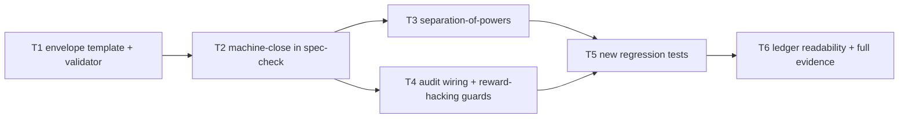

# Plan: Auto-tier pilot build (envelope-authorized machine-closed loop)

## Goal

Build the pilot machinery from `docs/design/0001-auto-tier-pilot.md` so one standing envelope authorizes long unattended Auto runs on this repo: envelope template + technical enforcement, machine-close path in the gate CLI, separation-of-powers, audit-ledger wiring, and reward-hacking guards — with irreversible-external acts staying human and the human role reduced to ledger sampling.

## Architecture

- Components touched: `scripts/spec-check.mjs` (envelope validation + `close --machine`), `.opencode/plugins/sdlc-lean.js` (SoP role checks in `checkSpecGate` opts + envelope/expected-outcome guards at closer time via `checkCloser`/`checkEnvelopeClean`), `docs/auto-envelope.template.md` (new pre-approval record), `docs/audit-ledger.md` (row format + sampling header), two new regression test files.
- Interfaces consumed: existing gate contract (`buildGate`/`validateGate`/`checkPath`/`closeGate`), existing `npm run verify` (= `lint` + `node --test`), existing audit-ledger row shape (`date | tier | check | result | reversal`).
- Interfaces produced: `node scripts/spec-check.mjs envelope check <file>`; `node scripts/spec-check.mjs close --machine --check "<cmd>" --critics <file> --reversal <sha> [--envelope <file>]`; machine-close audit-row append.

## Tech Stack

- Node.js, zero dependencies (plugin and CLI stay dep-free per repo rules).
- Test commands: `node --test <file>`, `npm run lint` (`node scripts/validate-skills.mjs`), `npm run verify` (`lint` + `node --test`).

## Spec

- `docs/design/0001-auto-tier-pilot.md` (accepted by human 2026-10-31) + pilot threat section in `docs/threat-model.md` + authorities `autonomy-dial`, `autonomous-loop`, `subagent-driven-development`.

## Global Constraints

- Plugin stays V1+V2 compatible and fail-open (never break activation); no `process.cwd()` as project root.
- Safety guards grow only by exact-known destructive patterns, each with a test; benign commands must pass.
- Spec gate active while building this plan: edits only inside frontmatter `files`; plan/spec immutable; `close` + re-approve to change scope — never bypass with bash.
- Bootstrap budget <5KB; skill bodies on demand.

## Lean Constraints

- Reuse-first: extend `spec-check.mjs` and `checkSpecGate` rather than new services, new deps, or new abstractions. Lowest rung that holds: template MD + CLI flags + hook checks + tests.
- No new skill, no new agent, no new command surface beyond one subcommand (`envelope check`) + one flag-mode (`close --machine`).

## Review Focus

- Machine-close trust boundary: closer is mechanical (evidence + hashes + critic verdicts present), never judgment; human `close` path byte-for-byte intact.
- Grader immutability is load-bearing: agent-edited checks must refuse machine-close, never go green.
- SoP freshness is real (distinct sessions/roles), not prose; correlated-model-failure residual stays owned by human sampling.
- Envelope enforced technically by hooks, not promises; out-of-envelope = deviation → escalate.

## Tasks

| # | Task | Spec req | Files | Test | Expected | Verify |
|---|------|----------|-------|------|----------|--------|
| 1 | Envelope template + validator | ENV-1 | `docs/auto-envelope.template.md`, `scripts/spec-check.mjs` | CLI self-check on valid + mutated fixtures | valid template passes, widened-path/empty-reversal fixture fails | `node scripts/spec-check.mjs envelope check docs/auto-envelope.template.md --root .` |
| 2 | Machine-close path | MC-1 | `scripts/spec-check.mjs` | Existing contract suite stays green | Human `close` unchanged; `close --machine` refuses when any criterion missing | `node --test tests/scripts/test-spec-check.mjs` |
| 3 | Separation-of-powers enforcement | SOP-1 | `.opencode/plugins/sdlc-lean.js` | Existing gate-enforcement suite stays green | Out-of-scope still blocked; same-session critic/closer refused | `node --test tests/opencode/test-spec-gate.mjs` |
| 4 | Audit wiring + reward-hacking guards | AUD-1, RH-1, ESC-1 | `scripts/spec-check.mjs`, `.opencode/plugins/sdlc-lean.js` | Existing host-evidence + safety suites stay green | Ledger row with reverting SHA; agent-edited grader refuses | `node --test tests/scripts/test-host-evidence.mjs` |
| 5 | New regression tests | MC-1, SOP-1, AUD-1, RH-1 | `tests/scripts/test-auto-tier-machine-close.mjs`, `tests/opencode/test-auto-tier-sop.mjs` | New suites green under full suite | All new tests pass; full verify green | `npm run verify` |
| 6 | Ledger readability + full evidence | SAMP-1, REF-1, EXT-1 | `docs/audit-ledger.md` | Full gate regression green; evidence validates | `spec-check verify` passes; one exit-0 row per task | `npm run verify` |

## Self-review

- Coverage: ENV-1→T1; MC-1→T2,T5; SOP-1→T3,T5; AUD-1→T4,T5; RH-1→T4,T5; ESC-1→T4; EXT-1→T6; REF-1→T6; SAMP-1→T6. Every task names a spec req; no orphan task; no task edits its own grader.
- Consistency: T2 keeps human close intact; T3 matches subagent-driven-development; T4 ledger shape matches autonomy-dial; files cover every edited path.
- Leanness: no new service/skill/agent/dependency; one subcommand (`envelope check`) + one flag-mode (`close --machine`) + template + hooks + two test files.
