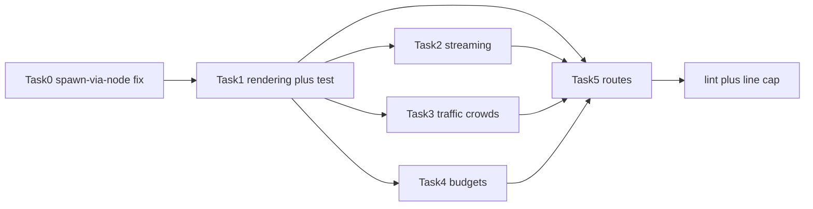

# Goal

Add photoreal Babylon.js guidance to the `web-game-development` skill: four
references plus `SKILL.md` routes plus a pinning test, with lint green and the
SKILL body at or under 155 lines.

# Architecture

- Four new reference files under
  `.opencode/skills/web-game-development/references/`; no existing reference
  edited.
- `SKILL.md` gains route-table rows only; body stays at or under 155 lines.
- `tests/opencode/test-web-game-photoreal.mjs` pins reference existence, route
  rows, the line cap, and the WebGL2-floor statement.

# Tech Stack

- Markdown references, plain JS test with `node --test`, no new dependency.
- Contract: `scripts/validate-skills.mjs` must exit 0 after every task.

# Spec

Approved spec `docs/specs/2026-10-31-photoreal-capabilities.md`: REQ-0 through
REQ-6, AC-0 through AC-10, Babylon-stay decision, trace table.

# Constraints

- Global: plan, spec, and gate marker immutable once the gate is active.
- `files` covers every source edit; `allow` covers progress ledger plus
  evidence JSON only.
- No engine-pick, netcode, shipping, vendored-material, or script changes
  (except the Task 0 REQ-0 gate-spawn recovery fix).
- WebGL2 floor plus WebGPU progressive enhancement; no WebGPU-only claims.
- Evidence only after all Verifies pass; `close` is separate, never its own row.

# Review Focus

- Routes point at files that exist with the specified content keywords.
- SKILL.md line cap holds after route rows are added.
- Sim/render separation stated in traffic guidance.
- Budgets name frame, asset, and GPU-memory numbers.

# Tasks

| # | Task | Spec req | Files | Test | Expected | Verify |
|---|---|---|---|---|---|---|
| 6 | Spawn-via-node fix plus regression test (extend existing tests/opencode/test-spec-gate.mjs, no new file) | REQ-0 | .opencode/plugins/sdlc-lean.js, tests/opencode/test-spec-gate.mjs | node --test tests/opencode/test-spec-gate.mjs | spawn uses node plus gated writes unblocked | `node --test tests/opencode/test-spec-gate.mjs && node scripts/validate-skills.mjs` |
| 1 | Rendering reference plus test skeleton | REQ-1, AC-1, AC-8, AC-10 | babylon-photoreal-rendering.md, test-web-game-photoreal.mjs | New suite asserts rendering reference keywords, route rows, line cap, WebGL2 floor | Suite passes with rendering reference present | `node --test tests/opencode/test-web-game-photoreal.mjs` |
| 2 | World-streaming reference | REQ-2, AC-2 | babylon-world-streaming.md | Suite asserts LOD, culling, tile streaming, eviction | Keywords present, suite still passes | `grep -q LOD .opencode/skills/web-game-development/references/babylon-world-streaming.md` |
| 3 | Traffic plus crowds reference | REQ-3, REQ-4, AC-3, AC-4 | babylon-traffic-crowds.md | Suite asserts deterministic sim separation, instancing, agent caps | Keywords present, suite still passes | `grep -q sim .opencode/skills/web-game-development/references/babylon-traffic-crowds.md` |
| 4 | Photoreal budgets reference | REQ-5, AC-5 | babylon-photoreal-budgets.md | Suite asserts frame, asset, GPU-memory budgets | Keywords present, suite still passes | `grep -q budget .opencode/skills/web-game-development/references/babylon-photoreal-budgets.md` |
| 5 | SKILL.md routes at or under 155 lines | REQ-6, AC-6, AC-7, AC-9 | SKILL.md | Suite asserts four route rows and line cap | Routes resolve, line count holds, lint passes | `grep -q babylon-photoreal .opencode/skills/web-game-development/SKILL.md && node scripts/validate-skills.mjs` |

# Self-review

- AC coverage: AC-0 in Task 0; AC-1 in Task 1; AC-2 in Task 2; AC-3 plus AC-4 in Task 3;
  AC-5 in Task 4; AC-6 plus AC-7 plus AC-9 in Task 5; AC-8 across Tasks 1-3;
  AC-10 in Task 1.
- Consistency: Task 0 first (gate-spawn fix unblocks gated writes); Task 1
  after Task 0; Tasks 2-4 after Task 1; Task 5 last; references only added,
  never edited in later tasks; SKILL.md
  touched only in Task 5; tests authored in Task 1, asserted in Tasks 2-5
  (test-spec-gate.mjs extended in Task 0, no new file).
- Leanness: four small references, route rows only, one test file, no new
  dependency, no script or plugin change except the Task 0 REQ-0 fix.
