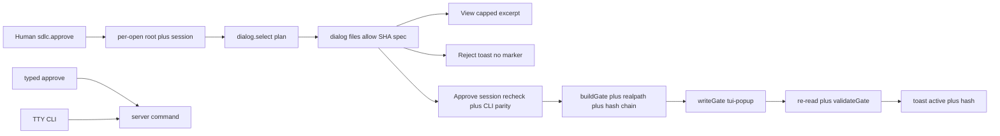

# Goal

One keystroke approves with no typed path: TUI palette `sdlc.approve` lists `docs/plans/*.md`, shows `files` plus `allow` plus plan SHA-256 plus spec, and Approve writes the normal `.sdlc/spec-gate.json` with host user and `approved_via: tui-popup`. Typed `/approve` and TTY CLI stay as fallbacks.

# Architecture

- `register.js` owns all TUI logic: per-open root, `listPlans`, `planDetails` via `buildGate`, `dialog.select` plus `dialog.confirm` plus capped `View`, global-first CLI import with byte-compare refuse, hash chain, `lstat` preexistence, content-matched unlink, second confirm on active overwrite, `validateGate` display and status, fallback matrix, module double-registration guard, palette-only default with no-bind retry.
- `tui.js` plus `index.js` shapes unchanged by default. Conditional stub removal only after manual double-scan smoke, flagged and not included.
- Server `/approve`, TTY `spec-check approve`, installer, `scripts/spec-check.mjs`, `.opencode/plugins/sdlc-lean.js` unchanged. TUI is direct-write execution path. Preview-only retired for this flow.
- Docs state popup-primary with typed plus TTY fallbacks, forgeable-label limit, headless plus SSH plus V1 matrix.

# Tech Stack

- Plain JS, no JSX, no npm import. `node:` builtins or relative imports only.
- Dynamic `node:fs` and `node:os` imports. Refuse when unavailable. No new dependency.
- Contract reuse via `buildGate` plus `readGate` plus `writeGate` plus `validateGate` plus `normalizeRel` plus `hashFile` from installed `spec-check.mjs`.
- Tests: `node --test` with fake keymap plus dialog plus toast plus router plus skill contexts and tmp roots.

# Spec

Approved spec `docs/specs/2026-10-31-popup-approval.md` AC1 through AC5 plus trace R1 through R4 plus review dispositions F1 through F11 and F02 F04 F05 F08 F8 F9.

Decisions already made:

- TUI direct write is the execution path. Typed `/approve` plus TTY CLI stay as fallbacks. No `session.command`, no agent write, no model prompt, no permission hook.
- Per-open root from TUI location only (`context.data.location.directory` else `context.location.directory`). Never `cwd` or `ctx.directory` fallback for approval. Refuse when missing. Abort when session route changes between select and confirm.
- Global-first CLI import (`$XDG_CONFIG_HOME/opencode/scripts/spec-check.mjs` or `~/.config/opencode/scripts/spec-check.mjs`), project copy only when no global exists. Refuse when both exist and differ by byte compare. Display derived from `buildGate` output, never the lenient parser.
- Hash chain: shownHash equals gate plan_sha256 equals re-read plan_sha256, and likewise for spec. `lstat` preexistence before write. Unlink only a marker written by this invocation with matching content. Overwrite of an active valid gate needs a second confirm naming old plan plus hash, else refuse with `close` hint.
- Display and status through full `validateGate`. Mismatch shows `gate invalid`. Unknown (`fs` missing) is distinct from inactive.
- Fallback matrix: `fs` missing shows exact `/approve <abs> sha256:<hex>` without claiming. `dialog` missing toasts plus logs the exact command. `keymap` missing logs only. No hash-less approval suggestion.
- Single `approved_via: tui-popup` token. Dynamic `node:os` import for username. Refuse when unavailable. UTC time. Plan file never written.
- Module double-registration guard. Palette-only default with optional bind fail-open and no-bind retry.
- View excerpt capped at 2000 chars with file plus allow counts.

# Global Constraints

- Read-only context: `scripts/spec-check.mjs`, `.opencode/plugins/sdlc-lean.js`, `tui.js`, `index.js`, spec, threat model, review file are not edited. Existing approval plus installer suites run as regression, not edited.
- `files` covers every source edit. `allow` covers progress ledger plus evidence JSON only. No debt change.
- `status: draft` with empty `approved_by` plus `approved_at`. No self-approval.
- Secrets never enter context or logs. No sandbox claimed.
- Test integrity: Task 1 authors all test updates first. Tasks 2 through 3 do not edit tests. If a grader is wrong, stop and escalate.
- Evidence only after all Verifies pass. Rows match table cells exactly, exit 0, UTC at. Close is separate, never its own row.

# Lean Constraints

- No `scripts/spec-check.mjs` change. `validateGate` allowlist change deferred. No CLI drift under gate.
- No new agent, skill, command file, npm dependency, JSX, or V1 change. V1 loads no TUI part.
- Double-scan stub removal is conditional on manual smoke. Default keeps `index.js`.
- Reuse `buildGate` plus `validateGate` plus `normalizeRel` plus realpath plus `lstat`. No second contract.
- View cap, fail-open toasts, advisory host-evidence count only.

# Review Focus

- Per-open root and session re-check: no stale root, no wrong checkout, no `cwd` fallback.
- CLI parity: global-first order, byte-compare refuse, display from `buildGate`.
- TOCTOU: three-way hash equality, `lstat` plus realpath plus content-matched delete, overwrite second confirm.
- Status honesty: `validateGate` gating, `gate invalid` on mismatch, unknown distinct from inactive.
- Fallbacks: exact hash command, no hash-less claim, palette survives bind failure.
- Residuals: `approved_via` forgeable informational label, close evidence binding is trust point, host user is residual owner, headless plus SSH uses TTY CLI.

# Tasks

| # | Task | Spec req | Files | Test | Expected | Verify |
|---|---|---|---|---|---|---|
| 1 | RED: extend TUI brain tests for direct-write contract | AC1 AC2 AC3 AC4 AC5, R1 R2 R3 R4, F1 F2 F3 F4 F5 F6 F04 F05 F07 F8 F9 F02 F10 F11 | tests/opencode/test-tui-brain.mjs | Failing tests assert per-open root and session-switch abort and CLI divergence refuse and TOCTOU chain and symlink escape and preexisting plus overwrite confirm and fallback matrix and double setup and tui-popup token and 2000-char View cap and no session dot command | New direct-write assertions fail against current preview-only register.js | ! node --test tests/opencode/test-tui-brain.mjs |
| 2 | GREEN: implement popup direct write in register.js | AC1 AC2 AC3 AC4, R1 R2 R3 R4 | .opencode/plugins/sdlc-lean-tui/register.js | Same TUI brain suite passes with direct write and no session dot command and validateGate display | Palette approve writes valid gate with tui-popup and toasts active plus short hash. Reject writes nothing. Status shows gate invalid on drift. Fallbacks show exact hash command. | node --test tests/opencode/test-tui-brain.mjs |
| 3 | Docs: name popup primary with fallbacks and forgeable limit | AC4 AC5 | README.md, USAGE.md, CHANGELOG.md | Docs contain popup-primary plus typed plus TTY fallback plus forgeable label plus headless TTY path plus V1 note | Readers find popup first and typed plus TTY second with no sandbox claim | grep -q tui-popup README.md USAGE.md CHANGELOG.md |
| 4 | Full gate: regression plus verify plus eval plus evidence | AC5 | docs/plans/2026-10-31-popup-approval-evidence.json | Full suite plus dry eval plus bootstrap plus installer parity all pass, evidence rows written after | Zero failures, bootstrap at most 5116, dry eval at least 35 probes zero failures, evidence rows match Verify cells with exit 0 and UTC at | npm run verify && node eval/run.mjs |

# Self-review

- AC coverage: AC1 picker list plus details plus View cap in Tasks 1 and 2. AC2 direct write plus re-check plus CLI parity plus hash chain plus preexistence plus tui-popup plus re-read plus validateGate plus overwrite confirm in Tasks 1 and 2. AC3 toasts plus refused plus gate invalid plus unknown versus inactive in Tasks 1 and 2. AC4 typed plus TTY unchanged plus no session dot command plus fallback matrix plus V1 plus headless in Tasks 1 through 3. AC5 TUI plus approval plus installer suites plus verify plus bootstrap plus eval plus docs in Tasks 1 through 4.
- Consistency: per-open root only, no `cwd` fallback. Display from `buildGate`, status from `validateGate`. Single tui-popup token. Refuse paths never claim a hash. Unlink only self-written matching marker. No `scripts/spec-check.mjs` edit, no `sdlc-lean.js` edit, no `tui.js` or `index.js` edit by default.
- Leanness: one helper surface, one contract import, palette-only default, capped View, fail-open toasts, no new dependency, no new file beyond allow-listed progress plus evidence.
- Deviations and flags: F2 plus F9 residual accepted by host user: `approved_via` is informational and bash-forgeable, trust comes from close evidence binding. `scripts/spec-check.mjs` unchanged, `validateGate` allowlist change deferred to avoid CLI drift. Double-scan stub removal is conditional on manual smoke, default keeps `index.js`, not in scope. Headless plus SSH has no popup, TTY CLI is the documented path. No pipes in Verify cells. Tasks 2 through 3 do not edit tests. Evidence follows Verifies, close is separate. Draft status with no self-approval.
