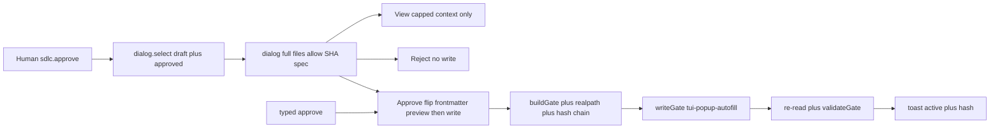

# Goal

Draft→popup→confirm→done with no hand-edit: the TUI popup lists draft plans (badged), confirms with full scope + hashes, and on human Approve flips plan frontmatter (`status`/`approved_by`/`approved_at`) then writes the normal gate — reusing the CLI autofill helpers (`sanitizeApprovedBy`/`applyApprovalFill`/`fillApprovalFrontmatter`, validate-before-mutate + restore-on-fail) via a new export from `scripts/spec-check.mjs`. Typed `/approve` gains the symmetric autofill. Reject writes nothing; pipes still refuse.

# Architecture

- `tests/opencode/test-popup-autofill.mjs` (new) owns the contract: draft badge, full-scope confirm, flip-then-gate order, reject-no-write, symlink/escape refuse, pipe refuse, restore-on-fail, `tui-popup-autofill` token, `os.userInfo` user (no `USER`-env trust).
- `scripts/spec-check.mjs` exports the autofill trio (`sanitizeApprovedBy`, `applyApprovalFill`, `fillApprovalFrontmatter`) for reuse; CLI `approve` keeps its behavior (already autofills on TTY, refuses pipes) and becomes the reference implementation.
- `.opencode/plugins/sdlc-lean-tui/register.js` adds the draft-inclusive picker + full-scope confirm + flip-then-gate Approve reusing the import (global-first, byte-compare refuse on divergence, per parent), with per-open root, session re-check, `lstat`+`realpath` containment (as `:486`), three-way hash chain, preexisting/overwrite second confirm, content-matched unlink, plan-text restore-on-fail.
- `.opencode/plugins/sdlc-lean.js` (`/approve`) gains the symmetric typed autofill: same helpers, same validate-before-mutate + restore-on-fail, same pipe refusal.
- Preview-only divergences retired for this flow: display/confirm derives from `buildGate` output, never the lenient parser; excerpt is context only.

# Tech Stack

- Plain JS, no JSX, no npm import. `node:` builtins or relative imports only.
- Dynamic `node:fs` / `node:os` imports in the TUI. Refuse when unavailable. `os.userInfo()` for the username, never `USER`-env trust.
- Contract reuse via `buildGate` + `readGate` + `writeGate` + `validateGate` + `normalizeRel` + `hashFile` + newly exported autofill trio from installed `spec-check.mjs`.
- Tests: `node --test` with fake keymap + dialog + toast + router + skill contexts and tmp roots.

# Spec

Amendment spec `docs/specs/2026-10-31-popup-autofill.md` AC1 through AC5 (draft selectable, informed confirm, approve flips then gates, reject writes nothing, pipe still refused) plus parent invariants (per-open root, session re-check, hash chain, realpath containment, fallback matrix, double-registration guard, forgeable-label limit).

Decisions already made:

- Flip allowed only after human confirm (popup Approve or typed `/approve`), reusing `sanitizeApprovedBy` → `applyApprovalFill` → `parsePlanText` preview → write → `buildGate` → `writeGate` → re-read → `validateGate`; any failure restores original plan text.
- Distinct `approved_via: tui-popup-autofill` token; username from `os.userInfo()`, refuse when unavailable; UTC time.
- Confirm renders full `files`/`allow` + plan SHA-256 + spec SHA-256 + spec link; 2000-char excerpt is context only.
- Draft rows badged `draft — Approve will fill frontmatter`; same listing filters as parent.
- Reject/dismiss leaves plan + marker byte-identical. Piped stdin refuses autofill on every path.

# Global Constraints

- `files` covers every source edit. `allow` covers progress ledger + evidence JSON only. No debt change.
- `status: draft` with empty `approved_by` + `approved_at`. No self-approval.
- Secrets never enter context or logs. No sandbox claimed.
- Test integrity: Task 1 authors all test updates first. Tasks 2 through 4 do not edit tests. If a grader is wrong, stop and escalate.
- Evidence only after all Verifies pass. Rows match table cells exactly, exit 0, UTC at. Close is separate, never its own row.

# Lean Constraints

- One shared autofill contract: TUI + server import from `scripts/spec-check.mjs`; no second implementation. Global-first import order with byte-compare refuse on divergence (per parent).
- No new agent, skill, command file, npm dependency, JSX, or V1 change. V1 loads no TUI part.
- Unlink only self-written matching marker; restore original plan text on any flip-path failure.
- View cap, fail-open toasts, advisory host-evidence count only.
- No task edits its own grader: implementation tasks never touch `tests/opencode/test-popup-autofill.mjs`; test task never touches source files.

# Review Focus

- Flip-before-gate order with validate-before-mutate: `parsePlanText` preview + spec regular-file check precede every write.
- Restore-on-fail: original plan bytes restored on any throw; marker unlinked only when self-written with matching content.
- Human proof: palette + `dialog.confirm` double-confirm; session re-check aborts on switch; pipes refuse.
- Scope honesty: full `files`/`allow` + both hashes + spec link in confirm; excerpt never the sole basis.
- Containment: `lstat` + `realpath` on plan, `.sdlc`, and marker; refuse on symlink/escape.
- Identity honesty: `os.userInfo()` user, distinct `tui-popup-autofill` token, both documented as informational (bash-forgeable), close evidence binding is the trust point.

# Tasks

| # | Task | Spec req | Files | Test | Expected | Verify |
|---|---|---|---|---|---|---|
| 1 | RED: new popup-autofill suite asserting draft→flip→gate contract | AC1 AC2 AC3 AC4 AC5 | tests/opencode/test-popup-autofill.mjs | Failing tests assert draft badge + full-scope confirm + flip-then-gate order + reject-no-write + symlink/escape refuse + pipe refuse + restore-on-fail + tui-popup-autofill token + os.userInfo user | New suite fails against current code (no draft path, no exported autofill, no typed autofill) | ! node --test tests/opencode/test-popup-autofill.mjs |
| 2 | Export autofill trio from spec-check.mjs for TUI/server reuse | AC3 | scripts/spec-check.mjs | Same new suite: import-shape assertions pass (trio importable), CLI approve behavior unchanged | Trio exported with no behavior change to CLI approve/status/verify/close | node --test tests/opencode/test-popup-autofill.mjs |
| 3 | GREEN: popup + typed autofill via shared helpers | AC1 AC2 AC3 AC4 AC5 | .opencode/plugins/sdlc-lean-tui/register.js, .opencode/plugins/sdlc-lean.js | Same new suite passes: draft Approve flips then gates with tui-popup-autofill, Reject writes nothing, pipe refused, restore-on-fail | Draft→popup→confirm→done with no hand-edit; parent suites still green | node --test tests/opencode/test-popup-autofill.mjs |
| 4 | Full gate: regression + verify + evidence | AC1 AC2 AC3 AC4 AC5 | docs/plans/2026-10-31-popup-autofill-evidence.json | Full suite + bootstrap + parent TUI/approve suites pass, evidence rows written after | Zero failures, bootstrap at most 5116, evidence rows match Verify cells with exit 0 and UTC at | npm run verify |

# Self-review

- AC coverage: AC1 draft selectable in Tasks 1 and 3. AC2 full-scope confirm in Tasks 1 and 3. AC3 flip-then-gate + token + userInfo + restore in Tasks 1 through 3. AC4 reject-no-write in Tasks 1 and 3. AC5 pipe refuse in Tasks 1 and 3. Full gate + evidence in Task 4.
- Consistency: display from `buildGate`, status from `validateGate`. Single new token `tui-popup-autofill`. Refuse paths never claim a hash. Restore plan text + unlink only self-written matching marker. Per-open root, session re-check, `lstat`+`realpath` containment throughout.
- Leanness: one shared trio, no second contract, palette + typed symmetric, capped View, fail-open toasts, no new dependency, no new file beyond allow-listed progress + evidence.
- Deviations and flags: widens parent "no spec-check.mjs change" and "plan file never written" — the explicit amendment being approved here; no other parent invariant changes. `approved_via` informational and bash-forgeable (parent F2 residual). Headless/SSH has no popup, TTY CLI is the documented path. No pipes in Verify cells. Tasks 2 through 4 do not edit tests. Evidence follows Verifies, close is separate. Draft status with no self-approval.
