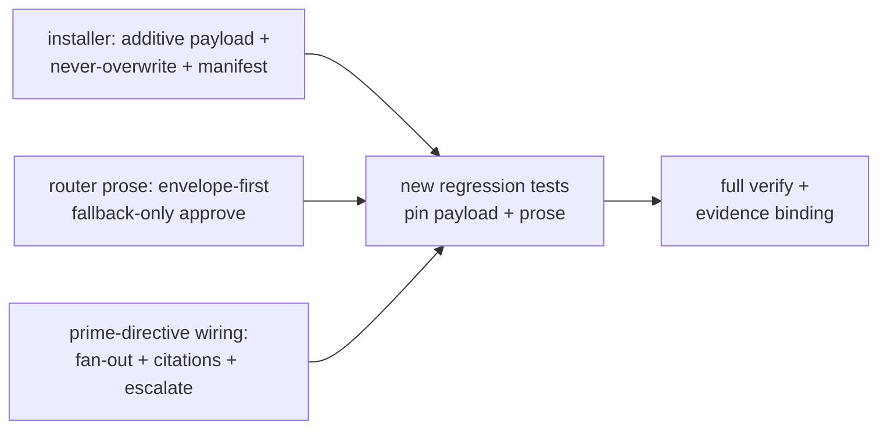

# Plan: autonomy by default (installer ships it, router assumes it)

## Goal

Make the envelope-authorized zero-approval loop the shipped default: the installer delivers the envelope template + `AUTONOMY.md` standing rule + ledger init additively, the router runs envelope-first with one chat yes at bootstrap, and the loop treats "ask the human to judge" as a defect — while human `/approve`+hash survives only as fallback and irreversible-external acts stay ALWAYS-human.

## Architecture

- Components touched: `scripts/install-global.mjs` (new additive-only payload entries + skip-if-exists + manifest tracking), `docs/AUTONOMY.md` (new standing-rule source), `docs/auto-envelope.template.md` + `docs/audit-ledger.md` (shipped as-is init sources), 6 skill bodies, 2 new test files.
- Interfaces consumed: `installGlobal({repo, target})` + `SOURCES` + manifest prune/containment guards; `envelope check` validator; existing prose suites + `npm run lint`.
- Interfaces produced: fresh install contains template + standing rule + header-only ledger; skip report; envelope-first router prose; ask-human-is-defect loop prose.
- Untouched: `.opencode/plugins/sdlc-lean.js` and `scripts/spec-check.mjs` (no behavior-code changes — prose only), `finishing-a-development-branch` + `brainstorming` (zero diff, pinned by test), spec + threat model (immutable inputs).

## Tech Stack

- Node.js, zero dependencies (installer and skills stay dep-free per repo rules).
- Test commands: `node --test <file>`, `npm run lint` (`scripts/validate-skills.mjs`), `npm run verify` (= lint + `node --test`).

## Spec

- `docs/design/0003-autonomy-by-default.md` (accepted by human chat accept 2026-11-01) + threat section `## 2026-11-01 autonomy-by-default` in `docs/threat-model.md`.

## Global Constraints

- Plugin stays V1+V2 compatible and fail-open — untouched by this plan.
- Installer manifest-pruned, never touches user files; additive payload extends that rule (skip-if-exists, never overwrite).
- Spec gate active while building: edits only inside frontmatter `files`; plan/spec immutable; `close` + re-approve to change scope — never bypass with bash.
- Bootstrap budget <5KB; human-facing output follows `communicating-concisely`.

## Lean Constraints

- Reuse-first: extend `SOURCES` + existing skip/prune guards (no new installer framework); prose edits are minimal line swaps inside caps, not rewrites.
- Lowest rung: installer flag-free + prose-only skill changes + 2 test files. No new skill, agent, command, or CLI surface.

## Review Focus

- Installer: skipped files must NOT enter `installed[]`; skip report says `already present, skipped`; symlink/traversal containment reused for new entries.
- Template scope: shipped template must still pass `envelope check`; if empty-scope fails validation, keep narrow pilot scope and document — never weaken the validator.
- Caps + hard strings: every replaced line keeps all hard strings pinned by prose suites. Out-of-scope diff must be empty.

## Tasks

| # | Task | Spec req | Files | Test | Expected | Verify |
|---|------|----------|-------|------|----------|--------|
| 1 | Installer ships autonomy payload additively | INST-SHIP, INST-ADD, THREAT-NOSYNC | `scripts/install-global.mjs`, `docs/AUTONOMY.md` (new), `docs/auto-envelope.template.md`, `docs/audit-ledger.md` | Existing installer suite stays green | Fresh target contains template + `AUTONOMY.md` + header-only ledger; pre-seeded files byte-identical with `already present, skipped`; skipped files excluded from manifest | `node --test tests/scripts/test-install-global.mjs` |
| 2 | Router default-posture prose | ROUTER, FALLBACK, BOOTSTRAP, WIDEN | `using-sdlc-lean`, `intent-preview`, `writing-plans` SKILL.md files | Existing prose suites stay green | envelope-first default; `/approve`+hash fallback-only; widening = own committed+auth step | `node --test tests/opencode/test-skill-contracts.mjs tests/opencode/test-brain-skills.mjs tests/opencode/test-trust-skills.mjs` |
| 3 | Prime-directive wiring | PRIME-a..e, THREAT-CITE | `autonomous-loop`, `option-selection`, `subagent-driven-development` SKILL.md files | Existing execution/brain suites stay green | Auto-default-inside-envelope; fan-out on uncertainty; citation-required cells; escalation carries findings | `node --test tests/opencode/test-execution-skills.mjs tests/opencode/test-brain-skills.mjs` |
| 4 | New regression tests | INST-SHIP, INST-ADD, ROUTER, PRIME-a, NONNEG | `tests/scripts/test-install-autonomy-default.mjs`, `tests/opencode/test-autonomy-default-posture.mjs` (new) | New suites green in isolation | payload + prose + untouched-pins pass | `node --test tests/scripts/test-install-autonomy-default.mjs tests/opencode/test-autonomy-default-posture.mjs` |
| 5 | Full gate regression + evidence binding | NONNEG, THREAT-NARROW | — (control state via `allow`) | Full suite green | `npm run verify` exits 0; evidence one exit-0 row per task with exact Verify + UTC at | `npm run verify` |

## Self-review

- Coverage: every task names a spec req; no orphan task; no task edits its own grader.
- Consistency: additive-only installer; fallback conditions match Decision; ask-human-is-defect bounded by ALWAYS-human list.
- Leanness: one new content file + installer extension + prose swaps + 2 test files; no new service/skill/agent/dependency/CLI surface.
