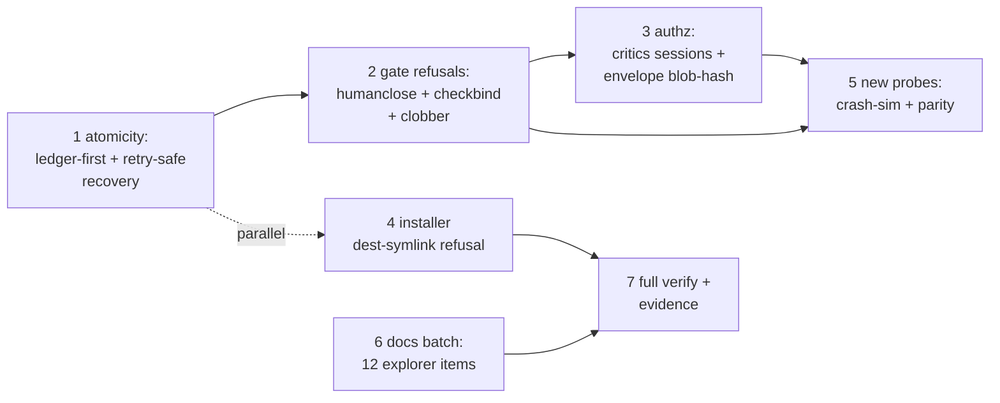

# Plan: fix-now gap-close batch (audit findings against autonomy-by-default)

## Goal

Close every sound fix-now finding from the full-flow audit (code-reviewer HIGH dual-mutation atomicity + MEDIUM human-CLI clobber; security P0-1..P0-5, P1-6..P1-9, P2-10; docs-explorer 12 wrong/missing items) against the standing spec `0003-autonomy-by-default`, so no crash bricks the gate with retry refused, no agent path forges a close, and the shipped docs match the built behavior — with unsound-without-broker residuals recorded as threat-model rows, not fake fixes.

## Architecture

- Components touched: `scripts/spec-check.mjs` (mutation tails, human CLI branches, auth anchor, critics block); `scripts/install-global.mjs` (dest lstat gate); new probe suites (not edits to graders); 10 doc/prose files + `docs/threat-model.md` residual rows.
- Interfaces consumed: `readGate`/`gatePath`, `validateCloseEvidence`, `checkEnvelopeFile`/`checkEnvelopeClean`, `ledgerHasReversal`, `collectMachineVerdicts`, `humanApproval`, installer `SOURCES` + manifest prune/containment, existing suites as read-only graders.
- Interfaces produced: crash-safe close/approve; non-TTY close refused; checkbind; clobber guard; session-enforced critics + blob-hash auth; installer symlink refusal; parity suite; corrected docs.
- Untouched: human `approve` TTY semantics outside new refusal branches, grader-path logic, existing test files, spec files (immutable inputs).

## Tech Stack

- Node.js, zero dependencies. Test commands: `node --test <file>`, `npm run lint`, `npm run verify`.

## Spec

- `docs/design/0003-autonomy-by-default.md` + human directive 2026-11-01. Prior art: pilot / machine-approve / autonomy-default plans + built code.
- Envelope: docs/envelope-gap-close-batch.md (standing machine authorization, human-directed 2026-11-01)

## Global Constraints

- Plugin stays V1+V2 compatible and fail-open; prefer CLI-only — plugin in scope for minimal parity touch only.
- Safety guards grow only by exact-known destructive patterns; benign must pass (add a test per new refusal).
- Spec gate active while building: edits only inside frontmatter `files`; plan/spec immutable; `close` + re-approve to change scope — never bypass with bash.
- Bootstrap budget <5KB.

## Lean Constraints

- Reuse-first: reorder existing appends/unlinks + reuse lstatSync/humanApproval/checkEnvelopeFile/collectMachineVerdicts — no new service, agent, skill, or dependency. Parity prefers a test over a refactor.
- Lowest rung: refusal branches + ordering fix + 2 new test files + doc-line corrections + threat-model residual rows.

## Review Focus

- Atomicity: crash window converges on retry, never bricked-refused; every refusal still throws before any mutation.
- Gate refusals: non-TTY close refuses; `--check true` no longer passes with pinned check; human-CLI pre-write guard mirrors plugin double-gate.
- Authz honesty: critics enforcement only to sound extent; blob-hash binding with backdate-resistant anchor; broker needs become residual rows.
- Test integrity: no task edits its own grader.

## Tasks

| # | Task | Spec req | Files | Test | Expected | Verify |
|---|------|----------|-------|------|----------|--------|
| 1 | Gate dual-mutation atomicity + crash recovery | audit-row + code HIGH-atomicity | `scripts/spec-check.mjs` | Existing contract + machine suites stay green | Crash-simulated retry converges exactly once, never bricked | `node --test tests/scripts/test-spec-check.mjs tests/scripts/test-auto-tier-machine-close.mjs tests/scripts/test-machine-approve.mjs` |
| 2 | CLI gate refusals: bare close humanApproval, checkbind, clobber guard | no-bypass + MEDIUM-clobber + sec P0 | `scripts/spec-check.mjs` | Existing contract suite stays green | Non-TTY close refused; check mismatch refused; active-gate human approve refused pre-write | `node --test tests/scripts/test-spec-check.mjs tests/scripts/test-machine-approve.mjs` |
| 3 | Authz hardening (enforceable subset) + residual rows | independent-critics + envelope-ceiling | `scripts/spec-check.mjs`, `docs/threat-model.md` | Existing machine-close suite stays green | Self-review verdicts refused; blob-hash auth binding; residuals documented | `node --test tests/scripts/test-auto-tier-machine-close.mjs` |
| 4 | Installer dest-symlink refusal | additive-only + sec P1 installer | `scripts/install-global.mjs` | Existing installer suites stay green | Symlinked dest refused, manifest unchanged | `node --test tests/scripts/test-install-global.mjs tests/scripts/test-install-autonomy-default.mjs` |
| 5 | New probes: crash-sim + parity suites | sec P2-10 divergence | `tests/scripts/test-gap-atomicity-probes.mjs`, `tests/scripts/test-gap-parity.mjs` (new) | New suites green | Crash retries converge; CLI↔plugin verdicts equal | `node --test tests/scripts/test-gap-atomicity-probes.mjs tests/scripts/test-gap-parity.mjs` |
| 6 | Docs batch: all 12 explorer items | Trace + Review-findings | `docs/design/0001-auto-tier-pilot.md`, `docs/design/0002-machine-approve.md`, `docs/design/0003-autonomy-by-default.md`, `docs/threat-model.md`, `docs/verify-recipe.md`, `docs/AUTONOMY.md`, `README.md`, `USAGE.md`, `CHANGELOG.md`, `.opencode/skills/intent-preview/SKILL.md`, `.opencode/skills/autonomous-loop/SKILL.md` | Lint + prose suites stay green | Statuses accepted with dispositions; recipe/README/USAGE/CHANGELOG current; loop prose aligned | `npm run lint` |
| 7 | Full regression + evidence binding | non-negotiables | — (control state via `allow`) | Full suite green | `npm run verify` exits 0; evidence one exit-0 row per task | `npm run verify` |

Verify read-only after writing: `git status --porcelain` shows only the 2 new files. Report + next step (human approve).
