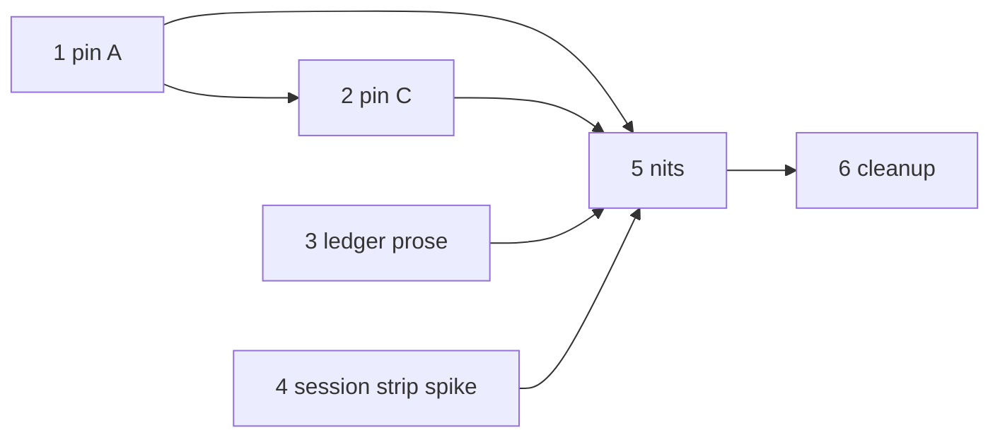

# Plan: follow-up hardening (test-pinning, ledger prose, review fallout)

## Goal

Close deferred items from Phases A through D: pin recorded probes as
committed tests (R1 Phase A, R2 Phase C), flip ledger plus matrix prose with
exact recorded wording (R3), investigate the session-strip question (R4),
apply the recorded nits batch (R5), and delete the voided Phase B drafts
(R6). Draft awaiting human approval; no code changes until approved.

## Architecture

- Test-pinning layer (T1-T2): recorded probe tables become committed
  assertions in the four named test files; merge-guard cases live in the
  safety-guards destructive-command suite owned by T1.
- Prose layer (T3): ledger plus threat-model plus capability-matrix flips use
  exact wording held in progress ledgers; no behavior change.
- Investigation plus nits plus cleanup (T4-T6): machine-close spike decides
  fix versus document; nits batch applies recorded fixes; cleanup removes
  only the three voided Phase B drafts.

## Tech stack

- Node test runner (`node --test`) for safety-guards, phase, perms, hooks,
  and machine-close suites.
- `npm run verify` as the full green gate; `npm run lint` for prose plus
  nits suites.
- `scripts/spec-check.mjs` gate contract: once approved, edits only inside
  frontmatter `files`; plan plus spec immutable while active.

## Spec

- `docs/specs/2026-11-07-follow-up-hardening.md`: R1 test-pinning A, R2
  test-pinning C, R3 ledger plus matrix prose, R4 session-strip
  investigation, R5 nits batch, R6 cleanup.
- Sources of truth: `docs/plans/phase-a-safety-guards-progress.md` probe
  tables (R1), `docs/plans/2026-11-07-phase-c-perms-progress.md` probes
  (R2), progress ledgers for exact R3 wording and R5 nits list.
- Acceptance: `npm run verify` green; every test edit add-only; evidence
  rows per task with exact Verify cells.

## Constraints

- Add-only tests: no existing assertion modified or deleted in T1, T2, T4.
- Never weaken grader assertions; R4 never touches grader semantics
  without escalation.
- Router budget holds at or under 5116 bytes after R5 abbreviation verdict.
- Spec gate: once approved, edits only inside frontmatter `files`;
  `close` plus re-approve to change scope, never bypass with bash.
- Lean: minimum code that passes; no new service, agent, or dependency.

## Review Focus

- Diff audit: every test-file hunk adds new assertions only; reviewer
  checks diff for modified or deleted assertions and fails closed.
- Wording audit: R3 flips match recorded ledger wording exactly.
- Spike audit: R4 confirms product-code bug before any fix; grader
  semantics untouched or escalated.
- Verify audit: each task reports its exact Verify cell output as evidence.

## Tasks

| # | Task | Spec req | Files | Test | Expected | Verify |
|---|------|----------|-------|------|----------|--------|
| 1 | Test-pinning Phase A | R1 recorded probes | tests/opencode/test-safety-guards.mjs | recorded node -e probes committed as new assertions | D-001 D-002 D-004 D-009 closed with committed tests | `node --test tests/opencode/test-safety-guards.mjs` |
| 2 | Test-pinning Phase C | R2 recorded probes | tests/scripts/research/test-phase.mjs, tests/opencode/test-agent-permissions.mjs, tests/opencode/test-ux-hooks.mjs | recorded probes committed as new assertions with merge-guard cases in T1 file | strictness plus invocation plus path scope plus uxStatus proven add-only | `npm run verify` |
| 3 | Ledger plus matrix prose | R3 exact wording flips | docs/debt-ledger.md, docs/threat-model.md, .opencode/skills/colab-lifecycle/references/capability-matrix.md | wording matches progress ledgers exactly | D-002 D-009 D-028 plus D-017 plus B-ledger parts plus re-audit row flipped | `npm run lint` |
| 4 | Session-strip spike | R4 machine-close question | scripts/spec-check.mjs | existing machine-close suite stays green | fix product code only if confirmed else document non-issue and escalate on grader-semantics touch | `node --test tests/scripts/test-auto-tier-machine-close.mjs` |
| 5 | Nits batch | R5 recorded nits | .opencode/plugins/sdlc-lean.js, .opencode/plugins/sdlc-lean-tui/register.js, .opencode/skills/using-sdlc-lean/SKILL.md, plugins/copilot/sdlc-lean/skills/colab-lifecycle/SKILL.md, plugins/copilot/sdlc-lean/skills/colab-lifecycle/lib/lifecycle.mjs | lint plus verify stay green | all recorded nits closed with no behavior change beyond stated and budget holds | `npm run verify` |
| 6 | Cleanup voided drafts | R6 voided Phase B drafts | docs/plans/2026-11-07-phase-b-gate.md, docs/plans/2026-11-07-phase-b-gate-progress.md, docs/plans/2026-11-07-phase-b-gate-evidence.json | no reference to voided drafts remains | voided Phase B drafts removed with history kept in B1 plan | test ! -e docs/plans/2026-11-07-phase-b-gate.md -a ! -e docs/plans/2026-11-07-phase-b-gate-progress.md -a ! -e docs/plans/2026-11-07-phase-b-gate-evidence.json |

## Coverage

- [ ] T1 owns tests/opencode/test-safety-guards.mjs (R1 plus R2 merge-guard home)
- [ ] T2 owns tests/scripts/research/test-phase.mjs (R2 strictness plus invocation)
- [ ] T2 owns tests/opencode/test-agent-permissions.mjs (R2 path scope plus reviewer rules)
- [ ] T2 owns tests/opencode/test-ux-hooks.mjs (R2 uxStatus caller plus status query)
- [ ] T3 owns docs/debt-ledger.md (R3 flips)
- [ ] T3 owns docs/threat-model.md (R3 flips)
- [ ] T3 owns .opencode/skills/colab-lifecycle/references/capability-matrix.md (R3 re-audit row)
- [ ] T4 owns scripts/spec-check.mjs (R4 spike target)
- [ ] T5 owns .opencode/plugins/sdlc-lean.js (R5 nits)
- [ ] T5 owns .opencode/plugins/sdlc-lean-tui/register.js (R5 nits)
- [ ] T5 owns .opencode/skills/using-sdlc-lean/SKILL.md (R5 router nits)
- [ ] T5 owns plugins/copilot/sdlc-lean/skills/colab-lifecycle/SKILL.md (R5 copilot link)
- [ ] T5 owns plugins/copilot/sdlc-lean/skills/colab-lifecycle/lib/lifecycle.mjs (R5 vendor or reword target)
- [ ] T6 owns docs/plans/2026-11-07-phase-b-gate.md (R6 delete)
- [ ] T6 owns docs/plans/2026-11-07-phase-b-gate-progress.md (R6 delete)
- [ ] T6 owns docs/plans/2026-11-07-phase-b-gate-evidence.json (R6 delete)

## Test integrity

Every test edit is add-only: no existing assertion is modified or deleted; new probes land as new assertions and weakening the suite fails the review.
