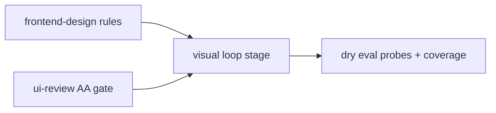

# Plan — Frontend quality v2

**Goal**: Upgrade three skills + game pipeline so agent-built UI clears WCAG 2.2 AA with a capped visual loop, no new deps/bootstrap changes.

**Spec**: [`docs/design/0005-frontend-quality-v2.md`](../design/0005-frontend-quality-v2.md) (accepted 2026-11-07)

**Architecture**: skill-text upgrades (frontend-design rules + template; ui-review AA checklist + slop patterns) feed a capped visual loop stage (screenshot→critique→fix, cap 2–3, pixels-only-when-needed) wired into the game pipeline first, feature optionally; Figma-MCP token pattern documented for when Figma exists.

**Tech stack**: React + Tailwind + shadcn/ui primitives (Radix WAI-ARIA); Playwright MCP (`toHaveScreenshot`, committed baselines, `--update-snapshots`); existing `node --test` gates; no npm adds.

**Spec**: design 0005 decisions — (1) frontend-design SKILL.md upgrade with the 5 rules + spec template, (2) ui-review upgrade (AA checklist + slop patterns), (3) visual loop stage in game pipeline first using existing Playwright MCP + committed baselines, (4) Figma-MCP token pattern documented.

**Constraints**: zero new deps; bootstrap untouched; line caps — frontend-design generic cap 160 (now 33), ui-review cap 25 (now 19, keep 5 hard strings + rewrite-not-append), web-game-development cap 155 (now 154, 1-line headroom).

**Review Focus**: WCAG 2.2 AA bar completeness (4.5:1/3:1 contrast, focus-not-obscured, 24px targets, APG keyboard/landmarks); loop non-convergence → escalate rule; slop patterns (custom controls, happy-path-only, missing motion, broken primitive contract); baseline storage cost.

| # | Task | Files | Test | Expected | Verify |
|---|------|-------|------|----------|--------|
| 1 | frontend-design 5 rules + spec template | `.opencode/skills/frontend-design/SKILL.md` | skill contract tests | 5 rules + full-spec template (per-component behavior, per-element prefs, stack/fonts/palette, context); stays under generic cap 160 | `node scripts/validate-skills.mjs && node --test tests/opencode/test-skill-contracts.mjs` |
| 2 | ui-review AA checklist + slop within 25-line cap | `.opencode/skills/ui-review/SKILL.md` | skill contract tests | AA checklist + slop patterns; 5 hard strings kept; rewrite-not-append to hold the 25-line cap | `node --test tests/opencode/test-skill-contracts.mjs` |
| 3 | Visual loop stage in game.md + pointer-only skill | `.opencode/commands/game.md`, `.opencode/skills/web-game-development/SKILL.md` | eval coverage + photoreal tests | screenshot→critique→fix stage, cap 2–3, pixels-only-when-needed, Build→Test gates; skill stays pointer-only within 1-line headroom | `node --test tests/opencode/test-eval-coverage.mjs && node --test tests/opencode/test-web-game-photoreal.mjs` |
| 4 | Dry eval probes + coverage | `eval/probes.mjs`, `eval/coverage.mjs` | probe tests | Add-only UI probes + coverage mapping; no live spend; update count literal to new total after adding probes (same-file, add-only intent preserved) | `node --test tests/eval/test-probes.mjs` |

**Dependency**: T1 ∥ T2 → T3 → T4.

## Coverage checklist

1. frontend-design carries the 5 rules + spec template under the line cap.
2. ui-review gates on the AA checklist with slop patterns called out.
3. Visual loop is capped 2–3 with a non-convergence escalate rule.
4. Pixels-only-when-needed: DOM/a11y evidence before screenshots.
5. Committed baselines + `--update-snapshots` flow documented.
6. Figma-MCP token extraction pattern documented.

**Test integrity**: add-only probes; existing skill-contract and eval tests are not weakened to pass.
