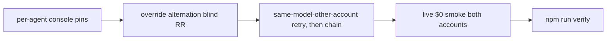

# Plan — Model routing activation (super-vl everywhere)

## Goal

Wire live console providers into agent pins + correct IDs everywhere; per-dispatch override alternates accounts blind round-robin with graceful degradation to static pins; prove links live at $0.

## Diagram

## Architecture

Frontmatter `model:` pins per activation amendment: implementer `console-openrouter/cohere/north-mini-code:free`; all worker roles (planner, code-reviewer, security-reviewer, explorer, test-writer, researcher) → `console-openrouter/nvidia/nemotron-3.5-super-vl:free`; orchestrator UNPINNED (inherits session = coordinator quality preserved by default). Manual-switch procedure (account-2 via session model override or /models picker) on 429/provider-error: built-in transport retry, then stop+escalate WITH ledger row telling the human what to switch to. No automatic fallback chain exists in OpenCode (maintainer: suite-owned retry only). No quota polling possible (console gateway hides keys) — manual-switch only, 429-driven fallback. No local config needed (console-managed `console-openrouter` primary / `console-openrouter2` fallback); verify via `opencode models | grep console-openrouter`. Current config keys only (`providers`, `settings.baseURL`, `package`) — legacy singular/options/npm forms outdated.

## Tech stack

OpenCode v2.2.6 (installed == latest stable); per-agent frontmatter `model:` pins; subagent per-dispatch `model` override; console-managed providers; `node --test`; `opencode run --model` live smokes; `npm run verify` gate.

## Spec

[`docs/design/0004-quota-aware-routing.md`](../design/0004-quota-aware-routing.md): accepted design + activation amendment 2026-11-07 (console IDs, primary+fallback, pins, paid exclusion, north break-glass, super-vl summarizer, ZDR verified, paid removed, north break-glass note) + v2.2.6 verification section (override precedence + graceful degradation, no auto-fallback, blind round-robin, live north-mini $0 both accounts, legacy forms outdated).

## Constraints

THREAT-NOSYNC preserved: usage note only, still zero `~/.config` writes; no local opencode.jsonc edit. Test integrity add-only; graders untouched. No paid calls (all free-only scope). No quota polling (keys hidden — blind alternation with no-polling rationale documented). Current config keys only. Orchestrator unpinned by design. Mirrored-agent alternation rejected; per-dispatch override is the mechanism with pin fallback.

## Review Focus

Pins exact per amendment (super-vl everywhere, both accounts, ZDR note, paid removed, north break-glass note); manual-switch procedure only (no automatic alternation without override — account 2 serves only via manual switch until the override experiment lands); paid exclusion holds; budget untouched (autonomy-dial SKILL stays ≤5116B if touched); no Go-primary replacement without human choice; legacy `openrouter/` + `openrouter-b` + outdated config forms fully gone.

## Tasks

| # | Task | Files | Test | Expected | Verify |
|---|---|------|------|----------|--------|
| 1 | super-vl pins: `model: console-openrouter/nvidia/nemotron-3.5-super-vl:free` on implementer, planner, code-reviewer, security-reviewer, explorer, test-writer, researcher (7 files); orchestrator UNPINNED (explicit). | Files: those 7 agent files + tests/opencode/test-agent-permissions.mjs (update pinning test to super-vl for all 7, add-only otherwise). | | | node --test tests/opencode/test-agent-permissions.mjs |
| 2 | override alternation protocol in orchestrator.md (per-dispatch explicit model, alternate console-openrouter/console-openrouter2 round-robin ledger-tracked; same-model-other-account retry first on 429; stop+escalate, no paid) + AUTONOMY table rewrite (super-vl everywhere, both accounts, ZDR note, paid removed, north break-glass note). | Files: orchestrator.md, AUTONOMY.md, docs/verify-recipe.md. | | | node scripts/spec-check.mjs verify --require-active |
| 3 | live smoke BOTH accounts: `opencode run --archived --model console-openrouter/nvidia/nemotron-3.5-super-vl:free "ping: reply ok" && opencode run --archived --model console-openrouter2/nvidia/nemotron-3.5-super-vl:free "ping: reply ok"` (single && compound — that IS the Verify cell verbatim). | Files: orchestrator.md (the protocol it exercises lives there; smoke validates the routing the protocol describes). | | | opencode run --archived --model console-openrouter/nvidia/nemotron-3.5-super-vl:free "ping: reply ok" && opencode run --archived --model console-openrouter2/nvidia/nemotron-3.5-super-vl:free "ping: reply ok" |
| 4 | eval routing probes → super-vl values (replace north/ultra/gemma assertions with super-vl where they assert role defaults; keep denylist/chain/gate probes, adjust wording only where the model ID changed; count must stay 44 — NO add/remove) + full suite. | Files: eval/probes.mjs, eval/coverage.mjs, tests/eval/test-probes.mjs. | | | npm run verify |

## Coverage checklist

- [ ] Console IDs (`console-openrouter` primary / `console-openrouter2` fallback) correct everywhere; no local jsonc edit
- [ ] Pins match amendment; orchestrator unpinned
- [ ] Override alternation protocol present (blind RR, retry order, paid gate, pin fallback)
- [ ] Live smoke proves both accounts at $0 with no paid call
- [ ] Blind alternation + no-polling rationale documented
- [ ] Legacy `openrouter/` + `openrouter-b` + outdated config forms fully gone
- [ ] Dots gap + gemma fallback documented
- [ ] Budget ≤5116B if autonomy-dial SKILL touched
- [ ] No Go-primary replacement without human choice

## Test integrity

Add-only pinning assertions; existing tests and graders untouched and unweakened — any unrelated failure stops the task.