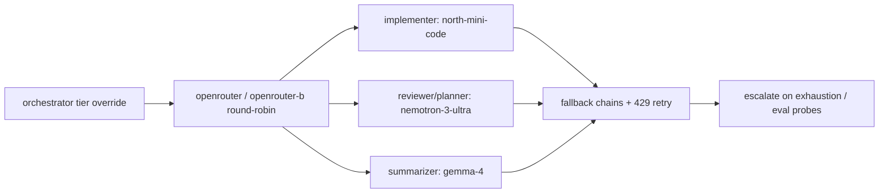

# Plan — Quota-aware model routing

**Goal**: Route OpenRouter free-quota models automatically (two $10 accounts, ~2,000 free req/day pooled) so Go-plan usage drops with zero task-quality regressions; 429s route around outages without human keystrokes inside the envelope, paid fallback never fires without human pre-authorization.

**Spec**: [`docs/design/0004-quota-aware-routing.md`](../design/0004-quota-aware-routing.md) (accepted 2026-11-07)

**Architecture**: prose-only routing config. Orchestrator alternates the two provider accounts round-robin (tracked in the progress ledger); per-agent free-first defaults with orchestrator tier override by task weight; per-role fallback chains on 429/provider-error; exhaustion stops and escalates. No OpenCode modifications — model pins, provider entries, and retry/fallback text only.

**Tech stack**: OpenCode per-agent model pins + `{env:}` key injection; Node 20+ ESM for probes; existing `npm run verify` / `npm run eval` gates.

**Spec**: design 0004 decisions — (1) two provider entries with separate keys, (2) static per-agent free-first defaults, (3) fallback chains per role with paid fallback only on envelope pre-authorized micro-spend cap, (4) privacy routing (customer code to no-train endpoints only; NVIDIA non-sensitive only; never secrets to free), (5) maintained denylist + periodic catalog re-probe procedure.

**Constraints**: prose-only routing, no OpenCode mods; THREAT-NOSYNC — no `~/.config` writes, repo-local generated text only; spend ALWAYS-human (paid fallback never fires without human pre-authorization); lean prose-only, no new dependencies.

**Review Focus**: quota math vs chains+alternation; single-provider fragility (one provider per `:free` endpoint); prompt-training exposure in traffic rules; 429-retry vs exhaustion-escalate boundary; ledger shows which model/account did what.

| # | Task | Files | Test | Expected | Verify |
|---|------|-------|------|----------|--------|
| 1 | Provider snippet (generated text, human-paste steps, zero writes outside repo) | `docs/AUTONOMY.md`, `docs/verify-recipe.md` | human paste-check of generated snippet | Generated `openrouter` + `openrouter-b` provider text with `{env:}` keys and paste steps; no writes outside repo. Human paste-check of snippet happens post-close as manual verification; evidence records generation only. | `node scripts/spec-check.mjs verify --require-active` |
| 2 | Tier→model mapping + denylist + privacy rules | `.opencode/agents/orchestrator.md`, `.opencode/skills/autonomy-dial/SKILL.md`, `.opencode/skills/using-sdlc-lean/SKILL.md` | contract + focused tests | Per-agent free-first defaults (implementer north-mini-code, reviewer/planner nemotron-3-ultra, summarizer gemma-4) + tier override + denylist + traffic rules. Bootstrap stays ≤5116B (measure before/after). | `npm run verify` |
| 3 | Fallback chains + 429-retry + exhaustion escalate | `.opencode/agents/orchestrator.md` | focused tests | Per-role chains on 429/provider-error; paid fallback gated on pre-authorization, else stop+escalate | `node --test tests/opencode/*.mjs` |
| 4 | Dry routing probes + docs | `eval/probes.mjs`, `eval/coverage.mjs` | dry probes | Add-only routing probes (no live spend); docs record alternation + re-probe procedure | `npm run eval` |

## Coverage checklist

1. Round-robin alternation across the two accounts is documented and ledger-tracked.
2. Per-agent free-first defaults match design 0004 (north-mini-code / nemotron-3-ultra / gemma-4).
3. Fallback chains cover 429 + provider-error per role.
4. Paid fallback requires envelope pre-authorized micro-spend cap, else stop+escalate.
5. Privacy routing: customer code to no-train endpoints only; NVIDIA non-sensitive only; secrets never to free.
6. Denylist is maintained with a periodic catalog re-probe procedure (`GET /api/v1/models` + `expiration_date`).
7. Eval-gated: zero task-quality regressions before Go-plan usage drops.
8. Quota math (~2,000/day pooled) supports the expected session load with redundancy.

**Test integrity**: add-only probes; existing probes and graders are not weakened to pass.
