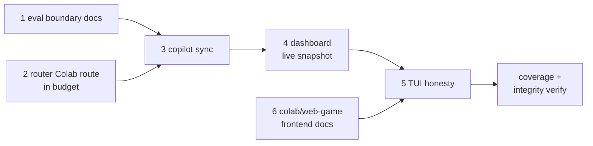

# Plan: Phase D eval/router/docs/copilot (draft)

## Goal

Docs-only Phase D against `docs/debt-ledger.md`: eval boundary docs, router Colab
route in budget, copilot sync, dashboard live snapshot, TUI honesty, and
colab/web-game/frontend docs — with coverage + integrity. No active gate; this
is a draft awaiting approval. No code changes until approved.

## Spec

- `docs/debt-ledger.md` (standing spec input; D-007 dashboard staleness, D-008
  Colab route, D-022 structural-vs-runtime boundary, D-026 autonomy wiring,
  D-030 footer slot, plus colab/web-game/frontend rows).
- Baseline SHA `644df00b078049487b036dbe1ccbf156d85c4dfb`.
- No active gate; docs-only draft.

## Global Constraints

- Docs-only: prose + static snapshot wiring only; no runtime behavior change.
- Bootstrap budget <5KB (router body stays within budget).
- Spec gate: once approved, edits only inside frontmatter `files`; plan/spec
  immutable while active; `close` + re-approve to change scope — never bypass
  with bash.
- Lean: minimum prose that closes the debt row; no new service/agent/dependency.

## Tasks

| # | Task | Spec req | Files | Test | Expected | Verify |
|---|------|----------|-------|------|----------|--------|
| 1 | Eval boundary docs | D-022 structural-vs-runtime | `eval/probes.mjs`, `eval/coverage.mjs`, `.opencode/skills/using-sdlc-lean/SKILL.md` | Probe schema suite stays green | Structural checks documented as non-proof; no runtime claim | `node --test tests/eval/test-probes.mjs` |
| 2 | Router Colab route in budget | D-008 Colab route | `.opencode/skills/using-sdlc-lean/SKILL.md` (router body) | Bootstrap budget test stays green | Colab intent routed within ≤5116 B budget | `node --test tests/opencode/test-plugin-loading.mjs` |
| 3 | Copilot sync | Copilot parity | `plugins/copilot/sdlc-lean/skills/**/SKILL.md`, `plugins/copilot/sdlc-lean/skills/**/references/**`, `plugins/copilot/sdlc-lean/README.md` | Copilot parity check green | Copilot tree matches OpenCode skill contracts | `diff -rq --exclude=lib .opencode/skills plugins/copilot/sdlc-lean/skills` |
| 4 | Dashboard live snapshot | D-007 staleness | `scripts/dashboard.mjs`, `docs/dashboard.html` | Dashboard suite stays green | Live snapshot documents refresh boundary honestly | `node scripts/dashboard.mjs --check` |
| 5 | TUI honesty | D-030 footer slot | `.opencode/plugins/sdlc-lean-tui/register.js` | TUI suite stays green | Status surface states gate/evidence honestly, no fake footer | node --test tests/opencode/test-tui-brain.mjs |
| 6 | Colab/web-game/frontend docs | Skill doc rows | `.opencode/skills/colab-lifecycle/SKILL.md`, `.opencode/skills/web-game-development/SKILL.md`, `.opencode/skills/frontend-design/SKILL.md` | Lint + prose suites stay green | Capability pins/ambiguities recorded in skill files only | `npm run lint` |

## Deferred to follow-up

- Ledger-status prose updates for colab/web-game/frontend rows in
  `docs/debt-ledger.md` (dropped from T6 scope: spec is immutable under gate,
  so the plan's `files` cannot list the spec). Skill-file-only wording in T6;
  ledger status changes ride a follow-up plan.

## Coverage + integrity

- Coverage: every `files` entry is owned by exactly one task (T1–T6 above);
  `eval/coverage.mjs` + `eval/probes.mjs` map stays in sync with the probe set.
- Integrity: no task edits its own grader; `tests/eval/test-probes.mjs` is a
  read-only grader for T1. Verify read-only after writing:
  `git status --porcelain` shows only the plan + `allow` files.
- Evidence: one exit-0 row per task in
  `docs/plans/2026-11-07-phase-d-eval-docs-evidence.json` on `close`.

Verify read-only after writing: `git status --porcelain` shows only the 3 listed
files. Report + next step (await approval).
