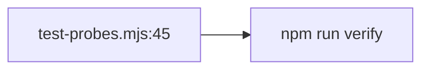

# Routing Count Pin — 35 → 40

## Goal

Pin the 40-probe count so full verify is green.

## Context

Routing probes took eval to 35→40, but tests/eval/test-probes.mjs:45 still asserts 35 (full suite red on exactly this). The routing gate couldn't cover the test file (out of scope) — this micro-plan closes that gap honestly.

## Diagram

## Architecture

One test file, one assertion: update the stale count literal in `tests/eval/test-probes.mjs` (line 45) from 35 to 40. No other file, no other assertion.

## Tech stack

`node --test` (existing count test, via `npm run verify`).

## Spec

Design 0004 routing probes (`docs/design/0004-quota-aware-routing.md`) + T4 5-probe addition: 35 + 5 routing = 40 total probes.

## Constraints

Add-only intent: only the count literal + comment change; zero probe/behavior edits. No probe additions, removals, renames, or behavior changes.

## Review Focus

Exact-count match 40; comment cites 35+5 (`35 + 5 routing T4`).

## Tasks

| # | Task | Files | Test | Expected | Verify |
|---|------|-------|------|----------|--------|
| 1 | Update count 35→40 with comment `35 + 5 routing T4` | tests/eval/test-probes.mjs | existing count test | full suite green | `npm run verify` |

## Coverage checklist

- [ ] Count assertion pins 40 (35 + 5 routing T4) so full verify is green

## Test integrity

Count literal only; any other failure stops the task.
