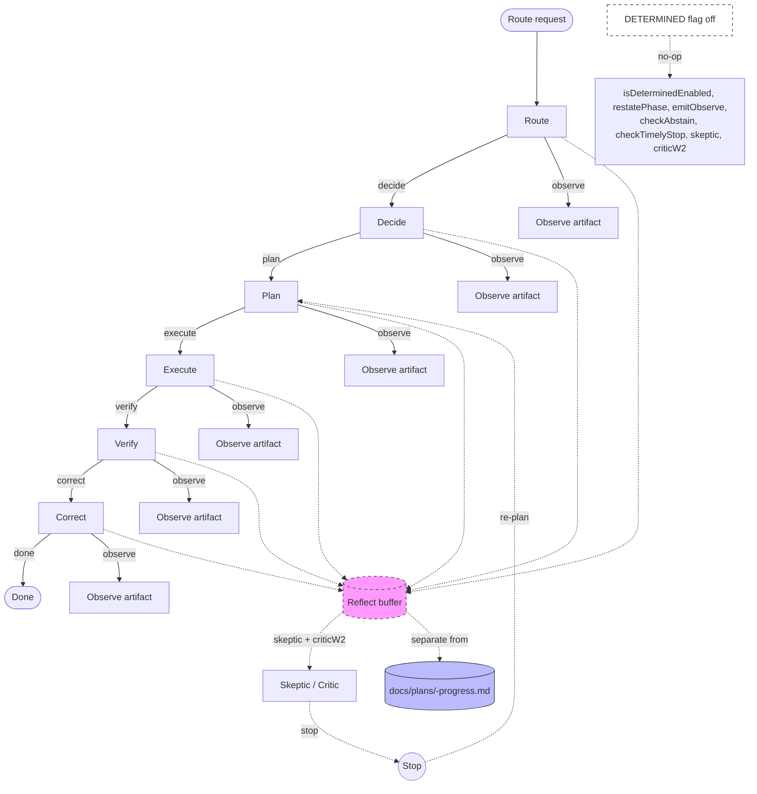

# Plan — Determined execution kernel impl

**Goal**: Implement additive determined-execution helpers behind the `DETERMINED` opt-in flag in `.opencode/plugins/sdlc-lean.js` and `.opencode/skills/autonomous-loop/SKILL.md` only: `isDeterminedEnabled`, `restatePhase`, `emitObserve`, a reflect buffer separate from the progress ledger, `checkAbstain`, `checkTimelyStop`, skeptic zero-persona prefix, and criticW2 — all no-op when the flag is off, so behavior is byte-identical and fail-open when disabled. Mirrors `docs/specs/2026-11-14-determined-execution.md` (R1-R7, N1-N3). Additive-only scope; no plugin/skill edits happen until this plan is approved.

**Spec**: [`docs/specs/2026-11-14-determined-execution.md`](../specs/2026-11-14-determined-execution.md) (read-only ref; allows additive plugin+skill behind `DETERMINED`).

**Citation**: 16ea20437159.

## Diagram

## Architecture

Additive helpers, all gated by `isDeterminedEnabled()` (no-op / pass-through when off):

- `restatePhase(phase, goal, state)` — R1: each route phase restates its own goal + current state before acting.
- `emitObserve(phase, artifact)` — R2: mandatory observe artifact before each phase transition; missing observe fails the phase when enabled.
- Reflect buffer — R3: scratch buffer for skeptic/critic notes, written separately from the progress ledger (`docs/plans/<slug>-progress.md`); ledger stays plan-level only.
- `checkAbstain(estFalseContinueRate)` — R4: abstain (decline to proceed, no-op result) when rate is in the 23-74% band; no-op when disabled.
- `checkTimelyStop(projectedCost, baselineCost)` — R5: stop early at 2.3-5x baseline cost band, emit observe artifact noting stop reason; opt-in, fail-open when disabled.
- skeptic zero-persona prefix — R6: applied before evaluation; flips 14-18% of evaluations, +7.4pp warmth; enabled only.
- `criticW2` — R7: width-2 parallel critics in fresh context, behind explicit opt-in flag; preserves `orchestrator.md:194-199` gate untouched.

File scope (additive-only, behind `DETERMINED`): `.opencode/plugins/sdlc-lean.js`, `.opencode/skills/autonomous-loop/SKILL.md`. No edits to `orchestrator.md`, scripts, `spec-check.mjs`, `tests/eval`, or other tests. No spec-gate activation, no `spec-check approve`, no flag implementation in this plan (flag wording only), no runtime behavior change, no new dependencies, no secrets, free-only.

## Tech stack

Node 20+ ESM, `node --test` (`npm run verify` unchanged), zero-dep plugin, markdown docs only, no new dependencies, free-only sources, no secrets or credentials.

## Constraints (AGENTS.md + spec)

- Additive-only: flag off ⇒ byte-identical to current kernel (N1).
- No active marker: fail-open preserved; no `spec-check approve` required (N2).
- Edits limited to the two files in frontmatter `files`, behind `DETERMINED` (N3).
- Bootstrap <5KB unaffected; skill bodies on-demand; human-facing output concise (30s budget); no spec-gate activation while this task is open.

## Review focus

- Frontmatter exact: `spec`, `status: draft`, `approved_by: ""`, `approved_at: ""`, `files` [plugin, skill], `allow` [progress, evidence.json].
- Task table cells exact: Spec req, Files exact, Test node --test, Expected flag-on vs flag-off identical, Verify exact commands (5 tasks).
- All seven spec requirements traceable: R1->T1, R2/R3->T2, R4/R5->T3, R6/R7->T4, N1-N3->T1-T5.
- Helpers all no-op when `DETERMINED` off; reflect buffer separate from ledger; `orchestrator.md:194-199` gate untouched.
- No out-of-scope claims (no plugin/skill edits yet, no approve, no gate activation).
- Citation 16ea20437159 present; step-3 verify command exits 0.

| # | Task | Spec req | Files exact | Test node --test | Expected flag-on vs flag-off identical | Verify |
|---|------|----------|-------------|------------------|----------------------------------------|--------------|
| 1 | YAML frontmatter: spec link, status draft, approved_by "", approved_at "", files [`.opencode/plugins/sdlc-lean.js`, `.opencode/skills/autonomous-loop/SKILL.md`], allow [progress, evidence.json] | Frontmatter contract (repo plan convention) | `docs/plans/2026-11-14-determined-kernel-impl.md` | `node --test` unchanged (docs-only; no new test files) | Identical: docs-only, flag not implemented | `test -f docs/plans/2026-11-14-determined-kernel-impl.md && grep -q 'status: draft' docs/plans/2026-11-14-determined-kernel-impl.md && grep -q 'approved_by: ""' docs/plans/2026-11-14-determined-kernel-impl.md; echo exit=$?` |
| 2 | Goal + mermaid + Architecture: `isDeterminedEnabled`, `restatePhase`, `emitObserve`; reflect buffer separate from ledger | R1-R3 (restate per phase, observe mandatory, reflect/ledger separation) | `docs/plans/2026-11-14-determined-kernel-impl.md` | `node --test` unchanged | Identical (helpers specify no-op-off behavior) | `grep -q 'isDeterminedEnabled' docs/plans/2026-11-14-determined-kernel-impl.md && grep -q 'restatePhase' docs/plans/2026-11-14-determined-kernel-impl.md && grep -q 'emitObserve' docs/plans/2026-11-14-determined-kernel-impl.md; echo exit=$?` |
| 3 | `checkAbstain` (23-74% false-continue band) + `checkTimelyStop` (2.3-5x cost band), no-op when off | R4-R5 (abstain monitor, timely-stop) | `docs/plans/2026-11-14-determined-kernel-impl.md` | `node --test` unchanged | Identical | `grep -q 'checkAbstain' docs/plans/2026-11-14-determined-kernel-impl.md && grep -q 'checkTimelyStop' docs/plans/2026-11-14-determined-kernel-impl.md; echo exit=$?` |
| 4 | Skeptic zero-persona prefix + `criticW2` width-2 parallel fresh-context critics, no-op when off | R6-R7 (skeptic prefix, critic width-2 opt-in) | `docs/plans/2026-11-14-determined-kernel-impl.md` | `node --test` unchanged | Identical | `grep -q 'skeptic' docs/plans/2026-11-14-determined-kernel-impl.md && grep -q 'criticW2' docs/plans/2026-11-14-determined-kernel-impl.md; echo exit=$?` |
| 5 | Constraints + review focus + coverage (R1->T1, R2/R3->T2, R4/R5->T3, R6/R7->T4, N1-N3->T1-T5) + step-3 self-verify exit 0 | N1-N3 (additive-only, fail-open, free-only) | `docs/plans/2026-11-14-determined-kernel-impl.md` | `node --test` unchanged; `npm run verify` unchanged | Identical | `test -f docs/plans/2026-11-14-determined-kernel-impl.md && grep -q 'status: draft' docs/plans/2026-11-14-determined-kernel-impl.md && grep -q 'isDeterminedEnabled' docs/plans/2026-11-14-determined-kernel-impl.md; echo exit=$?` |

## Coverage checklist

- [ ] T1: frontmatter exact (spec, status: draft, approved_by: "", approved_at: "", files [plugin, skill], allow [progress, evidence.json]); R1->T1 traceable
- [ ] T2: goal restated per route phase (R1); mermaid flowchart present; `isDeterminedEnabled`/`restatePhase`/`emitObserve` documented; reflect buffer separate from ledger (R3); R2/R3->T2
- [ ] T3: `checkAbstain` 23-74% band (R4); `checkTimelyStop` 2.3-5x cost band (R5); R4/R5->T3
- [ ] T4: skeptic zero-persona prefix (R6); `criticW2` width-2 opt-in (R7); R6/R7->T4
- [ ] T5: N1-N3 additive-only honored across T1-T5; out-of-scope honored; step-3 command exits 0; citation 16ea20437159 present
- [ ] 5-task table complete with Spec req / Files exact / Test node --test / Expected flag-on vs flag-off identical / Verify exact commands
- [ ] Task1 Verify checks `status: draft` + `approved_by: ""` on THIS file (stays closeable before approval)
- [ ] No plugin/skill edits yet; no approve; no spec-gate activation

## Test integrity

Docs-only plan; no runnable tests yet. `node --test` unchanged (`npm run verify` green). Tasks 2-5 Verify exact commands exit 0; Task1 Verify keeps the file closeable before approval (`status: draft`, `approved_by: ""` on this file).

## Approval

Draft only. Do NOT approve while this task is open. Scope limited to this plan file; plugin/skill edits require a separate approved step.
