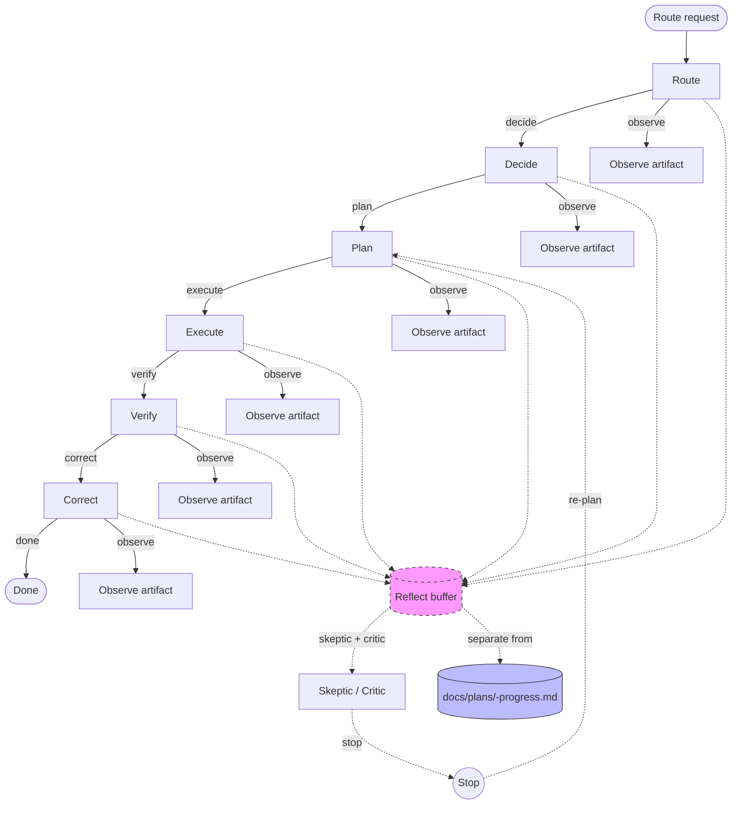

# Plan — Determined execution kernel

**Goal**: Document a determined execution kernel: each route phase restates its own goal and state before acting, observe artifacts are mandatory, and the reflect buffer stays separate from the progress ledger (`docs/plans/<slug>-progress.md`). Additive-only — byte-identical behavior when disabled, fail-open preserved, no new dependencies, no secrets, free-only. Mirrors `docs/specs/2026-11-14-determined-execution.md` (R1-R7, N1-N3).

**Citation**: e161aed0 — route-decide-plan-execute-verify-correct baseline.

**Spec**: [`docs/specs/2026-11-14-determined-execution.md`](../specs/2026-11-14-determined-execution.md) (DRAFT reference only).

## Diagram

## Architecture

Touched docs: 2 only — `docs/specs/2026-11-14-determined-execution.md` (read-only reference) and this plan (create). Read files: 8 — spec, this plan, 2 reference plans (`2026-10-23-spec-enforcement.md`, `2026-11-07-model-routing-activation.md`), 1 progress ledger, AGENTS.md, COMMUNICATION.md, plus repo/git state. No code files touched; no plugin, scripts, eval harness, or test edits. The ledger (`docs/plans/<slug>-progress.md`) records plan-level progress only; reflection is never mixed into ledger entries (R3).

## Tech stack

Markdown docs only; YAML frontmatter per repo plan convention; `node --test` unchanged (`npm run verify` green); no new dependencies; free-only sources; no secrets or credentials.

## Global constraints (AGENTS.md)

Zero-dep plugin untouched; docs and counts consistent; bootstrap <5KB unaffected (this plan is a doc, not injected skill body); skill bodies remain on-demand; human-facing output concise (30s budget); no spec-gate activation while this task is open.

## Lean constraints

Smallest durable contract: frontmatter + task table + coverage checklist. Reuse existing docs conventions (frontmatter fields, table columns, checklist format). Additive-only: byte-identical behavior when determined execution is off; no opt-in flag implementation; no runtime behavior change.

## Review focus

- Frontmatter exact: `spec`, `status: draft`, `approved_by: ""`, `approved_at: ""`, `files` [spec, plan], `allow` [progress, evidence.json]
- Task table cells exact: Spec req, Files exact, Test grep, Expected, Verify exact commands (4 tasks, no code)
- All seven spec requirements R1-R7 traceable; N1-N3 additive-only honored
- No out-of-scope claims (no plugin/scripts/spec edits, no gate activation)
- Citation e161aed0 present; verification command in step 3 exits 0

| # | Task | Spec req | Files exact | Test grep | Expected | Verify |
|---|------|----------|-------------|-----------|----------|--------|
| 1 | YAML frontmatter: spec link, status draft, approved_by "", approved_at "", files [spec, plan], allow [progress, evidence.json] | Frontmatter contract (repo plan convention) | `docs/plans/2026-11-14-determined-kernel.md` | `status: draft`, `approved_by: ""` | Parseable YAML with exact fields; no other files listed | `grep -q '^status: draft$' docs/plans/2026-11-14-determined-kernel.md && grep -q '^approved_by: ""$' docs/plans/2026-11-14-determined-kernel.md; echo exit=$?` |
| 2 | Goal + mermaid flowchart + Architecture (2 docs touched, 8 files read) | R1-R7 mirror; Design flowchart | `docs/specs/2026-11-14-determined-execution.md`, `docs/plans/2026-11-14-determined-kernel.md` | `# Determined Execution`, `flowchart TD` | Goal restated per phase; flowchart present; architecture notes 2 docs/8 files | `grep -q '# Determined Execution Spec' docs/specs/2026-11-14-determined-execution.md && grep -q 'flowchart TD' docs/plans/2026-11-14-determined-kernel.md; echo exit=$?` |
| 3 | Tech Stack + Global/Lean Constraints + Review Focus + coverage checklist | R2-R7 (observe, reflect, abstain, timely-stop, skeptic, critic, additive-only) | Both docs above | `## R2` … `## R7` in spec | All seven requirement sections present; constraints and review focus listed | `for r in R2 R3 R4 R5 R6 R7; do grep -q "## $r" docs/specs/2026-11-14-determined-execution.md; done; echo exit=$?` |
| 4 | Final verification gate: file exists, status draft, approved_by empty | N1-N3 (docs-only, byte-identical when disabled, fail-open) | `docs/plans/2026-11-14-determined-kernel.md` | `status: draft`, `approved_by: ""` | exit=0 | `test -f docs/plans/2026-11-14-determined-kernel.md && grep -q 'status: draft' docs/plans/2026-11-14-determined-kernel.md && grep -q 'approved_by: ""' docs/plans/2026-11-14-determined-kernel.md; echo exit=$?` |

## Coverage checklist

- [ ] Frontmatter exact: spec, status: draft, approved_by: "", approved_at: "", files [spec, plan], allow [progress, evidence.json]
- [ ] Goal restated per route phase (R1) with goal + state before acting
- [ ] Mermaid flowchart present (route → decide → plan → execute → verify → correct, observe artifacts, reflect buffer separate from ledger)
- [ ] Observe mandatory per phase (R2); missing observe fails the phase
- [ ] Reflect buffer separate from progress ledger (R3); ledger is plan-level only
- [ ] Abstain monitor 23-74% band (R4); timely-stop 2.3-5x cost band (R5); skeptic zero-persona prefix (R6); critic width-2 opt-in flag (R7)
- [ ] Additive-only contract: byte-identical when disabled, fail-open, no new deps, no secrets, free-only (N1-N3)
- [ ] Out-of-scope honored: no plugin/scripts/spec/test edits, no spec-gate activation
- [ ] 4-task table complete with Spec req / Files exact / Test grep / Expected / Verify exact commands
- [ ] Step 3 verify command exits 0; citation e161aed0 present

## Test integrity

Docs-only; no runnable tests. Verified by the step-3 command (file exists, `status: draft`, `approved_by: ""`). `npm run verify` unchanged.

Rubric: PASS
