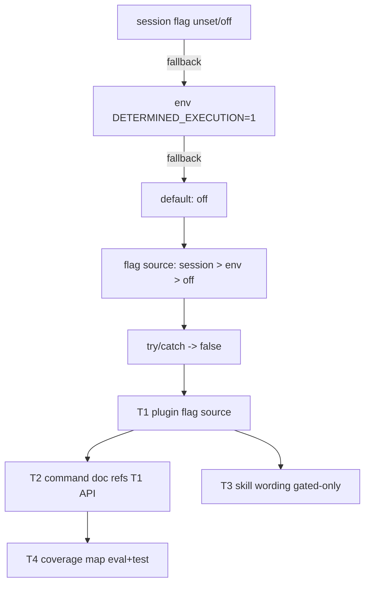

Goal: make "determined" execution easy to enable by gating it on precedence `session (unset/off) > DETERMINED_EXECUTION=1 > default-off`, adding a `determined.md` command doc that references the T1 API, and wording the autonomous-loop skill so "easy-enable" is gated-only.

## Architecture

- T1: flag source resolves `session (unset/off)` > `DETERMINED_EXECUTION=1` > default-off; parsing wrapped in try/catch returning false on any error; helpers return null when off.
- T2: `.opencode/commands/determined.md` documents the command and references the T1 flag-source API.
- T3: `.opencode/skills/autonomous-loop/SKILL.md` wording describes "easy-enable" only as gated (session/env/default-off), never unconditional.
- T4: `eval/coverage.mjs` + `tests/opencode/test-eval-coverage.mjs` coverage map (eval exempt + test 9->10, no weakening), spec req N3.

## Constraints

- Allowed files ONLY: `.opencode/plugins/sdlc-lean.js`, `.opencode/commands/determined.md`, `.opencode/skills/autonomous-loop/SKILL.md`, `eval/coverage.mjs`, `tests/opencode/test-eval-coverage.mjs`.
- Out of scope: no config, no spec-check.mjs/other tests-eval/orchestrator edits; T1-T4 limited to Allowed files ONLY; no approve, no secrets.
- No gate active while this plan is draft.

## Review focus

- Verify flag-source precedence `session > env > off` with try/catch false (T1).
- Verify command doc references T1 API (T2).
- Verify skill wording is gated-only (T3).
- Confirm exactly five files touched, no others.

## Coverage

| Node | Tasks | Requirement |
|------|-------|-------------|
| N1 | T1 + T3 | flag source + gated-only wording |
| N2 | T1 + T2 | flag source + command doc API ref |
| N3 | T1-T4 | full easy-enable chain |
| R1-R7 | gated-only | spec requirements apply only when gated |

| # | Task | Spec req | Files | Test | Expected | Verify |
|---|------|----------|-------|------|----------|--------|
| 1 | Implement flag source precedence session>env>off with try/catch false | session unset/off > DETERMINED_EXECUTION=1 > default-off | `.opencode/plugins/sdlc-lean.js` | `npm run verify` | exit 0 | `npm run verify` |
| 2 | Add command doc referencing T1 flag-source API | command doc refs T1 API | `.opencode/commands/determined.md` | `test -f .opencode/commands/determined.md && npm run verify` | exit 0 | `test -f .opencode/commands/determined.md && npm run verify` |
| 3 | Wording autonomous-loop skill gated-only | skill wording gated-only | `.opencode/skills/autonomous-loop/SKILL.md` | `node scripts/validate-skills.mjs` | exit 0 | `node scripts/validate-skills.mjs` |
| 4 | coverage map (eval exempt + test 9->10, no weakening) | N3 | `eval/coverage.mjs` + `tests/opencode/test-eval-coverage.mjs` | `npm run verify` | 10 stems mapped | `npm run verify` |
