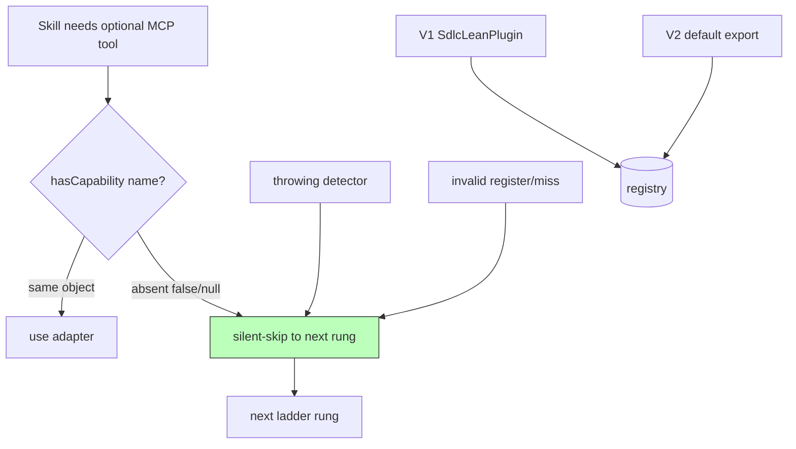

# Plan — Generic MCP capability registry (DI contract)

**Goal**: Add a zero-dep generic MCP capability registry to `.opencode/plugins/sdlc-lean.js` — `registerCapability` / `hasCapability` / `getCapability` / `clearCapabilities` — so skill text detects optional MCP tools only through this contract (`hasCapability(name)` / `getCapability(name)`); a missing capability silent-skips to the next rung and never hardcalls a server-qualified tool name. Fail-open everywhere: absent is `false`/`null`, throwing detectors are skipped, invalid input silent-skips. V1+V2 parity, bootstrap <5KB. Mirrors spec `REQ-1`. Docs reconstructed Task 4 from landed code/tests (prior 5-task design); this plan stays draft — planner never self-approves.

**Spec**: [`docs/specs/2026-11-18-life-better.md`](../specs/2026-11-18-life-better.md) (read-only ref; retroactive trace — spec written Task 4).

**Citations**: e161aed0, 582e3658 (parent-provided; not resolvable in this checkout).

## Diagram

## Architecture

Zero-dep in-memory `Map` registry, every entry wrapped in try/catch:

- `registerCapability(name, adapter)` — non-string/blank name or nullish adapter silent-skips; never throws.
- `hasCapability(name)` — `false` for absent/blank; runs an optional adapter detector (`detect`/`isAvailable`) and returns `false` when it throws; never throws.
- `getCapability(name)` — `null` for absent/blank or failed detector; otherwise the same registered object; never throws.
- `clearCapabilities()` — empties the registry (test isolation via `afterEach`); never throws.
- V1 (`SdlcLeanPlugin`) and V2 (`default`: `id`/`setup`/`server`) exports share the one registry; `default.server === SdlcLeanPlugin`.
- Bootstrap budget untouched (<5KB router-only; registry is not injected content).

File scope: `.opencode/plugins/sdlc-lean.js` + `tests/opencode/test-mcp-capabilities.mjs` only. No spawn, no install, no network, no secrets.

## Tech stack

Node 20+ ESM, `node --test`, zero-dep plugin, no new dependencies, free-only, no secrets.

## Constraints (AGENTS.md + spec)

- Fail-open: missing/throwing/invalid never blocks activation (spec N2/N3).
- V1+V2 importable; bootstrap <5KB; skill bodies on-demand.
- No grader edits; no spec-gate activation while this task is open.
- Human-facing output concise (30s budget).

## Review focus

- Frontmatter exact: `spec`, `status: draft`, `approved_by: ""`, `approved_at: ""`, `files` [plugin, test], `allow` [progress, evidence.json].
- Task table cells exact: Spec req REQ-1, Files exact, Test `node --test tests/opencode/test-mcp-capabilities.mjs`, Expected fail-open booleans, Verify exact commands.
- Registry never throws on any input; throwing detector → `false`/`null`; V1+V2 parity asserts present.
- No out-of-scope claims (no approve, no gate activation).

| # | Task | Spec req | Files exact | Test node --test | Expected | Verify |
|---|------|----------|-------------|------------------|----------|--------|
| 1 | YAML frontmatter: spec link, status draft, approved_by "", approved_at "", files [`.opencode/plugins/sdlc-lean.js`, `tests/opencode/test-mcp-capabilities.mjs`], allow [progress, evidence.json] | Frontmatter contract | `docs/plans/2026-11-16-mcp-di.md` | `node --test` unchanged (docs-only) | Identical: docs-only | `test -f docs/plans/2026-11-16-mcp-di.md && grep -q 'status: draft' docs/plans/2026-11-16-mcp-di.md && grep -q 'approved_by: ""' docs/plans/2026-11-16-mcp-di.md; echo exit=$?` |
| 2 | Registry core: `registerCapability` + `hasCapability`/`getCapability` — absent `false`/`null`, present same object, never throws | REQ-1 registry contract | `.opencode/plugins/sdlc-lean.js`, `tests/opencode/test-mcp-capabilities.mjs` | `node --test tests/opencode/test-mcp-capabilities.mjs` | absent `false`/`null`; present same object | `grep -q 'registerCapability' .opencode/plugins/sdlc-lean.js && grep -q 'absent capability is false/null' tests/opencode/test-mcp-capabilities.mjs; echo exit=$?` |
| 3 | Fail-open detectors: throwing `detect` → `false`/`null`; invalid/blank register + miss silent-skip; `clearCapabilities` empties | REQ-1 fail-open | `.opencode/plugins/sdlc-lean.js`, `tests/opencode/test-mcp-capabilities.mjs` | `node --test tests/opencode/test-mcp-capabilities.mjs` | no throw on any input | `grep -q 'throwing detector is skipped fail-open' tests/opencode/test-mcp-capabilities.mjs && grep -q 'invalid register/miss never throws' tests/opencode/test-mcp-capabilities.mjs; echo exit=$?` |
| 4 | V1+V2 parity: `SdlcLeanPlugin` + `default` (`id`/`setup`/`server`) share one registry; isolation via `afterEach(clearCapabilities)`; `~/` normalization | REQ-1 parity | `.opencode/plugins/sdlc-lean.js`, `tests/opencode/test-mcp-capabilities.mjs` | `node --test tests/opencode/test-mcp-capabilities.mjs` | parity asserts hold; isolation holds | `grep -q 'V1 SdlcLeanPlugin + V2 default exports exist' tests/opencode/test-mcp-capabilities.mjs && grep -q 'registry isolated between tests' tests/opencode/test-mcp-capabilities.mjs; echo exit=$?` |
| 5 | Docs + budget: connect-ladder wording uses contract only; bootstrap <5KB; coverage REQ-1→T2-T4 | REQ-1, AGENTS.md bootstrap | `.opencode/plugins/sdlc-lean.js`, `tests/opencode/test-mcp-capabilities.mjs` | `node --test tests/opencode/test-mcp-capabilities.mjs` (14/0) | 14 pass, bootstrap gate green | `node --test tests/opencode/test-mcp-capabilities.mjs 2>&1 \| grep -E '^ℹ (pass\|fail)'; echo exit=$?` |

## Coverage checklist

- [ ] T1: frontmatter exact (spec, status: draft, approved_by: "", approved_at: "", files [plugin, test], allow [progress, evidence.json])
- [ ] T2: registry core documented + implemented; REQ-1→T2
- [ ] T3: fail-open detectors + invalid-input silent-skip; REQ-1→T3
- [ ] T4: V1+V2 parity + test isolation + `~/` normalization; REQ-1→T4
- [ ] T5: ladder wording contract-only; bootstrap <5KB; 14/0 on the capability file
- [ ] Task1 Verify checks `status: draft` + `approved_by: ""` on THIS file (stays closeable before approval)
- [ ] No approve; no spec-gate activation

## Test integrity

`node --test tests/opencode/test-mcp-capabilities.mjs` — 14 tests, 14 pass, 0 fail. `afterEach(clearCapabilities)` isolates registry state between tests. No other suite touched.

## Approval

Draft only. Do NOT approve while this task is open. Scope limited to the two frontmatter files; activation wiring belongs to `2026-11-17-mcp-autodetect.md`.
