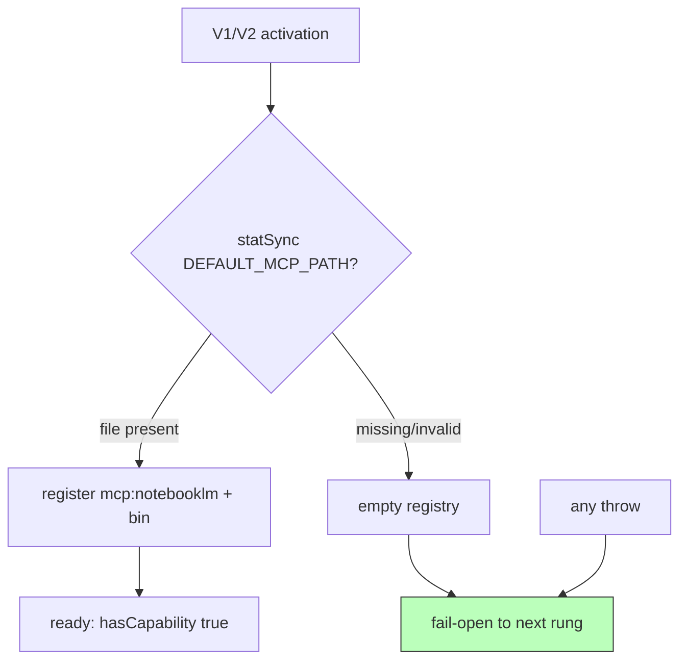

# Plan — Startup MCP auto-detect (best-effort, fail-open)

**Goal**: Auto-detect the optional `notebooklm-mcp` binary at activation via a best-effort existence probe — statSync-only, no spawn/install — and register it into the REQ-1 registry when present; absent/empty means an empty registry and fail-open to the next ladder rung. V1+V2 call it at activation inside try/catch so detection can never block startup. Portable homedir-resolved `DEFAULT_MCP_PATH` (`~/.local/bin/notebooklm-mcp`) shared between plugin and a zero-dep helper script. Mirrors spec `REQ-2`. Docs reconstructed Task 4 from landed code/tests (prior 4-task design); this plan stays draft — planner never self-approves.

**Spec**: [`docs/specs/2026-11-18-life-better.md`](../specs/2026-11-18-life-better.md) (read-only ref; retroactive trace — spec written Task 4).

**Citations**: e161aed0, 582e3658 (parent-provided; not resolvable in this checkout).

## Diagram

## Architecture

- `scripts/mcp-capabilities.mjs` — zero-dep ESM, V1+V2 importable: `DEFAULT_MCP_PATH` (homedir-resolved), `normalizeMcpPath` (`~/`→homedir, `~`→homedir, non-string/blank→`''`, never throws), `detectMcpCapability(binPath)` (statSync-only, missing→`{available:false}`, never throws, never spawns).
- `autoDetectCapabilities(binPath = DEFAULT_MCP_PATH)` in the plugin — same `~/` normalization, statSync probe, registers `{name:'mcp:notebooklm', bin}` when a file, deletes the key + returns `false` when missing; outer try/catch returns `false`, never throws.
- Activation: V1+V2 setup paths call `autoDetectCapabilities()` inside `try { } catch { }` (fail-open comment) — detection can never block or break startup.
- Skill wording (reverse-engineering connect ladder): startup statSync-only probe of portable `DEFAULT_MCP_PATH`; populated registry = ready, empty/missing = fail-open.

File scope: plugin + helper script + capability test file only. No spawn, no install, no network, no secrets.

## Tech stack

Node 20+ ESM, `node --test`, `fs.statSync` existence check only, zero-dep, free-only, no secrets.

## Constraints (AGENTS.md + spec)

- Existence-check-before-spawn: statSync only, zero spawn/install (spec N1).
- Fail-open: any probe failure → empty registry, activation continues (spec N2/N3).
- V1+V2 parity at activation; bootstrap <5KB; no grader edits.

## Review focus

- Frontmatter exact: `spec`, `status: draft`, `approved_by: ""`, `approved_at: ""`, `files` [plugin, helper, test], `allow` [progress, evidence.json].
- Task table cells exact: Spec req REQ-2, Files exact, Test `node --test tests/opencode/test-mcp-capabilities.mjs`, Expected probe booleans, Verify exact commands.
- Helper never throws/spawns; plugin + helper agree on `DEFAULT_MCP_PATH`; activation call is try/catch-guarded.
- No out-of-scope claims (no approve, no gate activation).

| # | Task | Spec req | Files exact | Test node --test | Expected | Verify |
|---|------|----------|-------------|------------------|----------|--------|
| 1 | YAML frontmatter: spec link, status draft, approved_by "", approved_at "", files [`.opencode/plugins/sdlc-lean.js`, `scripts/mcp-capabilities.mjs`, `tests/opencode/test-mcp-capabilities.mjs`], allow [progress, evidence.json] | Frontmatter contract | `docs/plans/2026-11-17-mcp-autodetect.md` | `node --test` unchanged (docs-only) | Identical: docs-only | `test -f docs/plans/2026-11-17-mcp-autodetect.md && grep -q 'status: draft' docs/plans/2026-11-17-mcp-autodetect.md && grep -q 'approved_by: ""' docs/plans/2026-11-17-mcp-autodetect.md; echo exit=$?` |
| 2 | Helper script: `DEFAULT_MCP_PATH` homedir pin + `normalizeMcpPath` (`~/`, blank, non-string) + `detectMcpCapability` statSync-only, never throws/spawns | REQ-2 probe | `scripts/mcp-capabilities.mjs`, `tests/opencode/test-mcp-capabilities.mjs` | `node --test tests/opencode/test-mcp-capabilities.mjs` | missing→`{available:false}`; invalid→unavailable, no throw | `grep -q 'missing binary' tests/opencode/test-mcp-capabilities.mjs && grep -q 'invalid/empty path never throws' tests/opencode/test-mcp-capabilities.mjs; echo exit=$?` |
| 3 | Plugin activation: `autoDetectCapabilities` + try/catch-guarded calls on V1+V2 setup; absent binary→empty registry, present binary→registered with `bin` | REQ-2 activation | `.opencode/plugins/sdlc-lean.js`, `tests/opencode/test-mcp-capabilities.mjs` | `node --test tests/opencode/test-mcp-capabilities.mjs` | guarded activation; register/unregister round-trip | `grep -q 'autoDetectCapabilities' .opencode/plugins/sdlc-lean.js && grep -q 'auto-detect: present binary' tests/opencode/test-mcp-capabilities.mjs; echo exit=$?` |
| 4 | Docs + parity: ladder wording (probe portable path, populated=ready/empty=fail-open, V1+V2, bootstrap <5KB); `DEFAULT_MCP_PATH` agreement; coverage REQ-2→T2-T4 | REQ-2, AGENTS.md bootstrap | `.opencode/plugins/sdlc-lean.js`, `scripts/mcp-capabilities.mjs`, `tests/opencode/test-mcp-capabilities.mjs` | `node --test tests/opencode/test-mcp-capabilities.mjs` (14/0) | agreement asserts hold; file 14/0 | `grep -q 'DEFAULT_MCP_PATH resolves under homedir' tests/opencode/test-mcp-capabilities.mjs && node --test tests/opencode/test-mcp-capabilities.mjs 2>&1 \| grep -E '^ℹ (pass\|fail)'; echo exit=$?` |

## Coverage checklist

- [ ] T1: frontmatter exact (spec, status: draft, approved_by: "", approved_at: "", files [plugin, helper, test], allow [progress, evidence.json])
- [ ] T2: helper script landed, statSync-only, never throws/spawns; REQ-2→T2
- [ ] T3: plugin auto-detect + guarded V1+V2 activation calls; round-trip tests; REQ-2→T3
- [ ] T4: ladder wording + path agreement assert + 14/0 on the capability file; REQ-2→T4
- [ ] Task1 Verify checks `status: draft` + `approved_by: ""` on THIS file (stays closeable before approval)
- [ ] No approve; no spec-gate activation

## Test integrity

Covered by `node --test tests/opencode/test-mcp-capabilities.mjs` — 14 tests, 14 pass, 0 fail (Task-2 detector rows + Task-1 auto-detect rows + `DEFAULT_MCP_PATH` pin row). Temp binaries use `os.tmpdir()` (portable, no `/tmp` hardcode). No other suite touched.

## Approval

Draft only. Do NOT approve while this task is open. Scope limited to the three frontmatter files; debt closeout belongs to `2026-11-18-life-better.md`.
