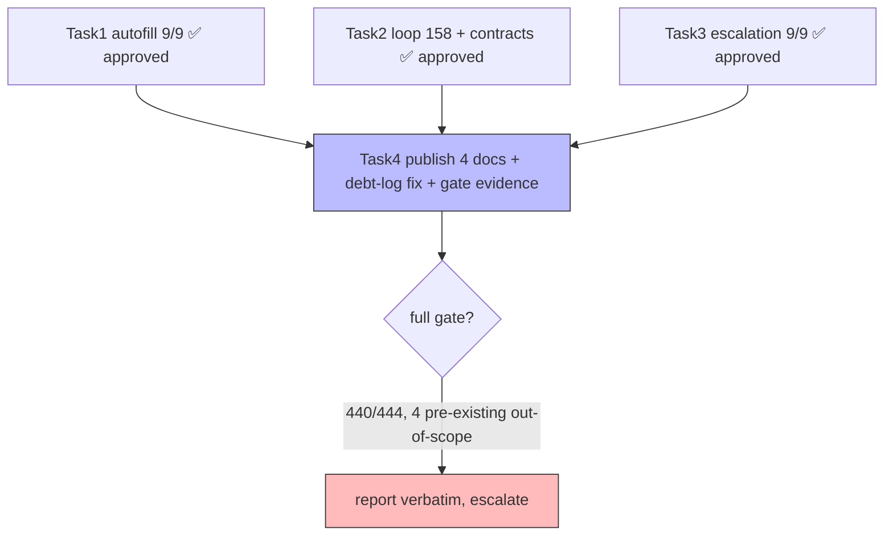

# Plan — Life-better closeout: publish artifacts + full-gate evidence

**Goal**: Close the life-better thread (spec REQ-1..REQ-4): Tasks 1-3 land approved with fresh evidence (approve-autofill 9/9, autonomous-loop 158/160 with skill-contracts green, tiered-reasoning escalation 9/9); Task 4 publishes the four missing docs-only artifacts (this spec's companion spec + two prior designs + this plan), applies the one-line-accurate debt-log fix in the reverse-engineering skill, and records full-gate evidence verbatim — including the 4 out-of-scope pre-existing failures, which are named, never edited. This plan stays draft — planner never self-approves; human approves via `node scripts/spec-check.mjs approve`.

**Spec**: [`docs/specs/2026-11-18-life-better.md`](../specs/2026-11-18-life-better.md) (read-only ref while this task is open).

**Citations**: e161aed0, 582e3658 (parent-provided; not resolvable in this checkout) + DESIGN.md + AGENTS.md (pinned in spec Goal).

## Diagram

## Architecture

- T1-T3 are evidence-only (already landed + approved): no code changes, test outputs recorded in the task table.
- T4 creates exactly four docs-only files (spec Goal/Non-goals/REQ-1..4/Trace; two reconstructed prior designs marked as such; this plan) and makes one tiny accuracy edit to the reverse-engineering `Known debt` block (three stale failure bullets → fixed-with-evidence; leanness note kept).
- Gate evidence is read-only: `node --test` runs, `validate-skills.mjs`, `wc` sizes. `.sdlc/spec-gate.json` is never hand-edited (absent in this checkout — logged as manual step for human approve). No grader, plugin, script, or test file is touched.

## Tech stack

Node 20+ ESM, `node --test`, `node scripts/validate-skills.mjs`, `wc`, markdown docs only, no new dependencies, no secrets.

## Constraints (AGENTS.md + spec)

- Planner never self-approves: all four docs `status: draft`, `approved_by: ""`.
- Edit boundary = frontmatter `files` only; graders frozen (verify-only, never edit).
- Fail-open preserved; no network/env assumptions; no `curl`/`wget`; no shell redirection outside the allowlist.
- Spec-gate: propose approve command, never run it here; never fabricate hashes.
- Surprises escalated, not absorbed (unresolvable citations, 440/444 vs green).

## Review focus

- Frontmatter exact: `spec`, `status: draft`, `approved_by: ""`, `approved_at: ""`, `files` [4 docs + RE SKILL.md], `allow` [progress, evidence.json].
- T1-T3 evidence numbers match standalone runs (9/9, 158 + 28/28, 9/9).
- T4 creates all four files with required sections; debt-log edit is tiny and accuracy-only.
- Gate tail pasted verbatim; 4 failures named with owning files; no grader diff.
- Citations recorded verbatim with unresolvable note; no fabricated hashes.

| # | Task | Spec req | Files exact | Test node --test | Expected | Verify |
|---|------|----------|-------------|------------------|----------|--------|
| 1 | Approve-autofill evidence (approved): `test-approve-autofill.mjs` 9/9 standalone | REQ-3 | none (evidence only) | `node --test tests/opencode/test-approve-autofill.mjs` | 9 pass / 0 fail | `node --test tests/opencode/test-approve-autofill.mjs 2>&1 \| grep -E '^ℹ (tests\|pass\|fail)'` |
| 2 | Loop-length evidence (approved): autonomous-loop SKILL.md 158 lines (cap 160), `test-skill-contracts.mjs` green | REQ-3 | none (evidence only) | `node --test tests/opencode/test-skill-contracts.mjs` | 158 ≤ 160; contracts pass | `wc -l .opencode/skills/autonomous-loop/SKILL.md; node --test tests/opencode/test-skill-contracts.mjs 2>&1 \| grep -E '^ℹ (pass\|fail)'` |
| 3 | Escalation evidence (approved): `test-tiered-reasoning.mjs` 9/9 standalone | REQ-3 | none (evidence only) | `node --test tests/opencode/test-tiered-reasoning.mjs` | 9 pass / 0 fail | `node --test tests/opencode/test-tiered-reasoning.mjs 2>&1 \| grep -E '^ℹ (tests\|pass\|fail)'` |
| 4 | Publish + gate evidence: create spec (Goal/Non-goals/REQ-1..4/Trace) + 3 plans; tiny debt-log accuracy fix; record `test-mcp-capabilities` 14/0, lint 0 failures, full-suite tail verbatim, bootstrap + loop sizes | REQ-4 | `docs/specs/2026-11-18-life-better.md`, `docs/plans/2026-11-16-mcp-di.md`, `docs/plans/2026-11-17-mcp-autodetect.md`, `docs/plans/2026-11-18-life-better.md`, `.opencode/skills/reverse-engineering/SKILL.md` | `node --test tests/opencode/test-mcp-capabilities.mjs` (14/0); `node scripts/validate-skills.mjs` (0 failures); `node --test tests/opencode/*.mjs` (tail verbatim) | 4 files exist; debt bullets match T1-T3 evidence; full tail 440/444 with 4 named pre-existing failures; bootstrap <5120B; loop ≤160 | `ls docs/plans/2026-11-1*.md docs/specs/2026-11-18-life-better.md; node --test tests/opencode/test-mcp-capabilities.mjs 2>&1 \| grep -E '^ℹ (pass\|fail)'; node scripts/validate-skills.mjs 2>&1 \| tail -1; wc -c .opencode/plugins/sdlc-lean.js; wc -l .opencode/skills/autonomous-loop/SKILL.md` |

## Coverage checklist

- [ ] T1: autofill 9/9 recorded (approved, evidence-only, no files)
- [ ] T2: loop 158/160 + contracts green recorded (approved, evidence-only, no files)
- [ ] T3: escalation 9/9 recorded (approved, evidence-only, no files)
- [ ] T4: spec has Goal/Non-goals/REQ-1..4/Trace; both prior designs marked reconstructed-Task-4; this plan complete; debt-log bullets match T1-T3; gate tail verbatim with 4 failures named
- [ ] Task4 Verify checks all 4 files exist + capability 14/0 + lint 0 failures + sizes
- [ ] No grader/plugin/script/test edits; no approve run; no `.sdlc/spec-gate.json` hand-edit (absent → manual step logged)

## Test integrity

Docs-only closeout plus read-only verification. T1-T3 pinned by standalone runs; T4 by file-existence greps and the named read-only commands. The full-suite 4 failures (`test-autonomy-default-posture.mjs` ×2, `test-tui-brain.mjs` approve-overwrite ×2) are pre-existing, out-of-scope graders — reproduced verbatim, never touched.

## Approval

Draft only. Do NOT approve while this task is open. Human close path (manual step, NOT run here): `node scripts/spec-check.mjs approve docs/plans/2026-11-18-life-better.md` after human review (TTY autofill), or the `--machine --envelope` path when an envelope covers the plan. `.sdlc/spec-gate.json` is written only by that flow.
