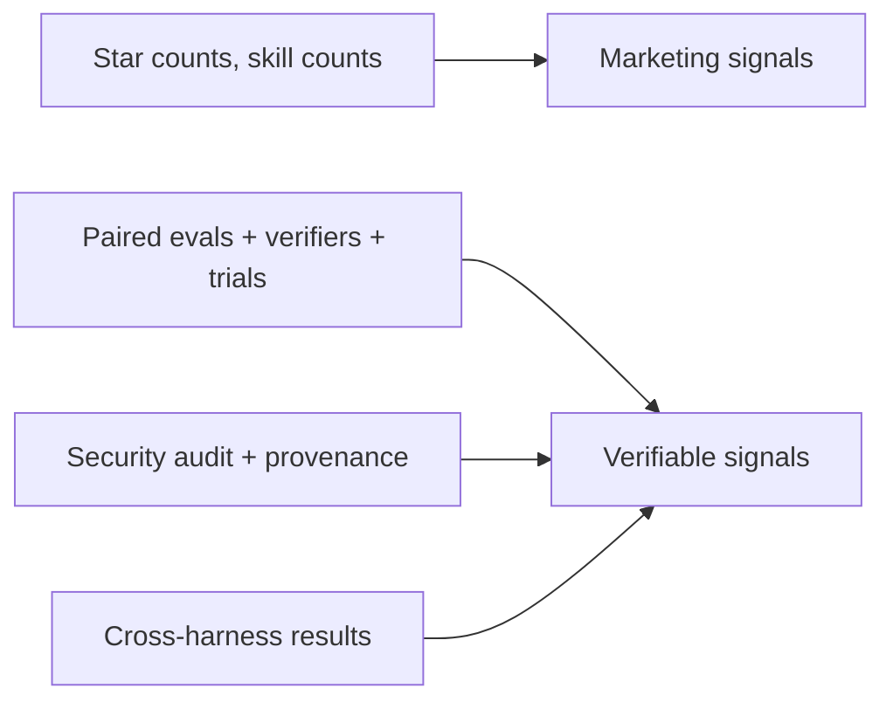

# Is sdlc-lean SOTA / S-tier?

_2026-10-05 · depth: standard · sources_reviewed: 21 · confidence: medium-high (converging independent evidence; no head-to-head suite benchmark exists)_

## Executive summary

- **No — not by evidence.** "SOTA/S-tier" is unsubstantiated for sdlc-lean: 1★, 1 contributor, 0 releases, repo 8 days old; no third-party review, benchmark, or adoption found [1][2].
- **No suite in this field can currently claim proven SOTA.** The closest suite-level evidence is sobering: SWE-Skills-Bench (~565 paired instances) found 39/49 skills gave zero pass-rate gain, average +1.2%, and 3 degraded [11]; SkillsBench (84 tasks, 7,308 trajectories) found curated skills on average +16.2pp, but 16/84 tasks negative and 4+ skills *degrade* results [12].
- **sdlc-lean's design does match current best practice**: progressive disclosure (36 skills, on-demand bodies, longest SKILL.md 101 lines), <5KB bootstrap enforced by test, latency-safe plugin hooks, hermetic tests green (57/57 + lint), eval harness dry-by-default, MIT [1][2][14].
- **Differentiation is real but niche**: the most complete *OpenCode-native* SDLC suite found — competitors are 4–13★ hobby repos [18][19][20]; auto-router + autonomous orchestrator + lean-review/debt-ledger is a distinctive combination [1][3][5].
- **Verdict**: S-tier engineering hygiene; adoption and outcome-evidence tier **unranked**. Honest label: *"strong for OpenCode today, not provably SOTA overall."*

## What SOTA actually requires (and how the field scores)

Anthropic's own guidance sets the verifiable bar: progressive disclosure, eval-first authoring (baseline without the skill, ≥3 evals, cross-model), deterministic graders over LLM judges, multiple trials, maintained eval artifacts [14][16]. Claims like star counts or skill counts are marketing; spec compliance, paired ablation, security audit, and cross-harness results are verifiable [14][16].

Benchmark reality check:

| Evidence | Result | Implication |
|---|---|---|
| SWE-Skills-Bench, 49 skills / ~565 tasks [11] | 39/49 zero gain; avg +1.2%; 3 degraded up to −10%; token overhead up to +451% | Most skills don't move outcomes |
| SkillsBench, 84 tasks / 7,308 trajectories [12] | Curated skills avg +16.2pp; 16/84 negative; 2–3 skills optimal, 4+ degrade; self-generated skills −1.3pp | Quality and restraint beat quantity |
| Skill security survey [13] | 26.1% of 31,132 community skills contain ≥1 vulnerability; 5.2% high severity | Security audit is table stakes |
| Harness variance [12] | Skill utilization varies by harness (Claude Code highest; Codex often ignores skills) | Cross-host claims need multi-harness runs |

**No benchmark evaluates complete suites** — only curated per-task skills. So "suite X is SOTA" is currently unfalsifiable by construction; the reference implementation is Anthropic's first-party set [4][12].

## Adoption reality (2026-10-05)

| Suite | Stars | Contributors | Published eval evidence | Source |
|---|---|---|---|---|
| obra/superpowers | 295.5k | 44 | Internal eval lab only (not public) | [3][10] |
| anthropics/skills | 179.7k | 16 | None (demo/reference) | [4] |
| DietrichGebert/ponytail | 155.6k | 93 | Self-published A/B (unaudited) | [5] |
| github/spec-kit | 140.2k | — | None found | [6] |
| BMAD-METHOD | 53.8k | — | None found | [7] |
| wshobson/agents | 40.2k | 88 | Static checks; judge unvalidated | [8] |
| **sdlc-lean** | **1** | **1** | **Self-harness, n=1 structural probes** | [1][2] |
| osmontero/opencode-skills | 13 | 1 | None | [18] |
| roy2392/sdlc-subagents-cli | 9 | — | None | [19] |
| kexinjinnn/opencode-subagents | 4 | — | None | [20] |

## sdlc-lean verified scorecard

First-party verification (this repo, 2026-10-05): 36 skills / 8 agents / 6 commands [1]; longest skill 101 lines vs Anthropic's <500-line guidance [14]; bootstrap <5KB test passes; `npm run verify` → 57/57 tests + lint green; eval harness refuses to spend by default and results are single-probe structural checks (`routing-best-way`: 1/1 PASS, $0) plus a dogfood note, not benchmarks [1][2].

Strengths: OpenCode-native breadth; router + orchestrator + 7 worker subagents; leanness guardrails (lean-review/debt-ledger); engineering hygiene (tests, lint, installer manifest); V1+V2 plugin compatibility; honest upstream credits [1].

Weakens the S-tier claim: 1★ / 1 contributor / 0 releases / 8 days old [2]; GitHub license detector says NOASSERTION though MIT text and package.json field exist [2]; OpenCode-only, while the ecosystem is converging on the cross-vendor skills standard [15][21]; 13 skill names are verbatim superpowers adaptations — synthesis, not invention [1][3]; no security audit; all quality evidence self-reported [1][2].

## What would move it to S-tier

1. **Paired suite-level evals** — with/without suite, deterministic verifier, ≥3–5 trials, published transcripts (the dry-run harness is already the foundation) [12][16].
2. **Security audit + provenance** — table stakes given 26.1% community vuln rate; the plugin runs code and hooks [13].
3. **Releases + versioning + license metadata fix** — signals maintenance to hosts and users [2].
4. **Cross-host portability** — align with the agentskills.io standard to escape OpenCode-only [15][21].
5. **Adoption loop** — docs/examples/community; no suite achieved S-tier recognition without it [3][4][5].

## Key takeaways

- For OpenCode users: **use it** — it is the strongest OpenCode-native SDLC suite found by a wide margin; select `orchestrator` for most value (see prior session findings).
- For "is it SOTA/S-tier overall": **not provable today** — any suite-level S-tier claim is unsupported in this field, including for superpowers and Anthropic's own set.
- Best honest framing: **S-tier engineering discipline, unranked outcome evidence, leader of a niche (OpenCode) that lacks a serious competitor.**

## Conflicts and gaps

- No head-to-head suite benchmark exists; star counts are single-source (GitHub API) and were not cross-checked [2].
- Vendor benchmarks (ponytail, wshobson) are unaudited self-reports [5][8]; SWE-Skills-Bench is a preprint [11]; SkillsBench is one large study [12].
- sdlc-lean's plugin internals verified only by its own tests; no independent audit or third-party usage found.
- Sub-question unresolved: which named community suite is objectively best — no evidence base supports ranking any.

## Sources

1. garikipatisai-code/sdlc-lean — https://github.com/garikipatisai-code/sdlc-lean
2. GitHub API: sdlc-lean repo data — https://api.github.com/repos/garikipatisai-code/sdlc-lean
3. obra/superpowers — https://github.com/obra/superpowers
4. anthropics/skills — https://github.com/anthropics/skills
5. DietrichGebert/ponytail — https://github.com/DietrichGebert/ponytail
6. github/spec-kit — https://github.com/github/spec-kit
7. BMAD-METHOD — https://github.com/bmad-code-org/BMAD-METHOD
8. wshobson/agents — https://github.com/wshobson/agents
9. buildermethods/agent-os — https://github.com/buildermethods/agent-os
10. prime-radiant-inc/superpowers-evals — https://github.com/prime-radiant-inc/superpowers-evals
11. SWE-Skills-Bench preprint — https://arxiv.org/abs/2603.15401
12. SkillsBench — https://arxiv.org/html/2602.12670v1
13. Skill security survey — https://arxiv.org/html/2602.12430v3
14. Anthropic: skill authoring best practices — https://platform.claude.com/docs/en/agents-and-tools/agent-skills/best-practices
15. Anthropic Engineering: equipping agents with Agent Skills — https://www.anthropic.com/engineering/equipping-agents-for-the-real-world-with-agent-skills
16. Anthropic Engineering: demystifying evals for AI agents — https://www.anthropic.com/engineering/demystifying-evals-for-ai-agents
17. OpenCode skills docs — https://opencode.ai/docs/skills
18. osmontero/opencode-skills — https://github.com/osmontero/opencode-skills
19. roy2392/sdlc-subagents-cli — https://github.com/roy2392/sdlc-subagents-cli
20. kexinjinnn/opencode-subagents — https://github.com/kexinjinnn/opencode-subagents
21. Agent Skills open standard — https://agentskills.io
