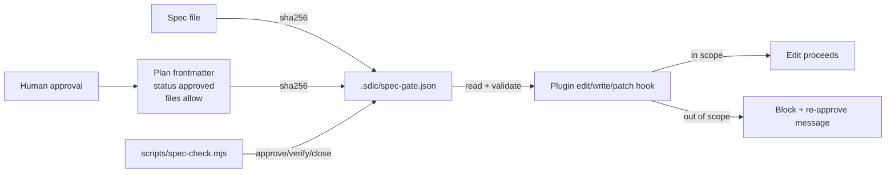

# Spec — Spec-gate enforcement for feature work

**Status**: APPROVED
**Approved by**: appusai (chat approval of Option B)
**Approved at**: 2026-10-24T01:49:00Z
**Supersedes**: none
**Related**: `docs/debt-ledger.md` D-011 (instruction-level enforcement gap)

## Goal

Turn the suite's spec-driven *workflow* into a spec-driven *gate* for file edits:
an approved plan binds a spec (SHA-256), a file scope, and an approval record;
the plugin blocks edits outside that scope; drift in the spec or plan fails
closed until a human re-approves.

## Non-goals

- Not a sandbox. `bash` redirection can still write files; the gate covers
  `edit`/`write`/`patch`/`apply_patch`.
- Not cryptographic approval. Hashes detect accidental drift, not a writer who
  edits `.sdlc/spec-gate.json` directly.
- Not a replacement for `scripts/research/phase.mjs` (deadlines, retries,
  delegation).
- No new dependencies; no external spec tool.

## Acceptance criteria

1. `spec-check approve <plan>` validates an approved plan, resolves its spec,
   computes SHA-256 for both, and writes `.sdlc/spec-gate.json` atomically.
2. `spec-check verify` fails on a missing/malformed marker, a spec/plan hash
   mismatch, an unsafe path, or a missing spec; exits 0 with no active marker.
3. The plugin blocks `edit`/`write`/`patch`/`apply_patch` targets outside the
   active plan's `files`/`allow` scope, allows in-scope files, and does nothing
   when no marker exists.
4. The active progress ledger and `docs/debt-ledger.md` stay writable; the spec
   and plan are immutable while the gate is active (re-approval required).
5. Workflow docs state that design, plan, and scope approval are authorization
   boundaries, not informational checkpoints, including under `autonomous-loop`.
6. Focused tests cover allow/block, hash drift, path traversal, fail-open with
   no marker, and V1 + V2 hook wiring. `npm run verify` is green.
7. The global installer ships `scripts/spec-check.mjs` byte-identically.
8. This feature's own plan is approved and verified through the gate.

## Design



### Plan contract

`docs/plans/YYYY-MM-DD-<slug>.md` starts with YAML frontmatter:

```yaml
---
spec: docs/specs/YYYY-MM-DD-<slug>.md
status: approved
approved_by: <name>
approved_at: <ISO-8601 UTC>
files:
  - exact/or/glob/path
allow:
  - docs/plans/<slug>-progress.md
---
```

`files` is the code/doc scope. `allow` is always-writable control state (the
progress ledger, debt ledger). The active plan derives its progress path by
replacing `.md` with `-progress.md` and always allows it.

### Marker contract

`.sdlc/spec-gate.json` (gitignored local state):

```json
{
  "version": 1,
  "plan": "docs/plans/....md",
  "plan_sha256": "64 hex",
  "spec": "docs/specs/....md",
  "spec_sha256": "64 hex",
  "approved_by": "name",
  "approved_at": "ISO-8601 UTC",
  "files": ["..."],
  "allow": ["..."],
  "created_at": "ISO-8601 UTC"
}
```

The marker copies `files`/`allow` at approval time. The plugin validates the
plan and spec hashes before using them, so editing either file blocks edits
until re-approval.

### Components

- `scripts/spec-check.mjs` — zero-dep CLI plus pure functions: `parsePlan`,
  `buildGate`, `writeGate`, `readGate`, `validateGate`, `isAllowed`, `hashFile`.
  Commands: `approve`, `status`, `verify`, `close`, `check`.
- `.opencode/plugins/sdlc-lean.js` — `checkSpecGate(tool, args, root)` runs after
  `checkSafety`; V1 `tool.execute.before` and V2 `execute.before` both call it.
  Missing root or missing marker = no-op (fail open). Present but invalid marker
  = block (fail closed for edits).
- Workflow text — `writing-plans`, `executing-plans`,
  `subagent-driven-development`, `implementer`, `requesting-code-review`,
  `verification-before-completion`, `autonomous-loop`, `orchestrator`,
  `feature.md`, `AGENTS.md`.
- Installer — ship `scripts/spec-check.mjs` globally; `/feature` uses the
  repo-local script when present, else the installed one.

### Path rules

- Relative paths only; reject absolute paths and `..` escapes.
- `*` matches one path segment, `**` matches zero or more segments.
- Exact files and glob patterns are accepted.
- Unknown patch targets (no parseable path header) pass (fail open); parsed
  targets are checked.

### Failure and precedence rules

- No marker: all file tools pass (suite remains usable in every repo).
- Marker present but malformed/hash-mismatched: block edits with a message that
  names `spec-check close` and `spec-check approve`.
- Design/plan/scope approval is an authorization boundary. An autonomous loop
  may continue inside an approved phase; it may not create, widen, or replace a
  plan without a new approval record.
- A blocked edit is not a bug to work around. Record a deviation and ask for a
  re-approval, or close the gate.

## Residual risks (accepted, documented)

- `bash` can write files outside scope; this is a drift guard, not a sandbox.
- A local writer can edit the marker; authenticity is out of scope.
- V2 hosts without `ctx.directory` fall back to `process.cwd()`; if neither is
  the project root, the gate fails open.
- Old plans without frontmatter are unaffected until explicitly approved.

## Test plan

- CLI: plan parsing (valid/missing/unapproved), approve/verify/close, spec and
  plan tamper, path traversal, glob matching, malformed marker, no-marker verify.
- Plugin: no marker, valid marker allow/block, progress/debt allow, glob, patch
  paths, hash mismatch, malformed marker, V1 `directory`, V2 `ctx.directory`.
- Installer: `scripts/spec-check.mjs` copied byte-identically and tracked.
- Docs: skill lint and full `npm run verify`.

## Approval

Approved by appusai in chat on 2026-10-23 (local), recorded as
2026-10-24T01:49:00Z. This spec is hashed into the plan's gate marker; changing
it requires a new approval.
