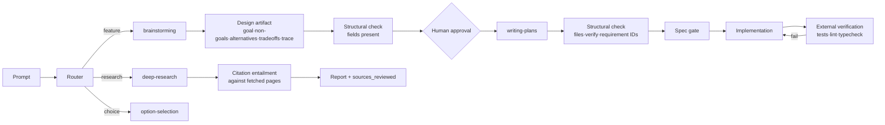

# Spec — Brain-layer hardening (evidence-backed)

**Status**: APPROVED
**Approved by**: appusai (chat: "I approve the spec")
**Approved at**: 2026-10-30T17:31:25Z
**Date**: 2026-10-30
**Related**: `docs/research/2026-10-30-brain-layer-evidence.md` (34 sources)

## Goal

Raise the quality of pre-implementation thinking by replacing unproven ceremony
with mechanisms that have measured evidence, and by making brain-artifact
quality structurally checkable. Keep the layer small: no new agents, no new
dependencies, no prompt bloat. Routing and the spec gate stay unchanged — the
pipeline decides *when* a gate runs; this spec decides *what the gate requires*.

## Non-goals

- No new subagents (debate, critic, planner swarm). Evidence is negative or
  cost-prohibitive [22][24][25].
- No new runtime dependency; no new skill.
- No change to the router or bootstrap; bootstrap stays ≤5116 bytes.
- No change to safety guards or `scripts/spec-check.mjs`.
- No claim that design docs reduce rework by a fixed multiplier [1].

## Decision record

| Option | Verdict | Why |
|---|---|---|
| A. Max everything — longer skills, more brain agents, debate | Rejected | Negative/expensive evidence [22][24][25]; instruction-density decay [18]; no measured quality gain from progressive disclosure [16] |
| B. Targeted mechanisms + structural measurement | **Chosen** | Proven levers: external verification [26][27][28], loop-closing research [11], decomposition for interdependent work [7], inspection with prepared reviewers [5] |
| C. Do nothing | Rejected | Current skills contain folklore ("2–5 min tasks", cost-of-defect framing) and there is no brain-artifact eval |

## Acceptance criteria

1. `brainstorming/SKILL.md` requires a design artifact with Goal, Non-goals,
   ≥2 alternatives (with why-rejected), trade-offs, and a requirement→design→test
   trace table; requires written individual review findings before approval;
   assigns review perspectives; records leading indicators; contains no
   cost-of-defect multiplier claim. Body ≤60 lines.
2. `writing-plans/SKILL.md` routes plan depth by task shape (localized vs
   multi-file interdependent), replaces the "2–5 minute" rule with "one
   verifiable outcome per task", requires exact files plus an external
   verification command per task, adds a binary requirement-coverage checklist,
   and adds a test-integrity rule (no editing the tests that grade the work).
   Body ≤85 lines.
3. `deep-research/SKILL.md` makes loop-closing explicit (each round's queries
   derive from what was just read), demotes personas to optional, requires
   per-claim entailment verification against fetched pages, requires one writer
   at fan-in, and states the benchmark caveat. Body ≤105 lines.
4. `option-selection/SKILL.md` uses a binary criteria matrix, includes
   "do nothing", uses swap-averaged pairwise for exactly two options, and
   records the decision. Body ≤45 lines.
5. `planner.md` mirrors the `writing-plans` changes (task shape, external
   verification, test integrity). Body ≤22 lines.
6. Each changed skill links at most one new reference file:
   `brainstorming/references/design-review.md`,
   `writing-plans/references/plan-rubric.md`,
   `deep-research/references/citation-check.md`. References hold templates and
   checklists; the skill body stays procedural.
7. `eval/lib/assert.mjs` adds `artifact-contains` and `artifact-matches`
   assertions with unit tests; `eval/probes.mjs` adds three probes
   (`brain-design`, `brain-plan`, `brain-research`); `node eval/run.mjs` dry
   lists them; no live spend in `npm run verify`.
8. `npm run verify` is green (lint + all tests); the bootstrap budget test still
   passes at ≤5116 bytes.
9. The global installer ships the changed skills, references, and agent files
   byte-identically (installer test or dry-run check).
10. A manual smoke run shows: a feature prompt triggers `brainstorming` and
    produces an artifact with the required fields; a research prompt triggers
    `deep-research` with a `Sources` section and `sources_reviewed: N`.

## Design

### Step 1 — Harden the gate skills

| File | Add (evidence) | Remove / demote | Cap |
|---|---|---|---|
| `brainstorming/SKILL.md` | artifact contract [2]; written individual review before approval [5]; perspective assignments [5]; trace table [5, low confidence]; leading indicators [2] | mandatory pre-mortem [4]; any cost multiplier [1] | 60 |
| `writing-plans/SKILL.md` | task-shape routing [7][8]; one verifiable outcome per task; external verify per task [9][26][27]; requirement-coverage checklist; test-integrity rule [29] | "2–5 minute" rule (no evidence) | 85 |
| `deep-research/SKILL.md` | loop-closing queries [11]; citation entailment [12][13]; single writer at fan-in [14]; benchmark caveat [15] | persona multiplication as a required step [11] | 105 |
| `option-selection/SKILL.md` | binary criteria matrix [31][32]; do-nothing option; swap-averaged pairwise [33]; decision record | holistic scoring | 45 |
| `agents/planner.md` | task shape, external verify, test integrity | minute granularity | 22 |

### Step 2 — Structural eval probes

Add assertion kinds to `eval/lib/assert.mjs`:

- `artifact-contains` — a generated artifact file contains a literal string.
- `artifact-matches` — a generated artifact file matches a regex.

Add probes to `eval/probes.mjs`:

| Probe | Prompt shape | Hard assertions |
|---|---|---|
| `brain-design` | "Design a feature; produce the design artifact, no code" | artifact contains `## Non-goals`, `Alternatives`, `Trade-offs`, `Review findings` |
| `brain-plan` | "Turn this approved spec into a plan" | artifact contains a task table with `Files` and `Verify`, and requirement IDs |
| `brain-research` | "Research X and write a cited report" | artifact contains `## Sources`, `sources_reviewed:`; citations resolve structurally |

Rules: structural assertions are hard; quality assertions are `advisory`.
Judge versions are pinned if a judge is added. No absolute Likert gates.

### Step 3 — References and measurement loop

- `brainstorming/references/design-review.md` — artifact template, perspective
  assignments, review protocol (individual findings first, meeting optional),
  leading-indicator log.
- `writing-plans/references/plan-rubric.md` — binary checklist: every
  requirement has a task; every task has exact files and an external verify
  command; no task edits its own grader.
- `deep-research/references/citation-check.md` — claim extraction, fetch,
  entailment check, citation-accuracy count, conflict handling.
- Record leading indicators in the design artifact; do not add a dashboard.

## Verification

| Check | Command | Pass condition |
|---|---|---|
| Skill lint | `npm run lint` | 0 failures |
| Unit + plugin tests | `npm test` | all pass; bootstrap ≤5116 bytes |
| Eval dry run | `node eval/run.mjs` | lists `brain-design`, `brain-plan`, `brain-research`; spends nothing |
| Installer parity | `node scripts/install-global.mjs` dry check | changed files match byte-for-byte |
| Manual smoke | one feature prompt + one research prompt | required fields and citations present |

Live eval (`node eval/run.mjs --run --filter brain --max-probes 3`) spends
tokens and needs separate approval; it is not part of `npm run verify`.

## Risks

- **Ceremony risk**: more structure can become box-ticking. Mitigation: binary
  criteria, line caps, references on demand.
- **Model sensitivity**: structural probes are stable; quality probes are
  advisory only.
- **Cap pressure**: if a cap forces cuts, cut prose, not rules.
- **Evidence limits**: the design gate is justified by inspection evidence and
  decision quality, not by a proven rework multiplier. Do not overclaim.

## Open questions

1. Should `spec-check` validate plan structure (requirement IDs, `Verify`
   column) at approval time, or stay a hash/scope gate? Defer until the probes
   show the format is stable.
2. Is written individual review mandatory for bounded tasks, or only for
   architectural ones? Proposed default: bounded = one reviewer; architectural =
   ≥2 perspectives with written findings.
3. Budget for the first live brain eval run (3 probes).
