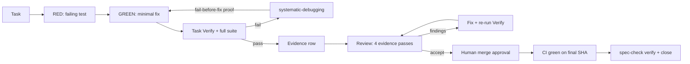

# Spec — Execution-quality hardening (Wave 2)

**Status**: APPROVED
**Approved by**: appusai (chat: "I approve")
**Approved at**: 2026-10-30T19:18:15Z
**Date**: 2026-10-30
**Program**: `docs/research/2026-10-30-suite-portfolio-audit.md` (Waves 1–4)
**Depends on**: Wave 1 trust core (closed 2026-10-30, evidence `00f0ec68…`)
**Citations**: unprefixed [n] refer to `docs/research/2026-10-30-brain-layer-evidence.md`; the audit’s [A n] sources are in `docs/research/2026-10-30-suite-portfolio-audit.md`.

## Goal

Make the execution layer's claims match its evidence: test-first is the external
signal (not a quality guarantee), debugging proves the repro fails before the
fix, review passes produce evidence rather than personas, review findings are
persisted and re-verified, merge is a human gate on the final SHA, and worktrees
record a baseline. No new agents, skills, dependencies, or sandbox claims.

## Non-goals

- No change to the Wave 1 trust core (TTY approval, evidence-bound close,
  permissions, eval trust).
- No new reviewer agent; `code-reviewer` stays read-only. A read-only test
  allowlist is deferred unless the host supports it.
- No full rewrite of the execution skills; targeted rule changes only.
- No domain skills (Wave 4) and no measurement contracts for all skills (Wave 3).

## Decision record

| Decision | Verdict | Evidence |
|---|---|---|
| Add a per-task critic agent | **No** | Critic without an independent verifier is the failure mode [24][25]; centralized verification is stronger |
| Keep 4 review passes but as personas | **No** | Perspective multiplication is ~0–2 points, non-significant [11]; generic checklists failed to replicate [5] |
| Review passes as evidence channels | **Yes** | Each pass must name its evidence source: spec, traced path, measurement, or diff |
| TDD as a quality guarantee | **No** | 30-subject longitudinal null on quality/productivity; more tests only [10] |
| TDD as the external-signal generator | **Yes** | Execution/test feedback is the measured lever [26][27] |

## Acceptance criteria

1. `test-driven-development` reframes “Iron Law” as **test-first generates the
   external signal**, states TDD does not guarantee quality or productivity
   [10], keeps RED-GREEN-REFACTOR, regression-first for bugfixes, and the Wave 1
   integrity sentence. Body ≤40 lines.
2. `systematic-debugging` requires a **fail-before-fix proof**: after the fix,
   temporarily revert the production change and confirm the repro test fails
   again; reapply and confirm green. The repro test stays; the repro command is
   recorded in the evidence row. Body ≤30 lines.
3. `executing-plans` removes any self-review fallback: if no reviewer is
   available, stop and escalate. It records review dispositions in the progress
   ledger and keeps the Wave 1 `Verify`/evidence/raw-output rules. Body ≤55
   lines.
4. `subagent-driven-development` states that fresh context limits cross-task
   state but is not a quality guarantee; no per-task critic unless it has an
   independent signal; reviewer gets raw `Verify` output and may run read-only
   tests; worktree setup records a baseline SHA and test command. Body ≤55 lines.
5. `requesting-code-review` maps each of the 4 passes to an evidence source
   (spec, traced attacker path, measurement, diff/lean review); a pass with no
   evidence says “no finding”, not a persona verdict. Findings persist as
   `path:line`, severity, disposition. Body ≤40 lines.
6. `receiving-code-review` re-runs the task `Verify` and full suite after
   applying fixes; records fixed/rejected/needs-human dispositions in the
   progress ledger; still forbids bulk apply. Body ≤25 lines.
7. `lean-review` makes `net: -N` **advisory, never a gate**; tags are binary
   (`delete`, `stdlib`, `native`, `yagni`, `shrink`) with a one-line reason;
   deletion must not remove tests, safety guards, or error handling; each item
   carries severity. Body ≤35 lines.
8. `finishing-a-development-branch` requires explicit human approval before
   merge, CI green **on the final SHA**, `spec-check verify` before cleanup, and
   `spec-check close` after evidence; “confirm CI scope” is not a green build.
   Body ≤20 lines.
9. `using-git-worktrees` records the baseline SHA and test command, notes that
   the spec-gate marker is per-worktree, checks dependency/port collisions, and
   cleans up only after merge/PR. Body ≤30 lines.
10. `npm run verify` is green; no new dependency; no Wave 1 regression; eval dry
    lists new `execution` probes (`debug-repro`, `review-disposition`,
    `merge-gate`, `worktree-baseline`); installer parity holds for changed files.
11. Evidence mapping: each AC cites the audit P1 finding it closes; no AC
    weakens a Wave 1 test (`test-trust-skills`, `test-spec-check`,
    `test-agent-permissions`, `test-brain-skills`).

## Design

### Step 1 — Test and debug

- TDD: replace the “Iron Law” framing with “test-first is how we generate the
  external signal”; keep the cycle. State the null result in one line: “TDD
  reliably adds tests; it does not by itself guarantee quality or productivity.”
- Debugging: add the revert-fix proof; the repro test stays; record the repro
  command in the evidence row.

### Step 2 — Execution and review

- executing-plans: no self-review fallback; dispositions in the ledger.
- subagent-driven: fresh context is a state-isolation tool, not a quality
  guarantee; no critic without an independent signal; worktree baseline.
- requesting-code-review: 4 passes as evidence channels; persist findings.
- receiving-code-review: re-run Verify + full suite; dispositions.

### Step 3 — Merge and isolation

- finishing-a-development-branch: human approval, final-SHA CI, spec-check
  verify/close.
- using-git-worktrees: baseline SHA/test, per-worktree marker, collision check.
- lean-review: advisory net-lines, binary tags, never delete guards.

### Step 4 — Measurement

- Add `tests/opencode/test-execution-skills.mjs` for the structural contracts.
- Add `eval/probes.mjs` group `execution` with four probes:
  `debug-repro` (failing test stays; fail-before-fix evidence),
  `review-disposition` (findings persisted with severity/disposition),
  `merge-gate` (human approval + final-SHA CI; no merge without it),
  `worktree-baseline` (baseline SHA/test recorded).
- Probes are structural/dry by default; live runs are opt-in and separately
  approved.

## Verification

| Check | Command | Pass condition |
|---|---|---|
| Lint + tests | `npm run verify` | 0 failures; Wave 1 tests unchanged |
| Structural contracts | `node --test tests/opencode/test-execution-skills.mjs` | all pass |
| Eval dry | `node eval/run.mjs` | lists 4 `execution` probes; no spend |
| Installer parity | `node --test tests/opencode/test-trust-skills.mjs` | changed files byte-identical |
| Live probes (optional) | `node eval/run.mjs --run --filter execution --max-probes N` | separate approval |

## Risks

- **Review ceremony**: 4 evidence passes can become box-ticking. Mitigation:
  “no finding” is allowed; each pass must name an evidence source.
- **Probe flakiness**: live probes depend on model behavior. Structural
  assertions are hard; live results are advisory until calibrated.
- **Merge gate friction**: human approval before merge is intentional; it is the
  same authorization boundary as plan approval.
- **Worktree marker**: per-worktree `.sdlc/spec-gate.json` is local state; the
  skill must warn, not automate.

## Open questions

1. Should `code-reviewer` get a read-only test allowlist, or keep receiving raw
   output? Proposed: receive output in Wave 2; allowlist only if the host
   supports a narrow `test` command.
2. Should `finishing-a-development-branch` block on a missing human reply, or
   present the menu and wait? Proposed: wait; no merge without an explicit human
   choice.
3. Live probe budget for Wave 2 (4 probes).
