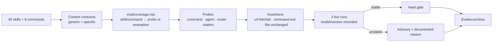

# Spec — Measurement hardening (Wave 3)

**Status**: APPROVED
**Approved by**: appusai (chat: "Approve", AC2 clarified as coverage declarations)
**Approved at**: 2026-10-30T20:55:13Z
**Date**: 2026-10-30
**Program**: `docs/research/2026-10-30-suite-portfolio-audit.md` (Waves 1–4)
**Depends on**: Wave 1 trust core (closed, evidence `00f0ec68…`) and Wave 2 execution quality (closed, evidence `c49a75aa…`)
**Citations**: unprefixed [n] refer to `docs/research/2026-10-30-brain-layer-evidence.md`; the audit’s [A n] sources are in `docs/research/2026-10-30-suite-portfolio-audit.md`.

## Goal

Make the rest of the suite measurable: a content contract for every top-level
skill, a central coverage map from skills/commands to probes, URL-fetched and
command-exit assertions, command/agent/router probes, and a calibration protocol
that turns stable advisory probes into hard gates. No new agents, skills,
dependencies, or domain rewrites.

## Non-goals

- No domain/meta content rewrites (Wave 4: threat-model, autonomy-dial, schemas,
  ADR, STE, release notes).
- No new runtime enforcement or sandbox claim.
- No live spend in `npm run verify`; live calibration is separately approved.
- No full rewrite of the 40 skills; the generic contract catches folklore and
  broken structure, specific contracts cover high-risk skills.

## Decision record

| Decision | Verdict | Evidence |
|---|---|---|
| Content contract for every skill | **Yes** — generic lint + explicit exemptions | Wave 1/2 gates cover 21 skills; the rest have no contract |
| Hard-gate known Wave 4 gaps | **No** — record `pending: Wave 4` | Non-goals forbid domain/meta content edits in Wave 3 |
| URL evidence by shape only | **No** — collect fetched URLs and require cited ⊆ fetched | `brain-research` only regexes a URL; fabricated URLs pass [12] |
| Command exit by artifact text only | **No** — run the command in the scratch and assert exit | `external-verification` evidence can be self-reported |
| Probe hard on first green | **No** — 3 stable live runs before hard | One live run is not calibration; model/version drift |
| Coverage map in `eval/coverage.mjs` | **Yes** | Explicit ownership beats a test that silently skips skills |

## Acceptance criteria

1. `tests/opencode/test-skill-contracts.mjs` covers every top-level skill (40):
   `name` == directory, description starts `Use when`, body ≤160 lines, no
   forbidden folklore (`/2[–-]5\s*min/i`, `/40\s*[×x]/i`, `/100\s*[×x]/i`,
   `/self-review\s+for\s+trivial/i`), every `references/<file>` link exists, and
   no broken relative link. Exemptions live in `eval/coverage.mjs` with a reason.
2. Specific contracts cover the high-risk skills: `reviewing-security`
   (input→sink→line template), `threat-model` (inbound route + written artifact +
   no ordinal likelihood), `autonomy-dial` (no `<5%`/self-confidence; named check
   command + ledger), `intent-preview` (no self-approval; no `>85%`), `research-protocol`
   (evidence bundle), `acquiring-capabilities` (install approval), `reverse-engineering`
   (no mutation/S-tier evidence), `colab-lifecycle` (release evidence), `web-game-development`
   (S-tier evidence table), `ui-review` (fetch fail-closed), `writing-release-notes`
   (command/probe or explicit exemption). Rules that require a Wave 4 content change are recorded in `eval/coverage.mjs` with `pending: Wave 4` and a reason, and are excluded from the hard gate until Wave 4; a contract must not fail on a known Wave 4 gap.
3. `eval/lib/parse.mjs` collects `urls` from `webfetch`/`fetch` tool calls;
   `eval/lib/assert.mjs` adds `url-fetched` (every URL matching a pattern in an
   artifact was fetched) and `command-exit` (a declared command exits as
   expected); `eval/run.mjs` runs `probe.command` in the scratch, records
   `observed.commandExit`, and passes `observed.urls`.
4. `brain-research` is upgraded in place (same id): cited URLs must be in
   `observed.urls`; `sources_reviewed:` is present; fabricated URLs fail. Do not
   add a new brain probe — the Wave 1 brain count stays exactly 3.
5. New probes: `command-security-audit` (routes to `security-reviewer`, no
   edits), `command-reverse-engineer` (route, no mutation), `command-preview`
   (read-only plan, waits for approval), `agent-readonly` (explorer/planner/
   code-reviewer edit denied), `router-threat-model`, `router-adr`,
   `router-incident`. Dry run lists them; live runs are opt-in.
6. `external-verification` is calibrated: the prompt forces
   `verification-before-completion` and an exact evidence JSON; 3 live runs are
   recorded with model/version; if all 3 pass, remove `advisory: true`, else keep
   it advisory and record the failure in `eval/results/` and the debt ledger.
7. The four `execution` probes are calibrated the same way (3 live runs each);
   stable probes become hard; unstable probes stay advisory with a recorded
   reason. No probe becomes hard on a single run.
8. `eval/coverage.mjs` maps every top-level skill to a probe/group or an
   explicit exemption with a reason; `tests/opencode/test-eval-coverage.mjs`
   enforces full coverage exactly once and checks every command has a probe.
   `writing-skills` requires a coverage entry for every new skill.
9. `commands/sdlc-lean.md` counts 40 top-level skills, not 60 vendored
   `SKILL.md` files (use `-mindepth 1 -maxdepth 1 -type d` or the plugin’s
   `listSkills`); a test asserts the output.
10. `npm run verify` is green; no new dependency/agent/skill; bootstrap ≤5116
   bytes; all Wave 1/2 tests unchanged and green.
11. Evidence mapping: each AC cites the audit P1 finding it closes; live
   calibration results are recorded with model, date, and pass/fail; no claim of
   runtime enforcement where the check is structural.

## Design

### Step 1 — Skill and command contracts

- Generic gate: 40 skills, caps ≤160, `Use when` descriptions, no folklore,
  references exist, no broken relative links.
- Specific contracts for the 11 high-risk skills; each AC names the exact
  required/forbidden rule.
- Where a rule already exists, the contract asserts it. Where it needs a Wave 4
  edit, the coverage entry is `pending: Wave 4` with a reason and is not
  hard-gated.
- `eval/coverage.mjs`: a single map `{ skill: { probe | group | exempt } }` and
  `{ command: { probe | exempt } }`. Exemptions need a one-line reason.
- `commands/sdlc-lean.md`: count top-level dirs, not vendored `SKILL.md`.

### Step 2 — Assertions and probes

- `parse.mjs`: collect `urls` from `webfetch`/`fetch` inputs.
- `assert.mjs`: `url-fetched` (artifact path + URL regex; every match must be in
  `observed.urls`) and `command-exit` (expected code).
- `run.mjs`: after the model, run `probe.command` in the scratch with a
  timeout, record `observed.commandExit`; no shell interpolation of model text.
- Probes: `command-security-audit`, `command-reverse-engineer`, `command-preview`,
  `agent-readonly`, `router-threat-model`, `router-adr`, `router-incident`.
- `brain-research` keeps its id and gains the `url-fetched` assertion; no new
  brain probe, so the Wave 1 brain count stays exactly 3.

### Step 3 — Calibration

- `external-verification`: force the skill and exact JSON; run 3× live; record
  model/version; stable → hard, else advisory.
- Execution probes: 3× live each; stable → hard, else advisory.
- Calibration runs are opt-in (`--run`), recorded in `eval/results/`, and
  separately approved. No live spend in `npm run verify`.

## Verification

| Check | Command | Pass condition |
|---|---|---|
| Lint + tests | `npm run verify` | 0 failures; Wave 1/2 tests unchanged |
| Skill contracts | `node --test tests/opencode/test-skill-contracts.mjs` | all 40 skills + specific contracts pass |
| Coverage | `node --test tests/opencode/test-eval-coverage.mjs` | every skill/command covered or explicitly exempt |
| Eval dry | `node eval/run.mjs` | lists new probes; no spend |
| Parser/assert | `node --test tests/eval/test-parse.mjs tests/eval/test-assert.mjs` | url-fetched/command-exit pass |
| Status command | `commands/sdlc-lean.md` fixture | 40 top-level skills |
| Live calibration | `node eval/run.mjs --run --filter <probe> --max-probes 1` | 3 runs; recorded |

## Risks

- **Coverage map rot**: new skills must add an entry; `writing-skills` and the
  test enforce it.
- **URL provenance**: subagent fetches may not appear in the main event stream;
  if so, `brain-research` stays advisory until the parser is proven.
- **Calibration cost**: 3 runs × up to 5 probes is a real spend; keep it
  separately approved and bounded.
- **Generic contract false positives**: exemptions are explicit and reasoned,
  not silent skips.

## Open questions

1. Should `brain-research` be hard or advisory until subagent URL collection
   is proven? Proposed: advisory until 3 stable runs.
2. Should `command-exit` run before or after the model? Proposed: after, in the
   same scratch, with a 60s timeout.
3. Live calibration budget for Wave 3.
