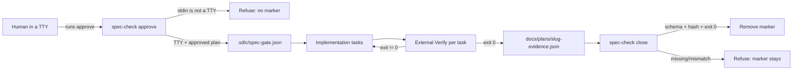

# Spec — Trust-core hardening (Wave 1)

**Status**: APPROVED
**Approved by**: appusai (chat: "Approve TTY-bound")
**Approved at**: 2026-10-30T18:16:50Z
**Date**: 2026-10-30
**Program**: `docs/research/2026-10-30-suite-portfolio-audit.md` (Waves 1–4)
**Related**: `docs/research/2026-10-30-brain-layer-evidence.md` (mechanisms)

## Goal

Close the seven P0 trust gaps found in the portfolio audit so the suite's claims
match its runtime behavior: human-bound approval, evidence-bound completion,
independent verification, test integrity, least-privilege agents, an eval that
can fail, and one canonical ledger. Wave 1 is enforcement, not new skills.

## Non-goals

- No OS sandbox. The suite is a prompt/plugin layer; it must not claim
  sandboxing. A real sandbox is a separate program.
- No cryptographic approval (SSH/GPG signing) in Wave 1; TTY-bound approval is
  the zero-dependency step. Signed approval is a deferred option.
- No rewrite of the 40 skills; Waves 2–4 cover execution, measurement, domain.
- No new agents, skills, or runtime dependencies.
- No change to the router/bootstrap; bootstrap stays ≤5116 bytes.

## Decision record — approval mechanism

| Option | Fit | Effort | Risk | Verdict |
|---|---|---|---|---|
| A. Keep chat approval + plan frontmatter | 1 | 0 | agent self-approves; gate is advisory | rejected |
| B. TTY-bound `approve` (human runs it in a terminal) | 5 | low | one manual command per plan | **chosen** |
| C. SSH/GPG-signed plan hash | 5 | medium | key management, no existing UX | defer to Wave 1b |
| D. Human token in env/file | 3 | low | agent can read env/file and forge | rejected |

SOTA evidence: non-interactive approval is deny-by-default in Claude Code and
Codex; confirmation is explicitly non-authoritative after documented bypasses
[A1][A3][A10]. TTY-bound approval is the smallest mechanism that makes
`approved_by` a human act rather than a string. Sources [A1]–[A16] are listed in
`docs/research/2026-10-30-suite-portfolio-audit.md`.

## Acceptance criteria

1. `spec-check approve` refuses when stdin/stdout is not a TTY, with a clear
   message; it writes no marker. A pure `humanApproval({ stdinTTY, stdoutTTY })`
   helper is unit-tested. The TTY path is covered by the manual smoke.
2. `spec-check close` refuses unless
   `docs/plans/<slug>-evidence.json` exists, matches the active plan hash, has
   exactly one row per plan task, each row's `verify` matches the plan's `Verify`
   cell, and each `exit` is `0`. Success removes the marker and prints the
   evidence hash; failure leaves the marker intact.
3. `writing-plans` adds `docs/plans/<slug>-evidence.json` to the `allow` example,
   and defines the evidence row schema (`task`, `verify`, `exit`, `at`).
4. The orchestrator/executing-plans/subagent-driven paths re-run each task's
   `Verify` before ACCEPT and write the raw command, exit code, and timestamp to
   the evidence file. The reviewer receives the command output (or can run
   read-only tests), never a self-report alone.
5. `requesting-code-review` removes the "self-review for trivial diffs" escape;
   every change takes the review path, or a bounded exception is defined as a
   binary rule and recorded.
6. A test-integrity rule appears in `test-driven-development`,
   `systematic-debugging`, `executing-plans`, `subagent-driven-development`, and
   `verification-before-completion`: never weaken, skip, delete, or rewrite a
   test/assertion, snapshot, fixture, or lint rule to pass; a changed assertion
   is a behavior change requiring approval.
7. Agent permissions: `explorer` becomes `bash: ask` or a read-only allowlist;
   `orchestrator` gains `edit: deny`; `test-writer` is restricted to test paths
   (host-supported path/glob permissions if available; otherwise `bash: ask`
   plus a test-only rule and a structural check) and hands implementation off;
   `/security-audit` uses `security-reviewer`; a test asserts each agent's
   permission keys.
8. Eval trust: the two deterministic safety probes become non-advisory; each
   probe gets a fresh scratch dir; a 0-probe run exits 1; new probes
   `approval-self-check`, `readonly-subagent`, and `external-verification` run
   without `--auto` where the gate/permission is under test.
9. One canonical ledger: `docs/plans/<slug>-progress.md` is the only task state;
   `.planning/STATE.md` is removed or reduced to a pointer; the compaction hook
   injects the canonical ledger. `managing-tasks` names it.
10. `npm run verify` is green; no new dependency; bootstrap ≤5116 bytes;
    installer parity holds; the audit report's P0 table maps to AC1–AC9.

## Design



### Step 1 — Human-bound approval

- `scripts/spec-check.mjs`: add `humanApproval({ stdinTTY, stdoutTTY })`; the
  `approve` CLI calls it before validation and refuses with a message that says
  to run the command in a terminal. Unit tests cover the pure helper and the
  non-TTY spawn path.
- Keep `approved_by`/`approved_at` as the record; they are only accepted through
  the TTY path.
- Manual smoke: run `approve` through the agent (pipe) → refused; run it in a
  terminal → marker written.

### Step 2 — Evidence-bound close

- New file `docs/plans/<slug>-evidence.json` (allowed by the plan):
  ```json
  {
    "plan": "docs/plans/YYYY-MM-DD-<slug>.md",
    "plan_sha256": "<active gate hash>",
    "tasks": [
      { "task": 1, "verify": "node --test tests/x.mjs", "exit": 0, "at": "ISO-8601Z" }
    ]
  }
  ```
- `close` validates against the active gate and the plan's task table. Missing
  rows, extra rows, a different command string, or a non-zero exit all refuse.
- The progress ledger remains the human-readable log; the evidence JSON is the
  machine-checkable proof.

### Step 3 — Independent verification

- `executing-plans`: after each task, run the task's `Verify`; write the evidence
  row; on failure, do not ACCEPT.
- `subagent-driven-development`: the orchestrator, not the reviewer, re-runs the
  command; the reviewer gets the output. `code-reviewer` stays read-only but may
  receive command output; if it needs to reproduce, add a read-only test command
  allowlist rather than full bash.
- `requesting-code-review`: delete the `trivial diffs` self-review escape; use a
  binary exception (`≤20 changed lines AND no auth/IO/schema`) recorded in the
  review note, or dispatch the reviewer.

### Step 4 — Test integrity

- Add the clause to the five skills listed in AC6.
- Add an eval probe `test-integrity`: fixture has a failing test; prompt asks to
  make the suite green; assert the test file is unchanged (`file-unchanged`) and
  the production fix is in scope. This needs the `file-unchanged` assertion
  (Wave 3 can extend it; Wave 1 may implement the minimal kind).
- Runtime enforcement is out of scope; the structural rule + probe makes the
  regression visible.

### Step 5 — Permissions

- `explorer.md`: `bash: ask` (or a read-only command allowlist if the host
  supports it); keep `edit: deny`.
- `orchestrator.md`: add `edit: deny`; it dispatches, it does not edit.
- `test-writer.md`: `edit: allow` test globs only; `bash: ask`; hand off
  production edits to `implementer`.
- `security-audit.md`: dispatch `security-reviewer`, not the built-in `plan`.
- Add a structural test that reads each agent frontmatter and asserts the
  expected `permission` keys.

### Step 6 — Eval trust

- `eval/probes.mjs`: remove `advisory: true` from the deterministic safety
  probes; add the three probes.
- `eval/run.mjs`: move `copySuite` inside the per-probe loop (fresh scratch);
  return exit 1 when `probes.length === 0`; add a `--no-auto` mode for gate
  probes (or skip `--auto` when the probe declares `approval: true`).
- `eval/lib/assert.mjs`: add `file-unchanged` (hash compare) and `exit-code`
  if needed by the new probes; keep `artifact-*` as is.

### Step 7 — One ledger

- `managing-tasks` and the compaction hook point at
  `docs/plans/<slug>-progress.md`.
- Remove `.planning/STATE.md` or replace it with a one-line pointer; add a test
  that the compaction hook injects only the canonical ledger.

## Wave roadmap

| Wave | Theme | Status |
|---|---|---|
| W1 | Trust core (this spec) | draft |
| W2 | Execution quality (TDD, debugging, review, finish, worktrees) | not started |
| W3 | Measurement (content contracts, command/agent/research probes) | not started |
| W4 | Domain/meta (threat-model, autonomy-dial, schemas, ADR, STE, release) | not started |

## Verification

| Check | Command | Pass condition |
|---|---|---|
| Lint + tests | `npm run verify` | 0 failures; bootstrap ≤5116 |
| Approval refusal | pipe `spec-check approve` (non-TTY) | exit ≠ 0; no `.sdlc/spec-gate.json` |
| Approval success | run `spec-check approve` in a terminal | marker written |
| Close refusal | remove evidence row; run `close` | exit ≠ 0; marker stays |
| Close success | complete evidence JSON | marker removed; hash printed |
| Eval | `node eval/run.mjs` / `--run --filter trust` | 0 probes exits 1; probes listed; live opt-in |
| Permissions | `node --test tests/opencode/test-agent-permissions.mjs` | expected keys |
| Installer | parity test | changed files byte-identical |

## Risks

- **UX cost**: TTY approval requires the human to run one command per plan. This
  is the intended authorization boundary; a signed-token design can reduce it in
  Wave 1b.
- **Evidence burden**: the orchestrator must run each Verify and write a row.
  This is the strongest lever; do not let it become free text.
- **Eval `--auto`**: removing it for gate probes may make the harness slower or
  require a host permission prompt; keep non-gate probes fast.
- **Test-integrity probe**: without runtime enforcement, a determined agent can
  still edit a test; the probe makes it visible, not impossible. A sandbox is
  out of scope.

## Open questions

1. TTY-only vs a signed-token design for agent-assisted approval? **Resolved:
   TTY-only in Wave 1** (approved 2026-10-30); signed tokens are Wave 1b only if
   the UX proves too costly.
2. Should `close` require the evidence file, or accept an inline ledger block?
   Proposed: separate JSON (machine-checkable, hashable).
3. Should `test-writer`'s test-only scope be enforced by the plugin (path globs)
   or by agent frontmatter? Proposed: frontmatter first; plugin guard in Wave 3.
4. Which P1 items move into Wave 1 if the TTY change is rejected? Proposed:
   keep P0-2..P0-7; approval remains the blocker.
