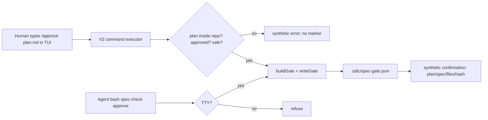

# Spec — TUI `/approve` command for plan approval

**Status**: APPROVED
**Approved by**: appusai (chat: "Approve")
**Approved at**: 2026-10-30T22:52:34Z
**Date**: 2026-10-30
**Related**: `docs/specs/2026-10-30-trust-core-hardening.md` (TTY-bound approval)
**API basis**: OpenCode V2 `ctx.command.transform` — commands are user-invoked and can run server-side executors (`https://opencode.ai/v2/docs/build/plugins/server`, fetched 2026-10-30).

## Goal

Make plan approval a first-class OpenCode flow: the human types `/approve <plan>` in the TUI, the plugin validates the plan and activates the spec gate. No terminal command, no shell. The TTY-bound `spec-check approve` stays as the terminal fallback; the agent still cannot approve a plan.

## Non-goals

- No agent-callable approval tool. `/approve` is a user command, not a tool.
- No signed tokens, no cryptographic approval, no OS sandbox.
- No change to plan/spec content, the evidence-bound close, or the four-wave contracts.
- No V1 command registration; V1 keeps the TTY CLI (fail-open, no break).

## Decision record

| Option | Verdict | Why |
|---|---|---|
| A. Plugin-registered V2 `/approve` command | **Chosen** | Human-invoked by construction; server executor writes the gate; no terminal |
| B. Custom `spec_approve` tool with `ctx.permission.assert` | Rejected | The agent initiates it; a click can be auto-approved under `--auto`; less deliberate than a command |
| C. Markdown slash command with `!` shell | Rejected | The host shell may still be non-TTY; same UX problem |
| D. Signed token | Rejected | Still requires a terminal step; more code |

## Acceptance criteria

1. In V2 `setup(ctx)`, the plugin registers an `approve` command via `ctx.command.transform` with a clear description. The command executor accepts exactly one plan path, resolves it inside `ctx.location.directory`, and rejects missing/ambiguous/outside-repo/draft/unsafe plans without writing a marker.
2. On success the executor imports the installed/project `scripts/spec-check.mjs`, calls `buildGate`/`writeGate`, and writes the normal `.sdlc/spec-gate.json`. The marker's `approved_by` is the host OS user (`os.userInfo().username`), `approved_at` is the command time (UTC), and `approved_via` is `tui-command`; the plan's own `approved_by`/`approved_at` remain unchanged.
3. The executor sends a synthetic confirmation to the session (`ctx.session.synthetic`) with the plan, spec, file count, and short hash. It does not send a model prompt and does not create a turn.
4. The agent cannot approve: no `spec_approve` tool is registered; the `bash` CLI remains TTY-bound and still refuses non-TTY calls; a test asserts the tool is absent.
5. V1 `SdlcLeanPlugin` hooks are unchanged and register no command; V1 users keep the TTY CLI. The global installer ships the plugin; no new dependency.
6. Tests cover: V2 command registration, successful gate write with host-user marker, draft/unsafe/outside-plan refusal with no marker, synthetic confirmation, no approval tool, V1 hooks unchanged, and `npm run verify` green. Bootstrap stays ≤5116 bytes.
7. Docs: `README.md`, `USAGE.md`, `writing-plans`, and `intent-preview` name `/approve` as the in-TUI human channel; the README flow diagram adds the `/approve` step; the TTY CLI remains documented as the terminal fallback.
8. The first plan for this feature is approved with the current TTY CLI (one last terminal step); after it lands, subsequent plans use `/approve`.

## Design

### Plugin surface

- V2 `setup(ctx)`: `ctx.command.transform((editor) => editor.add({ name: 'approve', description: 'Approve an SDLC plan and activate the spec gate (human-only)', execute }))`.
- The executor parses `prompt.text`; one path; trim; reject flags/multiple paths.
- Resolve `spec-check.mjs` from the project `scripts/` first, then the global install (`$XDG_CONFIG_HOME/opencode/scripts/` or `~/.config/opencode/scripts/`).
- `buildGate(root, planRel)` validates the plan/spec; `writeGate(root, gate)` writes atomically. Override `approved_by`/`approved_at`/`approved_via` before writing.
- Send `ctx.session.synthetic({ sessionID, text })`; no `ctx.session.prompt`.
- V1 named export: no change; no command.

### Security

- Commands are user-invoked; the agent's tool surface has no command executor. The only agent path remains `bash spec-check approve`, which is TTY-bound.
- The executor does not trust `prompt.text` as a human identity; it records the OS user and command time. The human act is typing `/approve`.
- The command refuses outside-repo paths using `normalizeRel`/`assertSafeRel`; no symlink escape.
- No new tool, no new dependency, no agent.

## Verification

| Check | Command | Pass condition |
|---|---|---|
| Unit | `node --test tests/opencode/test-approve-command.mjs` | registration, gate write, refusals, no tool |
| Full suite | `npm run verify` | 0 failures; bootstrap ≤5116 |
| Manual | type `/approve docs/plans/<plan>.md` in the TUI | marker written; synthetic confirmation |
| Non-TTY fallback | pipe `spec-check approve` | still refused |
| V1 | existing plugin tests | hooks unchanged, no command |

## Risks

- **Command API drift**: V2 `ctx.command.transform` is the documented API; pin the tested OpenCode version and fail open if absent.
- **Path ambiguity**: require exactly one repo-relative plan path; reject globs, flags, and multiple paths.
- **Marker identity**: the plan's `approved_by` string is agent-written; the marker's host-user field is the human act. Document both.
- **First-run bootstrap**: this feature's own plan still needs one TTY approval; after that, `/approve` is the default.

## Open questions

1. Should `/approve` also close/re-approve, or only approve a draft/approved plan? Proposed: approve only.
2. Should the command show a confirmation prompt after typing, or is the command itself the confirmation? Proposed: command is the confirmation; synthetic result only.
3. V1 command support? Proposed: no; TTY fallback.
