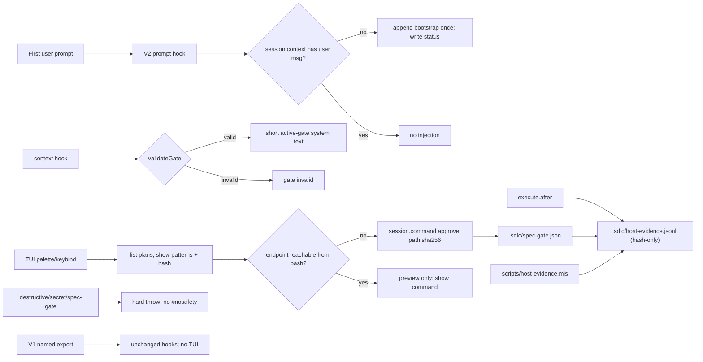

# Spec — V2-native brain: persisted context, TUI approval, advisory host evidence, strict guards

**Status**: APPROVED
**Approved by**: appusai (chat: "Ipprove" — approve)
**Approved at**: 2026-10-31T00:27:17Z
**Date**: 2026-10-30
**Related**: `docs/specs/2026-10-30-tui-approval-command.md`, `docs/specs/2026-10-30-trust-core-hardening.md`, `docs/threat-model.md`, `docs/review/2026-10-30-v2-native-brain.md`
**API basis**: OpenCode V2 plugin docs — `prompt` vs `context` persistence, `ctx.location.directory`, TUI `keymap`/`dialog`/`toast`, `tool.execute.after`, and the `permission`/`--auto` caveat (`https://opencode.ai/v2/docs/build/plugins/server`, `.../cli`, fetched 2026-10-30).

## Goal

Make sdlc-lean's brain native to OpenCode V2 without weakening the trust boundary: inject the router once per session through the persisted `prompt` hook, resolve the project from `ctx.location.directory`, add a TUI part for plan discovery/preview and hash-bound approval, record host command hashes as an advisory cross-check, and keep destructive, secret, and spec-gate guards as hard blocks. A native permission `ask` is explicitly deferred because V2 can auto-approve it under `--auto`.

## Non-goals

- No native `ask` and no permission hook this wave. Hard throws stay. The security review found that `--auto`, subagent, and non-interactive paths can auto-approve an `ask`, which would turn a guard into data loss.
- No `#nosafety` bypass. The in-band token is removed from the destructive, secret, and Colab guards; the agent cannot self-authorize.
- No `scripts/spec-check.mjs` changes. This avoids `cli_sha256` drift under an active gate; host evidence is a new read-only script.
- No hard host-evidence gate. Default is advisory; `--require-host` is opt-in.
- No `instructions.entry` (experimental), `ctx.storage`/`ctx.options`, read-only tools, event subscriptions, GUI/RPC/Effect part, TypeScript, or JSX.
- No OS sandbox or cryptographic approval. Approval remains host-user-bound.
- No V1 hook changes; V1 keeps the old bootstrap, toast, and no TUI part.
- No historical spec, plan, evidence, or debt-row rewrites.

## Alternatives

| Option | Verdict | Why |
|---|---|---|
| A. Do nothing | Rejected | 5 KB bootstrap re-sent per request; `ctx.directory` can fall back to `cwd`; V2 activation toast is dead; no native discovery or host evidence |
| B. Full V2 surface (storage, options, tools, events, RPC, GUI) | Rejected | Feature tourism: new surface without a user-facing outcome, more maintenance |
| C. Native `permission.hook("evaluate")` ask for destructive commands | Rejected after review | `ask` can auto-approve under `--auto`/subagent; one saved allow (`rm *`) can cover `rm -rf /`; keep hard throws until the host offers a non-auto-approvable ask |
| D. Server-only fixes, no TUI part | Rejected as primary | Misses the primary UX; retained as a fallback if the TUI part cannot load |
| E. Restructure the server plugin into one directory to host the TUI part | Rejected | V1 loads plugin files, not directories; a sibling TUI directory keeps V1 working |
| F. `instructions.entry` instead of the `prompt` hook | Rejected for now | Experimental API; `prompt` is documented as persisted and simpler |
| G. Hard host-evidence gate now | Rejected | No calibration; bash can still forge `.sdlc/host-evidence.jsonl` (D-013); advisory first |
| **H. Focused wave: persisted prompt + location + TUI discovery/hash-bound approval + advisory hash-only evidence + strict guards** | **Chosen** | Each item maps to a measured gap and keeps V1/TTY fallbacks |

## Trade-offs

- The TUI part adds a second plugin directory and installer surface; it is fail-open and can be removed.
- The picker's execution path is host-user-bound, not cryptographic. If the pre-flight shows the command endpoint is reachable from agent bash, the picker becomes preview-only and the human types the command.
- The bootstrap is appended to the first user prompt and persisted; it is visible once and may reach title generation. Appending keeps mention offsets valid.
- Host evidence is hash-only (no raw commands or output) but still forgeable by bash; it is advisory.
- Removing `#nosafety` is a breaking behavior change: the agent can no longer self-authorize destructive or secret access. The human can run those actions outside the agent.
- V1 keeps the old bootstrap and no TUI part, so behavior diverges while compatibility holds.

## Trace

| Requirement | Design | Test |
|---|---|---|
| R1 bootstrap once per session | `prompt` hook appends `getBootstrapContent`; persisted `session.context` check; child skip | first prompt appends; second unchanged; restart/retry; child skip |
| R2 correct project root | `projectRoot(ctx)` = location then directory; no cwd; gate fails closed if unknown | location-only, directory-only, neither |
| R3 active-gate context | `context` hook validates marker and injects a short summary; no bootstrap | valid/invalid marker; no gate |
| R4 TUI plan discovery | palette/keybind lists immediate plans, shows patterns + hash, confirms | helper tests + real `tui.js` fake-context test |
| R5 hash-bound approval | optional `sha256:<hex>` arg; re-read + `validateGate`; `approved_via` `tui-picker`/`tui-command` | match, mismatch, re-read, marker unchanged |
| R6 advisory host evidence | `execute.after` hash-only JSONL; `scripts/host-evidence.mjs` | skip/redact/cap/symlink; per-task matching |
| R7 strict guards | remove `#nosafety`; destructive/secret/Colab throw; no permission hook | existing guards updated; benign passes |
| R8 V1 and installer | V1 hooks untouched; TUI dir + script installed; no new dep | V1 shape, installer parity |
| R9 docs and threat model | README/USAGE/CHANGELOG; threat model + review record | docs assertions |

## Acceptance criteria

1. **Persisted bootstrap**: V2 registers `ctx.session.hook('prompt')`. On a prompt, it fetches `ctx.session.context({sessionID})`; if the session has no user message, it appends `\n\n${getBootstrapContent()}` to `event.prompt.text`. It skips child sessions (`ctx.session.get` with `parentID !== undefined`) and skips when the lookup fails. It does not use a process-local set or a text marker. A retry after a failed admission injects again. If the hook throws at runtime, it logs and marks the session for the context fallback. V1's `experimental.chat.messages.transform` is unchanged.
2. **Project root**: a single `projectRoot(ctx)` helper returns `ctx.location?.directory` first, then `ctx.directory`; it never returns `process.cwd()`. `gateRoot` and the compaction root use it. If the root is unknown, `checkSpecGate` throws for mutating file tools (fail closed); `compactionContext` returns `[]`; `approvePlan` refuses unless `ctx.location.directory` exists. Tests cover location-only, directory-only, and neither.
3. **Active-gate context**: the V2 `context` hook reads `.sdlc/spec-gate.json`, calls `validateGate`, and pushes one short system text with the validated plan/spec and file count. If the marker is invalid, it pushes only `gate invalid`. It does not inject the bootstrap. No gate means no injection.
4. **TUI part**: `.opencode/plugins/sdlc-lean-tui/` contains `index.js` (stub server part), `tui.js` (part), and `register.js` (pure helpers). `tui.js` is plain JS, no JSX, no npm import; a real fake-context test invokes the command. It registers a palette command `sdlc.approve` (optional keybind `ctrl+shift+a`, fail-open) that lists immediate `docs/plans/*.md` (skip `-progress`/`-evidence`, symlinks, non-regular, >1 MB, control chars), shows `files`/`allow` patterns and the plan SHA-256, confirms, and invokes the server `approve` command with `text: "<absolute-path> sha256:<hex>"`. It refuses when no current session is resolved. After the command it re-reads the marker and compares plan/spec/hash; success only on match, otherwise "refused — see session message". If the command endpoint is reachable from agent bash (pre-flight U2), the picker is preview-only: it shows the exact command and hash, and does not call `session.command`. It sends no model prompt.
5. **TUI activation/status**: the TUI part syncs `context.data.location.skill`, counts skills, and shows one activation toast per TUI process; a zero count logs only. The server `prompt` hook calls `writeStatus(sessionID)` once when it injects. A `sdlc.status` command shows the active gate and host-evidence match count. V1 keeps its toast.
6. **Host evidence**: V2 registers `ctx.tool.hook('execute.after')`. For `bash`/`shell` with a command and an active gate, it appends one JSONL row to `.sdlc/host-evidence.jsonl` with `at`, `sessionID`, `tool`, `argv0`, `command_sha256`, `plan_sha256`, `status`, `exit` (number or null), `output_sha256`, `output_bytes`, and `workdir`. It never stores the raw command or output. It skips `background`, `metadata.status === "running"`, and `metadata.timeout === true`. It creates `.sdlc` at 0700 and the file at 0600, refuses symlinks/non-regular files with `lstat` + `O_NOFOLLOW` + `fstat`, caps at 500 rows/2 MB, and never blocks the tool. `SDLC_LEAN_NO_HOST_EVIDENCE=1` disables it.
7. **Host-evidence script**: new `scripts/host-evidence.mjs` imports `parsePlanTasks` from `spec-check.mjs`. `status` reads the active marker and log, prints row count and `host evidence: n/m matched (advisory)`; `--require-host` exits 1 when any plan task lacks a match or m is zero. Matching normalizes a leading `!`/`$`, trims, collapses whitespace, hashes, and requires `plan_sha256` equality, `command_sha256` equality, status `completed`, and `exit === 0` (missing exit is `unknown`, never a match). Extra rows are advisory; malformed lines are skipped and counted. The evidence JSON schema and `spec-check.mjs` are unchanged.
8. **Strict guards**: remove the `#nosafety` early return from `checkSafety`. Destructive, secret, Colab-bridge, and spec-gate violations always throw; error messages no longer advertise the token. No permission hook is registered. Existing safety tests are updated to assert the token no longer bypasses; benign commands still pass. The agent cannot self-authorize.
9. **Approval integrity**: `resolveApprovalCli` prefers the installed global `scripts/spec-check.mjs`; the project copy is a fallback only when no global exists. Before `buildGate`, the plugin resolves the plan and spec with `fs.realpathSync` and refuses if either escapes the project root. After `writeGate`, it re-reads the marker, calls `validateGate`, and compares plan/spec/files to the built gate; a mismatch deletes the marker and refuses. A `sha256:<hex>` argument is optional; when present, it must match the plan bytes. The marker records `approved_via: "tui-picker"` when a hash is supplied, else `tui-command`. The plan file is never written.
10. **V1, installer, tests, docs**: V1 `SdlcLeanPlugin` is behavior-identical; V1 loads no TUI part. The installer copies `.opencode/plugins/sdlc-lean-tui/` and `scripts/host-evidence.mjs`, prunes stale files, and parity tests pass. No new npm dependency. Bootstrap stays ≤5116 bytes. Existing tests that assert context injection, V2 roots, safety, compaction, and approval are updated without weakening V1 coverage. `npm run verify` is green; the dry eval lists ≥35 probes and 0 failures. README, USAGE, CHANGELOG, threat model, and the review record are updated; the debt ledger records deferred native ask, `instructions.entry`, footer status, hard evidence, CLI symlink hardening, and read-only tools.

## Design

### Server surface

- `projectRoot(ctx)` replaces direct `ctx.directory` reads. `approvePlan` uses `ctx.location.directory` only.
- `ctx.session.hook('prompt')`: persisted `session.context` check, append bootstrap, child skip, `writeStatus`, no set/marker.
- `ctx.session.hook('context')`: validated active-gate summary only; runtime fallback for flagged sessions uses `event.system`.
- `ctx.session.hook('compaction')`: root from `projectRoot`; `[]` when unknown.
- `ctx.tool.hook('execute.after')`: hash-only host evidence; symlink-safe append; cap; kill switch.
- No `ctx.permission` call. `checkSafety` keeps the hard throws and loses `#nosafety`.
- `ctx.command.transform` keeps `/approve`; parser accepts one path plus optional `sha256:<hex>`; `approvePlan` prefers the global CLI, realpath-checks, re-reads/validates.

### TUI surface

- `index.js`: `export default { id: 'sdlc-lean-tui', setup() {} }`; if the host announces and scans the part twice, remove the stub and record the single-registration path.
- `tui.js`: `export default { id: 'sdlc-lean-tui', setup: setupTui }`.
- `register.js`: `listPlans(root)`, `planDetails(root, rel)`, `gateSummary(root)`, `resolveSessionID(context)`, `setupTui(context)`. Uses `keymap.layer`, `dialog.select/confirm/prompt`, `toast.show`, and `client.session.command` only when the pre-flight allows. Dynamic `import('node:fs')` inside try/catch so the prompt fallback works.
- The typed `/approve <path>` remains; the picker is additive.

### Script and installer

- `scripts/host-evidence.mjs`: `status`, `--require-host`, `--root`, `--plan`; imports `parsePlanTasks`; no writes.
- `scripts/install-global.mjs`: add a `kind: 'dir'` source for `plugins/sdlc-lean-tui` and a file source for `scripts/host-evidence.mjs`; summary keys and CLI output.
- No `scripts/spec-check.mjs` change, no dependency, no agent/skill/command file.

## Verification

| Check | Command | Pass condition |
|---|---|---|
| Prompt/root/guards | `node --test tests/opencode/test-v2-brain.mjs` | persisted append, restart/retry, child skip, roots, guard changes |
| TUI | `node --test tests/opencode/test-tui-brain.mjs` | listing, details, session, fake-context command, refusal |
| Host evidence | `node --test tests/opencode/test-host-evidence.mjs` | rows, skip, symlink, cap, kill switch |
| Evidence script | `node --test tests/scripts/test-host-evidence.mjs` | normalization, per-task match, `--require-host`, malformed |
| Existing | `node --test tests/opencode/test-plugin-loading.mjs tests/opencode/test-spec-gate.mjs tests/opencode/test-compaction-hook.mjs tests/opencode/test-safety-guards.mjs tests/opencode/test-approve-command.mjs` | updated, no weakened V1 |
| Installer | `node --test tests/scripts/test-install-global.mjs` | TUI dir + script copied, V1 file kept, prune |
| Full | `npm run verify && node eval/run.mjs` | 0 failures; bootstrap ≤5116; ≥35 probes, 0 failures |
| Manual | palette "Approve SDLC plan" in TUI | listing, details, hash, marker or preview-only |

## Risks

- **TUI API drift**: setup is fail-open; missing `keymap`/`dialog` logs and returns.
- **TUI `node:fs`**: dynamic import + path-prompt fallback; footer status deferred.
- **Picker boundary**: `session.command` is host-user-bound, not cryptographic; U2 decides execute vs preview-only.
- **Host evidence**: hash-only reduces secret exposure but does not stop forgery; advisory only.
- **Prompt append**: visible once and may reach title generation; append keeps mentions valid; test a mention prompt.
- **Strict guards**: `#nosafety` removal is breaking; docs and CHANGELOG state it.
- **V1 divergence**: V1 keeps old bootstrap/toast; exact-hook tests stay.
- **Double TUI registration**: manual smoke; drop the stub if duplicated.

## Open questions

1. If U2 shows the command endpoint is reachable from agent bash, accept preview-only? Proposed: yes; the human types the shown command.
2. Accept hard blocks instead of native `ask` until the host guarantees non-auto-approvable asks? Proposed: yes.
3. Accept the breaking `#nosafety` removal? Proposed: yes; the human can run those actions outside the agent.
4. Keybind `ctrl+shift+a` or palette only? Proposed: palette plus optional keybind, verified in manual smoke.

## Review findings

Full written findings and dispositions: `docs/review/2026-10-30-v2-native-brain.md`. Blockers and high-severity items:

| ID | Disposition | Change |
|---|---|---|
| SEC-01 native ask auto-approves under `--auto` | **Accept** — reject the ask | Hard throws stay; permission hook deferred |
| SEC-02 `session.command` is not human-only | **Accept with residual** — named owner: host user | Hash-bound picker; U2 pre-flight; preview-only fallback; `approved_via: tui-picker` |
| SEC-03 `#nosafety` is agent-controlled | **Accept** | Remove the bypass from all guards |
| SEC-04/F6 cwd fallback disables the gate | **Accept** | No cwd; fail closed on mutating tools when root is unknown |
| SEC-05/F22 host evidence stores secrets | **Accept** | Hash-only command; no raw output; 0600 |
| SEC-06 blind/TOCTOU approval | **Accept** | Show patterns + hash; require hash; re-read/validate |
| SEC-08/F27/F28/F29 forgeable/over-broad matches | **Accept** | Plan-hash stamping; per-task matching; exit required; zero rows fail |
| SEC-11 project CLI import | **Accept** | Prefer installed global CLI; re-read/validate marker |
| SEC-12 symlinked plan/spec | **Accept (plugin)** | Realpath containment before approval; CLI symlink hardening deferred |
| F1 once-per-session set is wrong | **Accept** | Persisted `session.context` check; no set |
| F2 mention offsets | **Accept** | Append, don't prepend |
| F5 approve/cwd contradiction | **Accept** | `approvePlan` uses location only |
| F9 picker cannot detect refusal | **Accept** | Re-read marker and compare |
| F19 symlink/FIFO evidence file | **Accept** | `lstat` + `O_NOFOLLOW` + `fstat` |
| F26 `!` verify matching | **Accept** | Normalize `!`/`$` |
| F31 saved allow widens destructive scope | **Accept as moot** | Ask deferred; hard throw stays |
| F35 CLI hash drift | **Accept** | No `spec-check.mjs` change |

Medium and low findings were folded into the acceptance criteria, tests, and risks; none were silently dropped.

## Leading indicators

- **Issues caught pre-implementation**: V2 `context` edits are not persisted; `ctx.directory` is V1-only; V2 activation toast is dead; `--auto` can auto-approve an `ask`; TUI `session.command` is not a human proof; `#nosafety` is agent-controlled; host evidence is forgeable.
- **Review coverage**: 3 perspectives (requirements, security, failure modes/operability); 18 security + 41 failure-mode findings; 2 blockers; dispositions recorded above.
- **Requirements traced**: 9/9 to tests.
