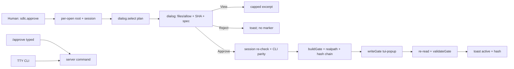

# Spec — Popup approval: one-keystroke plan approval with no typed path

**Status**: APPROVED
**Approved by**: appusai (chat: "I approve spec")
**Approved at**: 2026-10-31T01:26:04Z
**Date**: 2026-10-31
**Related**: `docs/specs/2026-10-30-v2-native-brain.md`, `docs/specs/2026-10-30-tui-approval-command.md`, `docs/threat-model.md`, `docs/review/2026-10-31-popup-approval.md`
**API basis**: OpenCode V2 TUI `keymap`/`dialog`/`toast`, `ctx.command.transform`, `session.synthetic` (`https://opencode.ai/v2/docs/build/plugins/server`, `.../cli`, fetched 2026-10-30).

## Goal

One keystroke approves with no typed path: the TUI palette command `sdlc.approve` lists `docs/plans/*.md`, shows `files`/`allow` patterns plus the plan SHA-256 and spec link, and Approve writes the normal `.sdlc/spec-gate.json` with the host OS user and `approved_via: tui-popup`. Typed `/approve` and the TTY CLI stay as fallbacks.

## Non-goals

- No verbal/agent-mediated approval: the agent never writes the gate.
- No `session.command` execution from the TUI; no native permission `ask`.
- No `scripts/spec-check.mjs` change; no new npm dependency, agent, skill, or command file.
- No signed tokens, no cryptographic approval, no OS sandbox.
- No V1 change; V1 keeps the TTY CLI and has no TUI part.

## Alternatives

| Option | Verdict | Why |
|---|---|---|
| A. TUI writes the gate directly | **Chosen** | Human-invoked in the TUI process; no agent, no command endpoint; reuses hash/realpath/re-read rules |
| B. Verbal approval via the agent question tool | Rejected | The agent becomes the gate writer; weaker boundary, harder to prove the human act |
| C. TUI calls `session.command` | Rejected | The endpoint is not proven human-only (SEC-02); this is the current empty-arg pain |
| D. Keep typed `/approve` only | Rejected | This is the complaint: palette selection submits no path, terminal is required |

## Trade-offs

- Buys a no-typing flow and kills the empty-arg `usage` error; the hash is shown before the decision.
- Costs a second gate-write path in the TUI that must stay in sync with the server/CLI contract; `node:fs` in the TUI is undocumented, so a path-prompt fallback stays.
- `approved_via` is informational, not proof: bash can forge any marker (D-013); trust comes from `close` evidence binding, not the label.
- V1 diverges further (no popup); compatibility is hook-shape only.

## Trace

| Requirement | Design | Test |
|---|---|---|
| R1 list with no typing | per-open root, `listPlans` immediate `.md`, skip progress/evidence/symlink/non-regular/>1MB/control/whitespace | listing filters, per-open root |
| R2 informed choice | `planDetails` shows `files`/`allow`/SHA/spec; View capped excerpt; confirm Approve/Reject | patterns + hash asserted |
| R3 human-only write | global-first CLI import, per-open root, session re-check, hash chain, realpath, preexisting-aware delete, re-read + `validateGate` | mismatch/escape/overwrite cases |
| R4 fallbacks kept | server `/approve` and TTY CLI unchanged; fallback shows exact hash command | existing approval tests |

## Review findings

Full record: `docs/review/2026-10-31-popup-approval.md`. Dispositions:

| ID | Disposition | Change |
|---|---|---|
| F1/F01 per-open root | **Accept** | Root resolved inside `openPicker`/`showStatus` from TUI location only, never `cwd`; abort on session switch |
| F2 `approved_via` forgeable | **Accept** | Label is informational; documented as forgeable; no sandbox claim |
| F3 CLI divergence | **Accept** | Single global-first order; refuse when global and project copies differ |
| F4 TOCTOU | **Accept** | Require shownHash, gate hash, and re-read hash all equal; content-matched delete only |
| F5 status display | **Accept** | Display through full `validateGate`; mismatch shows `gate invalid` |
| F6 symlink/marker | **Accept** | `lstat` CLI, `.sdlc`, marker; realpath containment; delete only what was written |
| F7 fallback hash | **Accept** | Fallback always includes the hash or refuses the hash claim |
| F8 double registration | **Accept** | Module guard; palette-only default, bind opt-in |
| F9 human-only proof | **Accept with residual (owner: host user)** | Palette/dialog assumed human-invoked; headless/SSH has no popup, TTY CLI is the path |
| F02 session re-check | **Accept** | Re-resolve after confirm; abort on change |
| F04 strict plan parse | **Accept** | Display from `buildGate` output, not the lenient parser |
| F05 preexisting marker | **Accept** | `lstat` before write; unlink only when no preexisting marker |
| F10 overwrite active | **Accept** | Second confirm naming old plan/hash or refuse with `close` hint |
| F11 username token | **Accept** | Dynamic `node:os` import; refuse when unavailable; single `tui-popup` token |

## Leading indicators

- **Issues caught pre-implementation**: server `/approve` receives empty `prompt.text` from palette; `session.command` is not a human proof; table `|` conflicts with shell regex; setup-captured root goes stale; global/project CLI divergence causes `cli-drift`.
- **Review coverage**: 2/2 perspectives produced findings (9 security + 15 failure-mode); all blockers mapped above.
- **Requirements traced**: 4/4 to tests.

## Acceptance criteria

1. **Popup picker**: `sdlc.approve` (palette plus optional `ctrl+shift+a`, fail-open with palette surviving a bind error) lists immediate `docs/plans/*.md` with all filters, shows `files`/`allow` patterns, plan SHA-256, and spec, and offers Approve/Reject/View (excerpt capped at 2000 chars). Root is resolved per open from the TUI location only, never `cwd`; no current session refuses. No path is typed.
2. **Direct write**: on Approve the TUI re-resolves the session and aborts on change, imports the installed global `spec-check.mjs` (project copy only when no global exists; refuse when the two copies differ), derives display from `buildGate` output, realpath-checks plan/spec, requires shownHash, gate hash, and re-read hash all equal, records `lstat` preexistence, writes `{ host user, UTC, approved_via: tui-popup }`, then re-reads and `validateGate`s; on mismatch it unlinks only a marker it wrote with matching content and refuses. Overwriting an active valid gate needs a second confirm naming the old plan/hash. The plan file is never written.
3. **Status and errors**: success toasts plan/spec/file count/short hash; refusal toasts `refused — see session message`; invalid marker shows `gate invalid`; missing `fs`/`dialog` shows the exact `/approve <abs> sha256:<hex>` command instead of claiming a hash; missing `keymap` logs only. `sdlc.status` shows the gate plus advisory host-evidence count and never conflates unknown with inactive.
4. **Fallbacks**: server `/approve <path> [sha256:<hex>]` and the TTY CLI are unchanged; V1 hooks unchanged and V1 loads no TUI part. No `session.command`, no model prompt, no permission hook. A module guard prevents double registration.
5. **Tests and docs**: TUI tests cover per-open root, session switch, CLI divergence, TOCTOU chain, symlink/escape, preexisting/overwrite, fallback matrix, double setup, and `approved_via`; existing approval/installer suites pass; `npm run verify` green; bootstrap ≤5116; dry eval ≥35 probes, 0 failures. README/USAGE/CHANGELOG name the popup as primary with typed/TTY fallbacks and state the forgeable-label limit.

## Design

### TUI surface

- `register.js` keeps `listPlans`, `planDetails`, `gateSummary`, `resolveSessionID`, `setupTui` with documented `keymap.layer(() => ({ mode: 'global', commands }))` and a no-`bind` retry.
- Root is never setup-captured; session is checked before and after confirm; display comes from `buildGate`; `validateGate` gates display and status.
- `tui.js`/`index.js` shapes unchanged; no JSX, no npm import; `node:fs` and `node:os` stay dynamically imported.

### Server/CLI/installer

- No server, CLI, or installer behavior change; the TUI directory already ships. Docs state the popup-primary flow and the forgeable-label limit.

## Verification

| Check | Command | Pass condition |
|---|---|---|
| TUI | `node --test tests/opencode/test-tui-brain.mjs` | per-open root, session switch, hash chain, symlink, overwrite, fallback, double setup, no `session.command` |
| Existing | `node --test tests/opencode/test-approve-command.mjs tests/scripts/test-install-global.mjs` | typed path, V1 keys, installer parity |
| Full | `npm run verify && node eval/run.mjs` | 0 failures; bootstrap ≤5116; ≥35 probes |
| Manual | palette `sdlc.approve` in TUI | list, details, Approve writes marker, toast; headless uses TTY CLI |

## Risks

- **TUI `node:fs`/import drift**: fail-open with the exact hash command; never claim without a hash.
- **Residual forgery**: bash can write any marker; `approved_via` is not proof; `close` evidence binding is the trust point.
- **Double registration**: module guard; manual smoke decides whether the `index.js` stub stays.
- **Contract drift**: refuse on global/project CLI divergence; installer keeps them byte-identical.

## Open questions

1. Also close/re-approve from the popup, or approve-only? Proposed: approve-only this wave.
2. Keybind plus palette, or palette only? Proposed: both, fail-open.
