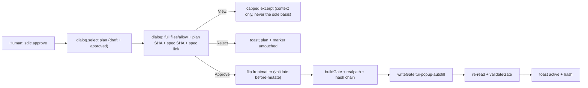

# Spec — Popup autofill: one-click draft→approved from the TUI

**Status**: DRAFT (amendment, needs human `/approve` before any code)
**Date**: 2026-10-31
**Parent**: `docs/specs/2026-10-31-popup-approval.md` (APPROVED, do NOT edit)
**Parent plan**: `docs/plans/2026-10-31-popup-approval.md` (approved, do NOT edit)
**Related**: `scripts/spec-check.mjs` (`parsePlanText:133`, `sanitizeApprovedBy:189`, `applyApprovalFill:204`, `fillApprovalFrontmatter:237`, CLI `approve:632`), `.opencode/plugins/sdlc-lean-tui/register.js` (marker containment `:486`), `docs/threat-model.md`
**Pain**: draft plans refuse at `parsePlanText:165` (`status !== 'approved'`); only the TTY CLI autofills via `applyApprovalFill:204`. The TUI popup (parent AC2: "The plan file is never written") therefore forces a hand-edit round-trip: open plan, flip frontmatter by hand, re-open popup.

## Goal

Draft→popup→confirm→done with no hand-edit: the TUI popup lists draft plans alongside approved ones, shows full scope + hashes, and on human Approve flips the plan-file frontmatter (`status`/`approved_by`/`approved_at`) then writes the normal `.sdlc/spec-gate.json` — one click, no terminal, no editor.

## Non-goals

- No verbal/agent-mediated approval: the agent never writes the plan flip or the gate.
- No `session.command` execution from the TUI; no native permission `ask`.
- No signed tokens, no cryptographic approval, no OS sandbox.
- No V1 change; V1 keeps the TTY CLI path.

## Amendments to parent (explicit, human-gated)

Parent spec §Non-goals says "No `scripts/spec-check.mjs` change" and parent AC2 says "The plan file is never written". This amendment widens both, and only these:

1. **Plan-file frontmatter flip allowed** — from the TUI popup Approve path AND the typed `/approve` server path, only after the human confirm, reusing the CLI helpers verbatim:
   - `sanitizeApprovedBy` → `applyApprovalFill` → `parsePlanText` preview (validate-before-mutate) → write → `buildGate` → `writeGate` → re-read → `validateGate`;
   - restore-on-fail: any throw after the flip restores the original plan text (CLI `approve:653-655` pattern) and unlinks only a marker this invocation wrote with matching content.
2. **Export autofill for reuse** — `sanitizeApprovedBy` / `applyApprovalFill` / `fillApprovalFrontmatter` become importable from `scripts/spec-check.mjs` so `register.js` and `.opencode/plugins/sdlc-lean.js` share one contract instead of a second implementation. Byte-parity / import-order rules from the parent (global-first, refuse on divergence) stay.

Everything else in the parent (per-open root, session re-check, hash chain, realpath containment, fallback matrix, double-registration guard, forgeable-label limit) is unchanged and applies to the flip path too.

## Flow

1. Picker lists immediate `docs/plans/*.md` including `status: draft` (same filters as parent: skip progress/evidence/symlink/non-regular/>1MB/control/whitespace). Draft rows are badged `draft — Approve will fill frontmatter`.
2. Confirm dialog shows the **full** `files` + `allow` patterns, plan SHA-256, spec SHA-256, and spec link. The 2000-char excerpt stays as context only.
3. On Approve: session re-check (abort on switch) → `lstat` plan (refuse symlink/non-regular) → `sanitizeApprovedBy(os.userInfo, no USER-env trust)` → `applyApprovalFill` in memory → `parsePlanText` preview + spec regular-file check → write flip → `buildGate` → preexisting/overwrite rules per parent → `writeGate` → re-read both files → `validateGate`. Any failure restores the original plan text.
4. Reject (or dialog dismiss) writes nothing — neither plan nor marker is touched.

## Threat table

| Threat | Mitigation |
|---|---|
| TTY-spoof via `script`/pty faking human confirm | Palette + `dialog.confirm` double-confirm is the human proof; session re-check aborts on route switch; no pipe path — non-TTY stdin still refused exactly as today |
| Symlink `.sdlc` / plan bypass redirecting the flip or marker outside the project | Same `lstat` + `realpath` containment as `register.js:486`: refuse on symlink `.sdlc`/plan/marker, refuse on realpath escape; plan flip additionally asserts containment (`assertContainedReal`) before I/O |
| Scope-blind confirm (human approves without seeing scope) | Confirm must render full `files`/`allow` + both SHA-256 + spec link; the 2000-char excerpt alone is never sufficient basis for Approve |
| `USER`/`USERNAME` env spoof forging `approved_by` | Username comes from `node:os.userInfo()` (dynamic import, refuse when unavailable); env is fallback-only at best and never trusted for the label; distinct `approved_via: tui-popup-autofill` token keeps the flip path distinguishable from the parent `tui-popup` path (both informational, both forgeable by bash — see parent F2) |

Residual (accepted, owner: host user): as in the parent, `approved_via` is informational, not proof; bash can forge any marker or frontmatter. Trust comes from `close` evidence binding, not the label.

## Acceptance criteria

1. **Draft selectable**: the popup lists `status: draft` plans (badged) with the same filters as approved plans; selecting one does not mutate anything.
2. **Informed confirm**: the Approve dialog shows full `files` + `allow`, plan SHA-256, spec SHA-256, and spec link; excerpt is capped context only.
3. **Approve flips then gates**: Approve flips `status`→`approved` + `approved_by` + `approved_at` (validate-before-mutate via `parsePlanText` preview), then `buildGate` → `writeGate` (`approved_via: tui-popup-autofill`, `os.userInfo` user, UTC) → re-read → `validateGate`; success toasts plan/spec/file count/short hash. Any failure restores the original plan text and refuses.
4. **Reject writes nothing**: Reject/dismiss leaves both the plan file and the marker byte-identical.
5. **Pipe still refused**: piped/non-TTY stdin on either the CLI or the typed path refuses the autofill exactly as today; there is no pipe autofill path.

## Verification

| Check | Command | Pass condition |
|---|---|---|
| New suite | `node --test tests/opencode/test-popup-autofill.mjs` | RED→GREEN: draft badge, full-scope confirm, flip-then-gate, reject-no-write, symlink/escape refuse, pipe refuse, restore-on-fail, `tui-popup-autofill` token |
| Regression | `node --test tests/opencode/test-tui-brain.mjs tests/opencode/test-approve-command.mjs` | parent popup + typed suites still green |
| Full | `npm run verify` | 0 failures; bootstrap ≤5116 |

## Open questions

1. Should the typed `/approve` also autofill (symmetric with popup), or popup-only? Proposed: symmetric — same helper, same confirm evidence.
2. Keep `tui-popup-autofill` distinct from `tui-popup`, or unify? Proposed: distinct, so evidence can tell flip approvals from already-approved approvals.
