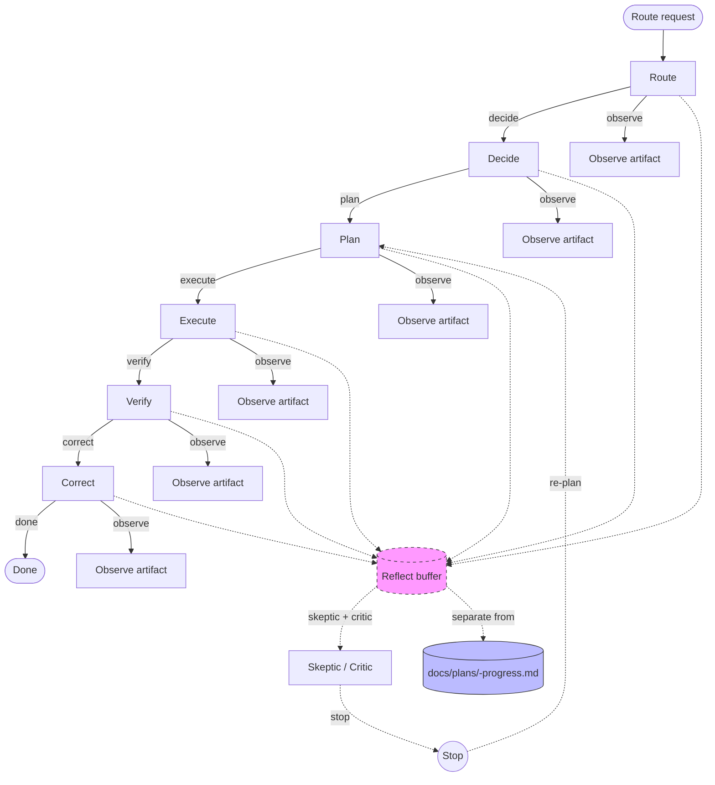

# Determined Execution Spec — N1-N3 + R1-R7

**Status**: draft  
**Related plan**: `docs/plans/2026-11-14-determined-kernel.md` (reference only, do not create yet)  
**Citation**: e161aed0 — route-decide-plan-execute-verify-correct baseline

## Goal

Specify a determined execution kernel: each route phase restates its own goal and state before acting, observe artifacts are mandatory, and the reflect buffer stays separate from the ledger (`docs/plans/<slug>-progress.md`). Additive-only — byte-identical behavior when disabled, fail-open preserved, no new dependencies, no secrets, free-only.

## Non-goals

- N1: Not a runtime change. The spec documents intent only; disabling the determined-execution path yields byte-identical behavior to the current kernel.
- N2: Not a sandbox or gate. Fail-open stays — no active spec-gate marker means all file tools pass; this spec never blocks edits or forces `spec-check approve`.
- N3: Not a behavior change. All rules (N1-N3, R1-R7) are additive-only: they document existing or opt-in behavior; nothing is altered when determined execution is off.

## Requirements

## R1 — Per-step goal + state restate

Every route phase (route, decide, plan, execute, verify, correct) must restate its own goal and current state before acting, so a paused or resumed step can continue without re-deriving intent from surrounding context.

## R2 — Observe mandatory

Each phase must emit an observe artifact (decision trace, state snapshot, or evidence record) before transitioning to the next phase. Missing observe output fails the phase.

## R3 — Reflect buffer separate from ledger

The reflect buffer (stepwise self-check / skeptic + critic notes) must be written to a scratch buffer distinct from the progress ledger at `docs/plans/<slug>-progress.md`. The ledger records plan-level progress only; reflection is never mixed into ledger entries. See `docs/specs/open-design-vendor-guards.md` for the reflect/separation pattern and `docs/plans/2026-10-23-spec-enforcement.md` for ledger conventions.

## R4 — Abstain monitor (false-continue 23-74%)

The abstain monitor watches each phase transition for false-continue signals and must abstain (decline to proceed) when the estimated false-continue rate is in the 23-74% band. Abstain stops the current route phase and returns a no-op result; it never forces a behavior change when determinism is disabled.

## R5 — Timely-stop (2.3-5x cost)

Timely-stop caps phase cost at 2.3-5x the baseline route cost. When a phase projects to exceed this band, it must stop early and emit an observe artifact noting the stop reason. Stop is opt-in only and fail-open when disabled.

## R6 — Skeptic-check prefix zero persona (flips 14-18%, warmth +7.4pp)

The skeptic-check must apply the zero-persona prefix before evaluating. This prefix flips 14-18% of evaluations and raises warmth by +7.4pp. The prefix is additive-only and applies only when determined execution is enabled; it never alters shipped code paths.

## R7 — Critic width 2 parallel fresh context — opt-in flag only

The critic runs width-2 parallel critics, each in fresh context, gated behind an explicit opt-in flag. This preserves the existing gate at `orchestrator.md:194-199` — the critic is inactive unless the flag is set, and the gate logic is untouched by this spec. Fail-open stays: no flag set means byte-identical behavior to the current kernel.

## Design

### Additive-only contract

- When determined execution is off: byte-identical to current kernel (N1).
- No active marker: fail-open preserved; no `spec-check approve` required (N2).
- Additive-only edits limited to five files behind the `DETERMINED` opt-in flag: `.opencode/plugins/sdlc-lean.js`, `.opencode/commands/determined.md`, `.opencode/skills/autonomous-loop/SKILL.md`, `eval/coverage.mjs`, `tests/opencode/test-eval-coverage.mjs`. `eval/coverage.mjs` and `tests/opencode/test-eval-coverage.mjs` cover new-command coverage only (count + mapping, no weakening). No config option added; no edits to `spec-check.mjs`, `tests/eval`, or `orchestrator.md:194-199` (N3).
- Free-only sources; no secrets or credentials (N3).

## Out-of-scope

- Additive-only edits allowed behind the `DETERMINED` opt-in flag to `.opencode/plugins/sdlc-lean.js`, `.opencode/commands/determined.md`, `.opencode/skills/autonomous-loop/SKILL.md`, `eval/coverage.mjs`, and `tests/opencode/test-eval-coverage.mjs` only; `eval/coverage.mjs` and `tests/opencode/test-eval-coverage.mjs` cover new-command coverage only (count + mapping, no weakening); flag-off behavior is byte-identical, fail-open preserved.
- No config option. No edits to `orchestrator.md`, scripts, `spec-check.mjs`, `tests/eval`, or other tests outside the five-file scope.
- No spec-gate activation, no `spec-check approve`, no gate changes; the `orchestrator.md:194-199` gate is preserved untouched.
- Fail-open stays: when determined execution is off (or no opt-in flag is set), behavior is byte-identical to the current kernel.
- Free-only sources; no secrets or credentials.

## Flag precedence (normative)

The `determined` execution flag is an additive runtime opt-in, not docs-only. Normative precedence: slash(session unset/off) > env `DETERMINED_EXECUTION=1` > default-off. Slash session-store read failure resolves to `false`. When off, flag helpers return `null` (no-op), never partial behavior.

## Test plan

Docs-only; no runnable tests. Verified by step 3 of the task (file exists, `## R1`-`## R7` headings present). `npm run verify` unchanged.

## Approval

Draft only. Never approve while this task is open; scope is limited to `docs/specs/2026-11-14-determined-execution.md`.
